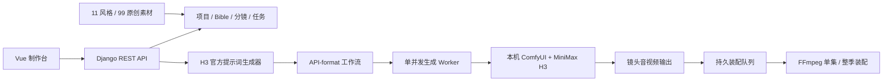

# AutoPrompt Studio

AutoPrompt Studio 是面向 MiniMax H3 的连续短剧生产台：Django 负责素材、连续性、H3 提示词、ComfyUI 工作流与任务状态，Vue 负责剧集策划、分镜和制作监控。本仓库随附 11 种原创风格、99 张人物/场景/道具参考图，可离线作为长期一致性锚点。

本仓库源码可在本地运行和部署。本项目源码许可证尚未确定；MiniMax H3、SDXL、ComfyUI 等第三方模型或组件分别受各自许可证约束，这些第三方许可证不构成本项目源码授权。

## 能力

- 11 种风格与 99 张原创本地素材，包含 SHA-256、来源、用途和提示词锚点清单。
- 连续剧项目列表、可上传项目封面、无限集数、角色/场景/道具 Bible、稳定 speaker ID、不可变 reference slot 和版本化一致性锁。
- 图片与视频分镜，逐镜头时长、三类 H3 输入模式：文生视频、首尾帧生视频（0/1/2 张图自动对应 T2VA/I2VA/L2VA/FL2VA）、参考生视频（0–9 图、0–3 视频、视频配对音轨和 0–3 独立音频）。Ref2VA 可显式选择官方默认执行工作流，或实验工作流 `video_minimax_h3_r2v_t8_dual_clock_4step`、`video_minimax_h3_r2v_turbo_lora`，并按模板调整采样步数、LoRA 模型强度。
- 按 MiniMax H3 官方格式生成 `integrated_multimodal_description` 或 Ref2VA 六段式提示词；可选用显式配置的文本模型把中文导演内容改写为英文，同时逐字保护对白、歌词和屏显文字。
- ComfyUI 节点/模型动态探测、图片/视频/音频安全上传、按实际选择动态接线、固定加载器自动装配、API Prompt 注入、可导入 UI 画布导出、单 GPU 持久任务队列、重试/恢复/取消、输出收集。
- 可为单集或所选剧集批量建立独立分镜生产任务，并使用 FFmpeg 按镜头顺序装配单集或整季成片。
- JWT、多租户权限、路径白名单、loopback ComfyUI 默认限制、OpenAPI、PostgreSQL 和 Docker 部署。



## 本地快速启动（PowerShell）

环境要求：Python 3.11、Node.js 22、FFmpeg，以及可访问的 ComfyUI。`restart.ps1` 按以下优先级解析 Windows 便携版根目录：显式 `-ComfyUIRoot` 或 `AUTOPROMPT_COMFYUI_ROOT`；进程环境的 `COMFYUI_OUTPUT_DIR`；`backend/.env` 的 `COMFYUI_OUTPUT_DIR`；进程环境的 `COMFYUI_OUTPUT_HOST_DIR`；根目录 `.env` 的 `COMFYUI_OUTPUT_HOST_DIR`。输出目录只能按绝对路径 `<portable-root>\ComfyUI\output` 反推；候选根目录必须同时包含 `python_embeded\python.exe` 和 `ComfyUI\main.py`。

```powershell
# 方式一：直接指定便携版根目录
$env:AUTOPROMPT_COMFYUI_ROOT = 'C:\path\to\ComfyUI_windows_portable'

# 方式二：使用进程环境的实际输出目录反推便携版根目录
$env:COMFYUI_OUTPUT_DIR = 'C:\path\to\ComfyUI_windows_portable\ComfyUI\output'
```

首次安装：

```powershell
# 在仓库根目录执行
powershell -ExecutionPolicy Bypass -File .\scripts\setup.ps1
Set-Location .\backend
.\.venv\Scripts\python manage.py createsuperuser
```

如需在本机自动生成可人工审核的英文导演字段，以及根据现有剧集/剧本/Bible 生成隔离的
中英双语分镜创作草稿，首次安装可追加 `-WithLocalTranslationModel`。模型身份、2.5 GB 下载、
一次性子进程、跨进程资源锁、创作草稿确认/应用和翻译审核流程见
[提示词翻译、扩写与双语创作审核](docs/local-prompt-translation.md)。除本地 Qwen 外，可按次显式选择
DeepSeek API；远程通道会外发完成候选所需的提示词/项目上下文，且失败不会静默回退。

完整的逐步制作流程已内置于前端左侧 **操作手册**（`/manual`）：从创建项目到按集组装、下载与异常恢复均可搜索。手册的版本、唯一内容源和功能变更时的强制更新规则见
[视频制作操作手册维护说明](docs/production-operator-manual.md)。

默认安装只导入系统预设和素材，不创建演示账号；`createsuperuser` 会交互式创建首个管理员。只有在隔离的本地演示环境中，才显式执行：

```powershell
# 在仓库根目录执行
powershell -ExecutionPolicy Bypass -File .\scripts\setup.ps1 -WithDemoProject
```

首次创建 `demo` 时会使用系统安全随机源生成高熵密码，仅在该次命令的标准输出中显示一次，程序不将明文写入文件。请立即通过批准的密钥渠道保存，不要复制到日志或工单。重复执行 seed 不会重置或再次显示已有 `demo` 的密码。

日常使用可直接双击仓库根目录的 `restart-all.cmd`。它会严格按“停止已登记的应用服务 → 数据库迁移 → 同步内置风格及启用的 H3/SDXL 工作流模板 → 恢复装配记录 → 确认 ComfyUI 健康 → 启动 Django API → 启动唯一的生成 worker → 启动独立的装配 worker → 启动 Vue 前端”的顺序执行；本地开发入口强制只监听 `127.0.0.1`，不会把账号和 GPU 队列暴露到局域网。ComfyUI 已健康时会复用当前 GPU 进程，否则会从按上述优先级解析并验证的便携版目录启动。生成 worker 启动后会按持久化 Prompt ID 核对并接续未完成任务；装配 worker 会恢复未完成的 FFmpeg 任务。页面只负责提交和展示状态，刷新或关闭页面不会中断组装。脚本会在数据库、存储、ComfyUI 和两个 worker 均通过 `/api/v1/health/ready/` 后才报告启动成功，运行日志写入 `.runtime/logs/`。同一工作区同时只能运行一个重启脚本，重复双击会立即提示而不会交叉停止进程；任一已登记服务停止失败且对应 PID 仍存活时，脚本在尝试清理其余服务后中止，不会再启动第二套 worker。启动中途失败时只清理该次启动创建的 Django、两个 worker、Vue 或 ComfyUI，复用的 ComfyUI 不会被停止。仅在诊断模板问题时才使用 `-SkipSeedData` 跳过模板同步。

```powershell
# 等价的 PowerShell 调用
powershell -ExecutionPolicy Bypass -File .\scripts\restart.ps1 -OpenBrowser

# 确认没有正在生成的任务后，如需连 ComfyUI 一并重启；脚本会读取 /queue 并拒绝中断活动任务
powershell -ExecutionPolicy Bypass -File .\scripts\restart.ps1 -RestartComfyUI -OpenBrowser

# 仅在队列无法核实或你明确接受中断/丢弃当前 ComfyUI 任务时使用
powershell -ExecutionPolicy Bypass -File .\scripts\restart.ps1 -RestartComfyUI -ForceComfyUIRestart -OpenBrowser

# 仅当你已确认 8000/5173 上未记录的 Python/Node 进程属于本项目时使用
powershell -ExecutionPolicy Bypass -File .\scripts\restart.ps1 -ForcePortTakeover -OpenBrowser
```

也可以继续手工启动。先确认 ComfyUI 在 `127.0.0.1:8188` 运行，随后分别打开四个终端：

```powershell
# 终端 1：API
Set-Location .\backend
.\.venv\Scripts\python manage.py runserver 127.0.0.1:8000
```

```powershell
# 终端 2：生成队列
Set-Location .\backend
.\.venv\Scripts\python manage.py run_generation_worker
```

```powershell
# 终端 3：成片装配队列
Set-Location .\backend
.\.venv\Scripts\python manage.py run_assembly_worker
```

```powershell
# 终端 4：前端
Set-Location .\frontend
npm run dev
```

打开 `http://127.0.0.1:5173`。`-WithDemoProject` 仅用于隔离的本地演示环境；正式环境不要创建或保留演示账号，并应通过 `manage.py createsuperuser` 或组织的身份管理流程创建独立账号。

公开注册默认关闭（`ALLOW_PUBLIC_REGISTRATION=false`），登录页会同步隐藏注册入口；正式账号由管理员创建。只有确实需要自助注册并已配置邮件验证和必要的滥用防护时，才应显式开启该配置。

API 使用与副作用说明见 [本地 API](./docs/api.md)，机器可读契约位于 [OpenAPI](./openapi.yaml)，开发文档页为 `http://127.0.0.1:8000/api/docs/`。前端默认使用真实 API；只有显式设置 `VITE_USE_MOCK=true` 才使用离线演示数据。

系统支持 MiniMax H3 视频/原生音频工作流与本地 SDXL Base 1.0 文生图工作流。官方 H3 模板以目标环境的低成本 GPU 烟测作为运行验收；T8 Dual-Clock 4-Step 与 Turbo LoRA 保持实验状态，必须在每个目标环境完成 GPU 端到端、稳定性、容量和画质验收。图片链路固定使用 `sd_xl_base_1.0.safetensors`，由 `CheckpointLoaderSimple → CLIPTextEncode → EmptyLatentImage → KSampler → VAEDecode → SaveImage` 生成；每次提交前使用实时 `/object_info` 校验节点和 checkpoint。图片素材只作为 Bible 文本连续性锚点，不会作为像素参考自动送入 ComfyUI，也不会静默调用收费 Partner API。

## H3 英文提示词优化器（可选）

H3 的导演描述建议使用英文；对白、歌词和真实屏显文字可以保留创作者指定的原语言。系统先在本地按官方 T2VA/首尾帧/Ref2VA 结构确定性编译提示词，再按需调用一个 OpenAI-compatible 文本模型改写导演描述。优化器默认关闭：`H3_PROMPT_OPTIMIZER_ENABLED=false` 时不会产生任何提示词网络请求，也不会把“未优化”伪装成“已优化”。提示词详情的 `quality.optimizer.status` 会如实显示 `not_required`、`disabled`、`misconfigured`、`failed_request`、`failed_validation` 或 `optimized`。

推荐优先连接本机 OpenAI-compatible 服务（模型名称按本机服务填写）：

```dotenv
H3_PROMPT_OPTIMIZER_ENABLED=true
H3_PROMPT_OPTIMIZER_BASE_URL=http://127.0.0.1:11434/v1
H3_PROMPT_OPTIMIZER_API_KEY=
H3_PROMPT_OPTIMIZER_MODEL=local-minimax-m2
H3_PROMPT_OPTIMIZER_ALLOW_NON_LOOPBACK=false
H3_PROMPT_OPTIMIZER_TIMEOUT_SECONDS=60
H3_PROMPT_OPTIMIZER_FAILURE_MODE=warn
H3_PROMPT_LANGUAGE_GATE=block
```

远程服务只允许 HTTPS，并且必须同时填写 `H3_PROMPT_OPTIMIZER_API_KEY` 和显式设置 `H3_PROMPT_OPTIMIZER_ALLOW_NON_LOOPBACK=true`。启用远程服务意味着人物设定、场景、动作、镜头、声音等导演描述会发给该服务；系统在传输前将 `<d>...</d>`、`<lyrics>...</lyrics>`、`<screen_text>...</screen_text>` 转换为不可读占位符，因此这些创作者原文不会随请求发出。API Key 只能写入部署环境变量，不应提交到仓库。

优化响应必须保持官方 section 顺序、分行/列表、镜头编号与时间戳、数字和全部参考标签，保护块也必须逐个原位返回；保护块外含中文或任一结构变化都会拒收。推荐使用 `H3_PROMPT_OPTIMIZER_FAILURE_MODE=warn`，这样优化服务异常时可以查看原提示词和错误；同时使用默认的 `H3_PROMPT_LANGUAGE_GATE=block`，确保含待改写中文导演字段的视频或 SDXL 图片提示词只能预览、不能进入生产队列。图片编译器没有自动英文改写器，会如实报告 `not_configured`，不会假装优化成功；真实屏显文字保存在 `<screen_text>` 中。`H3_PROMPT_LANGUAGE_GATE=warn` 提供非阻断诊断模式。需要立即停止外传时把 `H3_PROMPT_OPTIMIZER_ENABLED=false` 后重启 API/worker。PromptArtifact 是不可变审计记录，不会被后台静默重写；配置变化后需主动重新生成提示词。

## 典型制作流程

1. 在“连续剧项目”列表中新建或打开项目，可选上传 JPEG/PNG/WebP 封面，并选择风格、画幅、默认 H3 模式和输出规格；列表可收藏项目，或基于原项目创建不含任务与产物的独立重做草稿。
2. 从素材库绑定人物、场景和道具；完善外观、声线、材质、光线和禁止项后锁定 Bible。
3. 持续添加集数与分镜。每个分镜选择文生视频、首尾帧生视频或参考生视频，并设置叙事、镜头运动、时长、台词、环境声、配乐及实际需要的图片/视频/音频参考；未选择的槽位不会生成空连接。
4. 生成并审阅 H3 提示词。多分镜模式会生成严格递增的切点；单分镜模式会为每个镜头单独生成任务。
5. 在“生产工作流 → 创建生产任务”中选择 Ref2VA 执行工作流及其模板参数，再选择官方分辨率档位。官方默认保持自动匹配并固定为 20 steps；T8 Dual-Clock 默认 4 步、Turbo LoRA 默认 10 步，两者的 steps 范围为 1–20，LoRA 强度默认 1.0、范围为 0–2.2。两个变体均标记为实验工作流，并在入队前接受实时 ComfyUI 节点、端口和模型枚举预检；能力预检不替代 GPU 端到端、稳定性或画质验收。视频可用竖屏 `0.2 MP`（`352×608`）做低显存烟测；图片拥有独立的 `image_resolution_profile`，默认 `0.98 MP`（竖屏 `768×1344`），不会因同一集的视频选择 `0.2 MP` 而降质。两类任务都记录实际档位、尺寸倍数和工作流参数。
6. 为单集或所选剧集批量建立独立分镜任务。成功输出可按单集或整季装配；明确失败的任务可在页面点击“重试失败任务”，系统会保留源任务并创建可审计的新任务，不会误标整集完成。系统不会在本地失败时静默切换到收费 Partner API。

## 素材库

- 清单：[assets/library/manifest.json](./assets/library/manifest.json)
- 生成与修订提示词：[assets/library/generation-prompts.md](./assets/library/generation-prompts.md)
- 构建脚本：[scripts/build_asset_library.py](./scripts/build_asset_library.py)
- 校验脚本：[scripts/validate_asset_library.py](./scripts/validate_asset_library.py)

每种风格固定 3 个人物、3 个无人场景、3 个独立道具。manifest 收录的侦探雨街素材不含生成式伪文字，末日医护人物素材不含近似红十字符号。

## Docker 部署

Docker 方案包含 PostgreSQL、Django API、单并发生成 worker、独立装配 worker、readiness 验证器和非 root Nginx/Vue。前端会等待 `/api/v1/health/ready/` 确认数据库、迁移、存储、ComfyUI 与两个 worker 心跳全部正常后再启动。应用容器使用只读根文件系统、去除 Linux capabilities 和 `no-new-privileges`；ComfyUI 仍作为宿主机独立进程运行。

```powershell
Copy-Item .env.example .env
# 编辑 .env 中的所有 placeholder：强随机且 URL-safe 的数据库密码、
# 50+ 字符 Django 密钥、真实域名、精确 HTTPS CORS/CSRF 源和 ComfyUI 目录
.\backend\.venv\Scripts\python .\scripts\validate_production_deployment.py
# 只校验，不把插值后的密钥打印到终端或 CI 日志
docker compose config --quiet
docker compose up --build -d
```

标准 Compose 是强制生产 profile，不是 LAN HTTP 演示入口。Nginx 只发布到 `127.0.0.1:8080`，必须由宿主机上可信的 TLS 反向代理对外提供真实域名，并覆盖 `Host`/`X-Forwarded-For`/`X-Forwarded-Proto=https`。任一密钥、PostgreSQL、HTTPS、HSTS、hosts 或可信源不合格时，Django 会在迁移前拒绝启动。容器通过 `host.docker.internal:8188` 连接宿主机 ComfyUI；部署到其他主机时应配置明确的私有地址，并在网络层限制访问。完整边界和验收命令见 [生产部署安全](./docs/production-deployment.md)。

上传素材按用户隔离并受类型、尺寸、单文件和租户总配额限制；服务端记录上传者、时间和 SHA-256。产物只通过短期签名 `/api/v1/media/{token}/` 读取，禁止重新暴露裸 `/media/`。普通用户只能执行已启用的全局系统模板，模板写入仅限 staff；需要额外允许本地素材读取或处理节点时，仅可把人工验证过的无副作用节点加入服务端 `COMFYUI_EXTRA_ALLOWED_NODE_TYPES`。最终装配可叠加 `AI-generated · MiniMax H3` 标识并写入元数据。Windows 会在未配置字体时从系统字体目录选择可用字体；精简 Linux 或自定义镜像应显式设置 `ASSEMBLY_AI_LABEL_FONTFILE` 为容器内存在的字体文件。

## 验证

```powershell
powershell -ExecutionPolicy Bypass -File .\scripts\check.ps1
powershell -ExecutionPolicy Bypass -File .\scripts\security_check.ps1
```

## 备份与恢复

`scripts/backup.ps1` 可一致性备份 SQLite（或通过 `pg_dump` 备份 PostgreSQL）、Django 媒体目录、ComfyUI 产物目录以及显式选择的配置文件，并生成逐文件 SHA-256 清单。`scripts/restore.ps1` 默认只做校验/Dry-run；真实恢复必须显式传入 `-ConfirmRestore`，且会先自动创建 pre-restore 备份并保留所有被替换的原目录，不做自动删除。完整命令、安全边界和灾备演练要求见 [docs/backup-restore.md](./docs/backup-restore.md)。

第一条命令校验素材库及全部哈希、Docker/Compose/Nginx 生产安全不变式、Django deployment check、迁移漂移、OpenAPI 和后前端测试/构建；第二条使用执行时可用的漏洞库审计 Python 与生产前端依赖。所有原生命令的非零退出码都会让脚本立即失败。ComfyUI 高负载生成不属于常规单元测试；目标环境的节点、模型与烟测判定方法见 [ComfyUI 兼容性与验证](./docs/comfyui-audit.md)。

## 第三方许可证

- 仓库随附 [MiniMax H3 许可证副本](./licenses/minimax-h3/LICENSE-2026-08-09.txt) 和其要求的 [NOTICE](./NOTICE)。源码、容器和离线发行包应保留这些第三方许可文件。
- SDXL 1.0 图片链路使用 CreativeML Open RAIL++-M（2023-07-26）。MiniMax H3、SDXL、ComfyUI、FFmpeg 及其他依赖分别适用其自身许可证；请在复制或分发相关组件时遵守对应条款。

需求边界见 [MVP 需求](./docs/mvp-requirements.md)，组件与数据流见 [架构](./docs/architecture.md)，接口见 [本地 API](./docs/api.md)，配置和运行命令见 [运维](./docs/operations.md)。ComfyUI 节点、模型和安全策略见 [ComfyUI 兼容性与验证](./docs/comfyui-audit.md)，上线前验收项见 [生产技术验收](./docs/production-readiness.md)，有效架构决策见 [决策目录](./docs/decisions/README.md)。
