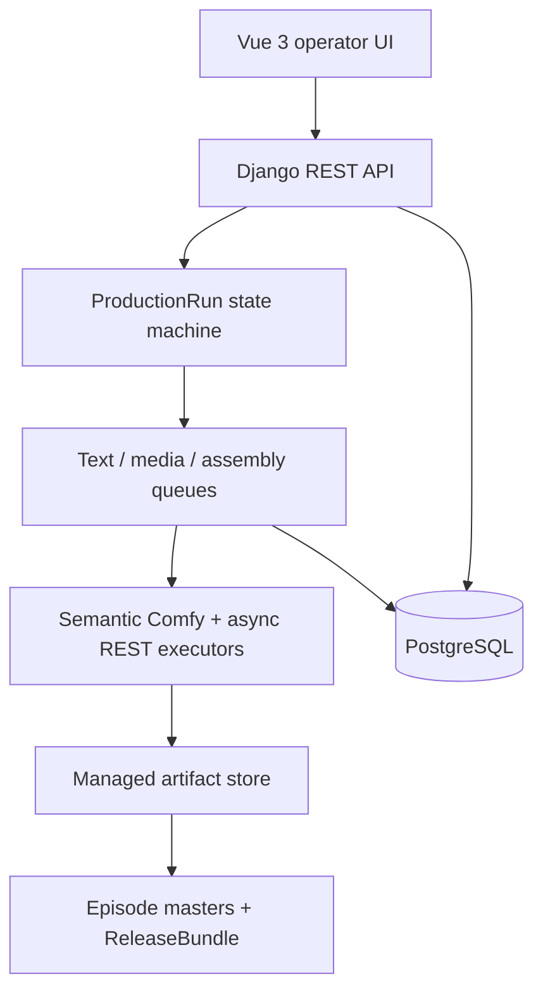

# Architecture

本文描述当前实现，不把 catalog 项、适配器名称或测试桩写成已经可用的生产能力。

## 系统边界

PostgreSQL 保存业务事实、持久队列状态、运行快照、审计和 provenance；worker 通过数据库任务行的 claim/lease 状态领取工作。媒体必须归档到受管存储后才能成为装配输入。前端只通过正式 API 操作，不以本地文件、浏览器缓存或旧接口作为事实来源。

## 唯一生产主路径

"新建连续剧"先建立内容事实，页面提供三种入口：

- 空项目：只创建 `SeriesProject`，之后在项目工作台补齐脚本并创建运行。
- 导入脚本：先把原文写入 `ScriptSource`，在服务端安全预览中核对，再显式确认为不可变 `ScriptRevision`；选中的已发布配方决定是否继续做 `script.structure`。
- AI 创建：同一页面流程先建立项目，再创建 AI 脚本 `ProductionRun`；外部调用授权、币种和预算在运行创建时明确给出。后续创建失败会保留已创建项目并显示部分完成，不伪装成原子成功。

`ProductionRun` 是唯一的新生产写入口。它固定以下职责边界：

1. 选择已确认脚本，或选择 AI 脚本模式。
2. AI 模式先生成脚本并进入人工审核。导入模式中，已符合正式 renderer 的脚本走确定性 `script.structure` no-op 候选；其他原文由经审核的文本模型生成覆盖全文的结构化 preview revision。两者都必须在 required `script_review` 中确认，不直接覆盖原 confirmed revision。
3. 脚本确认后，以确定性逻辑 materialize Bible，再进入人工审核。
4. 固化 storyboard、route、cost、recipe、workflow、PromptProfile 和 configuration snapshot。
5. 通过 approve、select-route、authorize-cost、continue 等动作推进。
6. 执行器产出远端结果后，归档为 managed artifact。
7. 每集装配一个 episode master。
8. 全部逐集母版验证完成后建立 `ReleaseBundle`。

`Task`、`DeferredGenerationRequest`、`Assembly` 和 `ReleaseBundle` API 是完全只读的诊断投影。创建、重试、取消与有序 fallback 都由所属 `ProductionRun` 状态机执行；诊断资源没有写例外。

ProductionRecipe 只有在发布校验确认唯一正式 content 入口，以及完整有序的 content → storyboard → prompt → media → selection → assembly → delivery 闭包后，才能进入 ProductionRun。

## 内容事实与运行事实

脚本来源、脚本修订、Bible 和镜头设计是内容事实；ProductionRun 的输入快照、路由、成本授权、生成尝试、受管产物与交付结果是运行事实。ProductionRun 创建后引用不可变快照，避免项目配置或内容后续变化静默改变正在运行的生产。

AI 脚本不是直接写入确认态。生成结果、人工审核、确定性 Bible materialization 和 Bible 审核是分开的显式阶段；失败和冲突保持可见。

## PromptProfile 语义装配

PromptProfile 是文本与媒体提示词的唯一可配置语义装配主路径。`PromptFieldDefinition` 维护可扩展的类型化字段目录，包含字段名、类别、含义、影响、默认值、枚举与必填约束。`PromptProfileVersion` 按 operation、model family 和 mode 组合字段，每条规则只能读取白名单 source selector，并确定输出 channel、顺序、标签、分隔符、缺省处理与长度限制。它是数据合同，不执行任意模板或代码。

同一模型可以配置多个 Profile 版本和多个策略 binding。运行时使用已发布 Profile，并按精确 model version、mode 和 priority 解析唯一 active binding；同优先级多解、缺少 binding、字段缺失或 checksum 漂移都 fail-closed。`script.generate`、`script.structure`、`prompt.normalize`、`image.generate` 和 `video.generate` 在配方发布、运行创建与阶段提交中都执行该门禁；Profile/binding/checksum 同时冻结到运行事实，重试不切换策略。各 provider 或执行器仍有确定性传输合同，但不提供第二套可配置提示词模板。

Deployment real smoke 对文本和媒体使用同一持久任务事实：API 先创建 `ModelDeploymentSmokeAttempt` 并返回 `202`，worker 领取 claim 后才提交外部请求。`script.generate`、`script.structure` 与 `prompt.normalize` 的固定低成本请求、plan checksum、目标 deployment hash 和费用估算在提交前冻结；worker 从 `submitting` 恢复时只写 `uncertain`，禁止自动再次 POST。重复 active 请求复用原 attempt，管理员消歧只追加不可变 `ModelDeploymentSmokeAttemptResolution`，不会把人工结论当作 passed capability snapshot。

## 工作流语义层

Comfy workflow 以图 JSON 和 semantic bindings 存储。编译器解析诸如 prompt、negative prompt、尺寸、帧率和输出等语义，不依赖固定节点 ID。提交前会验证：

- workflow 图和节点绑定可解析；
- 输入输出 semantics 满足 workflow family；
- executor 与 model deployment 兼容；
- 发布版本有真实 smoke evidence。

已保存工作流的 ComfyUI 操作是安全导出，不是跨页面直接打开。validated、published 或 retired 版本只能使用其实际 `validated_deployment`；draft 也必须显式选择兼容且 active 的 ComfyUI deployment。服务端在网络访问前检查 graph/config/evidence 漂移，然后返回 `download_import` JSON 供用户在 ComfyUI 中导入；不会提交任务或伪造 direct-open。

ProductionRun 的媒体工作流选择是版本化运行输入：`uniform` 为全部选中镜头冻结同一 route，`per_shot` 为每个 Shot 冻结一条 route。服务端检查完整覆盖、项目归属、workflow/deployment/model/mode 兼容性和 PromptProfile 唯一性，并在 StageRun 中保存安全投影与 hash。AI/导入创建时 Shot 尚未物化，首版只提交 `uniform`。

bootstrap catalog 只是待审阅草案：inactive、draft、`needs_review`、未运行 smoke。启动和 demo seed 都不会覆盖 workflow catalog。catalog 中保留的 H3、SDXL 等词只表示可选 adapter、模型系列或许可审阅对象，不表示已安装或启用。

## 执行器

当前有两类媒体执行器：

- semantic Comfy executor；
- async REST executor，支持标准文本输入的 T2I 和 T2V。

async REST schema 是封闭契约。I2V/reference image 需要把受管输入上传到 provider 并返回 provider 可接受的引用；当前没有统一上传契约，因此 ProductionRun 以 `provider_upload_contract_missing` 明确阻断，不会丢弃参考图后伪装成成功。

当前没有跨节点或多 GPU scheduler。多个 worker 进程可以并行，但并发限制是进程局部配置，不是全局 GPU 配额、抢占或调度。

## 受管产物与交付

外部 executor 返回的 URL 或标识不是可直接交付的资产。系统会：

1. 下载/读取远端结果；
2. 限制大小、类型和地址范围；
3. 校验媒体；
4. 写入受管存储；
5. 建立 attempt、artifact 和 provenance 关系；
6. 仅把验证后的 managed artifact 交给装配。

归档同时从冻结的 task、attempt、stage、route、workflow 与 configuration 事实白名单生成 `comparison_parameters`。前端“参数差异”只比较该字段；`manifest_metadata` 中的任务身份、对象键、输出索引与 hash 只用于定位和 provenance，不冒充生成参数。

装配以逐集为单位。每个 episode master 记录来源项和 provenance；`ReleaseBundle` 聚合逐集母版并执行完整性验证。系统不生成整季单条长视频。

## 配置、启动激活与主机推荐

有效配置按五层解析：

1. model version default；
2. workflow version default；
3. active system revision；
4. active project revision；
5. active run override。

优先级从后向前覆盖。ProductionRun 创建时冻结最终值、来源、revision 与 hash；运行期不再从环境变量或新 revision 回退/重算。部署秘密、数据库连接和受控文件根目录仍属于部署配置，不是业务配置层。

非重启配置可按其 activation policy 生效。restart-required revision 进入 pending，并在新 boot identity 下显式 activate；仅生成新的 `AUTOPROMPT_BOOT_ID` 不等于激活。

Settings 按服务端 Schema 把布尔、枚举、数值、文本、受管凭据和 JSON 合同拆成类型化编辑器，并展示含义、影响、默认值、范围、必填与生效方式。需要引用其他平台资源的字段使用服务端所有的 `resource_ref` schema 和 safe options，页面只展示可选依赖并标注不可选原因，保存时服务端再次核验资源身份、capability 和 readiness。当前已登记的 `resource_ref` 是 `prompt.normalize` 的 model deployment；没有可用前置资源时不接受手填 UUID 绕过。

RuntimeHost probe 写入观察到的硬件与软件能力。recommend 根据 catalog、deployment、workflow 和 host 事实生成草案。decide 时服务端重新验证 host snapshot 有效期、catalog hash、configuration hash、deployment/workflow 现状与候选兼容性；任一事实漂移都会以 stale 拒绝。接受推荐只产生 reviewable draft，不会下载模型、创建虚假的已部署状态、自动发布 workflow 或自动激活配置。

## 后台服务

正式本地启动/重启入口是 `scripts/restart.ps1`；仓库当前没有独立的本地停止脚本。除 API、前端及基础依赖外，restart 启动：

- generation worker；
- text-generation worker；
- async-media worker；
- assembly worker；
- platform-maintenance worker。

maintenance worker 负责可恢复的 lease/队列维护，不把失败静默改成成功。RuntimeHost 探测使用数据库持久 `RuntimeHostProbeAttempt`：API 只返回 202，worker 领取/心跳/恢复/终态，HostCapabilitySnapshot 通过一对一 attempt 关系提供崩溃后的提交确认；大文件 SHA 不占用 API 请求线程。所有写操作应支持审计、幂等键或状态机约束。

文本、ComfyUI、async media 和 assembly worker 在终态事实提交后，通过 transaction `on_commit` 触发幂等 ProductionRun auto-advance。状态机会继续普通自动阶段，但在 required review、成本授权、路由或候选选择门主动暂停；后置推进失败不会改写已持久的 worker 成功/失败事实。

## 契约与安全

根 [openapi.yaml](../openapi.yaml) 是唯一机器 API 契约；`GET /api/schema/` 从同一来源动态呈现。数据库结构以 Django migrations 为唯一入口。

credential 由 SecretBinding 指向活动 SecretVersion；ConfigRevision 则冻结精确的不可变 SecretVersion。原值以独立部署密钥环执行 AES-256-GCM 加密，数据库只保存密文、nonce、AAD 合同和 key id。日志、普通 API、审计正文、前端和文档都不得回显明文或可关联的内部材料；密钥环不进入数据库。远端地址、artifact 下载和 workflow JSON 均执行安全校验。

外部模型调用不从 provider 是否已配置推断授权。每个 ProductionRun 显式冻结 `allow_external_calls`、预算上限和币种，路由费率不确定、未授权、缺少预算或超额都阻断提交。运行、阶段、GenerationAttempt、route/cost 决策、PromptProfile 引用和受管产物 provenance 形成审计链；请求/响应正文和凭据不写入普通审计正文。

认证角色为 member、platform administrator（Django staff）和 super administrator。只有超级管理员可管理角色、状态、临时密码、访问审计和 SecretBinding；所有相关变更都会递增认证版本，使旧 access/refresh token 失效。首次临时密码登录被顶层认证门禁限制为账号读取与改密。

## 尚未证明的边界

仓库已有单元、契约与模拟集成测试，但没有真实外部 provider/GPU 端到端成功证据。生产验收必须在目标环境补齐 provider 授权、model deployment probe、workflow real smoke、异步轮询、artifact 归档、逐集装配、发布包验证和备份恢复证据。
