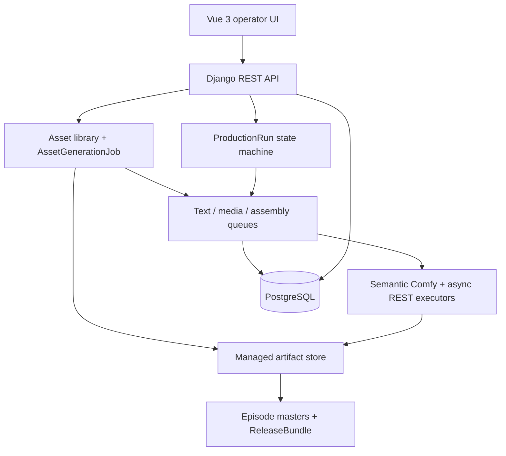
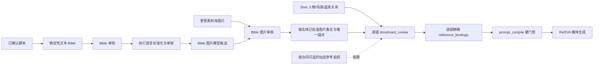

# Architecture

本文描述当前实现，不把 catalog 项、适配器名称或测试桩写成已经可用的生产能力。

## 系统边界

PostgreSQL 保存业务事实、持久队列状态、运行快照、审计和 provenance；worker 通过数据库任务行的 claim/lease 状态领取工作。媒体必须归档到受管存储后才能成为装配输入。前端只通过正式 API 操作，不以本地文件、浏览器缓存或旧接口作为事实来源。

所有新增和编辑表单遵守[填写表单最小输入标准](form-input-standard.md)：服务端目录用类型化选项，版本、结构版本、排序和创建生命周期由系统维护，只有业务事实保留输入；目录读取失败会清空旧值并在打开、校验和提交层失败关闭。普通页面不能用自由文本或完整 JSON 建立第二事实源，已有 revision 或已发布合同只允许差异 PATCH 或创建后继版本。

## 素材库与短剧生产边界

`Asset` 是图片、视频、音频和剧本的统一受管素材事实；本地上传与模型生成最终都写入该表，并通过短期签名预览/下载地址访问。`AssetGenerationJob` 是独立素材生成的持久状态机，以 `execution_kind=deployment|comfy_workflow` 冻结租户、类型、提示词、精确生成目标、实际 deployment、operation、真实 smoke、外发授权、预算、费用与请求 hash。ComfyUI 任务还冻结规范化 `workflow_inputs`、Asset facts、编译后的 bindings、conditioning mode、媒体预处理合同和各层 hash。提示词候选和剧本由 text-generation worker 执行；异步 API 图片、视频和音频由 async-media worker 提交、轮询、受限下载并物化；ComfyUI 图片、视频和音频由 generation worker 执行冻结工作流并从受控共享输出目录物化。远端 URL 或 ComfyUI 历史项本身都不是 Asset。

Asset 的名称、基础描述、视觉锚点和风格只描述素材内容；只读 `source_info` 单独提供入库来源摘要。公开创建 API 要求上传、受管路径或外部引用三种来源恰好一种，并由服务端生成摘要，客户端不能伪造或改写。该摘要不参与血缘判断或素材快照 hash，机器审计仍以生成任务、ProductionRun/GeneratedArtifact 关系及 metadata 中冻结的 ID/hash 为准。ProductionRun 把 Bible 候选物化入库时必须从实体复制完整业务信息，缺字段就阻断，不允许用运行说明充当内容描述；历史修复也只有在完整关系链和冻结 manifest 一致时才执行。

远端提交边界无法确定时，任务只进入 `uncertain`，普通重试被拒绝。staff 通过带稳定幂等键的正式 resolve action 追加不可变 `AssetGenerationJobResolution`，冻结结论、消歧请求 hash、provider request id 的 hash、费用证据和说明；任务详情投影最新 resolution，响应丢失不会迫使操作员创建第二条证据。ComfyUI 以 job UUID 作为冻结 submission token，恢复逻辑只查询同一 token；队列/历史 missing 不是“未提交”证据。确认成功的媒体任务只恢复原 request 的 collect，collect 与任一仍有效的人工费用证据冲突时重新阻断对账，不能覆盖审计事实或再次提交。

`ignore_late_result` 是素材任务的冻结取消意图。取消之后即使远端晚到成功，也只允许读取并记录实际费用，输出不会物化为 Asset；人工消歧不得清除此事实。远端 request id 超过受控长度时保存完整值的 SHA-256 并 fail-closed，不用截断身份继续 poll/cancel。

独立素材库 `AssetGenerationJob` 中的提示词模型结果只作为可编辑候选，不自动触发第二次模型调用；这项边界不适用于后文所述 ProductionRun `script_normalize` 目标字段内容生成。视频与音频入库时只接受可安全探测并能可靠确定正时长的源媒体，分别物化为 `reference_video`、`reference_audio`；当前 H3 conditioning 的 2–15 秒不是平台统一上传限制。素材生成任务选定 Workflow 与 `CONDITIONING_MODE` 时，服务端即按该版本冻结的 `input_contract.conditioning_contract` 及其 `preprocessing` 合同校验和预处理引用媒体；同一素材随后绑定到 ProductionRun 时，由该 Run 冻结的版本再次执行同一公共合同，不继承素材任务的隐含默认。剧本物化为规范 UTF-8 Markdown；进入项目时不会把 Asset 伪装成项目内容事实，而是显式复制为关联该 Asset 的 `ScriptSource` 和 preview `ScriptRevision`，继续走确认门。

素材生成 options 对 Deployment 和 Workflow 使用不同证据门。文本、剧本及异步 API 媒体要求 active Deployment、published model、active Provider 和 fresh 精确 operation smoke。ComfyUI 媒体要求 current/published Workflow、匹配 output kind、Live validation、精确绑定 succeeded attempt/fixture/compiled graph/execution target 的真实 Workflow smoke、模板执行权限和持久 Save 主输出；只接受 loopback validated Deployment 与共享 `COMFYUI_OUTPUT_DIR`。固定或动态输入不会让版本从目录消失；options 返回该版本的 `workflow_input_schema`，创建时客户端提交 Workflow version 与满足合同的 `workflow_inputs`，服务端解析并冻结精确 validated Deployment，不能自行配对。

素材生成只建立可复用库素材，不创建 Episode、Shot、装配或交付。短剧生产仍只能由 `ProductionRun` 冻结项目内容、route、cost、recipe、workflow、PromptProfile 和 configuration 后推进。

## 唯一短剧生产主路径

"新建连续剧"先建立内容事实，页面提供三种入口：

- 空项目：只创建 `SeriesProject`，之后在项目工作台补齐脚本并创建运行。
- 导入脚本：先把原文写入 `ScriptSource`，在服务端安全预览中核对，再显式确认为不可变 `ScriptRevision`；选中的已发布配方决定是否继续做 `script.structure`。
- AI 创建：同一页面流程先建立项目，再创建 AI 脚本 `ProductionRun`；外部调用授权、币种和预算在运行创建时明确给出。后续创建失败会保留已创建项目并显示部分完成，不伪装成原子成功。

AI 创建必须提交集数、每集镜数和单集总时长；导入剧本只有在所选已发布配方包含 `script_structure/ai` 时才显示并接受同一组结构化计划。服务端把单集总时长预算与该阶段全部冻结文本 route 的镜头时长策略求交，形成带 SHA-256 的 `structured_shot_duration_contract`，再把有效 minimum/default/maximum 注入结构化输入；例如 1 集、1 镜、1 秒冻结为 1000/1000/1000ms。任一 route、总预算或显式 override 冲突都在创建任何文本模型 Attempt 前拒绝。没有 `script_structure` 的导入配方不接受也不伪造这份合同。

`ProductionRun` 是唯一的短剧生产写入口。它固定以下职责边界：

1. 选择已确认脚本，或选择 AI 脚本模式。
2. AI 模式先生成脚本并进入人工审核。导入模式中，已符合正式 renderer 的脚本走确定性 `script.structure` no-op 候选；其他原文由经审核的文本模型生成覆盖全文的结构化 preview revision。两者都必须在 required `script_review` 中确认，不直接覆盖原 confirmed revision。
3. 脚本确认后，以确定性逻辑 materialize 人物、场景和道具的文本 Bible，再进入人工或注册策略审核。
4. Ref2VA 运行在执行语言标准化后生成 Bible 图片候选；人工/辅助运行可把模型候选与素材库图片混合审核，全自动运行只接受每实体唯一的本 Run 模型候选。
5. `storyboard_review` 把每个 Shot 的人物、场景、道具关系精确绑定到已批准实体 Asset，并按冻结工作流的动态参考合同决定是否绑定视频；`prompt_compile` 再做一次闭包校验。
6. 固化 storyboard、route、cost、recipe、workflow、PromptProfile 和 configuration snapshot，并通过 approve、select-route、authorize-cost、continue 等动作推进。
7. 执行器产出远端结果后，归档为 managed artifact。
8. 每集装配一个 episode master；全部逐集母版验证完成后建立 `ReleaseBundle`。

短剧 `Task`、`DeferredGenerationRequest`、`Assembly` 和 `ReleaseBundle` API 是完全只读的诊断投影。创建、重试、取消与有序 fallback 都由所属 `ProductionRun` 状态机执行；这些诊断资源没有写例外。素材生成使用独立的 `AssetGenerationJob` 聚合与 API，不强转为 `Task`：它冻结 Deployment 或 WorkflowTemplateVersion，保留自己的 queued/submitting/submitted/running/cancel_requested/succeeded/failed/cancelled/uncertain 状态，并通过专用端点执行取消、失败/已取消重试和 staff 人工消歧。前端“生产工作流”仅在展示层联合两类任务，短剧分组和状态机保持独立。

ProductionRecipe 只有在发布校验确认唯一正式 content 入口，以及完整有序的 content → storyboard → prompt → media → selection → assembly → delivery 闭包后，才能进入 ProductionRun。

## Ref2VA 一致性锚点与组件调用关系

文本 Bible、Bible 参考图和动态参考视频承担不同职责：文本 Bible 定义实体语义，实体参考图冻结人物外观、场景结构和道具形态；动态参考视频是原生 Ref2VA 读取的完整视频条件，通常用来表达同故事动作节奏与镜头运动意图，但可能同时影响人物、场景、道具和构图，purpose 不提供模型级内容隔离。只具备文本描述和动态视频不能证明跨镜头身份一致性。

人工/辅助运行在 `bible_image_review` 可以执行三种来源组合：仅模型候选、仅素材库图片、两者混合。素材库选择会冻结 Asset ID 与真实文件 SHA-256；审核提交时重新校验所有者/全局范围、active 状态、图片 MIME、实体类别、非项目封面和 checksum。模型候选保留 GenerationAttempt、PromptArtifact、PromptProfile、模型、任务和受管文件 provenance；尚未物化的已选候选在同一审核事务中复制为项目租户所有的不可变 Asset。每个实体必须且只能从已选集合中指定一个 anchor，同一最终 Asset 不得绑定多个实体。

人工/辅助运行可在尚未决定的 `bible_image_review` 中，为指定实体使用本 Run 已冻结的模型、route 和 Bible PromptProfile 追加一个候选。该操作不覆盖旧候选，每实体同一 Run 最多 8 个，并使用 request UUID 保证同请求幂等；语义来源或候选快照漂移、已有审核决定、仍有执行中任务或全自动模式都会拒绝。未知费用重新打开成本授权门，不能继承首次生成授权。

AI 新剧本的全自动运行只接受人物、场景、道具 Bible 均为空的新项目；已有任一 Bible 实体时在创建 Run/审核事实前拒绝。这样后续策略检查的“项目全部 Bible 实体”就是本 Run 从新脚本物化的范围，不会把既有项目无关实体误当成本次输入。全自动 `bible_image_review` policy 只在每个实体恰好有一个来自本 Run、本生成阶段的当前候选时推进，并将其物化为 Asset/anchor。后续策略要求全部已物化 Bible 实体至少出现在一个 Shot 关系中，再按每个 Shot 的实际人物、场景和道具绑定已批准 anchor，并按冻结工作流合同加入该 Shot 已选的动态参考视频。`prompt_compile` 最终核对 Bible 图片阶段成功快照、每个 Ref2VA Shot 至少一张实体图、实体关系完整性和 Asset 是否属于相应实体的批准集合；任一条件不满足均 fail-closed。

Ref2VA 配方发布/执行闭包强制包含 `bible_image_generation → bible_image_review → storyboard_review → prompt_compile`。缺少该闭包的历史终态 Run 仍保持原审计结论，但不能作为跨镜头一致性证据；缺少闭包的未终态历史 Run 和新 Run 会阻断，不能用旧配方或仅动态视频继续生产。

## 内容事实与运行事实

脚本来源、脚本修订、Bible 和镜头设计是内容事实；ProductionRun 的输入快照、路由、成本授权、生成尝试、受管产物与交付结果是运行事实。ProductionRun 创建后引用不可变快照，避免项目配置或内容后续变化静默改变正在运行的生产。

AI 脚本不是直接写入确认态。生成结果、人工审核、确定性 Bible materialization 和 Bible 审核是分开的显式阶段；失败和冲突保持可见。

模型注册同样区分声明事实与运行观测事实。ModelProfileVersion/ModelArtifact 冻结模型能力、相对文件定位、大小与 SHA-256；HostCapabilitySnapshot/RuntimeModelAvailability 记录某台主机在某一时刻实际看到的文件。artifact 顶层 `available` 只是已完成过的核验状态，新路由仍只接受最新、未过期且 size/SHA 精确匹配的主机事实。草稿定位变化会失效当前核验指针但保留旧观测；published/retired 版本及其 artifact 不可原地改写，必须用新版本表达新相对路径或新字节。模型安装根属于环境配置而不是 artifact 绝对路径，调整后通过重启、主机探测与重新核验收敛，禁止读侧猜路径或回退旧快照。

ModelDeployment 是执行目标的版本化绑定。active/error 可先停用；仅无证据、无引用的 disabled 空记录可删除。承载 probe、smoke、主机可用性、工作流、配方或运行事实的记录必须保留，并在替换活动引用后进入不可逆的 retired 只读终态。ModelArtifact → ModelProfileVersion、RuntimeModelAvailability → ModelArtifact 等关键 provenance 引用使用保护语义，运行观测不会因注册表清理而级联删除；注册表 API 从不移动或删除物理模型文件。

平台注册删除由一个白名单 `registry_deletion` 领域服务统一计算，而不是由页面列表、ORM 任意级联或异常文本推测。影响图同时遍历显式 FK/related objects、受控配方 JSON 引用、ConfigValue 资源引用，以及 ProductionRun、PromptArtifact、GenerationAttempt 和 Deployment Smoke request snapshot 冻结的 Prompt Binding 身份，返回完整、带 SHA-256 的四类策略；目标和每个依赖还携带不暴露原始路径/JSON 的状态指纹，使非展示字段变化也会令旧复核失效。唯一执行入口是 `registry-deletion-execute`，detail API 不保留直删旁路。执行与所有正式 Recipe/ConfigValue JSON 引用写入，以及把 Binding ID/key 冻结进 ProductionRun、PromptArtifact、GenerationAttempt 和 Deployment Smoke request snapshot 的写入，共享 PostgreSQL transaction advisory lock（SQLite 开发环境使用进程内互斥）并遵守 guard → Binding 行锁顺序；所有写方持锁后重读并复验引用身份，Binding key 创建后不可变。删方先用初始图发现锁集合，锁齐可变依赖、自动子项及其生命周期父边界，再用第二张图比对完整影响，最后按“可选依赖 → 自动子项 → 根对象”执行。`PROTECT` 仍是最后一道失败关闭约束，owned draft 子项必须在预览和执行摘要中可见；属于平台注册表的自动子项也单独写生命周期审计。该设计不提供 force，历史事实只允许保留并让根对象退役。

## PromptProfile 语义装配

PromptProfile 是文本与媒体提示词的唯一可配置语义主路径。`PromptFieldDefinition` 维护可扩展的类型化字段目录，包含字段名、类别、含义、影响、默认值、枚举与必填约束。字段目录 API 另由独立 preview-only registry 返回只读 `preview_example`，供页面开箱预览；该值不读取生产默认值、不进入 Profile 合同或 SHA，也不参与 ProductionRun。`PromptProfileVersion` 按 operation、model family 和 mode 组合字段；每条 `PromptProfileFieldRule` 同时回答两个业务问题：字段内容如何获得，以及最终提示词如何排版。前者用 `generation_mode`、受控 `generation_source_selector`、必填、语言、长度边界和白名单 validator keys 声明字段如何取得或生成并校验；后者用 source selector、可选 `projection_primitive`、channel、顺序、标签、分隔符、缺省处理与字段级最大字符数确定性装配。Profile 级 `channel_limits` 再对最终通道配置阻断上限与可选预警阈值；缺省通道不设置隐藏上限。模型专属字段名、段落顺序和约束组合只存在于版本化 Profile 数据中，主逻辑不执行配置中的模板、函数、脚本或自定义正则。

字段内容合同中的 `generation_source_selector` 不是开放点路径。`model_generated` 与 `translate_only` 必须从同一个 `prompt_generation_sources` registry 选择当前可写项；该 registry 同时派生生产字段事实采集、resolver allowlist、options API 和草稿写入校验，因此语法合法但生产不可解析的值也无法进入当前合同。当前 35 项静态事实按项目、当前镜头关联人物/场景/道具 Bible 与当前镜头分组，每项公开“读取什么、什么时候可用、作用范围”；人物或道具多匹配仍以歧义阻断。`server_locked` 与 `passthrough` 不启动字段生成，generation source 必须自动等于最终 `source_selector`。已发布/退役版本继续保留冻结历史词汇，不会被当前目录静默改写。

`generation_context_selectors` 冻结每个目标字段在主要内容来源之外可额外读取哪些已确认事实。空数组表示只提供 `generation_source_selector` 对应的主要内容来源；平台不会隐式扩大到相邻镜头或全剧。受控目录明确区分 `target_shot.dialogue_metadata`（说话人、语言、时序、语调等元数据，不含对白原文）和 `target_shot.dialogue_authored_text`（已确认对白原文），而 `adjacent_shots.core`、`all_shots.core` 必须由 Profile 逐字段显式开启。该上下文只影响文本生成输入，不授予 Provider 能力或执行权限；能力仍来自注册驱动、已发布 ModelProfile/Deployment/Workflow 与新鲜真实 Smoke。

新建和经配置面修改的 Profile 使用合同 schema v6。规范合同继承 schema v5 的逐字段 `generation_context_selectors`，并新增逐字段 `projection_primitive`；字段生成、来源投影、装配规则、`source_projection_config` 与 Profile 级 `channel_limits` 全部统一冻结大小与 SHA-256，任一生成、上下文、原语、投影、装配或通道边界变化都会产生新的合同摘要，发布后不可原地改写。schema v1–v5 只用于读取已经发布的历史审计事实。投影配置只能保存服务端已注册引擎接受的受限事实树，不能携带模板、函数、脚本或自定义正则。新规则通过正式 API 必须显式提交 generation mode、source、context selector list、required、language、length unit 和 validator list；`projection.output` 还必须选择已注册 primitive，`passthrough` 也必须声明来源且只能透传同一装配 source，不能用默认值掩盖缺字段。

来源投影分成三个稳定职责。`direct_v1` 直接读取通用事实。`declarative_v1` 是当前可写的组合引擎：代码中的 primitive registry 只定义确定性原语、所属 engine、结果类型及其允许消费的 contribution selector；Profile 字段规则用 `source_selector=projection.output` 和 `projection_primitive` 把原语结果映射到任意 `field_definition.key`，再由同一规则配置字段数量、顺序、标签、分隔和 channel。`source_projection_config.schema_version=3` 只保存实际被使用 engine 的受限 options，配置集合必须与规则使用的 engine 集合精确一致。由此新模型可在页面重组已有原语，新增代码只发生在平台确实缺少确定性算法时。

`classified_reference_context_ir_v1` 和 `request.h3_ref2va.*` 仅用于读取冻结历史合同，不属于当前写目录，也不能执行旧编译。既有 Profile、ProductionRun、PromptArtifact 和 Binding 继续按原 hash 读取；新建、发布和 clone successor 不会接受该投影器，也不会把旧 Binding 重指向新版本。迁移为旧配置准备待复核的通用模板草稿，正常版本演进则从当前可写的 published/retired Profile 复制精确配置与全部规则创建下一 draft，再单独复核发布和选择新 Binding，避免修改历史事实。

同一模型可以配置多个 Profile 版本和多个策略 binding。`script.generate`、`script.structure`、`prompt.normalize` 的默认 resolver 按精确 model version、mode 和 priority 解析唯一 active binding；同优先级多解、缺少 binding、字段缺失或 checksum 漂移都 fail-closed。`image.generate`、`video.generate` 与 Bible image 的 ProductionRun 主路径改为用户显式选择兼容 binding ID：route options 暴露安全 choices，创建事务逐项复验并冻结完整 binding/Profile/contract/model/operation/mode，运行与重试只读冻结引用，不再查询后来 active/priority。各 provider 或执行器仍有确定性传输合同，但不提供第二套可配置提示词模板。

`script_normalize` 的字段内容执行器不识别 H3、模型名称或固定字段名。存在下游媒体策略时，请求冻结 `target_prompt_contract(kind=prompt_profile_field_generation, schema_version=3)`，其中嵌入所选已发布 PromptProfile 的完整 schema v6 合同、合同 SHA-256、逐字段允许的已确认事实上下文、`projection_primitive` 及 request ID 规则。执行器只把 `model_generated` 和 `translate_only` 交给文本模型，并按配置的 generation source、generation context selectors、required、language、length 和白名单 validators 校验；`server_locked` 与 `passthrough` 不会被模型重写。空 context selector list 只提供主要内容来源，平台不做隐式全剧注入。字段标签、顺序、通道、分隔符及最终通道长度由同一 PromptProfile 确定性装配和校验。`source_projection_config` 只参数化所选引擎的确定性行为；投影后仍有语义残留时以稳定错误阻断，交回已有的有限重试与人工审核流程，原语本身不调用模型或无限重试。历史 Profile schema v1–v5 只保留审计能力；新的字段内容执行必须嵌入 schema v6 Profile。六段名称、先后、每段生成方式、上下文范围和 primitive 映射属于示例 Profile 版本数据；发布门禁只校验通用合同、目录原语和模板占位符，不按 H3 或其他模型名称分支。

精确声明 `prompt.normalize` 的 `ModelProfileVersion` 必须在 `specification.prompt_normalization` 冻结 `max_input_bytes`、`max_output_tokens`、`max_items_per_batch`、`timeout_seconds` 四项必填硬容量，并显式冻结 `chat_request_options`（无额外选项时为 `{}`）；可选 `input_byte_warning_threshold` 与 `output_token_warning_threshold` 分别冻结输入字节和完成 token 的非阻断建议阈值。`chat_request_options` 可声明当前 Provider 已支持的非敏感请求选项，例如 `temperature`、`response_format` 或 `{"thinking":{"type":"disabled"}}`。受控 adapter 校验后将成员展开到实际 Chat Completions 请求顶层，不传输包装键；它不得覆盖 `model`、`messages`、输出预算、`stream`、`seed`、传输地址/超时或包装键，不得包含凭据。键格式、JSON 类型、深度、字段/数组数量、字符串和总大小都由当前 `security.prompt_normalization.*` 安全边界校验，前端不复制数值。分批、硬容量、建议审计、传输超时、请求选项与代表性 Deployment Smoke 共用这一模型版本事实，不读取隐藏默认值。`script_normalize` 在首个提交前先按 `generation_mode` 分桶，再保持原 request 顺序按 `max_items_per_batch` 与实际 chat messages UTF-8 字节数贪心装批；只有超过 `max_input_bytes` 才拆批或阻断，超过 `input_byte_warning_threshold` 只持久化 `recommended_input_bytes_exceeded`，不拆批、不重试、不失败。每批建立独立 `GenerationAttempt`；成功结果保留 Attempt provenance，最终按原始 `request_id` 顺序聚合。某批失败时只重试该批，已成功批次不会重投；Provider `finish_reason=length` 仍表示真实截断并硬失败。

该通用字段内容生成阶段只有两类已知响应校验失败可消费 `production.prompt_field_retry_limit`：`provider_response_invalid` 或 `prompt_normalize_contract_failed`，并且每次计数必须存在唯一 `KNOWN_RESPONSE_REJECTED` 审计。配置值表示额外自动尝试数并在新 Run 创建时冻结；耗尽后创建覆盖全部冻结 request ID 的空白人工候选，失败模型输出不会成为可审核候选，人工替换文本也必须重新通过同一冻结 PromptProfile schema-v6 字段合同。只有上一 Attempt 的安全审计与冻结 `item_generation_rule` 反校验为唯一 `length_out_of_range` 时，服务端才会为下一 Attempt 派生固定 schema 的 `retry_feedback`：只包含受控 `reason_code`、数值 `validation_context` 和服务端 `request_index`，并冻结修复关系及反馈 SHA-256。它不是设置项、不可人工编辑，也不包含模型原文；不满足安全条件的失败不会生成反馈。`chat_request_options` 配置校验、其他 pre-submit 失败、`provider_request_rejected`、`uncertain`、Smoke/配置漂移、目标合同或快照漂移、审计缺失均不消费该重试，也不会降级为人工补字段；必须修正源配置或运行证据。其中合同自身或快照漂移在提交前硬阻断，不能靠人工填写或提高重试次数绕过。

Deployment real smoke 对文本和媒体使用同一持久任务事实：API 先创建 `ModelDeploymentSmokeAttempt` 并返回 `202`，worker 领取 claim 后才提交外部请求。`script.generate`、`script.structure` 使用受控低成本 fixture；`prompt.normalize` 先从兼容的已发布生成字段 PromptProfile 组装完整零填充合同并测量基础输入，再生成接近 `max_input_bytes`、且不超过 `max_items_per_batch` 的代表性容量请求，冻结 input bytes、item count、容量占用率、容量/选项合同 SHA、plan checksum、目标 deployment hash 和费用估算。若容量不高于基础输入，API 在提交 Provider 前返回明确 4xx 配置错误，不创建外部请求或付费 Attempt。任何 ModelProfileVersion 规格、`chat_request_options`、凭据或 Deployment 事实变化都会改变 deployment target SHA；旧 passed snapshot 保留为历史审计，但不再 fresh，所有新路由要求的 operation 都必须对当前 target 重跑真实 Smoke。worker 从 `submitting` 恢复时只写 `uncertain`，禁止自动再次 POST。重复 active 请求复用原 attempt，管理员消歧只追加不可变 `ModelDeploymentSmokeAttemptResolution`，不会把人工结论当作 passed capability snapshot。

模型容量、建议阈值、质量建议和 `chat_request_options` 都是按 operation 冻结的 ModelProfileVersion 数据，不是架构常量。`visual_rules.generate` 的颜色数量、负面约束数量/单项长度、候选文本长度及 `recommended_negative_clauses` 只在所选版本显式声明 `quality_advisories` 时生效；数量/长度偏离只形成 warning/audit，建议负面短语只合并到可人工移除的候选中。省略配置或字段即停用对应建议，不存在代码默认清单。Deployment、Smoke 与新 ProductionRun 必须读取当时明确选择的已发布模型版本，冻结精确规格和 target hash；旧版本及其 Smoke 只保留历史审计，不得从旧迁移号、旧版本号或文档示例推断当前容量。`script.generate`、`script.structure`、`prompt.normalize` 与 `visual_rules.generate` 分别验证自己的当前合同，通用主逻辑不按 H3、DeepSeek、版本号或字段名分支。结构、枚举、唯一性、可打印英文、来源回显与绝对 JSON/请求包络仍是平台硬合同。

H3 Ref2VA 六段是上述通用合同的一个可配置案例：schema v6 Profile 选择 `declarative_v1`，六条规则都使用 `projection.output`，分别映射 `reference_context.subject_definitions`、`reference_context.summary`、`reference_context.retention_analysis`、`reference_context.detailed_description`、`reference_context.overall_soundscape` 与 `reference_context.non_diegetic_music` 原语。六段业务字段、顺序、标签、通道、逐字段生成规则及上下文范围都保存在 Profile 中；原语 registry 不保存“H3 必须六段”的业务组合。三个模型生成段可显式选择 `project.style`、`target_shot.core`、`target_shot.dialogue_metadata`、`target_shot.linked_bible`，不读取相邻镜头或全剧；已确认对白原文不进入模型可见附加上下文，而由服务器按该策略已配置的对白模板写入最终通道（本案例使用 `<d>`），避免模型改写台词或串入外镜。`source_projection_config.schema_version=5` 的 `primitive_options.reference_context_ir_v1.rendering` 保存参考声明、逐镜/已审核逐镜描述、对白、风格、声景、音乐与空值说明的简单占位符模板，以及按类别/用途精确匹配的任务名称、保留方式和使用说明。配套音频与普通素材均进入保留关系及逐镜引用，未知用途明确阻断；首镜头/后续镜头分别使用配置模板，累计时间码由实际有效镜头时长计算。所有文案随版本冻结，编译器只读取规范化事实并执行通用插值，不调用模型专用构建器。后三个模型生成段的 `350..500`、`1..80`、`1..60` 英文词范围及十二句生成目标都是该配置案例的 `length_advisory`，不是平台默认硬边界。视频尺寸、帧数、帧率、steps 与 Bible 图片参数必须分别读取本次选择并冻结的视频 Workflow 和图片 Workflow；历史验收实例的数值不能作为新 Run 默认值，两套 Workflow 的 validation、真实 Smoke、Binding 与版本证据也不能互相复用。

## 工作流语义层

Comfy workflow 以图 JSON 和 semantic bindings 存储。编译器解析诸如 prompt、negative prompt、尺寸、帧率和输出等语义，不依赖固定节点 ID。提交前会验证：

- workflow 图和节点绑定可解析；
- 输入输出 semantics 满足 workflow family；
- executor 与 model deployment 兼容；
- 发布版本有真实 smoke evidence。

ComfyUI saved-workflow 使用五层事实链，而不是在一次“导入”里同时完成发现、执行适配和生产准入：

1. **发现并纳管来源**：`discover` 只读受控 userdata 相对目录；管理员显式以 `import_kind=candidate` 纳管后，平台冻结来源作用域、规范化路径、原始 JSON、大小和 SHA-256 为不可变 `ComfyWorkflowSource`。合法候选只要求来源目录受控、JSON 可解析、大小合规且不含禁止字段；不要求目标 ModelProfileVersion 已发布、目标执行 Deployment 可用或已经匹配 projector。用于读取本地 ComfyUI 目录的内部 source Deployment 只是受控传输代理，不是候选的生产执行授权。
2. **生成执行合同草稿**：preview 必须基于已纳管的精确 candidate，并从实时 `object_info` 提取主输出候选、参数、固定素材槽、动态引用、模型依赖和结构诊断。未选择主输出时只返回选择信息；选择主输出后持久化或复用不可变 `ComfyWorkflowContractDraft`。无法解释的部分保留在 `blockers`、`live_validate_requirements` 与 `actionability=candidate_only` 中，不删除候选，也不伪装成可执行。
3. **Live Validate**：只有由 `actionability=ready_for_executable_import` 草稿提升出的 `WorkflowTemplateVersion` 才进入实时校验；此时才要求匹配的 active 目标 Deployment、已发布模型、当前模型文件证明、实时节点 Schema 和冻结 adapter/projector 身份一致。
4. **真实 Smoke**：平台按版本的 `smoke_fixture_schema` 接收本次具体参数和 Asset，创建不可变 `WorkflowSmokeAttempt`，校验真实提交、产物、媒体流和资源容量。
5. **发布与生产路由**：合同、Live Validate 与真实 Smoke 的当前证据都通过后才能发布；Recipe 和 ProductionRun 只引用已发布版本。candidate 和 contract draft 永远不能直接进入 Validate、Smoke、Recipe 或 ProductionRun。

工作流结构投影由版本化领域对象 `WorkflowProjectorVersion` 驱动，不存入普通 `ConfigRevision`。稳定 `WorkflowProjector` 聚合版本；版本冻结 Provider driver、operation、output kind、受审 engine key/version、节点角色与关键连接、可选节点数量、参数开放/冻结策略、模型文件角色、素材槽/动态引用及注册 adapter，并维护 draft/published/retired、definition schema/size/SHA 与发布审计。新投影只选择 active family 的 current published 版本；代码仅保留通用执行原语、安全验证器和已注册 adapter。迁移提供 `generic.comfy.fixed`、`minimax_h3.dual_clock_t2va`、`minimax_h3.dual_clock_fl2va`、`minimax_h3.classified_ref2va` 四个受管 family；具体 H3 组合属于版本数据，不在通用导入分支按模型名硬编码。

Projector 管理 UI 不维护第二份枚举或 Engine 兼容矩阵。`workflow-projector-versions/options` 从同一服务端注册表返回版本化 editor schema、字段分区、枚举、数量边界，以及 Engine 唯一对应的 adapter contract、projection kind、锁定字段、专项字段与 `creation_template`。新建支持从工作流推荐、复制版本、空白引擎三种初始化方式，共用一个编辑器和创建 API；切换方式不触发扫描或运行，推荐方式明确区分前往扫描区和生成推荐配置两个动作。空白骨架不读取已有版本、不继承模型或图结构业务规则，未补齐前不可保存。浏览器据此呈现结构化参数表单，完整 JSON 仅作为同一草稿的高级复核入口。未知 editor schema、未知 Engine 或目录不完整时客户端失败关闭；保存/发布仍由服务端执行完整 definition、跨字段、敏感字段、大小与冲突校验。

新增 `generic.references/v1` 是模型无关的受审原语组合：`generic.comfy/v2` + `generic.asset_groups/v1`，由 `projection.config.groups` 描述来源分支、顺序端口或逐项合并及数量来源。`generic.classified/v1` 使用 `generic.comfy/v3` + `generic.classified_references/v1`，配置目标角色、参考模式、四类媒体端口、数量来源和静态语义。通用执行器负责 LoadImage/LoadVideo/GetVideoComponents/LoadAudio 及按序接线；配套音轨按视频序号接入，可存在空位。H3 节点、4 步、LoRA 强度、24fps 和 5+17k 帧数都只是 `minimax_h3.classified_ref2va` 方案数据，不存在 H3 专用编译器或导入/Smoke 分支。兼容这些原语的新模型仅需新建配置并验收；新算法、新节点安全许可或现有原语无法表达的预处理仍需受审扩展。

所有可执行 Workflow 都必须冻结 Projector 与 adapter 引用；没有引用的合同不能执行。新版本须重新导入并独立完成在线校验和真实烟测，旧数据的清理不提供旧执行兼容入口。

preview 将精确 projector version ID、版本号、definition SHA、engine identity 和投影结果冻结进 `ComfyWorkflowContractDraft`。正式提升只校验并消费该不可变草稿，不重新读取本地文件或实时 `object_info`；随后建立/复用 `WorkflowTemplateVersion` 及其正式来源 provenance。projector 发布新 current 版本、本地文件被覆盖或节点目录变化都不会改写历史 candidate、draft 或 WorkflowTemplateVersion；要采用新 projector 语义，可基于同一不可变 candidate 生成新草稿并提升新版本。只有本地来源字节变化时才重新扫描并纳管新的 candidate revision。

提升后的工作流版本只包含值无关结构合同：安全图、parameter Schema、semantic target、固定素材槽或 projector 派生的动态参考拓扑、模型依赖和唯一主输出。具体 smoke 参数和 Asset 不参与候选、草稿或版本身份；工作流版本验收页在每次创建 WorkflowSmokeAttempt 时冻结 fixture，素材生成则按同一不可变版本的 `workflow_input_schema` 创建独立生产输入。两类投影复用参数类型、固定槽、动态引用和 conditioning 合同的规范化/校验内核，但生产输入不读取 smoke-only `smoke_inputs` 或技术 fixture 默认值。普通 generic 素材槽是固定 scalar slot：required `1..1`、optional `0..1`，每个 Load 节点形成独立槽；只有冻结的 published projector 精确匹配时才能生成运行时可变的 `references.pictures/videos/audios`。没有素材输入的版本仍可提升并 validate。

WorkflowSmokeAttempt 持久化 fixture 的 schema version、规范化大小、hash 及受管 Asset binding facts；详情 API 不公开原始参数值。worker 在执行前重新校验 fixture、素材字节和结构合同，成功 evidence 绑定 attempt、fixture、compiled graph、validated deployment 和真实输出。参数值或 Asset 变化创建新 attempt；Schema、槽位、图、模型或主输出变化创建新版本。

Workflow 发布后可同时被 ProductionRun 和素材库消费，但两者创建各自的运行事实。素材库接受 image/video/audio 和唯一持久 Save 主输出，并通过 `workflow_input_schema` 公开全部可编辑标量、每个固定图片/视频/音频槽，以及按 `CONDITIONING_MODE` 切换的动态图片、视频和音频引用。客户端只提交标量、Asset ID、用途和音轨配对意图；公共服务重新读取 owner/global Asset，校验 active/MIME/受管路径/SHA-256，交给同一 semantic compiler、staging 与 conditioning/preprocessing adapter。prompt、model、output prefix 和 batch semantics 仍由服务端控制，batch size 固定为 1。素材任务不创建或读取 ProductionRecipe；它只复用短剧的底层输入能力，并以自己的任务 UUID 作为 ComfyUI submission token。generation worker 与 Workflow smoke、ProductionRun Comfy task 和其他 Comfy 素材任务共用数据库 `generation-claim` 互斥门，防止同一 GPU 主路径竞争提交。ComfyUI Deployment 可以冻结通用 `pre_submit_resource_release` 合同；启用后只在全新 submit 的 `/prompt` 前调用一次 `/free`，并要求单并发 GPU 门。恢复、轮询与收集永不触发全局释放；释放失败在提交前 fail closed，不能被归类成远端 prompt 状态不确定。该配置属于部署执行目标，变化会使 Workflow validation/smoke target evidence 失效。

Workflow smoke 越过提交边界后若无法确认远端终态，只写 `uncertain`，并在 deployment→version→attempt 锁序内阻止任何新 attempt。staff 可追加不可变 `WorkflowSmokeAttemptResolution`，只允许确认未提交或确认远端已失败/成功；原 request id 仅保存 hash。该人工事实只解除显式重跑门，不修改旧 attempt、不生成 passed evidence，也不替代一次新的真实 smoke。

已保存工作流的 ComfyUI 操作是安全导出，不是跨页面直接打开。validated、published 或 retired 版本只能使用其实际 `validated_deployment`；draft 也必须显式选择兼容且 active 的 ComfyUI deployment。服务端在网络访问前检查 graph/config/evidence 漂移，然后返回 `download_import` JSON 供用户在 ComfyUI 中导入；不会提交任务或伪造 direct-open。

ProductionRun 的媒体工作流选择是 schema v2 版本化运行输入：`uniform` 为全部选中镜头冻结同一 route，并按实际 `operation+mode` 冻结显式 binding；`per_shot` 为每个 Shot 冻结 route 与显式 binding。Bible image 使用独立显式 binding 字段。服务端检查完整覆盖、项目归属、workflow/deployment/model/mode/Profile/contract 兼容性，并在 Run、Stage、PromptArtifact 与 GenerationAttempt 中保存同一安全投影与 hash。AI/导入创建时 Shot 尚未物化，首版只提交按项目默认视频 mode 构造的 `uniform`。

动态参考视频基数的唯一权威来源，是当前执行选择的 `CONDITIONING_MODE` 在冻结工作流 `input_contract.conditioning_contract.modes[].dynamic_reference_topology.videos` 中对应的合同。合同可声明 `0..N`：`minimum_items=0` 表示可以不选，`maximum_items=0` 表示禁止选择，其他组合按 `minimum_items..maximum_items` 接受并复验完整集合。素材生成表单按同一合同动态展示多图、多视频、音频、用途和配对输入；ProductionRun 的人工、辅助和全自动三条线也不再各自叠加“最多一条”或“至少两条即阻断”的隐藏策略。人工/辅助逐镜审核显示所选 route 的实际范围；全自动策略保存并按同一合同物化全部明确选择，服务端在素材任务创建、短剧创建/审核与 `prompt_compile` 分别再校验用途、数量、配对、互斥及 Asset 快照。当前 H3 Ref2VA 配置实例为 `0..3`，只是版本化合同数据，不是平台硬编码上限。

bootstrap catalog 只是待审阅草案：inactive、draft、`needs_review`、未运行 smoke。启动和 demo seed 都不会覆盖 workflow catalog。catalog 中保留的 H3、SDXL 等词只表示可选 adapter、模型系列或许可审阅对象，不表示已安装或启用。

## 执行器

当前有两类媒体执行器，二者都可服务 `AssetGenerationJob`，但证据与产物合同不同：

- semantic Comfy executor；素材库只读冻结 Workflow 图，从 loopback ComfyUI 的唯一主输出和任务专属前缀定位共享 `COMFYUI_OUTPUT_DIR` 文件；
- async REST executor，支持标准文本输入的 T2I、T2V 和 T2A。

Provider API 外连执行统一硬安全边界：目标主机必须列入部署级 `AI_PROVIDER_ALLOWED_HOSTS`，公网只允许 HTTPS，明示 loopback 主机才允许 HTTP；每次请求只解析一次 DNS，公网结果经过私网、loopback、link-local、multicast、reserved 与 unspecified 地址过滤后冻结，TCP 只连接该数值地址集合，同时 HTTP Host、HTTPS SNI 与证书校验仍使用原始主机名。响应读取前还必须复核实际 peer 属于冻结集合；传输禁止继承环境代理并禁止重定向，任一条件不满足即 fail-closed，不能改走未审计网络路径。

async REST schema 是封闭契约。I2V/reference image 需要把受管输入上传到 provider 并返回 provider 可接受的引用；当前没有统一上传契约，因此 ProductionRun 以 `provider_upload_contract_missing` 明确阻断，不会丢弃参考图后伪装成成功。

当前没有跨节点或多 GPU scheduler。多个 worker 进程可以并行，但并发限制是进程局部配置，不是全局 GPU 配额、抢占或调度。

## 受管产物与交付

外部 executor 返回的 URL 或标识不是可直接交付的资产。系统会：

1. 下载/读取远端结果；
2. 限制大小、类型和地址范围；
3. 校验媒体；
4. 写入受管存储；
5. 建立 attempt、artifact 和 provenance 关系；
6. 仅把验证后的 managed artifact 交给装配。

归档同时从冻结的 task、attempt、stage、route、workflow 与 configuration 事实白名单生成 `comparison_parameters`。前端“参数差异”只比较该字段；`manifest_metadata` 中的任务身份、对象键、输出索引与 hash 只用于定位和 provenance，不冒充生成参数。

装配以逐集为单位。每个 episode master 记录来源项和 provenance；`ReleaseBundle` 聚合逐集母版并执行完整性验证。系统不生成整季单条长视频。

装配、公开分发与动态参考素材预处理共用数据库版本化媒体处理配置，而不是各自维护 FFmpeg 隐藏默认值。`delivery.assembly_media_profile`、`delivery.distribution_media_profile` 与 `reference.media_preprocessing_profile` 分别保存编码、音频、探测/规范化超时、验证容差和 AI 披露样式；所有入库视频/音频的字节探测另由 system 普通配置 `artifact.media_probe_timeout_seconds` 统一控制。ConfigRevision 是唯一事实源。普通 profile 的嵌套资源字段通过通用 `security_ceiling_paths` 指向 superadmin-only `security.*` 绝对边界，发布、有效解析和冻结快照都执行同一声明式校验。装配签名、分发 release identity 和 GenerationTask 参考媒体冻结快照分别携带 profile/hash，因此调参产生新审计身份，不会让旧衍生媒体冒充当前合同。

## 配置、启动激活与主机推荐

有效配置按五层解析：

1. model version default；
2. workflow version default；
3. active system revision；
4. active project revision；
5. active run override。

优先级从后向前覆盖。ProductionRun 创建时冻结最终值、来源、revision 与 hash；运行期不再从环境变量或新 revision 回退/重算。部署秘密、数据库连接和受控文件根目录仍属于部署配置，不是业务配置层。

非重启配置可按其 activation policy 生效。restart-required revision 进入 pending，并在新 boot identity 下显式 activate；仅生成新的 `AUTOPROMPT_BOOT_ID` 不等于激活。

Settings 按服务端 Schema 把布尔、枚举、数值、文本、受管凭据和 JSON 合同拆成类型化编辑器，并展示含义、影响、默认值、范围、必填与生效方式。需要引用其他平台资源的字段使用服务端所有的 `resource_ref` schema 和 safe options，页面只展示可选依赖并标注不可选原因；服务端对相对基线新增或真实变更的引用再次核验资源身份、capability 和 readiness，原样继承引用只校验不可变合同，实际消费者使用前仍执行 live gate。当前已登记的 `resource_ref` 是 `prompt.normalize` 的 model deployment；没有可用前置资源时不接受手填 UUID 绕过。

运行期轮询、心跳、陈旧任务回收和就绪检查也只读取当前 active ConfigRevision。generation/text/async-media/assembly 共用 `runtime.task_worker_poll_seconds`、`runtime.task_heartbeat_seconds`、`runtime.task_idle_timeout_seconds` 与 `runtime.task_stale_recovery_interval_seconds`；generation/text 的未指定陈旧阈值读取 `runtime.worker_stale_recovery_minutes`，而 CLI 仅能显式覆盖本进程。素材任务的文本提交宽限和 ComfyUI 不确定任务对账批量分别读取 `runtime.asset_text_submission_grace_seconds` 与 `runtime.asset_uncertain_reconcile_batch_size`。真实 smoke 的轮询读取 `workflow.smoke_poll_interval_seconds`。Deferred request 在创建时冻结 `runtime.deferred_generation_retry_backoff_seconds`，AssemblyJob 在入队时冻结 `delivery.assembly_max_attempts`，两者均不因之后 active revision 变化而改变历史重试事实；组装上限还受 `security.delivery.assembly_max_attempts` fail-closed 边界限制。正式项目创建从 `production.project_creation_policy` v2 取得语言、画幅选项、FPS、默认镜头媒介类型、建议容量与连续性种子策略；分辨率、镜头时长与音频开关各自读取现有单一配置源，不在该对象合同中复制。运营列表与 ComfyUI 节点元数据浏览分别读取 `api.default_page_size`、`workflow.node_metadata_default_page_size` 和 `workflow.node_metadata_input_preview_limit`，请求分页和搜索长度再受当前 superadmin-only 安全边界约束。主机探测、平台维护和 readiness 分别使用 `runtime.host_probe_*`、`runtime.platform_maintenance_*`、`runtime.readiness_*`，其中三个 `runtime.readiness_*_worker_required` 明确声明当前部署要求哪些 Worker。公开分发由 superadmin-only `security.delivery.public_distribution_enabled` 控制，锁回收读取 `runtime.distribution_lock_stale_seconds`；签名清单中的 `shot-public-v1` 是代码协议版本，不是可伪造的业务配置。缺定义、缺 active 值或关系无效时 fail-closed，不再读取 Django settings 或代码默认值。`TASK_MAX_CONCURRENT` 例外地保留为每台主机启动前的物理进程/GPU 并发上限；它不是业务建议值，也不能被 project/run revision 提高。

业务语义按职责落在不同版本事实中：对白 JSON 的条目、说话人 ID、正文和表演说明绝对包络使用 superadmin-only `security.dialogue.*`；剧本候选资源估算使用 system/project 的 `production.series_concept_resource_advisory`，超过建议只记录 warning；确定性拆稿的道具简称规则使用 `production.script_prop_alias_policy`。视频尺寸格点、最大边、帧率与帧对齐属于所选 WorkflowTemplateVersion 的冻结合同；当前 H3 v2/v3 由 `parameters.image.width/height` 的 min/max/multiple-of 与 `frame_policy` 提供事实，通用代码不按 H3 名称保存第二份数值。字段集合、S1 说话人格式、JSON 类型和 `0 <= start_ms < end_ms` 等属于协议/Schema 不变量，不是可运营阈值。

`runtime.gpu_probe_timeout_seconds` 是本机 GPU 探测的 system 普通配置，受 `security.runtime.max_timeout_seconds` 保护；HostCapabilitySnapshot 持久化实际生效秒数与配置解析 SHA。受限异步 REST Provider 的终态每类项数、单个终态/返回状态字符数和产物主机白名单项数读取三个 `security.provider.async_rest_*` 安全边界，只有超级管理员可修改，超长远端状态在持久化前明确失败。

canonical 专名/视觉候选的完整模型上下文读取 system/project 的 `production.canonical_context_policy` 生成非阻断建议审计；正文、Bible 视觉锚点和 glossary 不按建议容量截断。实体/运行项绝对容量继续读取 `security.canonical_glossary.*`，最终序列化请求继续受请求字节安全边界保护。

RuntimeHost probe 写入观察到的硬件与软件能力。recommend 根据 catalog、deployment、workflow 和 host 事实生成草案。decide 时服务端重新验证 host snapshot 有效期、catalog hash、configuration hash、deployment/workflow 现状与候选兼容性；任一事实漂移都会以 stale 拒绝。接受推荐只产生 reviewable draft，不会下载模型、创建虚假的已部署状态、自动发布 workflow 或自动激活配置。

## 后台服务

正式本地启动/重启入口是 `scripts/restart.ps1`；仓库当前没有独立的本地停止脚本。除 API、前端及基础依赖外，restart 启动：

- generation worker；
- text-generation worker；
- async-media worker；
- assembly worker；
- platform-maintenance worker。

text-generation 与 async-media worker 分别领取文本和异步 API 的 ProductionRun 尝试及素材库 `AssetGenerationJob`；generation worker 在同一 ComfyUI GPU 互斥门中依次领取 Workflow smoke、workflow-backed AssetGenerationJob 与 ProductionRun GenerationTask。各路径保存自己的运行事实和 lineage，不能把 Workflow smoke、素材任务或短剧任务互相伪装为成功证据。素材任务从 `submitting` 崩溃恢复时进入 `uncertain`，禁止自动重放 POST；ComfyUI 恢复只用冻结 submission token 查询原请求，仍无法确认时等待人工消歧。明确失败或取消才可创建新重试任务。maintenance worker 负责可恢复的 lease/队列维护，不把失败静默改成成功。RuntimeHost 探测使用数据库持久 `RuntimeHostProbeAttempt`：API 只返回 202，worker 领取/心跳/恢复/终态，HostCapabilitySnapshot 通过一对一 attempt 关系提供崩溃后的提交确认；大文件 SHA 不占用 API 请求线程。所有写操作应支持审计、幂等键或状态机约束。

文本、ComfyUI、async media 和 assembly worker 在终态事实提交后，通过 transaction `on_commit` 触发幂等 ProductionRun auto-advance。状态机会继续普通自动阶段，但在 required review、成本授权、路由或候选选择门主动暂停；后置推进失败不会改写已持久的 worker 成功/失败事实。

## 契约与安全

根 [openapi.yaml](../openapi.yaml) 是唯一机器 API 契约；`GET /api/schema/` 从同一来源动态呈现。数据库结构以 Django migrations 为唯一入口。

credential 由 SecretBinding 指向活动 SecretVersion；ConfigRevision 则冻结精确的不可变 SecretVersion。原值以独立部署密钥环执行 AES-256-GCM 加密，数据库只保存密文、nonce、AAD 合同和 key id。日志、普通 API、审计正文、前端和文档都不得回显明文或可关联的内部材料；密钥环不进入数据库。远端地址、artifact 下载和 workflow JSON 均执行安全校验。

外部模型调用不从 provider 是否已配置推断授权。每个 ProductionRun 和 AssetGenerationJob 分别显式冻结 `allow_external_calls`、预算上限和币种，路由费率不确定、未授权、缺少预算或超额都阻断提交。短剧运行、阶段、GenerationAttempt、route/cost 决策、PromptProfile 引用和受管产物 provenance 形成生产审计链；素材生成则保存自己的 deployment、operation、request hash、规范化输入请求、Asset facts/bindings、conditioning/preprocessing hash、费用与输出 Asset 血缘。普通 API 和审计投影不公开本地路径、临时上传名、请求/响应正文或凭据。

认证角色为 member、platform administrator（Django staff）和 super administrator。只有超级管理员可管理角色、状态、临时密码、访问审计和 SecretBinding；所有相关变更都会递增认证版本，使旧 access/refresh token 失效。首次临时密码登录被顶层认证门禁限制为账号读取与改密。

## 生产证据边界

仓库单元、契约与模拟集成测试只证明代码合同，不能推导真实外部 provider/GPU 案例是否成功。生产验收必须以目标环境的 provider 授权、model deployment probe、workflow real smoke、异步轮询、Asset/Artifact 归档、下载与短剧复用、逐集装配、发布包验证和备份恢复记录为准；未取得对应持久证据的项目仍标记未验证。
