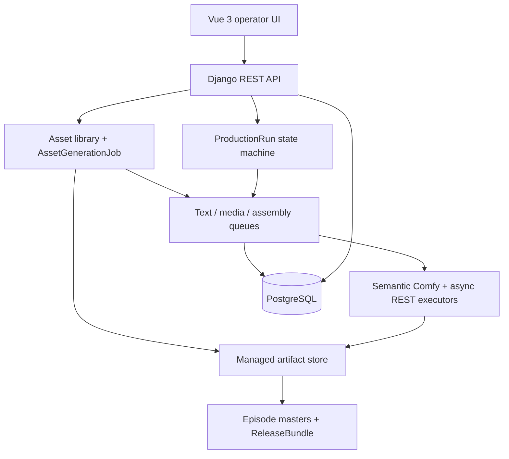
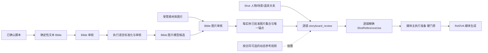

# Architecture

装配任务的消费事实直接保存在原AssemblyJob的`consumer_stage`及`consumer_input_sha256`，Run沿该Stage关系读取；源片段的生成Stage是不同职责。人工入口先在原命令事务冻结Stage输入，再调用共用装配器；配方首次与明确失败重试传同一真实消费阶段。复用键同时限定消费Stage和输入摘要，不能借同一片段/配置命中把另一个Run或输入版本的物理任务冒充本次任务。ProductionAssemblyLink仅保存当前逐集任务指针；替换后旧失败Job、source_items及创建时消费事实均保留，不新增第二条队列或审计流。未记录的旧任务显示未记录，不按当前链接补历史；任务中心Run/Stage过滤直接走消费FK，列表不加载快照正文。

配方装配重试的详情/预览/提交共用`production_assembly_retry`确切目标校验。提交绑定完整失败Job集合与消费Stage输入SHA，并核对Job的集、项目、所有者、正式执行范围及完整Link覆盖，旧确认不能消费后来失败的后继任务。锁序与worker统一为Project在Job之前；重试复用原装配器和状态机，整批事务外层沿用新文件guard，提交失败也回收本次concat。只读预览通过同一冻结来源校验的无锁读取路径，不创建平行事实、不补历史归属。

M4动态需求范围以原`frozen_recipe_material_units`为准：候选目录、审核写回、阶段完整性和绑定漂移共用同一实体范围投影，不使用项目实体全集代替本轮需求。所有生成素材单元（含纯主图）都经过原候选选择及素材登记器；无自动策略则等待明确选择。`require_complete_recipe_material_results`在正式输出冻结、阶段完成检查及原审核writer入口核对全部冻结单元/需求身份，不能只遍历已有Preparation而漏掉尚未准备的变体。进行中候选预览仍可显示部分结果；无新表、队列或独立装配事实。

明确追加候选的待重新选择状态由原`bible_regeneration_preparing`事件、受影响单元Preparation中的确切`generation_request`和原ArtifactSelectionDecision先后关系派生，不增加另一份状态表，不以迟到完成时间判断。新的人工选择沿原writer追加决定并处理确切依赖；保留同图仍复用既有素材版本，原决定/已生成变体的历史依据不改写。阶段推进和正式输出完整性共用此检查，不能用旧已登记图绕过本次明确选择。

### Bible 变体设定基础层（第154批，M3局部旧合同清理）

M3-08只保留完整的设定摘要schema2：设定正文、归属、来源、修订及固定主图依赖共用`bible_variants.verify_setting`，停用schema1只校验正文的兼容分支。新对象默认版本为2；迁移0218仅调整默认值，不转换旧摘要、不补主图/声明来源、不改审核。库约束仍允许保存待清理的旧事实，但运行时不再消费旧合同，详情、修订、审核、依赖和原流程核对显式失败；有效schema2历史修订仍按确切ID读取。旧记录的具体清理及现用迁移仍按R06另核对，不能把文件迁移验证称为现用已切换。

素材引用名的NFKC＋casefold冲突身份统一到`bible_reference_name_key`，原语义关系校验、设定名称容量校验和写入唯一性检查复用，比较不翻译或改写保存名称。生成规则继续由原M1输出结构、`script_semantics`和`script_semantic_relations`编译，字段布局、语言与创作约束依本次配置；不插入固定声明或全局英文要求。实体物化只走`materialize_script_reference_bible`，设定只走原`_save_revision`，原人工/策略事务不变。分镜只消费确切结构与保存的语义映射，不以旧规范稿解析/渲染回退。

M3-07复用`bible_material_requirements`，在原Bible人工/策略决定事务中输出`material_requirements`，与原物化回执一同保存于原StageRun快照，不新建表、队列或决定。声明外观ID限定本次范围，确切内容来自本次已核对的修订：新来源不带入旧剧本的其他实体/变体，也不把人工修订回退为原声明绑定的旧修订。没有外观不造需求，没有变体不扩增候选。原纯人工项目Bible配方审核明确使用`source.kind=project_bible`，不伪造剧本来源。

需求只引用设定ID/修订/SHA，不复制锚点成为新写者；变体保留历史主图修订依赖，主图后续编辑不自动改绑。设定中的basis_asset仅作为declared_reference_asset传递，既不代表目标已满足，也不能冒充变体所需的已选主图图片。原运行详情API可读取阶段输出。内部消费读者校验原决定/来源、保存输出与确切设定，并按调用者明确实体范围核对原RunPlan；缺失输出或不一致显式失败，不读时补造、修复或返回重算结果代替。声明输出本身不依赖未来镜头已入库，剧集范围消费仍不能擅自包含尚无对应镜头关系的项目实体。实际素材权限/文件、实例输入和动态图片执行由M4接续；本段不表示M4调度、图片生成或现用联调完成。

M4配方输入复用同一需求读者：显式实体列表读者保持空列表为空，`read_run_bible_material_requirements`明确选择“全部本轮声明与RunPlan的交集”，二者共用原决定、来源、设定及范围验证。`production_recipe_media_stages`将完整需求和原审核引用冻结在已有图片阶段输入；`production_recipe_material_units`把每条需求投影为独立外观单元（appearance身份、确切requirement、实体scope、角色与确切主图依赖），不新建事实表/队列。主图和兄弟变体不共享实体单元键；历史主图依赖不改绑到当前修订，不补造缺失目标。任务上限按需求数×候选数。原Preparation/追加主图候选使用外观单元身份；混合阶段先核对变体路线来源，再等待确切主图选择登记后准备变体，沿原队列归档和共用素材版本登记，不调用实体主图写回器处理变体。无需求、审核变化或快照漂移显式拒绝，旧实体单元不转换。生成、选择、登记、公开人工选材与已有/上传自动履约的实现及隔离证据见后文；第206批接入全部候选明确失败后的原请求重试等待态。生成版本自动/人工保真复用已接通；全部明确失败后更换成图来源已于第209批接通；M4整体验收尚未完成。

M3-06页面继续沿项目工作室的BibleVariantEditor维护唯一设定来源：详情将共同身份、主图外观和变体差异分区，变体只读所保存主图修订的正文，不复制或切换到最新主图。人工另存仍使用原revise，保存前说明只追加本造型修订、不改兄弟变体、旧审核和冻结请求；下游继续核对原基线。原source按需对照及历史只读不变，长文本换行与窄屏折行。人审标签仅说明真实BibleVariantReview；无人审不推定生产阻塞或策略通过，自动决定仍在原ProductionRun审计查看。实体图片历史中的variant_index只显示为生成候选序号，不作为服装/状态变体。本项开发与隔离页面验收已通过，无新HTTP/Schema或写者；0213–0217现用迁移和M3整体交付仍未完成。

M3-05复用原Bible声明写者与ApprovalDecision：配方冻结的approve_frozen_bible_v1及本轮unattended授权均有效时，原调度器直接校验、物化并冻结可用设定，保存actor=recipe_policy、策略/SHA及无人审者的阶段决定。policy_evidence保存来源/基线摘要、物化引用与素材需求，不复制正文；单个BibleVariantReview仍只属于真实人工，不为自动路径填reviewed集合或借owner代审。assisted/manual继续等待完整内容核对，配置自动模式也不能覆盖当前拒绝、忽略身份/来源/文件错误或改写历史人工修订。两种路径共享物化、引用与原事务，需求输出或决定保存失败回滚本次设定及一致性锁。

下游Bible读者核验原策略授权、决定摘要与来源快照，沿原创作漂移检查读取同一设定。分镜只读来源预检接受本轮真实人审或已验证的策略决定；没有单项人审时review_id为null，阶段决定仍通过原bible_review引用追溯，不冒充人审。原有明确人审保留，不改成策略。此段只接通设定决策及下游读者，不等于M5新语义分镜writer、M4实际图片或现用平台验收。

参考素材名称来自原准备冻结的 reference-use 事实：类型、实体/素材及确切版本标识决定身份，名称保留原语言。辅助模型与最终视频组装共用该来源，不使用项目级派生标签字典，不将译名当作实体键，也不自动附加主图外观正文。图片生成独立读取明确选择的身份与外观设定。

可选翻译服务的 `canonical_identity_mappings` 只维护词语映射：显式 glossary 原样保留，实体名称唯一时才添加 speaker/slug 术语，同名词不按数据库顺序挑选。新增同名实体会使依赖旧隐式映射的翻译上下文失效，原候选/审核正文不重写。三类实体只做项目范围窄查询；这不是整条生产请求的性能认证。语言由所选字段 language_policy 指导模型，平台不按正文语种拒绝执行，也不自动翻译。

M3-03来源对照：`bible_setting_sources.read_setting_source`在原设定详情的按需GET动作中，先核验不可变设定，再沿造型初始source_binding读取确切ScriptRevisionStructure及已保存投影证据，校验实体/造型声明摘要；不重解析原稿、不查询当前输出配置、不改来源。字段仅临时投影初始声明值、所选修订值、原字段路径及差异，配置literal/default与保存输出区分，缺字段与明确空值区分，人工登记没有脚本来源时显式null。保存输出不冒称原稿逐句事实或非模型推断，原文和设计补充不靠名称猜测。主/历史详情共用BibleSettingSource组件，切换修订清空旧状态，失败不展示上次成功值；变体身份仍只来自固定主图，不复制到对照。默认清单/详情不附带结构化正文，来源读取通过原一对一索引定位，响应不返回完整剧本或其他实体。

原script_bible_materialization仍是唯一声明写者，沿项目事务和稳定key复用实体/造型；新源记录本次确切使用，不覆盖已审核的人工修订及原决定。原源重放读自己的回执，不改用后来主图/变体；初始authoring来源与后续使用来源分开。M3-03没有新表、迁移、队列、缓存、来源转换或第二套设定写者。该项开发/隔离验收完成，M3整体及正式环境切换尚未完成；0213–0217仍未迁现用库，详细证据见[详细设计7.3](optimization/modules/m3-bible/design.md#m3)。

M3-02实体作者收敛：三类实体CRUD与工作室只维护基础信息、其他已有创作字段及素材关系，旧visual_identity从请求/响应、搜索和页面读写移除；旧字段提交明确400，不做兼容转换。ORM字段和过渡期defer/exclude已移除，不再依赖旧列存在。原script_bible_materialization不再向实体复制共同身份，身份/外观只写入原BibleVariantRevision；普通实体编辑不自动建立、更新或迁移设定。实体可先仅名称登记，图片/锚点不是登记前提。原项目优先事务锁、权限、锁定和来源保护保留；无调用的旧sync序列化器及字段常量删除。迁移文件0217仅RemoveField三类实体的visual_identity，不复制或转换旧值；升级丢弃这三列，逆迁移只重建空列，无法恢复原文，恢复须依原数据库备份。实体其他字段、主图/变体修订、来源、审核、素材及关联均不改写，无设定不补造。0213–0217未迁现用库，实际切换须按R06核对目标与备份；代码/隔离验证不等于现用切换或整个M3完成。

旧固定母稿候选HTTP action、按名称/旧锚点匹配的分类器、候选/错误serializer及其OpenAPI组件已移除；不回退旧母稿、不为未知调用方保留别名或重定向。`script_bible.py`只保留旧来源防伪校验，不再提供解析、渲染、实体匹配或来源写入入口。旧来源记录保持不可伪造/篡改，不因旧apply退役而变成普通可写metadata。

三类内部Django管理表单没有旧列，仍拒绝该键提交，搜索只用基础信息；其来源保护和项目锁保持。生产URLconf未挂载该管理入口，没有新路由。既有初始化命令只在显式新建示例实体时调用同一个`bible_variants.create_variant`写者保存主图设定，不构造人审、图片或剧本来源；重复初始化不改设定、不按旧列转换已有实体。以上仅代码/隔离验证，现用库和服务未改。

M3-02完整审核接线：`production_runs._canonical_bible`按所需列读取三类实体，不读取或冻结旧`visual_identity`；手动与配方审核共用原创作投影及`appearance_settings`确切引用。身份/外观正文只有原`BibleVariantRevision`是设定事实源，完整审核展示由`bible_content_review`批量读取当前修订和变体固定历史主图，不另存可编辑正文。原候选声明改为`identity_anchor: string|null`，只投影采用时保存的源字段，缺失与明确空值区分；无primary不补设定。原实体其他创作字段、原审批身份及原事务保持。旧整体审核含重复字段时与当前合同不一致，读者明确报陈旧，不删除字段兜底、升级或改写历史审核；新审核以设定及其他创作字段为漂移依据。前端手动/配方共用组件和根OpenAPI同步，无新端点；实体旧列按0217移除，规范稿分镜解析另随M5切换。

M3-02拆稿基线接线：`script_bible_review_inventory`只读取原实体的id/name/description/is_locked/metadata及人物stable_speaker_id；删除旧全列行读取助手，按三类实体批量调用`read_entity_primary_settings`并冻结`primary_setting_ref`四项内容身份。基线不读取旧visual_identity、不复制锚点、不把设定审核或图片关联作为拆稿就绪条件；无主图为null，明确空正文仍有确切修订。新主图或修订变化会改变原拆稿摘要并拒绝旧请求；损坏指针/正文通过原materialization.ready=false/reason显式返回，既不降级也不阻挡查看已有内容。仍沿项目优先锁、原拆稿/采用事务及原回执；已完成拆稿的原来源合同不追写最新设定。此段不改变M5规范稿拆稿器，不代表新语义映射分镜writer或现用切换已完成。

M3-02媒体主体关联收敛：`execution_input_resolution`对三类Bible仅查询id/project/anchor/name/description并核对所选Asset关联；请求内缓存按owner/project/类型/实体/Asset隔离，重复使用返回深拷贝，每个输入仍校验自己的允许类型。主体事实不复制visual_identity或隐式读取当前主图正文；图片、显式正文输入与主体身份保持各自来源。`execution_workflow_uses`是提示词参考投影和Workflow素材装配的共同冻结读者，校验主体精确形状及原来源摘要/端口，旧身份字段与缺失主体值明确拒绝，不从当前库补值或迁旧快照。`execution_reference_materials`按本次冻结输出类型投影：图片保留名称/外观说明及素材提示，视频仅携带名称、身份、来源摘要和实际槽位关系，不把主体描述、素材description/prompt_hint（含配套音轨）自动作为辅助或渲染输入；固定帧槽位语义保持，不能从创作描述推断首帧。显式外部主体仍用external身份和声明类别。新解析观察当前名称/关联，已冻结投影不重读；实际上传另复用原素材授权/文件核验。项目参考描述和提示词消费者也通过下述主图读者取值，不读取实体旧列。

M3-02一致性消费接线：`consistency.capture_consistency_snapshot`与原同步锁写者均经`read_entity_primary_settings`读取同一项目三类实体的主图；一次指针查询及一次确切正文查询，缺失主图为null、损坏不降级。快照复用`primary_setting_content`保留确切正文与内容引用；`ConsistencyLock.identity`只保存`primary_setting_ref`的四项ID/修订/SHA，不复制身份锚点，不成为第二个设定写者。`sync_consistency_locks`按原项目优先锁序，在一个事务中更新/失效派生锁；无变化不升版，失败回滚全部锁变化。GET只返回当次正文及原已存活动锁，不以读侧重算掩盖锁可能落后的状态，不改写旧冻结值。原稳定素材槽位不重排，角色出镜判断复用本次已核验主图，不额外读取或冻结旧身份字段。既有两个HTTP action使用准确的快照/锁列表机器契约，无新增Schema迁移、业务入口或真实执行。

M3-02角色视觉规则：`visual_reference_policy.character_visual_reference_decisions`仍用于Bible一致性快照的全局资格判断。显式include/exclude不依赖设定正文；auto按项目/人物集合批量核验当前主图identity_anchor，结合原说明/角色语义使用原高置信度规则。造型差异不决定永久身份；无主图/空身份不补旧visual_identity，坏指针或正文不能伪装不存在。M5明确分镜关系及通用项目提示词/参考上下文不再用此规则推断本镜出镜或改写画外音：出镜只来自visible关系，发声只来自对应原对白行的speaker关系，voiceover保留原值。旧Shot参考绑定入口与物理字段已在代码/0230迁移退役；第264批已获具体范围授权并实际应用0230–0232；M5-09独立试用收尾仍未完成，不据迁移成功推导全模块已验收。

M3-02主图译文维护沿三类实体的 primary_setting.identity_anchor／appearance_anchor 及自身可编辑字段范围。`prompt_translation` 先按项目核对实体，窄列读取与共享确切设定读者分工；翻译上下文带主图ID／修订／SHA及两段原文，不根据同文接受另一修订。第254批将此维护范围与生成目录解耦：`prompt_generation_sources` 仅投影已实现执行来源读者及其同源帮助，不再承诺直接读取 Bible／Shot 固定列；结构生成由确切结构与路径负责。主图未建立、损坏及已保存空正文分别处理，不读取旧文字或升级旧译文。

第252批已移除旧项目媒体来源适配器及其专用ORM读者。正式关系读取/审核映射仍复用`shot_character_relations.shot_character_relations`核对明确角色、身份和原对白位置，再由原准备冻结确切输入；主设定、确认翻译和纯参考渲染分别沿各自唯一能力验证。编译测试显式传入主体、对白与已解析参考，不从当前主图、视觉资格或旧素材池补值，不隐式去掉关闭音频时仍提供的对白。纯ReferenceContextFacts不重读当前库，直接字段与参考编译均以SQL断言禁止业务数据回读；第254批已退役生成目录中的旧固定列及生成准备的source_facts读取；第255批进一步以策略确切结构路径派生内部render_values，公共单元不再接受固定source_facts，原文保留在准备投影。StoryboardView/API固定创作入口及Shot物理列已退役；M5-08已在第259批完成联合验收；第264批已实际切换，M5-09独立试用收尾另见唯一清单。

分镜素材输入只沿`ShotReferenceUse`确切来源→`reference_use_records`→本次调用映射→共用执行输入解析器→`execution_reference_materials`投影端口与标签，不再从旧Shot JSON/素材池或项目全局Picture顺序构造另一份执行参考。当前事实编译器只接原准备中已经解析的参考记录，没有临时Shot绑定/素材池参数。渲染器单元测试显式提供输入记录；它们不是来源授权或实际端口分配的证据，这些由真实素材解析及输入投影组合测试负责。Shot内容编辑已移除旧模式裁剪、自动绑定及素材用途写入，API不暴露/接受旧reference_bindings、reference_assets；删除normalize_shot_reference_bindings和前端旧绑定适配器。分镜页仅保存正文、明确关系与创作连续意图，选材跳转原生产工作台逐次引用入口，普通保存不改写选择或审核依据。模型及0230迁移退役旧characters/reference_assets/reference_bindings，保留明确角色与逐次引用且不从旧池回填。种子只对新建示例写明确visible/speaker，重跑不补关系或改选择；按集生产人物范围使用明确角色，镜头版本查询不预取旧池，素材删除/改类保护读取ShotReferenceUse，逐次选材不进入全局Picture编号。第264批已实际应用0230–0232；M5-08清理与消费者联合验收已完成，M5-09模块试用和M6后续各按唯一清单接续，不冒称整个模块完成。

M3-01项目级身份接线（2026-10-01）：原物化器使用`BibleEntityIdentity`，以`project + entity_key`唯一关联原CharacterBible/SceneBible/PropBible之一；同名不同key不合并，不同项目的key各自独立。身份表只存键、实体外键和时间，不复制名称、锚点、图片或剧本正文，不增加管理API。映射随项目声明实体数增长，使用项目/key唯一索引；随实体/项目级联删除，实体能否删除仍由原来源和设定引用约束决定。原实体API检查跨项目移动，正常改名/编辑仍走原规则。0215/0216仅提交Schema迁移文件并完成隔离测试：不按旧名、slug或修订补造身份，不回填来源、不改写或清理业务数据，未迁现用库。证据及后续模块边界见[详细设计M3](optimization/modules/m3-bible/design.md#m3)。

设定集新增统一变体编辑器与 `/bible-variants/` API。BibleVariant按项目和单一实体持有稳定身份及当前修订号；BibleVariantRevision保存不可变完整设定，BibleVariantReview保存精确修订的人审，不是图片采用。主表和分页历史只读摘要，详情按需读取各16KiB以内的锚点；项目锁、期望版本与SHA防止覆盖旧决定。引用名语言不限，按项目NFKC/casefold唯一，改名不换对象ID；Bible展示名不承担唯一身份。Schema唯一入口为Django migrations；代码及隔离测试不代表现用服务已完成相应切换。

设定/审核事实由共用服务写入，API和工作室读取；每次明确修改追加一条修订，每修订至多一次审核。默认不清理审核和来源事实，实体/素材关系以PROTECT保留；生命周期沿项目数据库备份与正式恢复流程，不以临时文件作为事实源。普通basis Asset只是记录身份依据，不能当作主图采用授权。素材库不维护第二套变体设定。

M3-04名称冲突诊断复用`bible_variants._unique_reference`：项目锁内按原project/reference_key唯一索引读取冲突造型及所属实体的身份/显示列，不读取设定正文，不扫其他项目；create、revise及声明writer沿同一函数返回具体冲突对象。多语言显示名不作身份匹配，人工改引用名仅追加本对象修订，不修改来源key、其他同名对象或对白。生产语言策略与名称使用链仍待M3-04后续核验，不因局部诊断修复宣称模块通过。

旧规范稿正文编解码器`script_canonical_body.py`及`series_concept_drafts.py`已随M5唯一writer切换移除；不保留规范文本→重新解析→固定Shot创作列的旁路。新生成/结构化请求与响应继续以确切输出版本及保真JSON为准，分镜只引用原M2结构、字段版本与原值。

剧本模型请求/响应统一由`script_semantic_requests.py`按确切输出版本编译、核验和解析；`text_generation_queue.py`只承担原队列领取、执行分派及冻结部署等职责。`script_structure.py`保留模型传输政策校验和规划输入结构，已删除无调用的旧规范稿读取与渲染，不为历史请求增加转换层。M2保存确切结构化修订，M5人工/配方入口共用声明writer，不复制另一份字段字典或正文。

剧本候选通过`execution_production_candidates.py`和`script_semantic_candidates.py`核对原调用、请求文件、确切输出合同及保存的结构化详情，不按正文或当前配置重建来源。Bible审核/物化、人工结构检查统一读取本轮确切采用的ScriptRevision；导入稿无需伪造模型调用。旧声明业务模块、固定母稿候选查询及旧来源读者已删除；旧规范稿分镜解析已移除，无旧master_script候选回退读取或转换入口。

下游有限业务语义使用 `scene_key/character_keys/prop_keys`、对白的`speaker_entity_key`与素材`references`；外部剧本响应不强制这些键名，字段位置、必填和默认由确切共享结构及语义映射决定。Bible物化及分镜只读预检已直接消费保存的语义投影，分镜实际writer尚待切换。关系校验不按同名、唯一场景或首角色补全；画外发言人不自动加入可见角色，人物没有参考图不等于没有出场，不把内部消费语义当作外部固定输出格式。

字段映射预览及剧本语义作者共用`RecipeStructureMappingEditor`：新建“按字段组成对象”只展开目标合同的必需且无结构默认的属性，可选字段通过“配置…的来源”显式加入，不为全部可选字段自动生成无效空映射。已保存映射原样读取，不因此默认展开规则改写；缺失、默认值、类型和关系仍由原后端合同校验，前端不求值或拼接创作正文。

`ScriptBibleEntityBinding`保存每份`ScriptRevision + entity_key`的来源回执：0216将目标关系改为外键，不同源修订可引用同一项目实体；同一源修订不能给同一实体绑定两个key。`ScriptBibleAppearanceBinding`以来源回执和variant key（主图为空）唯一保存该次使用的确切BibleVariantRevision ID/SHA及该源声明摘要，不复制正文。BibleVariant保持初次创建来源，已声明造型按实体＋variant key唯一，每实体至多一份主图。BibleVariantRevision的v2摘要继续覆盖设定、归属、初始声明摘要、确切主图修订及其摘要；变体不串联兄弟变体，设定依赖不代表主图图片已采用。来源回执只追加、外键PROTECT，按实际采用源数/声明造型数增长，原剧本和原设定修订仍是唯一正文事实。0216不为既有绑定推断新身份或使用回执；缺失时显式失败，不提供旧数据兼容或读侧修复，具体不适配开发数据的清理需另核对范围。

原`script_bible_materialization.py`冻结本轮确切确认修订及保存的语义投影，schema3来源只保留`structure_source`与实体声明摘要，不读取旧模型声明包装。人工和配方入口核对原采用决定/前序成功阶段的来源回执；缺失或漂移不补造、不按当前配置重解析。在原项目锁和事务中按稳定key复用实体，已有主图/变体引用此次物化时明确的当前设定修订，缺失key才创建；新来源不是编辑命令，不覆盖已有名称、正文或人审。新增变体依赖此次引用的主图修订，既有变体不自动改绑。重放只读该源保存的确切使用回执，即使后来人工另存修订也不换成最新值、不恢复旧当前指针。未声明外观时只建实体，缺锚点不编造，变体仍需明确主图及引用名；新建的引用名冲突整批回滚，不按同名合并或自动改名。内核不创建审核、采用或模型任务，不提供第二个API/CLI。审核清单区分原声明和现有设定；只读分镜预检区分造型初始来源与本次剧本引用，按本轮明确审核的确切修订解析，忽略其他源给同一实体新增而本剧本未声明的造型，不将图片或当前配置当作来源。

`bible_setting_evidence.py`为Bible创作审核基线提供共用的只读设定证据：当前设定按明确修订号批量读取并验证，依赖按已保存的主图修订ID读取（可以是历史修订），不替换为最新版本。每实体的appearance_settings只保存角色、名称、来源、修订ID/SHA、原设定审核及确切主图依赖/审核引用，不复制锚点正文；无设定时当前投影明确为空数组，不改写历史快照或补造设定。原手动/配方canonical与漂移检查共用此投影，设定变化要求重新审核，单独图片绑定仍独立于创作漂移。缺修订、跨归属、正文摘要不符明确失败，不静默遗漏。

M3-02的输入消费接线复用`production_reviewed_content.read_reviewed_entity_primaries`及其单实体入口：从原审核实体的唯一主图引用进入确切设定正文读者，校验项目、实体、角色及完整引用，分别返回共同身份和主图外观，不读旧Bible.visual_identity。`context_field`的两项主图selector和`request.subject`的可编辑引用共用该读者及字段目录；前者冻结原审核及`setting`引用，同次解析共用正文；后者预览原文、显示主图修订，明确填入后允许本次编辑，提交重读核对原审核和原引用。没有新输入类型、队列、字典、翻译或审核写入。缺设定不是空白；明确保存的空字符串按上下文目标约束判断，可编辑引用不预填空正文。实体旧字段写者、消费者及模型定义已移除；保留非法旧输入的显式拒绝，不提供兼容转换。

`production.entity.content`与`shot.linked_bible`共用reviewed_entity_content，去除旧视觉身份/素材关系，primary_setting为确切主图两段正文或明确无设定的null，完整引用仍在appearance_settings。关联Bible只按原ShotCharacterRelation的明确出镜/发声关系选择实体，实体正文旁保留role/position，不能将实体全集当作可见人物；不读旧混合人物池或动态视觉子集。再一次批量读取缺少的正文；请求内缓存键含Run、Bible审核决定和实体身份，不跨请求持久化、不构成事实源。重复映射共享实体时复用同一确切修订，逐镜结构映射仍拒绝读取其他镜头，深拷贝投影隔离本次草稿修改，读取失败不写入部分缓存。已核验原审核的单独正文读取不追随主图新修订；正式输入仍先检查当前创作审核一致性，变化后须重新审核，不凭缓存绕过漂移。对白关联按speaker.position逐行取确切实体，仅取姓名与声音并校验原speaker_id，不再扫描人物池匹配、不改原对白/时间、不额外读取主图正文；不隐式把这些显式JSON输入注入视频提示词。

同模块的`setting_revision_rows`统一详情、声明回执和审核所需的确切正文查询；`read_setting_revisions`按请求ID集合及项目批量读取、要求集合完整，再复用原`verify_setting`校验。单次查询加载本修订、固定主图修订、初始来源身份及原review，不联入ScriptRevision.content、实体visual_identity/metadata或完整项目正文；小型审核投影仍保留自己的有界批量查询，不为列表加载所有正文，也没有新缓存或第二份存储。审核清单比较完整`setting_reference`以发现来源/主图/审核引用变化；提交前重读确切当前设定，缺项整体失败而非静默跳过，沿原事务回滚。三类实体的旧正文写者和消费者已收敛，0217完成旧列的Schema移除。

工作室的原设定编辑器按需展示角色、声明来源及固定主图设定。M3-02已移除按原始修订推导的创作必填门禁；人工新增明确分为主图与基于确切主图修订的变体，两者都无需预先生成图片。主图身份与各造型外观可明确留空，变体不保存共同身份副本。原create服务核对同实体主图修订ID及摘要，允许历史修订；复用已有每实体唯一主图约束和同一_save_revision写者，API角色枚举读取模型定义，不新增Schema或第二套写入器。另存修订不切换依赖、不复制主图文字、不覆盖旧正文或审核、不采用图片。历史正文和确切依赖可读，列表和历史清单不加载锚点；后续生成所需输入按执行合同校验，不把可保存等同于图片就绪。后续剧本声明已可复用同一项目身份下人工登记的唯一主图，来源仍为null且原正文/名称不覆盖；首次引用保存其当前确切修订ID/SHA，旧源重放仍读原回执。人工变体无声明key，不能按同名猜配，冲突整批回滚。原确切设定读者及分镜预检共用source_reference校验真实创建来源，人工主图被引用不会变成“剧本生成”；本轮没有改变审核策略或接通分镜实际writer。共同身份只存于主图确切修订，变体引用其固定主图修订，不再向实体列复制同一锚点。

`bible_content_review.py`提供手动/配方共用的完整审核集合：核对上述schema3来源，直接读取原保存实体/主图/变体语义，另列当前设定及固定历史主图正文。候选`source_facts`含同一`structure_source`、`semantic_path`及字符串或null的声明文本；null表示未声明，空字符串表示明确空文本，不生成`origin/source_lines`。原审批入口核对来源凭证、项目基线及精确实体/设定集合，再在同一事务保存物化、准确设定review和原ApprovalDecision；回执失败整批回滚。重复审核复用已批准决定，拒绝的当前设定不能被覆盖；仅审核本次当前修订，不替历史主图补批准。自动策略不借运行所有者冒充人审；M3审核策略变化未在此实施。旧V1按名称物化writer和前端旧候选审核解析器已移除，历史快照不改写。

`script_storyboard_plan.py`是确定性分镜写入共用的只读预检，不提供新API；人工及配方正式冻结、执行与原回执均已接入共同writer。沿原Run→项目锁，复用人工/配方确切采用来源读者，核验保存的结构化语义与此前人工Bible审批；一次批量读取声明绑定，按稳定key解析场景、可见角色、道具、对白参与者及有序素材使用。集/镜坐标读取显式episode/shot值，保留作者顺序，不以数组下标代替；对白及原镜头语义不重写。使用项绑定本轮已审核的确切设定修订、原审核和固定主图设定，不选图片、不分配模型槽位、不带入外观锚点。缺绑定、设定漂移、审核不符、跨实体变体或重复使用标识明确失败；名称翻译与正文扫描不承担身份匹配。`basis`为schema2，仅记录原结构化来源/阶段/审核及关系摘要；后续writer必须在自己的写事务重读并比较，不能把此前返回的内存计划当作持续有效的写授权。

`shot_reference_sources.resolve_shot_reference_sources`读取原`ShotReferenceUse`中已保存的确切选择，按调用方镜头顺序及用途位置输出使用身份、实体/变体/设定修订、素材版本或直接Asset、指纹和来源。它不是选材规则或列表读取器：用途和设定元数据批量读取，实际文件及版本来源复用共用素材读者校验；同一操作内相同目标只核验一次，各用途仍保留独立身份，跨请求重新核验。直接视频/音频无需Bible或素材系列；生成版本复用原登记及固定主图依据，不因本轮选择existing而改写原生成来源。越权、未选择、设定/版本错配、来源损坏、文件缺失及指纹漂移显式失败，不找最新版本，不读取旧混合人物/素材池，也不写审核或生成事实。返回值不含存储路径、外观正文或模型槽位；后续选择writer/执行准备必须在自己的原事务内重读，不能把此前内存结果当成写授权。

`shot_reference_choices`提供M5-05共同单镜选材事务，已接人工选材页面与命令/API，配方自动应用已接原审核事务，配方单镜命令及共用页面已接，旧人工审核/显式恢复及完整请求验收仍未闭合。`read_shot_reference_choices`只读窄列用途清单及其摘要，不探测文件，允许显示未选择用途；摘要包含项目/镜头、用途身份/顺序/类型/目的/确切设定和当前选择，不以更新时间制造冲突，也不是执行就绪证明。`apply_shot_reference_choices`按项目→镜头→用途锁顺序重读并比较摘要，对本次提交的全部用途先调用同一个素材解析核心，全部有效后才更新原`ShotReferenceUse`的四个选择字段和更新时间；不改用途声明、Bible默认主图、其他镜头或旧混合关系。单用途可先选而其他用途保持待选，返回的已解析子集不等于整镜完成。相同当前选择也重查实际文件，值未变化时零DML；陈旧基线即使与期望值碰巧一致也拒绝，不能冒充原命令重放成功。单镜多用途写入及外层原命令回执失败都可事务回滚，无第二套选择/审核/执行事实。人工调用方现由`production_manual_shot_references`在原Run/Stage事务内核对冻结动作权限、准确分镜采用、单镜范围、旧基线及原准备/调用状态，并由原`ProductionManualCommand`保存`select`回执；选材不创建审核或改变阶段状态。仅有选材回执不算下游已启动，原改选影响检查仍按真实准备、决定和结果判断。原请求重放返回原Shot回执，不重写后来选择、不证明当前文件可用；配方人工改选后端及共用控件已接，旧人工审核/显式恢复及完整请求验收尚未闭合，M5-05仍部分完成。

第221批的原人工分镜审核与`read_reviewed_shot_references`开始消费同一确切用途解析器，不再从旧`reference_bindings`投影执行输入；原Run→项目锁下校验当前审核与用途事实，使用`shot-use:<use_key>`保持引用身份，版本/指纹仍由原canonical审核快照保存。原展开器只按图片/视频/音频分类并保留用途和确切设定主体，不发明首尾帧或音画配对。人工审核取消“独立图片必须先经Bible图池”的错误前提，实体/设定内容审核仍沿原事实；后续M5-05已统一配方人工改选和原附加素材展示到逐次引用，旧池不再进入新审核合同。审核响应与页面共用后端来源目录。第224批已按批准修正合同：业务描述可选并保留原值；每次调用独立映射来源/槽位，仅目标接口确有额外用途时明确配置，不猜枚举或首帧。M5-05/06/07已有分项证据，M5-08清理已在第259批完成，M5-09完整模块验收尚未完成，不能以局部请求证据声称模块已交付。

第222批新增内部只读`production_shot_reference_defaults.plan_upstream_shot_reference_choices`：调用方明确原Run/下游Stage、单镜、上游Stage及输出摘要，复用冻结拓扑和原M4输出目录，按`ShotReferenceUse.setting_revision_id`匹配原确切素材版本。已有选择只核验不覆盖；缺设定、无结果或多个同设定结果分别返回人工选择、缺失或歧义，不取主图、最新版本或按名称猜测。唯一结果继续经过原选择回执/文件读者和M5共同解析器；本轮复用记existing、本轮生成记generated，原素材取得来源不变。返回建议及用途基线，不写选择、审核、调用或阶段状态；ready只表示这一组选材建议可解析，不表示执行请求就绪。第223批补配方作者与冻结读取，第224批完成用途修正，第225批接自动应用；只读计划本身仍不是审核或执行授权。

`production_recipe_shot_references`定义单一来源目录及规则校验。原配方编辑器在`storyboard_review/review`声明`shot_reference_selection`：上游/已有/上传来源、明确上游阶段、自动唯一确切设定匹配或人工选择、允许替换已有选择。已有/上传只允许人工选择；来源不完整明确报错，不推断第一上游或库内自动策略。规则只随原RunPlan和原Stage输入冻结，上游只记录确切Stage/输出摘要，不复制素材选择。`plan_configured_shot_reference_choices`从冻结输入核验并调用原只读计划，当前配方修改不能替换原权限，上游变化不能重新绑定；读取不写用途、审核或执行事实。第225批原`production_storyboard_policy`在Run→项目→镜头事务核对冻结来源，先规划全轮用途，全部明确后调用同一选材writer；已有选择保留，缺设定/无结果/歧义进入`waiting_shot_reference_selection`，不写半轮选择或配方审批。原调度器保持Stage running、Run awaiting_input，普通自动扫描不恢复待输入运行。原输入验证器消费共同用途记录，原ApprovalDecision记录recipe_policy而非人审；失败回滚选择与审核证据。创作来源仅排除四个下游选择字段，完成的审核仍冻结并比较全部选择。`production_shot_reference_editability`为两种Run复用同一准备/调用保护，未知调用及已冻结取消准备不允许改写。旧自动主图推断函数及其专用测试已删除；原人工配方写者随后由第229批共同确切审核替换，临时边界已删除；原显式Continue承接等待恢复，不能将待选本身视为成功。

第332批细分 `RecipeShotReferenceSourceConflict`：合法旧选择与本轮使用来源不符且冻结规则允许替换、冲突镜头未进入执行时，属于显式人工接管，不能静默覆盖，也不能因 blocked 状态使原选材命令不可达。原选材 writer 将应用默认选择及终验置于同一保存点，仅捕获该来源冲突并回滚全部新选择，再沿原 `waiting_shot_reference_selection` 状态返回；真实文件、权限、冻结来源漂移和目标接口错误仍抛出。全轮文件真实性先于来源分类校验，不用首个可恢复来源冲突掩盖其他坏文件。正式人工命令与最终审核继续执行相同来源校验，不增加旁路或第二个事实来源。

第228批将配方单镜命令与自动审核的来源校验收敛到`production_recipe_shot_references`：目录查询只读元数据，提交/审核重读原结果及文件，按完整原来源引用去重，不按版本号省略不同来源的校验。`production_storyboard_policy.read_recipe_storyboard_reference_selection`在原Run→项目→镜头→用途锁内批量读取当前确切选择，复用共同解析器与目标媒体合同；返回完整选择及来源/选择摘要，不写选择、审批或执行准备。原自动应用随后复用该核心形成原策略证据，失败回滚仍在原事务内。选材等待只允许原显式Continue恢复，普通内部推进也不越过该等待；缺项继续等待，上游变化明确阻断，不重新冻结来源。人工配方审核的正式API/页面已沿下段接通；选择、审核和请求编译分别保留各自验证边界。

第229批原人工配方审核删除实体主图/旧混合binding写者，以同一只读核心核对已保存ShotReferenceUse；原ProductionRun新增storyboard-reference-selection读取，原approve要求上游和完整选择双摘要，防止同创作来源下改选后仍批准旧依据。准入与读取限原assisted当前审核阶段及同owner权限，读取不写选择/准备；批准在原事务重验全部版本/文件与原目标合同，只写原正式快照/ApprovalDecision（human/真实user），错误/回执失败不部分批准。现有单镜命令、策略审核及显式Continue仍复用原事实，没有新表/队列。页面只读显示独立用途、可选创作原文、来源与确切版本/SHA，不轮询替换已见摘要；选择打开清除批准依据，关闭后重新核对，明确409不被归为结果未知或自动重试，其他未知响应仍受原回执保护。旧审核请求serializers、实体主图草稿/页面及废弃图片编辑组件已删除；原Shot CRUD亦已退役旧混合字段，不保留配方审核兼容。新增7项后端审核、8项组件/请求和2项父页面行为测试；空参考实际目标仍核对原执行定义。第230批已将旧交付夹具收敛到当前entities、原生inputs及声明式分镜writer；隔离交付仅验证调度/审核/装配，显式固定提示词不冒充M6独立字段投影。已有/上传改选使用真实选择API、原审核、原准备和请求编译，初始分镜/RunPlan为隔离夹具，未伪造远端准入或生成成功。

原执行输入解析器对镜头范围的`reviewed:`项，按调用输入key、shot_id和原用途reference_key重建身份，并通过共用`resolve_shot_reference_sources`核对已保存的确切设定、素材版本/Asset及文件事实；主体和素材必须与该用途一致。不能因为新选图片不在Bible旧主图/参考池就拒绝，也不能靠伪造前缀、另一镜头/用途或已变更选择通过。此解析只读，不改Bible主图、不补参考池、不把选材视为审批；非分镜映射的独立主体输入仍按其原关联合同校验。准备及请求编译不等于模型准入、提交或真实Smoke。

前端`ManualShotReferenceSelection`由原`ManualProductionWorkbench`挂载，镜头目录、用途基线和提交分别复用原targets、manual-shot-references及manual-actions。共用`ExecutionInputAssetPicker`向调用方保留确切系列/版本身份，不另造上传或素材事实；`productionManualShotReferences`只维护当前页面草稿与原请求快照，保存仍写原ShotReferenceUse。冲突显式重读，结果未知原样核对；关闭面板不卸载待核对上下文，外层轮询不能覆盖它，实际离开提醒未保存内容。列表与预览不是文件可用或请求输入完成证明，单用途成功不代表整镜履约。

M5-06的`shotReferenceBatch`只持有页面内草稿和原命令快照，由同一选材面板挂接`ShotReferenceBatchPreview`。每个镜头保留独立用途列表，不按素材或实体合并；预览重新读取原uses摘要及创作来源，逐镜复用既有单用途请求校验/装配后组合choices。每镜一个原事务/回执，跨镜独立，部分失败、未知和已确认结果分别展示，未选目标保持不变。未知原样核对、迟到预览失效、父页上下文锁及离开提醒共用原入口，不新增持久化批次/选择事实。原素材预览身份读取也收敛为共同函数，失效时明确报错，不补替代版本。

M5-07的`ExactReferencePreview`为两种原审核页共享的只读、按用途展开视图；`exactReferencePreview`同时承接原选材预览的唯一身份读取。只按所见确切版本、系列、Asset和SHA请求现有目录，区分选择来源与版本取得方式；当前名称是展示元数据，不替代冻结身份。人工审核页由原canonical.reference_uses恢复展示的版本ID，并与原执行投影的素材/SHA核对，缺失或错配拒绝，不补查实时Shot冒充原合同。图片/音视频加载错误单独呈现；详情收起/输入变更/卸载使未完成读取失效。此层不写选择、审核、准备或调用，不修改原审核摘要，也不维护跨请求事实缓存。

两入口关系展示复用`storyboard_review_display`：只投影原canonical中的集/镜号、场景、类型化出镜/发声关系及道具ID；按同项目确切ID批量读取Bible当前名称，最多三次仅id/name的索引查询，不逐镜查库，不读取旧人物集合或用名字反向匹配。读时`display`与原批准合同分离，名称时点明确为`current_bible_by_id`，缺名称显式unavailable，不修改或重新冻结旧审核。前端`storyboardReviewDisplay`检查完整镜头范围和关系状态，排序仅作用于副本；两页共用`StoryboardShotRelations`，发声位置指向原对白行、发声不代表出镜。工作流历史绑定及未执行修改影响已按M5-07完成定向隔离核验；第235批以`ShotPreparationHistory`补齐全驱动原准备历史：任务中心只按原生产准备的unit_key与项目/阶段/轮次权限筛选，使用签名游标，不读大JSON推断归属；`TaskCenterDetail`只读模式复用原历史/正文分块/参数/提示词解释，不轮询或暴露写入口。非ComfyUI无媒体输入的原定义明确无槽位绑定，缺可核对媒体证据时不伪装空输入；当前不支持的媒体提交不在展示任务中扩展。模块试用依赖M5-08/09，不以展示完成代替模块交付。

`ShotExecutionEvidence`沿原任务列表/详情/input-prompt核对相同任务、准备、Attempt、请求摘要及实例版本，再由共享`FrozenTaskReferences`逐用途只读展示；此处只覆盖原ComfyUI GenerationTask，不为其他执行驱动补造队列任务。原名称、实际输入/标签/端口/用途参数、指纹和暂存状态来自同份原请求事实；仅提示词上下文与实际模型媒体槽位分离。预览地址由原任务reader在所有者/原文件摘要校验后提供，UI不查询当前选择或寻找替代版本；未持久化系列版本时明确未记录，不形成读侧兼容回填。两原审核页复用该组件，查看不改变审核摘要。人工未知审核请求保护原body/key及父层刷新/关闭/路由；首次明确拒绝才解锁，未知结果后的拒绝不能清除原请求。

第226批`production_recipe_shot_reference_commands`仅扩展原人工命令事务的配方`storyboard_review/select`：复用同一ProductionManualCommand回执/幂等实现、共同ShotReferenceUse writer与执行保护，不另建选择事实或队列。原计划/冻结Stage来源授权；上游限定原目录内版本与真实结果/文件，已有或上传按明确来源核验，不猜上游、首帧或主图。禁止改选只限制已有选择的替换，不阻止首次选择。自动和人工配方选材共用`recipe_storyboard_reference_source`创作来源边界，完成审核或下游已准备不可改。正式`recipe-shot-references`仅返回真实冻结来源、单镜基线及元数据候选，不伪造人工采用修订、不探测文件。保存不审批、不推进；回执失败一起回滚，重放不重写后来的选择，其他配方动作仍拒绝此入口。第227批配方工作台经薄宿主复用原单镜编辑器、素材选择器和原命令装配。真实配方基线不用人工采用修订；上游只能选原冻结候选，明确选择时重读确切版本/Asset/SHA，已有/上传入口受同一规则限制。关闭保留原未知请求，重开字节一致核对；打开/草稿/未知与人工上下文锁合并，暂停整页轮询和运行操作，防迟到响应重挂载。禁止覆盖已有选择不禁止首次选择，业务用途仅显示原值，不传作模型用途。当批仅完成控件隔离验证；此后228–230已完成旧配方人工审核切换、等待显式恢复及选定图请求编译，231接多镜批量原命令复用。M5完整交付、现用模块试用和真实模型效果仍按各自验收，不用控件通过替代。

第143批起的V0-e2b/e2c已接通声明来源、类型化关系和共同分镜writer；代码/隔离验证不等于模块上线。确切素材解析器是内部共同能力；配方自动应用、单镜/多镜命令、审核恢复及选定图请求编译已接并隔离验证；M5-07关系审核/原执行历史展示已交付内部验收，旧混合读者清理已按M5-08完成，模块试用仍属M5-09，M6负责独立字段策略输入及真实输入槽位。共同storyboard_content与人工审核已去除旧人物/附件池读取，仅冻结明确关系和独立用途；Shot CRUD、提示词与参考上下文的人物读者已收敛，旧素材绑定与物理字段已从模型及0230迁移退役，固定创作字段消费者已按确切独立字段收敛，七个固定创作列由0232退役；第264批已备份后实际应用0230–0232，M5-08联合验收已完成，M5-09模块试用仍须收尾。不能把发言者补成可见角色，也不能将空旧人物池理解为无需参考图。M4已有确切主图图片依赖消费，完整新配方链和实际媒体仍待各模块验收；接口见[API](api.md#bible-变体设定与修订)，实施状态见[唯一清单](optimization/modules/common/design.md#tracking)。

影视规则业务输出的受控可选 `camera_guidance` 文字字段随原输出版本冻结，经原解析器和逐项审核后只保存在原审核快照，下游通过 `reviewed_visual_rules.camera_guidance` 引用。项目写回与项目变化检查仍限原三项基础规则；该专用协议不接受任意新业务字段。通用JSON与剧本映射分别使用各自明确协议，不混用影视转换规则。

M2-01剧本配置沿同一`BusinessOutputVersion`增加`script_semantics.v1`：只在原parser_contract存储显式映射，引用共享DataStructureVersion，保存/发布/后继/退役与摘要复用原唯一实现。`script_semantics.py`提供有限业务输入Schema（实体、主图、变体、分集/分镜声明），外部返回名称/层级由共享字段结构及映射决定；这不是另一字段字典、生成模板或独立业务事实库。`preview-script-semantics`仅检查JSON结构与映射，保留raw_value、含自定义字段的source_value、语义value及路径/版本证据，不执行模型或实体/镜头写入。配置页复用共用结构选择与映射编辑器，保存后按ID/修订/SHA预览；修改或迟到回执不会复用旧成功报告。原文与候选落库、引用关系校验、实际生成请求接线仍归M2后续项，现有text.structured不能误用此协议，现用运行未自动切换。

`script_semantic_requests.py`提供M2请求编译与冻结读取核心；原准备校验、请求编译及实例输出投影已接线，模型政策作者与正式目录准入已切换，冻结核对复用原worker共用读者：从确切输出快照生成共享结构Schema与消费语义/映射说明，复用原Profile通道，构造未发送Chat载荷及业务计划。输出定义、已解析输入、原稿来源、参数和传输选项按职责冻结；准备阶段沿原Chat选项校验器核验选项，冻结读取不再查询当前选项边界、注册表或重新生成协议正文。来源字节/摘要与修订身份由`script_sources.verify_script_text_source`共用校验；system分段范围/摘要由`system_message_layout.inspect_system_message_layout`核验，任务中心同样复用它。请求与计划不共享可变选项对象，审计字段与组装回执不发送给模型。 原build_native_text_plan先校验确切输出、已解析输入、参数和紧凑传输政策，不创建占位Profile或消息；原build_native_text_request待实际通道齐备后复用同一编译器。新合同仅接受timeout_seconds/chat_request_options，不从旧field_contract/reference_policy补值；提交前同时核对计划传输政策与原冻结实例，缺失或漂移不能进入旧请求构造器。

原`native_text_interface`从实例明确选择的`output_version`经唯一能力/输出协议目录校验，投影同一输出引用；从所选模型的已校验政策仅取timeout_seconds/chat_request_options作为新协议传输政策，不读取旧生成资源建议。实例与基础资源合同共用此入口，未增加存储、版本选择器或执行路径。隔离验收已使用原实例创建、读取input-contract、发布及后继修改API，再进入原准备/编译，不手工拼装可成功的输出定义；创建输出新版本不隐式改选，已发布实例快照不改写。正式协议目录现允许script.generate/script.structure引用script_semantics.v1，实例必须明确选择确切输出版本；模型政策仅接受timeout_seconds/chat_request_options。模型选项schema_version=3与实际表单同源，不再维护field_contract/reference_policy，旧键明确拒绝且页面可显式从当前草稿移除。隔离测试不再替换成功路径的协议准入。此作者及准入切换不代表0213已迁移、现用服务已重载或M2已交付；候选字段编辑与确切采用来源已接线；残留旧协议清理及M3/M5业务改造仍按各自任务推进。

`structured_output_parsing.parse_structure_text`统一通用文本及剧本的严格JSON、结构/default解析、未知字段提醒和错误原值保留；剧本投影共享同一次解析预算，不另解码或猜测格式。`parse_script_semantic_output`按确切输出引用解析，复用预览的结构/映射核心后再由`script_semantic_relations.py`校验声明key、主图/变体引用名、集镜坐标、实体类型/变体归属、素材使用、发言人与已提供的时间关系。完整报告标记structure_mapping_and_relations，失败保留原值和明确错误，不代表候选保存或采用；配置预览仍明确只覆盖structure_and_mapping。关系诊断复用原映射证据定位实际来源路径，支持整体对象、lookup及带点/中文属性；literal不冒称原稿字段。完整返回和修订写入共用这一入口，不把自定义创作字段强塞进有限业务语义。

关系检查不按姓名/译名推断实体，不自动补出场对象、不要求每镜存在场景/对白/全部创作字段；素材用途/字段默认/必填由确切结构负责。显式false和配置默认均沿M1解析器保留，未配置的缺值不会被关系校验补造。对白原文、顺序及时间不改写；画外音发言人或音频/动作参考不等于可见人物。请求编译的consumer_semantics.relationships与关系诊断使用同源有限规则目录，不是另一份业务字段配置或生产质量门禁。`parse_script_semantic_response`先核验冻结请求、载荷和实例预期输出，再调用完整解析。这些解析函数自身不调用模型或写候选。原生解析分派现按冻结定义和计划显式声明的新输出协议调用它们，错误不回退旧解析器；原生产worker按实际请求保存原文、修订详情和候选。原公开候选详情和共用采用writer已接同一新协议；正式实例输出准入和模型政策作者已切换，候选字段编辑与确切采用来源已接原审核事务，Bible消费保存语义；分镜writer仍待M5，不据隔离验证宣称现用生成已支持新格式；JSON修订的显式结构化API已接线，边界见下文。

`ScriptRevisionStructure`是原ScriptRevision的一对一按需结构化详情，内部读写由`script_revision_structures.py`承担，不另建候选队列或采用状态。0213迁移文件只建详情表，尚未应用现用库；不转换、回填或清理旧数据。原文继续归原修订content，详情不复制原文字符串/raw_value，保存确切输出快照、含自定义字段的来源值、语义投影及默认/提醒/路径证据。首次写入须通过structure_mapping_and_relations检查；坏引用不产生详情，保存结果不代表可物化、已确认或采用。不兼容/补造仅做结构投影的旧详情。

导入来源的字段编辑复用M1 StructuredJsonEditor，详情只读返回由冻结结构编译的json_schema，不另存可编辑Schema或字典。另存沿原POST script-revisions，通过structure_basis传原修订及详情SHA；同一来源锁下调用原修订创建器与详情writer，任何类型/关系/存储错误整体回滚。原修订不变，新修订是实际用户创建的preview，不冒充模型返回、不自动确认或采用；确切输出退役不改变原字段含义。页面保留失败草稿、丢弃跨修订迟到回执，未知写入结果要求核对而非自动重提。can_revise沿原公共来源规则派生，模型候选不通过此入口编辑，改在原生产审核页面编辑草稿并明确另存采用；当前仅隔离验证，非现用库/模型验收。

详情writer以`ScriptSemanticValidationError`保留解析器的字段错误、关系位置及校验范围；JSON导入沿原400错误信封显示实际源路径。原响应诊断服务读取同一异常，保存在原ExecutionTextResponseReview，不另建结果库、不把完整返回复制到诊断。关系literal来自配置，无源字段时不推断。原执行准备和返回记录共用ExecutionResponseDiagnostics展示；相同关系的源/业务位置合并，已补全的旧错误进入原历史区，不伪装当前失败。隔离组合验证了原结算保留坏响应、零候选及明确补全后的原文保留；解析及候选分派已接原worker/补全事务，隔离测试不再替换这两处分派；原生配置准入和请求作者已切换，候选编辑已接原审核事务，下游尚未完成，不能据此声称现用链已通过运行验收。

| 字段/关系 | 来源、容量与读取 |
| --- | --- |
| revision | 原修订一对一主键，详情及幂等通过唯一索引定位。删除修订只级联本详情，不删除兄弟修订。 |
| output_version | 原BusinessOutputVersion外键；保护仍用定义，保存核对真实版本和快照。冻结调用可在原输出退役后完成，不改为当前版本；新请求/导入选择已发布版本由正式调用方负责。 |
| document | schema_version=1，包含修订身份/正文SHA、输出快照与结构化结果。低频JSON仅按详情加载；写读采用调用方显式容量，不截断或另设隐藏门槛。 |
| document_schema_version / document_size_bytes / document_sha256 / created_at | 共用JSON合同生成版本/字节/SHA，模型记录创建时间。读取核验原稿、归属、冻结输出及存储值类型；缺失/损坏不重新解析或补造。 |

原修订锁/事务保证首次保存；同修订/同输出重放返回已有记录，不调用模型、重新解析/投影或查当前配置。不同输出或原文变化须另存修订；写入、回读及外层事务失败回滚本次详情。普通列表不加载详情；该服务不更改确认、项目、采用或调用来源。

原`script_sources`写入器现按实际字符串保存正文、UTF-8字节数和SHA256，不在修订服务改写换行。原文创建与另存HTTP共用不裁剪/不类型强转的文本字段，修订创建实际执行其已声明的输入Serializer；空白/非法文本仍拒绝。上传保留独立文件和提取正文，素材库明确的`utf8_markdown_v1`归一化仅在入库提取边界执行，不泄漏到项目修订/模型返回写入，不转换历史记录。

`create_structured_script_source`内部事务复用原来源/修订写入与上述详情服务：原文、来源和完整结构/映射/关系校验后的详情共同提交，解析/存储或外层事务失败全部回滚。来源必须明确为文本输入或实际模型返回，不伪装上传、模型Attempt或人工审核。它现由`script_semantic_candidates.py`候选组件串接原GeneratedArtifact，原worker和响应补全按冻结新协议调用同一组件；原Artifact详情及共用采用writer已接同一新协议，原生实例已要求确切输出版本，原文、候选与结构化详情沿同一事务保存，失败不留假候选；M2模块交付、现用迁移和真实生成验收另行记录。

JSON手工导入由原ScriptSource/ScriptRevision保存原稿，再在原修订视图的`structure`显式POST选择已发布剧本输出版本，调用同一`save_script_revision_structure`解析和保存；失败原稿保留、详情事务回滚。GET按需返回原保存详情，无记录才返回null，损坏和缺配置明确报错；不在读取时重解析或读取当前版本替代。只读`structure-options`按标准分页返回可用输出摘要，复用原BusinessOutputVersion，不复制目录或开放作者写权限。页面在原预览下查看自定义字段、语义及路径证据；首次解析只针对preview，重复同输出保存幂等，不修改确认/采用或下游对象。此入口不请求模型、不解释任意文本语法，也不新增文件上传格式；0213和现用服务未加载的新能力不可称为在线验收。

结构化剧本候选复用`execution_production_candidates.py`的原Artifact身份/清单写入及主调用核对，同一实现也用于现有worker，不新建候选表或队列。新剧本result仅保存`schema_version=1`、`script_revision_id`及`script_structure_sha256`，不复制正文、自定义字段或完整投影。原`origin_generation_attempt`关联此次调用；Artifact保留原文对象位置、字节数、SHA及原候选序号/分组，结果摘要绑定确切详情。来源、修订、详情与Artifact在同一事务提交；Artifact写入、唯一约束或外层结算失败全部回滚本次新增记录，不覆盖同一调用的已有候选，也不更新采用/项目/阶段事实。

结构化候选服务入口不接受调用方指定另一份输出合同，而是复用原`read_frozen_execution_request`读取本次Preparation、冻结实例定义及请求文件。`read_production_attempt_request`由原生产文本worker、保留响应读者与结构化候选共同使用，核对实际调用/阶段/实例/部署、原请求字节与同一文件引用，不重组请求或重新选择配置。`read_frozen_execution_request`通过同一`verify_script_semantic_execution`核对同次计划、载荷、实际输入、参数、策略通道与结构化原稿来源，在远端提交前发现不一致；候选读者复用这一核对，不重复实现或重建请求，输出来自冻结定义，不从当前输出目录补造。

候选读取先核对原成功主调用/Preparation/Artifact清单及上述冻结请求，再按修订读取既存结构化详情，核对原文、指针摘要及确切输出；不重跑AI、解析或映射。运行预加载时底层候选/详情读取为3条索引查询，完整服务入口还包含原请求/实例核对，不把底层查询量冒充完整入口成本，也不把大详情加入普通列表。人工补全复用原ExecutionTextResponseReview及原文件核验，保存/读取均要求候选原文等于已确认补全文本，补全确认不代表剧本采用。新候选请求接线使用隔离实例/调用及正式请求文件机制测试；原队列领取、worker新结果结算/失败响应留存、原响应补全与候选事务已接线。早期测试的局部准入替换已由正式实例API及协议目录验收取代，远端提交仍使用明确的测试替身。候选字段编辑已接入原采用事务，下游业务消费和剩余失效旧实现清理仍待完成；现用数据库、服务和真实模型未在本轮操作。

新剧本候选读者将已存来源值以`candidate`返回一次，响应`projection`仅保留语义值及路径/默认/诊断；存储文档仍是原唯一事实，不因展示调整而改写。顶层`warnings`复用结构化文本统一提示格式，`text`返回原文。共享审核组件按操作区分：剧本展示支持JSON根数组、标量及显式null，自定义0/false/null不被当成缺失；影视规则仍按冻结对象合同校验。原GeneratedArtifact详情和任务中心现根据冻结接口显式分派到同一读者，返回同源json_schema，不要求master_script等固定键；普通候选列表仍不读取结构化详情或请求正文。剧本分派不再保留旧result.candidate.master_script分支；缺确切输出、缺修订指针或原文/摘要不符明确失败，即使旧结果外层摘要完整也不能冒充新候选。共用剧本采用writer重验同次冻结来源及确切修订后确认原修订、选择原Artifact并更新Run和母稿；只修改剧本、不回写项目标题/梗概。此段与正式实例准入已接线，不等于现用链在线可用。

M2下游来源由`read_confirmed_script_structure`统一读取：调用方必须给出原采用的完整已确认修订引用，再按修订唯一键读取原详情；返回原文、来源字段值与语义投影，不重解析、不查询当前输出目录、不从项目母稿或最新修订回填，也不要求导入/人工文本有模型调用。小型`structure_source`仅包含schema_version、kind、script确认引用、document_sha256、output确切ID/版本/SHA及configuration_sha256，完整数据仍归原详情。人工/配方/配置自动采用模型候选时，共用原采用事务将此引用写入原审核证据；配方完成审核及接续前用同一读者核对。人工导入采用的原script_input输出使用schema_version=4，配方确认输入的原Artifact清单使用schema_version=2，两者固定同一可选来源引用。没有详情的纯文本仍能作为AI结构化输入，来源明确为null；已有详情损坏则报错，不降级。人工下游按当前确切采用决定按需读取，普通选项/列表不加载大详情；配方输入产物只由输入执行或显式批准事务创建，读取/接续不补造缺失产物。原确认生命周期不变：新增预览不影响旧依据，新确认使同来源旧修订失效时明确报错、不替换旧下游。正文/详情漂移或来源不符不修复、不重新映射，采用时任何失败整体回滚。原manual_script_structure_check已复用人工按需出口：不重解析原文或读取历史模型请求，按原语义投影返回集/镜头声明数量，空数组可为0；无采用是no_script，采用来源明确为null且原确认/正文完好才是unstructured，否则有详情为structured或损坏报错。接口、页面与手册同步，不保留旧canonical/not_canonical状态兼容。普通选项仍不加载大详情，不新增持久状态；Bible来源/审核/物化及内部只读分镜预检已直接消费保存语义，配方由read_recipe_script_structure核对原前序成功输入/审核的同一来源。相同修订重复Bible接续不复制对象、不覆盖人工修订；实际Episode/Shot writer与M3跨修订身份收敛仍待后续，不把只读预检当作分镜产出通过。

本文描述当前代码的架构合同，不将代码、隔离测试与运行验收混为一谈。当前待办、未完成验收、字段平台新目标及延期决定只在[最新待办复核清单](optimization/backlog-review-2026-09-28.md)维护；[执行计划](optimization/execution-instance-unification-plan.md)保留详细设计和日期化证据。计划中尚未实现的能力不能作为当前架构已交付声明。

### 逐素材预处理证据

任务中心在原媒体trace上分列冻结声明与原暂存回执中的处理元数据。摘要复用适配器作者目录，以原staging版本、适配器、用途和媒体处理配置SHA核对能否解读，不执行当前预处理器。原字节、恒定帧率副本、配对音轨和原样音视频分别保留记录语义；内嵌原音明确共用视频使用。缺失或不确定值不由声明回填，摘要与图连通均不构成节点执行、模型送达或任务成功事实。不新增存储、查询或历史回写。

### 逐素材图路径

任务中心的`port_routes`按逐次素材使用核对原图入口到声明消费端口的一条最短路径。分类端口来自原执行定义，固定语义及动态顺序／合并组目标来自与标量核对共读的精确工作流快照；不增加逐素材查询。路径以索引引用原共享边列表，保留输出序号和输入名，不按克隆节点名推断、不重新编译、不枚举组合路径。直接加载可无中间边，断开与不可核对分开显示；这不是完整转换、节点算法、执行顺序或送达证明，不改历史请求或结果。

### 媒体路径节点输入

原`media_trace.nodes/edges`复用同次核验的精确工作流原图与冻结编译图，按节点ID／类型解释每个输入是否相同、变化、新增或不可比较。覆盖完整冻结图，包括无参考素材请求、上游及未连通节点；节点存在不代表执行，不推断克隆／替换节点继承关系，移除项只保留名称。节点参数通过共享公共脱敏器一次批量处理，媒体占位引用、敏感和路径内容不进入API正文。逐次媒体路径引用同一完整边列表，仍只证明各自的连通路径。只读投影与原详情大小边界共用，无新存储或业务写回；这是冻结配置比较，不是完整节点算法或实际发送证据。

### 原调用的提交字段

`task_center_submission.py` 对任务详情已经授权读取并精确选中的调用对象做纯只读投影：保留本地提交边界、提交登记时间与请求标识存储状态。标识可能预先分配，登记也可能来自恢复或人工核对，因此不推断真实发送、供应商接收或业务成功；无字段不等于未调用。时间倒序／摘要异常只产生解释异常，不改真实任务／费用／审核事实。无新增查询、持久化或历史补写，实际发送正文和远端证明仍不能由冻结请求推导。

### 视觉风格

`Style` 是视觉风格的唯一事实来源。素材库和新建连续剧复用同一管理组件与原 `/styles/` API；分类取服务端元数据，展示简介与模型视觉要求分开编辑。运行时不读取预置常量来覆盖用户配置。`seed_data` 仅创建缺失的默认记录，不恢复停用、不覆盖人工修改、不停用额外共享风格。

`StyleCategory` 是管理员维护的共享题材目录，替代固定枚举；`Style.category` 为可空PROTECT外键，指向稳定key，分类可不填。目录名称、说明、顺序、启停状态通过统一风格管理页/API配置；说明仅用于选项帮助。新关联要求分类启用，原关联允许保留。分类key与名称仅随明确引用的项目风格上下文冻结，不参与模型、工作流或配方选择；改名不更换key，不改写已冻结请求。0175一次性迁移保留原分类代码；运行时无预置分类兜底。

风格主键和技术标识由服务端生成并保持稳定。普通用户维护个人风格，管理员维护共享风格；列表显示总引用计数，明细按权限分页。项目、素材和素材生成任务使用PROTECT外键，删除不再静默解除关联；有引用时使用停用，新选择只提供启用项，已有引用仍可查看。更新记录平台生命周期审计，不自动运行模型、不重写已有冻结请求。显示说明的数据修复与运行时配置分离，由0174一次性迁移精确匹配原模板文字。

### 执行状态、诊断与模型约束表单

人工工作台的步骤生命周期与实际调用状态分别投影：开放步骤可追加独立候选，不代表worker正在运行；按原Preparation／GenerationAttempt聚合主、辅助调用与准备数量，不写回一份新的状态事实。查看已有准备按精确Stage定位，不能触发新生成。文本Smoke沿原worker和原任务保存私有原始响应manifest，任务中心核验后只读展示正文和具体校验阶段；成功和失败的供应商token用量经统一白名单保存，缺失不补造、也不等同实际扣费。

人工工作台从服务端活动目录展示生成步骤，不以“仍允许新建候选”作为读取历史的条件；关闭的轮次和记录区仍能查看主辅调用，父页面刷新同一轮次后重新读取活动，不清除未提交的选择和说明。“查看本步骤任务”与“在任务中心查看本轮任务”复用唯一任务中心，以精确StageRun／ProductionRun ID取交集。准备由正式stage外键归属，装配由ProductionAssemblyLink归属；无关联不按项目推断，辅助调用仍在原根准备详情中，不另建列表事实。筛选、计数与签名游标共享范围，查看历史不改变执行、审核或采用状态。

模型媒体约束表单与运行验证共享 `media_capabilities` 字段目录和安全边界。页面经模型选项API读取固定字段，只写原ModelProfileVersion.specification；完整JSON不能在页面上重复编辑已表单化的媒体约束。“设置固定宽高”只是原四个上下限的原子编辑，不新增保存字段或运行解释：只有明确应用才写入本地草稿，取消或非法输入不改原值；暂存时其他媒体编辑与模型保存禁用，外部值变化取消暂存，倍数/短长边/帧率/时长保持原值。模型能力、Projector物理映射与系统业务资源提醒职责分离；来源／输出版本和派生输入的实施边界见优化计划，不从表单化推断整个闭环已完成。

原生剧本生成、剧本结构化及影视规则请求共享文本通道投影：策略的 `system_instruction` 进入 system，正／负向正文进入 user 的 `prompt_profile`。同一策略的 `structured_fields` 是冻结计划中的审计副本，不再随这三种请求重复发送；不支持的非空结构化通道显式报错，不借字段快照补齐缺失正文。两种消息角色属于一次请求，不是两次调用。结构化业务本身必需的原剧本、用户显式重复的策略内容不做模糊去重；`prompt.normalize` 的保护词／逐项引用协议独立，未纳入本次去重。历史冻结请求仍按保存内容发送和展示，不重建、不改写。

任务中心“输入与实际提示词”按需展开来源追溯：`task_center_prompt_trace.py`只读经原摘要核验的策略装配、显式输入接线及来源凭据，区分项目输入、默认值和已审核辅助字段；不会读取当前策略或重新编译。影视规则v2／剧本生成v2／结构化v3／提示词起草v1按协议位置精确比对通道。两类剧本请求从确切业务输出及同次计划按inputs动态核对实际输入、可选规划及Profile通道；system沿原组装回执核验，不再读取旧source_lines/reference_request或拼接旧规划后缀。原稿修订身份和SHA只保存在冻结计划中，由共用冻结请求读者核验，不随模型user输入重复发送。独立规范化v1复用纯保护词转换核对user JSON，明确系统通道在该协议中作为数据。`task_center_field_trace.py`另按原批次SHA与完整user JSON核对字段生成／翻译v1，区分生成来源、额外上下文、字段要求与审核后装配位置；核对函数无查询，安全脱敏仍沿原出口。父策略ID是批次的来源策略，不是叶子实例的另一份策略，也不证明本次已审核或采用。重复JSON键／消息、内容差异、计划缺失及不支持协议均显式报告；适配器的system输出协议与策略系统约束分开解释，不把局部通道一致当成整个请求完全溯源。投影复用原脱敏与64KiB按需读取，不增加任务、快照或映射配置。

`task_center_media_trace.py`沿原媒体用途、冻结图及暂存回执校验链解释Comfy接线：逻辑输入／逐次使用→声明端口→原图实际媒体入口→可达图连接，另展示冻结预处理合同／配置及原处理回执。重复Asset使用不合并；上下文输入不上传，内嵌原音共享明确配对视频的上传但保留自己的端口。任务中心选择的原根任务是回执唯一来源，不取其他重试或当前素材；缺回执不等于失败，损坏不伪装成功，原任务结果不变。图拓扑不证明节点执行过程；暂存回执不证明提交或生成成功。完整转换、其他协议及实测覆盖边界仍见优化台账。

原生影视规则、剧本生成、剧本结构化和独立规范化的新请求在实际system拼接处记录`system_message_layout`，保存在原operation_plan内并随请求SHA冻结；仅记录有界连续位置与摘要，不复制正文、不增加结果事实表，也不进入供应商payload。`task_center_system_message.py`核对原消息整条／分段摘要和完整覆盖后展示平台协议、字段合同、输出结构／允许值／质量建议、策略及可选规划的来源。未知协议、旧请求无布局或损坏记录明确不可核对，不用当前builder补造历史；核对器零查询，不代表任务中心原有脱敏／权限读取没有查询。它说明请求组装事实，不证明已发送、模型遵循或业务审核成功；字段生成／翻译在原transport顶层冻结同形布局，由同一核对器／组件读取。固定返回协议与字段消费安全约束分开说明，具体写作／语言／来源规则仍在原user批次的field_contract，不标作system策略。旧字段任务未保存布局时明确不可核对，不补写历史；其他协议尚无布局记录。

独立规范化构造器只承担结构化翻译、保护词占位往返及条目绑定的计数修复；未知请求根字段先于请求构造和响应处理被拒绝，不执行旧目标字段合同、旧Shot固定列投影或另一套人工字段替换校验。字段生成继续使用`execution_field_contracts`冻结的显式来源、上下文、引用与确切字段规则，复用`validate_frozen_prompt_field_rule`和`validate_prompt_field_text`。合法的`target_shot.core`来源及用户自定义同名字段不受此边界影响；服务是否已加载新代码另见优化检查点。

### 系统资源策略与人工确认

预算、调用次数与文本输出额度统一来自已启用的系统 ConfigRevision：`execution.resources.review_policy`。配方、步骤与单次创建表单不再设置业务预算；0180 删除配方与 Run 的旧预算/调用上限字段，0181 删除项目创建策略中的重复次数配置；不兼容模型、实例及关联运行须经备份和精确预览后清理，不保留旧格式运行分支。配置修订审计保留真实原文，不充当运行期兼容入口。

每次准备/提交在原根锁下复核当前策略、真实累计费用、预留和调用次数。超额转入待人工确认，保留输入，不产生终态失败。确认绑定请求、策略修订和预计用量，独立记录于 ExecutionResourceConfirmation；确认本身不外呼，用户另点继续才重新检查和提交。策略、价格或用量变化后旧确认不能放行。等待中的任务不被后台扫描自动唤醒。

原生文本新准备冻结系统输出额度及来源；既有请求保持原值。生产文本截断响应与已识别的容量拒绝进入待人工处理，正文保存在非公开正式文件存储，数据库只存大小、摘要和诊断。人工补全通过原协议校验后成为带追溯记录的候选，不自动采用、不再次外呼。未留存的历史正文无法恢复。服务商真实容量、上下文窗口和格式校验不因业务额度审批失效。

无配方新建仍不授权外部调用、不调用模型；制作台通过原 authorize-cost 保存外发授权，系统策略不代替外发同意。未知费用、非零异币种、权限、秘密和远端不确定性仍需明确处理。费用和次数只由原 Run/Job/Smoke 账目统计。字段、权限和错误见 [API 文档](api.md#系统资源策略与人工确认)。

### 项目与视频输入模式边界

项目创建与分镜拆稿不预选视频输入模式；项目不保存 `default_conditioning_mode`，制作能力目录不返回项目默认模式。新分镜允许空的规划模式，不能从项目偏好或模式目录首项推断执行。实际素材槽位、输入模式和参数由 Preparation 引用的精确执行实例合同校验；有配方沿用冻结实例，无配方生成时明确选择。迁移只清理项目的废弃偏好，不修改已执行任务、采用记录或媒体输入快照。

新建页只请求轻量 `capabilities/project-creation`：复用同一个 `project_creation_policy` 和创建默认值投影，不依赖完整制作能力、执行实例扫描或任务历史。全局导航只初始化风格及最近项目；任务使用页自行初始化任务。风格、创建规格、配方各有独立加载/失败状态，未加载必需事实时不可提交；异步结果按页面生命周期和登录会话丢弃。页面不内置默认风格或无效分辨率，宽高来自服务端画幅选项，实际生成仍通过冻结的执行实例合同校验。
本文描述当前实现，不把 catalog 项、适配器名称或测试桩写成已经可用的生产能力。

2026-09-13准入收敛：基础资源Smoke已移除一律阻断的切换占位，仍使用原Preparation、原SmokeAttempt、同一准入和原worker；隔离回归覆盖实际内部检查，不再替换准入来证明可执行。ComfyUI生产按原阶段目录及冻结主产物合同接入同一准入，限现有媒体阶段，不将图像/视频队列用于文本业务或另建执行器。生产Comfy提交UUID使用实际GenerationAttempt身份：明确重试复用冻结准备但创建新调用及新提交标识；原调用恢复沿原标识。产物归档核对同一调用身份，Preparation及请求SHA仍是唯一输入来源。完整开发、清理、实际迁移/服务切换仍由代理完成，最终线上业务验收由用户进行；进度见改造计划0.1及最新进展条目，不能据源码接线认定运行环境已切换。

人工内容更换复用原Stage/ApprovalDecision及各步骤的原依据读取器：无生成活动的内容审核和已停止未使用准备分别核对，返回review_only/review_and_stopped；已有媒体结果沿原参考图/选片复核，返回media_review_required。已结束的原生文本结果增加text_review_required：核对原候选、调用及动作回执，可与上述审核、媒体和停止准备共存，不遗漏其他活动。旧文本的来源核验不放宽：来源变化必须主动创建新准备并审核新候选，不能重新绑定旧结果冒充新生成；旧影视规则审核显示changed，当前剧本只由Run明确采用决定指定。未知调用、未停止准备、损坏证据、未接通协议的其他步骤、装配锁及终态仍阻断。读写共用原Run锁，旧请求、费用和审核不重写，不新增模型专用判断、队列或自动重跑授权。

人工参考图审核也沿同一协议：原schema2审核快照记录RunPlan、剧本/上游审核上下文、完整创作Bible与影视规则摘要；参考图关系使用写回后的原实体快照另行核对，不纳入创作摘要以免审核自失效。选片和参考图复用production_reviewed_content.manual_review_context，不建立第二份当前剧本、审核表或生成来源。参考图生成和媒体生成均可在原调用确定结束后进入media_review_required；只有库图审核而未生成时归入review_only。旧生成来源不变，变更原因供用户确认是否复用，不能据此伪造新生成或强行复用已不适配的旧候选。

无配方选片审核schema4将采用成员、当前交付分镜和content_basis一并冻结到原Stage快照/ApprovalDecision。交付分镜复用RunPlan选集与正式Episode/Shot，内容依据复用本轮采用剧本、完整分镜及参考、人物场景道具、影视规则和原上游审核决定的摘要；不新建内容表或时间线表。任一依据变更使旧选片审核changed，changes列出变化类别，旧提交拒绝，共享素材读取及装配阻断。人工复核后判断既有媒体是否适合当前交付，不改写原Preparation/Attempt，不代表基于新内容重生成。尤其不重新解析旧准备的selected_output，避免同阶段旧候选引用构成审核循环。读取只核对数据库事实，实际媒体字节仍在明确批准/装配时核验。文本、媒体与停止准备的混合复核按上述状态逐项判断；装配后或终态仍须新建Run，不能重写原交付依据。

镜头时间由原Shot保存episode_start_ms/episode_end_ms空对或明确区间，duration_ms始终是逐镜生成时长。剧本模板渲染、原确定性拆稿、分镜表单和装配共用同一时间关系校验；本集45–50秒意味着生成5秒，不能用作源视频的截取端点。导入/粘贴保存原稿，非模板内容须经原script.structure实例及人工确认，再进入唯一自动拆稿入口；AI生成和结构化候选共用规范渲染。手动创建分镜仍可独立进行。已声明区间的差值、原行时间保留及顺序装配衔接均显式核验，不静默使用默认值修复冲突。0163已包含在后续切换记录中；长视频逐镜截取仍不属于需求范围。

M5-01关系基础（0221关系模型）：继续使用唯一`script_semantics.v1`结构/映射和`script_storyboard_plan`只读解析；不新建姓名解析或字段字典。主场景与道具复用`Shot.scene/props`；`ShotCharacterRelation`分别记录`visible`与`speaker`，`position`从0开始，前者为声明可见顺序，后者对应原对白行位置。同一人物可仅发言、仅可见或同时具备两者，素材引用本身不产生出场关系。0230删除旧`Shot.characters`混合参与关系表，不从中猜测或回填新关系。

Shot常规编辑人物入口复用上述明确关系和共享形状校验，不读写旧characters池；逐行发言者以确切实体ID核对原speaker_id，不按名字查找。serializer在Shot锁内重验并原子保存对白/关系，相同关系不更换行ID；列表预取明确关系，无逐镜查询。前端以原JSON行作为唯一对白值，人物选择、出镜切换、删行位置、演绎翻译各自只改相应字段，不做字符串拆装，也不因关闭音频清空原文。提示词/参考上下文的人物读者已接上述共用关系；旧素材字段与关系表由0230退役，固定创作值只沿确切独立字段进入策略，0232退役七个固定创作列，联合验收与整模块切换单独记录。

声明分镜唯一writer将`script_semantics.v1`的`is_voiceover`映射为正式Shot对白的`voiceover`，只转换合同键并保留布尔值、原文及明确区间，不由发言者/出镜关系猜测画外音。无发言者且空文本的声明不生成无效对白行；原空值、零值和false仍保存在确切剧本来源中。源剧本及历史审核不改写，读侧不兼容两种键；现用试用缺陷的修复及重新采用各记录真实操作。 新建Episode的prompt_settings同时显式保存本轮冻结的multi_shot与include_audio，不在页面读取时补当前默认值。

`ShotReferenceUse`按镜头保存唯一`use_key`、有序`position`、媒体类型、可配置用途和可选确切`BibleVariantRevision`。已选来源二选一：原`AssetReferenceVersion`或无需Bible/系列的直接`Asset`；同时保存选定素材SHA256以识别改变，不复制文件或锚点。`source_mode`沿用generated/existing/upload，表示本次用途的选择方式，不改写素材的真实生成/上传来源；空字符串仅表示尚未选择，不默认生成。明确选择了方式但尚未得到素材时，来源外键仍为空，不伪装已履约。模型校验项目/所有者、设定修订、已记录媒体类型及指纹；数据库约束角色、用途标识、顺序和来源互斥，引用受保护，逐镜索引沿唯一键读取。M5-04共同解析器已核验实际文件、指纹及原生成依据，M5-05选材事务、原审核及Preparation/请求编译复用它，M5-06批量逐镜复用同一命令。请求编译已有隔离验证，但不以模型校验或编译结果替代实际执行和效果验收。

M5-02预检继续锁定原Run所采用的确切ScriptRevision/输出结构版本和本轮Bible审核，不读取“最新”修订。关联ID解析前复用`script_relation_errors`有限规则，重复/未知key通过原`ScriptSemanticValidationError`同时给出语义路径及确切来源路径；字面量映射不会冒充原稿字段。`StoryboardSourcePlan.provenance`按需返回原映射证据，不放进冻结basis。`compare_storyboard_source_plans`仅对比两个已验证预检的来源basis、原集/镜坐标、顺序以及场景/可见人物/道具/发言者/用途；不同坐标是增删而非按数组下标配对，显式空集合和用途顺序不归一化消除。差异受调用方提供的配置字节上限约束，超限显式失败，不截断。此为内部只读预检，未新开API或操作入口。

原`production_storyboard_materialization.py`已有内部类型化关系事务段：调用方明确传入原集/镜坐标与目标Shot ID，服务在原Run/项目锁内重读确切来源并校验basis摘要、完整坐标和项目归属；对白只把显式实体key投影为已解析speaker_id，原文、空值、零时间、画外音和可选字段缺省保持。主场景、道具、visible/speaker及有序设定用途一起写入，全量校验后才写第一行；已完整相同则零写入，已有不一致/半套明确关系、后续选材或对白变化均拒绝，不清除或补写。用途初始明确未选素材，不造Asset、生成、选择或审核记录；仅受影响镜头更新修改时间，事务失败一并回滚。

同一物化服务的`read_storyboard_materialization_plan`提供内部只读合同：重新核对原Run、阶段模式、项目范围、已采用M2结构及本轮M3决定，再验原Run配置摘要。合同schema3只携带确切来源basis、配置摘要及实际创建参数；正文/关系/有效时长是临时投影，不另存剧本副本。时长按明确duration、明确区间差、冻结默认的顺序解析，显式区间须与时长一致；对白时间按有效时长检查，不截断、不合成时间线、不拆镜或重编号。未再引入旧episode_count_hint、文本自动拆分或名字别名参数。

原分镜来源计划同时按需返回逐镜`source_fields`，由`script_storyboard_fields.py`读取M2保存的结构节点、字段版本、字段值、默认值及映射证据；不再解析原文或查询当前字段目录。每项包含确切结构版本、node_key、字段定义快照、原始路径及token路径、present/source_present、默认值路径和存在时的value。固定语义正文只承担身份/时序/关系，独立创作字段不强塞到detailed_description、不预拼narrative，也不按字段名新增列。镜头取值范围来自原整体路径或明确each条目；跨范围字段及lookup仅取明确选中值，不带入搜索key、其他镜头或未选兄弟字段。列表位置和node_key区分同一字段定义的不同使用，空值、缺省、false、零和空集合保持区别；M2配置默认值保留证据，不冒充模型/人工填写。未登记的额外键留在原文档，不伪造字段身份。读取按现有执行配置字节预算限制展开，超限/失效来源显式报错、不截断，返回副本不改原详情；该纯字段投影不写库、不增加HTTP入口或另一份字段字典。独立创作字段的原始值仍以原ScriptRevisionStructure为唯一存储，准备合同仅冻结原来源摘要，不重复保存字段值。

`ShotScriptSource`保存镜头到原`ScriptRevisionStructure`及原分镜Stage的窄关联，不保存第二份字段值或执行结果。Shot一对一主键、Stage＋原集镜正整数坐标唯一；两项64字符SHA256分别核验原详情及创建合同，创建时间记录实际关联写入。原坐标与镜头后续显示编号独立。镜头删除级联其绑定，结构化详情/Stage被引用时保护删除；没有回填旧镜头或依据名字造来源。结构正文、字段/输出版本和原始路径仍归M2原详情。Schema入口为[0226迁移](../backend/studio/migrations/0226_shot_script_source.py)，空表反向不改旧镜头，有新绑定后反向会丢失绑定，恢复依赖备份，不能声称可自动恢复。

原物化服务`materialize_declared_storyboard`在Run→项目锁下重读来源/冻结配置并核对schema3合同摘要，统一创建Episode/Shot、原声明对白与时长、来源绑定、显式场景/道具/可见/发言关系和有序素材需求。保留原集镜编号及返回顺序，不推导创作正文或标题；除明确分集标题等有限展示/调度信息外，独立创作值不复制旧固定列，字段详情通过绑定读取。全部关联与创建同一事务，调用方后续原回执写入失败也整体回滚。完整相同集合重放零业务写入；已有其他分镜、少镜头/少绑定/少关系、来源/配置或后续正文改动均显式冲突，不补半套数据、不覆盖有效修改。关系阶段在重放中仅校验，不将恢复已清空关系冒充幂等成功。服务自身不创建Stage完成、审核、执行准备、模型调用或素材事实；成功回执仍由原调用方事务负责。

`read_shot_source_fields`为内部按需详情读取：先按Shot主键及项目范围取窄绑定，再核验确切M2详情/摘要，沿原坐标返回原独立字段。不读当前Run选择或项目母稿，不查询当前字段目录，不重新解析；显示编号变更不改变原来源。来源缺失、跨项目、摘要/坐标失效及超限均明确报错，不回退旧固定列或最新修订。来源查询不带正文列，原详情按修订主键加载；不加入默认镜头列表，不增加第二套字段字典。

正式Shot只读详情 `GET /api/v1/shots/{id}/source-fields/` 已复用上述唯一读取器：先经Shot所有权过滤/对象权限，窄列获取项目归属，再按绑定原坐标核验来源，返回source及fields；没有第二份字段存储或当前目录重解析。响应序列化显式保留缺失value与null的区别，缺绑定/损坏来源返回409，来源错误和成功均private/no-store。StoryboardView的ShotSourceFields按需展示确切定义版本、原值、默认值证据与来源；项目/镜头切换使旧异步响应失效，读取失败清空旧详情。集合沿ReadonlyDataValue延迟展开，不将源字段混同某次模型实际输入。原固定创作表单、适配读写和Shot API七个固定文字字段已退役；构图/负面词不再通过metadata作为活动创作输入。API拒绝旧键，不把空文本或标题补作narrative。

`storyboard_content`当前快照只冻结有限业务事实、确切结构来源、人工字段修订引用与类型化关系，不查询七个旧创作列，也不把旧framing/negative_prompt纳入新摘要；原人工采用与参考审核复用该投影。独立字段修订变化仍进入原审核漂移判断，历史快照不转换、不补写。声明writer只写有限业务事实及确切独立字段；Shot模型、管理搜索与安装种子不再引用七个旧列，0232只移除这些列，不转换原文或重写来源/审核/调用记录。Shot翻译读者只查询归属项目内镜头的id与dialogue，固定创作来源在上下文和采用读取入口同样拒绝，不能绕过来源检查；旧候选保持原事实并明确不可重新确认。迁移逆向只能恢复列结构，旧文本恢复须依赖迁移前备份。第264批已按明确授权实际应用0232；旧列原值恢复仍须迁移前备份，不据迁移完成冒称M5-09试用完成。

`ShotFieldRevision`（[0231迁移](../backend/studio/migrations/0231_shot_field_revision.py)）是独立输入人工值的追加详情，不是另一份剧本或字段字典。原来源仍由ShotScriptSource及M2唯一详情绑定；修订仅存按确切node_key/token路径索引的人工覆盖集合、原绑定SHA、序号/前驱、实际操作人/时间、请求身份及内容版本/字节/SHA。set另存原始JSON，reset另存移除该槽位覆盖；对象/子字段各自独立，不改映射语义、角色/素材关系或原对白时间。每镜修订号与请求ID分别唯一，复合索引服务当前/历史读取；默认列表不取正文。追加写者`shot_field_revisions.py`在镜头锁内重读原依据，复用M1冻结Schema验证，不查询当前字段目录、不重新解析或注入默认值，超限/冲突显式失败。未知提交重放同请求得到原确切修订，不返回最新值冒充原结果；响应构造失败整体回滚。现有通用追加管理器及实例保存禁止覆盖，正常修订不可单独删除；反向移除此新表会丢失修订，恢复须备份，不声称有值后可自动恢复。

原Shot新增field-revisions读写动作，原source-fields保持只读。`ShotFieldRevisions.vue`按需加载并复用StructuredJsonEditor/ReadonlyDataValue，Schema来自原节点，缺失/null/空串/false/0与默认来源分别显示；历史和成功写入回执只读，需显式重新读取当前版才能继续修改。409保留草稿但不重发；未知结果锁定原请求，跨项目/镜头丢弃迟到回执。`storyboard_content`以一次索引批量窄元数据查询记录本镜确切人工修订，有修订时进入原审核内容摘要；没有修订时不补造来源。此处不是采用事实，既有审核/执行仍由原链路判断陈旧与冻结。策略及作者页面接线见下文，M5消费者清理已按M5-08完成；第264批已实际应用0230–0232，M5-09独立试用仍单独验收。

独立字段消费读者为`production_shot_field_sources.py`：按原RunPlan范围和指定分镜审核决定复用原审核读取，再由`read_frozen_shot_field_revision`核对原`script_source`及确切修订完整引用。显式null表示原始字段，不同于编辑API默认最新修订；后来追加的人工值不能替换已引用版本，新的取值仍须通过原审核陈旧检查。按结构版本、节点key及字段定义版本选择原始JSON，保留原路径、默认来源、是否人工覆盖、确切审核/修订与取值SHA；缺失、错版本、重复节点歧义及预算超限明确失败，不读固定Shot列、不查询当前字典或重解析。多字段共享一次原绑定/修订读取，返回副本不写来源/审核/准备事实。

原M1结构映射增加`shot_field`叶子，保存确切`field={structure_version_id,node_key,field_definition_version_id}`及本镜scope，不新增固定创作列、字典或组合语言。`execution_shot_field_mapping`从确切M1版本派生节点Schema供配置检查，RunPlan只冻结配方实际引用的字段Schema摘要，不读取未来镜头或业务值。原配方绑定器填入本轮审核ID，原规范化器核对RunPlan、实例开放范围、制作对象和原审核，再批量调用上段读者；原绑定Schema与所选配置不符则失败。路径、列表映射和request.structured_input继续复用M1及原策略，组合只由策略定义。单次调用复用确切配置Schema、不跨请求缓存；业务原值仍按本次审核读取，重复叶子值及证据累计有界。原配方作者复用DataStructureVersionSelect与SchemaPathSelect，以ShotFieldMappingSelect选择确切版本/节点，ProductionRecipeRouteEditor提供路线生命周期内的共享Schema目录给递归字段；只读、无前置审核/shot范围、加载/错误与类型不符均明确呈现。目录只保存服务器编译Schema，不包含业务原值；移除版本或卸载后迟到响应无效，重读失败不能沿用旧成功Schema。原生select在父层取消变更后同步回已接受值，防止显示版本与保存身份不一致。API/RunPlan/输入解析与原页面配置已分段接通，M5-08联合验收与M5/M6整项交付仍未完成；隔离页面证据不等于现用M5切换。

配方`recipe_non_model_input_contract`已直接冻结共同计划为`materialization={contract,sha256}`，contract为schema3；原执行分派重新核验完整Stage输入后调用`materialize_declared_storyboard`。已删除配方旧规范文本来源/参数解析函数，不再按默认集数、字符数或名字扫描拆稿。原调度事务保存同一Stage的输出和成功状态，输出回执失败会回滚当轮目标创建；没有第二套采用或完成记录。原`storyboard_content`批量读取三类窄关系，将`script_source`（结构修订、Stage、原坐标和双摘要）、`character_relations`及`reference_uses`纳入原创作/阶段快照与漂移检查，不复制结构化原字段值。无绑定明确为null；旧混合人物池不推导或替代新关系。创作视图仅含用途声明及设定身份；参考视图另含明确素材来源/版本/Asset/摘要。三个新查询按Shot范围批量执行，不逐镜加载结构正文或当前字典。

人工`_materialization`同样直接读取共同schema3计划；原GET不物化，原manual-actions明确确认后调用共同writer并在原命令事务写入schema5采用快照、真实人审和命令回执。source仅保存kind/contract/sha256，不保留旧解析method/warnings；已删materialize_confirmed_storyboard、旧专用参数和规范文本时长检查。前端预览/采用来源核对相同合同，展示确切结构/Bible依据，不猜集数或字符切段，未知响应重试同请求。旧breakdown_script、专用参数/时长校验、规范文本编解码、未使用导入及直接旧测试已删除；两正式入口只保留共同声明writer。0227退役三项旧切段/道具简称配置并从能力响应移除两项切段阈值，旧配置/Run快照不改写。CR-M5-BODY-MAP-01无业务待决；M5-08/M6继续独立字段编辑/策略和旧混合读者收敛，不双写或把旧池空值当作素材规划完成。M5未模块交付；0223–0229已按第224批范围切换，M5完整页面/请求验收未完成，隔离API/组件/浏览器验证不代表真实媒体或下游交付通过。

项目独立翻译复用原AssetGenerationJob（prompt/text候选）、ExecutionPreparation与文本worker。ProjectTranslationRequest仅关联项目和原Job；ProjectTranslationSource逐字段保存真实作用域、原文/上下文/输入摘要、保护快照及所见人工修订，不承担队列、费用或模型结果职责。采用只写原PromptFieldTranslation待审核层，需原字段身份/上下文/修订仍一致；人工确认只更新候选审核事实，保留原source_text/source_hash及上下文；不写Shot创作列、不改对白及delivery，不把模型成功当作人工确认。旧promote-shot接口、promoted_fields活动回执和前端回填事件已删除；历史审核元数据只保留历史含义。原Job重试复制准确来源而不刷新原文，重复采用返回原回执。名称术语由明确确认写入原术语表，不再通过旧同步补全或默认部署隐式外呼。独立翻译与名称页面使用同一准备、候选和确认链；实际Schema与切换记录统一见改造计划当前状态，不由源码版本推断部署状态。

来源表为温数据：一次明确请求一条Request、每个所选字段一条Source；不会按轮询/心跳增长。列表使用项目/created_at/id与request/position索引及窄列，不加载源文、结果、保护正文或模型连接配置。Source正文/保护内容受原翻译长度、批次和64KiB配置合同硬上限共同约束；保留/清理沿原Job批准闭包，删除Job时级联来源，独立删除已采用审核项受关系限制，完整项目闭包可一起清理。运行中/不确定翻译及辅助调用阻止项目删除，避免消失的来源继续产生未核对结果。没有另存结果文件或无限JSON任务历史。SQLite定向SQL/EXPLAIN与Schema往返已覆盖，生产规模P95、PostgreSQL并发/执行计划和浏览器尚未实测。

原Comfy worker的检查观察与输入合同分开：GenerationTaskObservation是一条Task领取中的一次节点预检或资源释放事实，只保存有类型的结果、时间、数量、SHA及HTTP/原因码，不存图、提示词、连接配置或通用JSON日志。唯一写入方是原worker，沿Run→Stage→Preparation→Attempt→Task核对领取后追加；失去领取不记到新领取，数据库失败不返回成功。原任务仍是队列事实源，Preparation仍是输入事实源；此表不承担准入或执行，不从旧capability_snapshot回填。详情API分页读取，主Task列表不联表。

正式Recipe作者入口只接受schema3，路线保存精确执行实例版本/SHA、输入来源与步骤参数；阶段目录移除了独立规范化/提示词编译阶段，字段准备和确定性组装归属实际调用的同一Preparation。项目文本、字段辅助、异步媒体、原Comfy任务及人工制作均接共同准备和原队列；完整配方发布/创建校验真实阶段、路线及审核闭包，不保留整体开发占位阻断。逐镜来源、文本与媒体审核、原装配和封存已做隔离串联，仍须区分代码验证、实际服务切换与用户线上验收，最新状态只在改造计划第0.1节及证据台账维护。

分发失败恢复是原GenerationTask的本地后处理阶段，不新增生成任务、交付队列或第二份输入合同。主任务成功与首次distribution_state=queued同事务提交；原generation worker先处理待恢复副本，处理期间分别维持任务领取和文件锁心跳。领取过期显示failed，必须明确重试，不自动重新编码。状态/修订/领取UUID/请求及开始结束时间/心跳/受控错误均为原Task有类型字段，只覆盖当前处理轮次，不追加无界JSON历史；原输出签名及副本记录仍是文件事实源。读取页只查窄字段，实际下载/封存复验文件。领取索引为distribution_state、distribution_requested_at、id；每个原任务一份当前阶段状态，随原任务按既有生命周期清理，不制造独立积累表。0158只加Schema，不把既有母版伪造为已完成副本。公开请求属于原ProductionRun，比较处理修订保证同请求重放不增加工作；陈旧页面冲突须重读。配置仍从既有媒体方案、披露和字体入口读取，无模型专用规则。恢复完成后沿原Run推进；人工封存仍需明确人工动作。

平台配置就绪目录只读schema3配方与精确执行实例（含所需辅助叶子），不再按旧部署/工作流路线或Binding推选。资源、Worker及组合证据由同一准入规则核对；目录没有本次素材/参数/预算，scope=configuration_only、request_checked=false，容量保持unknown。旧合同或坏证据明确阻断，数量不可核验返回null；完整计划和本次执行请求分别核验，不用配置通过冒充实际执行许可。

字段叶子Smoke在共用协议验证边界将已知字段合同错误转换为原Django校验错误，供新请求和冻结证据读取复用；不另造就绪校验或历史修复层。主调用的无效证据仍阻断，条件辅助叶子显示原辅助注意项、可用证据数为0；不让单份无效叶子规则中断整个配方目录。异常运行错误不伪装为正常合同错误，冻结输入和既有调用结果不回写。

无配方逐集装配已接正式核对视图、人工动作与原worker：本轮完整选片和输出配置在首次入队冻结，失败重试必须引用准确旧job，不自动交付。ReleaseBundle仅接受本轮RunPlan范围及明确采用的Artifact，生成来源读取同次Preparation、采用来源保留真实Asset；Comfy公开副本仍须核验。发布包只保留v3单一合同，并绑定精确RunPlan SHA，不能为独立旧发布包补造Run。装配声明“含模型生成素材”须有真实来源记录；仅库素材采用不推定为AI或人工原创。人工“确认成片并封存”复用原ReleaseBundle，配方也沿同一装配与交付服务执行；隔离素材及真实本地FFmpeg/FFprobe链路测试不等于实际模型成片验收。

装配配置由`assembly_contracts`共用校验：当前参数解析、人工冻结合同读取和原队列入队核对相同字段、明确整数尺寸/FPS、重试上限、披露类型以及编码正文和SHA256。无效配置在创建任务/文件前失败，不补当前默认或修复旧摘要；安全上限仍来自原安全配置。`project_assembly_output_fields`与`project_assembly_timing_fields`复用一个M1确切结构解析/映射实现，保留原值、自定义字段、显式默认和来源；分别映射width/height/fps和完整已知集镜时序，不把编码/披露设置改成另一套业务字典。schema3配方装配可选声明`assembly_output`/`assembly_timing`，引用各自已发布通用JSON BusinessOutputVersion的确切ID/SHA，保存原始source_text及M1 mapping；原配方编辑器/POST/PATCH/发布验证同一合同，有限目标结构来自原options目录。`assembly_author_contracts`为人工/配方共用的确切版本、原文及投影核对入口，`production_recipe_assembly_output`仅限制配方阶段位置并连接原装配合同，不增加队列、采用或执行事实。首次准备冻结完整输出/结构合同及投影报告，后续校验原报告一致，不用当前注册版本静默修复。时序投影在入队前与原服务端来源快照的完整集镜范围/顺序/时长/起止一致性核对，不改Shot、不改选片；采用身份及摘要仍由原writer/快照产生。未配置时序作者时直接沿原Shot路径，不增加必填门禁。2026-10-05第299–300批完成配方及人工入口的已知原文作者子段隔离验证；305–306批已接动态上游，309批已加载305–307代码；311批增加下述交付引用，312批增加可选已采用片段核对作者，完整多集组合仍待，不代表M8-01已交付。

第312批`assembly_media`把自定义字段布局映射为完整集镜号及原已采用artifact_id，复用同一M1解析/映射及有限类型校验；配置只是核对，不另造候选选择/素材采用。生成候选或已通过原人工采用形成的adopted_media均保留原事实，Asset ID/路径不能代替产物ID。schema3原Stage配置冻结作者、输入冻结原来源；人工入口原输入快照同时冻结authors/author_contracts与已审核来源，原幂等命令摘要覆盖完整原文。逐项与原来源一致后才沿原AssemblyJob入队；坏身份、跨镜、缺镜、重排、上游选择修订漂移或冻结投影损坏均拒绝，不静默补当前合同。动态JSON上游仅用于配方，人工不暗绑上游；省略该作者不改变原路径。隔离已有视频采用/审核/作者/入队组合没有新增生成记录；不把队列及来源验证写成已完成编码或完整M8交付。

第311批可选交付字段`delivery_metadata`沿同一M1作者校验、确切输出/结构版本与原值投影，目标仅为ReleaseBundle的title/notes，不改项目元数据。原文和本轮已选择通用JSON上游互斥；原Stage首次准备冻结完整合同/投影/选择身份，原封存writer将标题、说明及完整来源纳入同一v3签名。签名读取只用已批量验证RunPlan和封存字段作纯校验，不查当前Stage/注册版本或锁定采用；当前阶段与上游漂移只在封存/live verify检查，配置解析错误转换为明确业务错误。复用原队列、状态机与ReleaseBundle，不增加第二来源或生产门禁；无现用加载，本子段不等于M8整项交付。

第300批人工装配作者接入原`manual-assembly`读取与非持久化POST预览，原`manual-actions`的assembly/assemble可附带预览的authors。命令在原注册表写锁及Run/项目事务内重新解析、核对完整选片/时序/参数摘要后入原AssemblyJob队列；首次原StageRun.input_snapshot同时保存作者原文、确切输出/结构合同与投影，后续各集和明确失败重试只使用这份冻结值。未配置作者时保持原项目几何/已审核时序；已冻结作者不可更换，缺失/损坏不补当前注册版本，即使外层摘要被重新计算也要核对原文、投影与配置/时序一致。没有第二队列、选片或审核事实；回执失败回滚任务/关联/快照与新建文件。原人工页复用配方映射组件，预览失败保留草稿，编辑后取消旧确认，未知响应仍使用原请求；冻结报告按需只读，不回查当前目录。此为输出几何/已知时序作者子段；后续动态来源和交付引用进展见本节及唯一检查点，不代表完整多集浏览器组合或M8模块已经验收。

配方`production_recipe_stage_snapshots`首次准备装配时从原Run配置读取编码/重试/披露策略，并捕获项目尺寸/FPS和本机字体，保存到原StageRun的`assembly_configuration`；重读严格核对原摘要/RunPlan，不重新解析当前业务值。同一阶段输入快照保存`assembly_sources`：剧集/镜头身份与序号、明确毫秒时长及可空成对剧集时间、媒体类型、确切已采用产物及文件/manifest摘要、原采用决定ID与修订。它读取原选片事实，不新建采用记录，也不把自动选择改成人审。首次入队与明确失败重试共用`recipe_assembly_sources`核对原快照、上游输出和当前事实；换源、改顺序/时长、重新采用或manifest变化均明确拒绝，不覆盖原快照、失败任务或关联。配方返回完整原逐镜快照，人工入口只从已审核清单投影到同一`frozen_sources`，与`frozen_configuration`一起进入原`create_assembly`。共用合同层验证完整形状、确切身份/摘要、集镜顺序与毫秒时序；装配器把这些冻结值用于Clip、FFmpeg命令、AssemblySourceItem时长及来源签名，当前Shot仅用于归属/漂移核对，不再重建或替换消费时序。原ID-only内部入队参数已删除，没有兼容读者。两入口仍共用原文件校验、队列、编码与披露配置，历史阶段缺少所需合同明确失败，不能自动补齐。该消费者接线不等于完整多集组合或失败Job历史归属已完成，相关范围继续按M8原任务推进。

分镜编辑页只维护正式镜头事实，不从历史PromptArtifact选择最新记录作为当前提示词或就绪依据；保存后不带回旧预览缓存。执行准备确认本次配置与内容，任务详情按唯一实际Attempt/Preparation读取冻结请求。旧提示词、生成图、Binding及延迟续接API、模型和消费者已从当前源码移除，不提供历史读取兼容；实际旧表及数据须在核定清理后通过Django migration移除。

共同Comfy请求读取器只校验本次Preparation中保存的编译结果：图、解析语义、素材绑定、文件要求、精确编译器/工作流合同及主输出。它不重编译或查询最新素材补值；源图派生尺寸以同次使用中保存的真实观测核对。节点监测规则在精确执行定义中冻结，本轮生产时限在首次输入解析时从Run快照冻结；缺失即失败，不另建旧route兼容。此合同读取层已接素材、组合Smoke和生产媒体读取。

原GenerationTask的素材暂存、节点类型/静默窗口及硬时限读取也已改为沿唯一主GenerationAttempt读取同一次Preparation；不再使用旧PromptArtifact、injected_values或素材ID占位符作为这些环节的执行来源。逐素材使用上传与回执复用共同暂存器；上传前后核对原领取次数/开始时间及Run、Stage、准备和Attempt状态，心跳不续期，过时worker不能写回。连接解析核对精确实例目标，允许目标未变的停用实例核对旧远端请求，但不能因此新提交。原队列并发领取从主准备对应Run读取冻结并发/显存规则，再核对精确目标的当前主机观测与物理/安全上限；不再读取旧execution_capacity。已提交token的恢复不申请新配额，也不能重置原时限。提交/恢复与归档已接实际准备，正常schema3配方发布与创建已改为完整闭包合同检查，隔离测试贯穿审核、媒体生成、装配和交付；这不代表实际环境已切换或线上模型已验收。

原worker的后续轮询、遥测、失败、取消与归档只允许本次领取写回；归档以实际Preparation/主Attempt的输出合同和逐素材使用回执为来源，Task成功、Attempt成功和受管manifest在原事务中封存。失败/取消/恢复与本次预算使用同一根锁序，远端5xx、失联或历史缺失不当作明确拒绝；没有实付账单时保留未知和已提交预留。terminal_succeeded单独记录远端完成，不能代替平台媒体验收。恢复程序在远端查询后核对候选心跳及状态未变化，只跟踪原token，不倒退领取计数、不重置时限。高频刷新按需排除大JSON。原派发事务已为每个Comfy主Attempt创建唯一Task，重放只返回原任务；Task已移除旧trace/快照/执行参数字段，旧生产者及装配、交付消费者仍需收敛，门禁不因这些隔离测试提前开放。

## 系统边界

无配方逐镜参考审核已有独立 `manual-storyboard-review` 读取与原 `manual-actions` 的 `storyboard_review/approve` 写入。先明确采用分镜，再逐镜核对原ShotReferenceUse；使用共同逐用途解析、确切版本/Asset授权与字节摘要校验、所需Bible实体/设定审核，不新建媒体库或实例选择层。确认只写原StageRun快照、ApprovalDecision及幂等回执，不改Shot、自动补槽位或触发模型。共享已审核镜头读取检查本轮采用决定、创作内容、素材身份及需要的Bible/图片审核仍一致后返回原快照；实际每次Preparation继续独立按执行实例合同解析数量/用途/端口。旧附加素材仅显示，不作为模型输入。终态、装配和已有下游结果的改选门禁保持；这仍是P4源码与隔离验收，不是实际环境已可生产的声明。

人工 Bible 来源/审核使用原 StageRun 快照 schema2：来源冻结精确剧本采用 Decision，审核冻结原 `_canonical_bible` 去除独立图片绑定后的完整创作事实。页面展示完整既有范围，用户核对候选并明确确认全部设定后才调用原物化写入；不添加模型补全或旧快照回填。共享 `read_reviewed_bible` 对人工路径验证原决定、可用前置步骤及当前来源/内容摘要，再返回原审核快照；声音等字段变化明确失效，图片绑定不改变创作审核。配方路径继续读取原配方审核，二者是现有人工/配方业务源，不是旧协议双读兼容。本分项已有实现与隔离验证，后续清理/切换见统一计划第25节；当前剩余验收见第0.1节，不重复执行旧快照清理。

任务参数/提示词查看沿同一实际准备读取；参数只含已解析值、来源与冻结约束，素材目录保留逐使用身份和精确端口，配套音轨关联本次视频使用而非相同Asset。暂存状态与远端执行状态分开，context-only不伪装工作流输入。列表不查询当前素材或存储；详情预览仅在当前授权、启用和字节摘要仍匹配时提供，冻结名称与请求不随目录变动。

任务工作流查看与下载复用主准备读取及逐使用暂存回执校验。Task拥有上传暂存目录，Preparation拥有远端幂等token和主输出前缀；两个标识不互相替代。未完成暂存可看冻结图，但不标可执行；损坏来源不能回退旧trace。API图查看无需外呼，UI画布只读该实际实例的节点目录。详情中执行身份、冻结请求摘要和当前导出摘要明确分开，前端不补造成功字段或404旧入口回退。Task分配位于主调用派发事务，生产、无配方及素材消费者共享这条准备链；代码与隔离测试不代替实际环境切换及用户线上验收。

PostgreSQL 保存业务事实、持久队列状态、运行快照、审计和 provenance；worker 通过数据库任务行的 claim/lease 状态领取工作。媒体必须归档到受管存储后才能成为装配输入。前端只通过正式 API 操作，不以本地文件、浏览器缓存或旧接口作为事实来源。

所有新增和编辑表单遵守[填写表单最小输入标准](form-input-standard.md)：服务端目录用类型化选项，版本、结构版本、排序和创建生命周期由系统维护，只有业务事实保留输入；目录读取失败会清空旧值并在打开、校验和提交层失败关闭。普通页面不能用自由文本或完整 JSON 建立第二事实源，已有 revision 或已发布合同只允许差异 PATCH 或创建后继版本。

## 执行实例注册与统一业务入口

`studio/models.py`与迁移`0141_execution_instance_registry`已定义以下注册结构，内部配置服务位于`services/execution_instances.py`。0141只新增表与约束，不转换或自动发布任何现有资源；部署环境是否已应用以Django迁移状态为准。管理草稿及完整定义查询/显式发布/退役API与独立“执行实例”分区已在代码中接入，业务入口和原队列已按后续记录切换；当前精确资源与真实业务仍须独立验收。完整目标与剩余工作仅在[统一改造计划](optimization/execution-instance-unification-plan.md)维护。

| 结构 | 粒度、关联与约束 |
| --- | --- |
| ModelExecutionInstance | 稳定业务身份；唯一不可改key、名称、说明、启停和修订号；不复制模型部署 |
| ModelExecutionInstanceVersion | 实例+版本唯一；一个部署、一个精确执行operation/mode、可选一个Workflow和一个策略；profile必有策略，manual/none无策略；生命周期与发布人/时间受约束 |
| ExecutionInputSpec / ExecutionInputTarget | 输入key/位置唯一，明确类型与数量；文本/JSON单值，可引用确切DataStructureVersion（PROTECT）；目标映射至执行槽位或策略输入；最多一个主执行目标，跨逻辑输入不得争写同一执行槽位 |
| ExecutionParameterSpec | 版本+参数key唯一；有类型的数值限制、枚举和步长/余数；固定值与默认值互斥；nullable JSON标量用于保留整数/小数/布尔精度，应用校验拒绝错误类型与非有限值 |
| ExecutionAuxiliaryBinding | 版本+辅助用途唯一，禁止自引用；完整定义核对叶子冻结合同、当前目标和输出协议，并冻结其ID/SHA；不把叶子发布或Smoke当作父组合已通过 |
| ExecutionVersionContract | 一版本一个低频合同详情，正文与schema/size/SHA核对，单字段64KiB存储上限；不是可单独编辑的第二套配置 |

内部草稿创建/更新复用registry引用写锁与`PlatformLifecycleAuditEvent`。版本由服务端在父身份行锁内分配；更新要求expected_revision，已发布/退役版本拒绝修改；子项校验失败回滚同一事务。草稿改变时旧派生合同失效，不自动写一份冒充已校验的合同。配置子表仅用于作者配置与详情，普通目录只需身份/版本窄表；必要索引为唯一键、外键和operation/status，不索引正文。当前资源默认受PROTECT保护，草稿拥有的配置子项随父删除；维护清理仍按计划中的精确依赖范围执行，尚未提供新增删除旁路。

`execution_definitions.py`组合资源身份、目标摘要、参数范围、素材接线、提示词通道及输出规则；草稿查询只计算，显式发布核对 revision 与完整定义SHA后原子冻结、记录发布人/时间和审计。已发布/退役查询返回当时正文；当前目标漂移核对与冻结完整性是不同操作，失效目标不阻止退役。相同发布/退役请求不重复写入，异SHA/异退役原因冲突；后继仅复制校验过的作者配置，不复制证据。定义适配覆盖媒体Workflow/受限REST的人工、直接取值及声明式参考策略，以及独立的提示词字段生成/翻译/起草协议与辅助叶子组合。素材、生产、无配方和组合Smoke使用各自根任务与统一准备协议；缺少适配或配置时明确报错，不伪造替代任务。只读`selection-options`提供Schema与精确资源选择，`authoring-options`允许草稿查看配置目录，均不提供可提交结论；不能据此宣称在线验收通过。

`PromptProfileCompilationFacts`是提示词组装共用值接口；原项目入口只负责从真实项目/镜头解析事实与既有审核证据，再调用同一个编译器。无项目请求可传入授权解析后的来源、有序单元、主体、参考及明确选择的字段，不伪造Django对象。原语渲染、字段顺序/格式/通道、长度与引用校验继续复用，参考质量建议也读取值对象；投影输出禁止从外部来源注入。`execution_profile_inputs`从精确直接策略构建输入目录，`execution_prompts`核对编译结果的策略身份并复验目标通道。

独立的策略本次取值端口由 `execution_profile_inputs.derived_request_inputs/reconcile_request_inputs`在唯一草稿写入事务中派生，不由前端维护一份可编辑副本。其范围仅限已登记的request值来源，不包含媒体引用、项目／镜头读者或额外生成上下文；同来源多字段沿现有类型与枚举交集核验。明确复用物理槽位的映射仍属于执行组合配置。作者目录提供只读派生标识，完整定义仍冻结实际输入及消费字段；后继重新派生，历史合同与准备不重算。这是输入去重的首批实现，不是来源／输出版本注册闭环完成。

`execution_text_contracts`登记三项新文本协议，复用现有chat_completion传输，不新增队列或模型分支。模型版本通过text_execution显式持有参数合同与Chat选项；业务字段说明来自父策略的冻结field_contract，不内置H3文案。固定JSON外壳和request_id核对属于受审线协议，不属于模型业务规则。组包函数不解密凭据、不访问网络、不产生任务；人工正文和模型响应通过`execution_field_contracts.validate_execution_field`共用类型、必填、安全字符与JSON结构检查；语言、字段标签及原文使用要求只指导生成，不复制另一个人工校验器。

`ExecutionPreparation`是四种根owner互斥的准备索引，不是远端队列。`ExecutionPreparationContract`持有不可变意图／解析来源／审核合同及写一次的最终请求manifest；最终请求的规范JSON完整正文位于正式默认文件存储私有`execution-requests/{preparation_id}/`，不再存数据库JSON列。manifest包含所属准备、`prepared_request_key/schema_version/size_bytes/sha256`；内容类型固定为UTF-8 JSON，状态和冻结时间沿原Preparation，存储后端沿Django正式default storage。运行输入、辅助字段批次、准备意图、解析事实及完整请求统一采用现有可配置`security.snapshot.stage_max_bytes`边界，不再误用配置列的64KiB限制。0240移除intent的64KiB及resolved_inputs的256KiB固定校验器／数据库约束；配置定义、参数、审核和结果字段仍遵守各自合同。迁移不改写既有正文或摘要，也不恢复已取消的整套准备存储重构。文件写入、回读与摘要校验完成才在原事务冻结；GenerationAttempt的`request_snapshot_key`及摘要引用同一文件，不复制正文。授权详情、重放和各worker共用验真读取，丢失／损坏明确失败，不能重编译补史；列表只读索引，不扫描文件目录。`ExecutionFieldValue`记录有界文本、来源、真实生成任务或人工来源及批准事实；`ExecutionFieldSelection`明确本次采用哪个修订，不查询“最新confirmed”。主请求冻结后不能改字段，重试需要重放原值或显式创建新准备。

执行实例切换开发的0151区分生产辅助Attempt的两条关系：`preparation`指向辅助调用自身的精确准备，`parent_preparation`指向同Stage/Run内接收字段的主准备，仅auxiliary角色有父关联。辅助准备派发前的可信冻结意图与派发后正式FK交叉校验；不以JSON查询代替任务关系。原文本worker将完整字段批次、真实任务终态及费用在同一事务落库；字段批准核对原成功任务与结果SHA，不把辅助成功冒充主模型验收。父+批次+尝试序号唯一索引兼作批次读取索引，不另建重复父FK索引；普通详情仅取每批最新任务，其余历史保留在原任务事实中。此为当前代码关系；初始开发证据见改造计划25.61，后续切换记录及未完成验收以[当前工作包](optimization/records/execution-unification/2026-09-25.md#current-work-packages)为准，不沿用初始“未部署”结论。

0143补齐准备原因、评估修订/时间索引和低频evaluation详情；推进才写判断，GET不重算。字段变化使旧判断失效并重新待检查，不伪造ready。0144把统一准入策略及恢复间隔登记到既有配置修订；运行仅读取生效系统来源，初始值不作为代码回退。实际数据库迁移位置和切换结果记录在改造计划R7台账，不以源码存在推断迁移已执行。

0145为原Job/Attempt增加必填执行实例及准备关联、辅助批次和活动唯一约束；先由维护清单清理不兼容根任务，迁移遇到残留直接拒绝，不回填旧记录。素材创建/options使用精确实例，根任务与准备原子创建，人工字段待确认。Job冻结读取、文本/async/Comfy消费、根预算与当前准入、原队列派发、continue及准备扫描共享同一执行协议。组合Smoke复用原两类Attempt及共享准备/暂存/输出校验，不写基础资源通过状态。证据查询、素材表单、原生文本和生产RunPlan均有正式入口；实际迁移及服务切换由R7记录，线上真实模型验收由用户完成。

`execution_capacity_signatures`从冻结传输合同及已核对资源快照提取已知规格，不以种子、提示词正文、Asset ID、探测时间或剩余磁盘定义容量。尺寸来源是实际媒体探测和已编译语义；没有受审分词器或处理后媒体测量时明确列出缺失项，不用字符数猜token、原文件尺寸冒充处理后尺寸。托管API标记provider_managed，不猜其GPU。

0149的`ExecutionCapacityObservation`是原成功任务每个Preparation至多一条的派生样本，随原成功终态在同一事务提交。elapsed_ms是提交开始至收集完成的墙钟时长（含排队/轮询），不是GPU耗时。缺维度时签名为null、容量unknown；完整规格只按精确版本和相同签名查询，不推断较小规格或整个范围。业务成功样本不能写成Smoke通过。查询使用版本/签名/观测时间/id复合索引、窄字段投影，再按需核对原任务和有摘要正文；损坏显式失败，不取更早样本兜底。

Preparation共用工作台读取冻结field_slots及明确Selection，人工正文另存修订；确认与采用分离，替换要显式选择。GET导出烟测输入只锁内核对来源，不创建准备或复制历史授权；新Smoke动作重新验证并复用原resolved_inputs/已采用字段，保留实际种子、素材及修订。远端提交仍由原worker承担。Comfy内联文本回执使用原文本任务结果落库，文件输出与内联输出分别按冻结输出合同核对，不伪造媒体文件。

配方的受控对白输入修订使用`ProductionStageInputAmendment`：每个Stage至多一份不可变记录，关联原Stage与操作人，保存有界策略证据及schema/大小/SHA。只允许当前尚无准备和调用的`media_generation`阶段执行固定的`dialogue_missing_voiceover_is_false_v1`策略，不提供任意改写RunPlan的接口。原计划保持不可变，读取器核对原计划/原阶段/生效阶段摘要及精确变更后，向共用映射预览和首次Preparation提供同一有效声明；准备意图绑定修订ID/SHA。来源原始缺省、剧本和审核不回填：`item_field.if_missing`是显式转换，仅属性不存在时补false，已有标记保持，错误类型仍拒绝。preview只读，apply须复核原计划和提案摘要；重复提交返回同一审计，不触发生成、批准或取消。存储、API、界面均沿原Run，审计不是第二套可编辑配方或业务审核来源。

媒体Stage配置/输入快照中的`stage_declaration_sha256`始终指向RunPlan内的原始声明，输入快照另冻结制作对象集合；不能用修订后的摘要覆盖或比较原计划身份。即使修订发生在首次冻结之前，快照仍取原声明。冻结、重试和媒体推进共用该口径，同时校验修订证据；实际映射与准备继续使用经审计的有效声明及修订ID/SHA。非法修订、原计划/阶段摘要不符或制作对象变化仍阻断，不以存在修订为由跳过校验。

容量样本数量受原主/辅助任务数量约束，随Preparation删除级联，不新建独立队列、无限时序副本或第二套成功事实。详情上限64KiB，不复制提示词、密钥或远端原始请求ID；生命周期沿原执行记录，P5清单必须包含此派生关联。SQLite索引与隔离事务已验证，PostgreSQL并发及真实容量测量尚未验收。

`execution_parameter_preparation`复核冻结参数来源、步骤层、静态事实和首次种子；`execution_preparation_requests`从真实准备/明确字段采用生成无外呼的传输请求预览，复用原异步API与文本协议校验。`execution_admission`区分精确组合、TTL和容量；容量观测适配未完成时明确unknown。`execution_finalization`负责一次性冻结及阻断评估；素材根的`execution_asset_admission`读取真实组合Smoke、当前资源与当前系统资源策略，`execution_asset_dispatch`在原队列派发及提交前复用同一当前决策。原worker继续拥有并发/提交/轮询/取消，不新增远端队列；实例数不增加底层并发额度。

`execution_preparation_fields`已实现锁内人工修订、复核与显式采用：沿Run/根owner→Preparation→字段/采用记录的顺序，核对当前owner权限、精确主策略、冻结字段来源及正文/规则SHA；跨准备复用必须显式提供原准备和字段ID，核查双方权限与来源一致性，不复制生成调用。相同已提交动作只读重放，异正文/来源或旧修订冲突；确认本身不选择，不外呼也不把状态伪装成ready。解析详情的`field_requests`复用既有有摘要的内部字段请求，禁止外部编辑此规则正文。准备只读详情及字段创建/详情/分页/确认/拒绝API已注册，明确“确认并采用”在同一事务内完成；选择冲突回滚本次新增确认。人工与配方自动审批遵循冻结审核合同，生产RunPlan、素材continue及原worker准备扫描使用同一最终冻结链路；隔离测试不等于真实模型验收。

`execution_preparations`内部创建器在原根任务事务内冻结完整定义、来源、首次种子和人工审核合同；重放核对原意图，不重抽种子或重新读正文。`execution_selected_outputs`将明确Decision和Artifact对解析为实际素材使用，不强制先复制成Asset。来源须属于当前Run及适配器给定的合法上游阶段，仍为当前选中且阶段/实际生成来源成功；真实文件、manifest摘要、租户及关联Asset（若有）均核对。文件验证与装配复用`verified_generated_artifact_media`；媒体配对拓扑共用无Asset ID依赖的事实校验。RunPlan目录及根适配器提供精确来源、主体和单元映射；有合法输出不等于已经完成下游参考审核或获准提交。

引用解析分别读取“执行能力”和“提示词用途”，前者必须由模型明确声明并与Workflow能力一致，后者来自所选策略。该检查不调用模型、不改资源、不查旧Binding，也不证明通道接线、完整参数交集、输出解析或真实Smoke通过；后续发布与准入不能单独使用这一检查。当前隔离测试覆盖SQLite约束/事务和空注册Schema往返，未证明PostgreSQL并发或真实业务链可用。

`execution_parameters.py`提供纯标量参数交集编译/解析：输入是明确来源、按默认值优先级排序的约束层；保留每层来源，合并范围/枚举/长度，使用精确有理数和同余合并验证多组步长/余数的共同解。不同固定值不覆盖，显式请求错误不回退到默认值，必需参数无值时报错。它不发现模型、不生成seed，也不解析阶段来源。草稿保存已接入Workflow与受限async REST的模型/API标量交集，换目标同样重验；模型文件、素材、提示词通道和服务端输出路径不开放为普通参数。工作流空范围表示不限制，不当作0；Smoke样例不填充生产默认值。短边/长边与时长等联合约束仍保留在接口合同中，后续实际请求归一化必须校验，不能只检查每个标量。

页面在“管理执行实例→查看配置→复核完整合同→参数生效约束与来源”读取同一`interface.parameters`的`rule/value_source/layers`：展示生效范围、枚举、全部对齐、固定／默认值与每层精确来源；模型／工作流／实例规则不由浏览器重新求交。草稿参数选择只展示目标约束，明确尚未合并未保存覆盖。请求表单复用该说明；准备工作台从已保存`resolved_inputs.parameters.contracts/sources`显示本次值来源，区分request、首次生成seed和带修订的系统额度，不把合同默认值当作本次来源。缺记录显式呈现，不查当前配置补齐；整体媒体约束、帧策略及静态事实另行只读查看。来源标识不是物理节点/API路径，不按名称推断槽位。人工／无提示词方式按现行合同不具有`profile_inputs`，只读配置不再误要求策略输入；策略方式缺字段仍报错。

同一合同复核页另提供按需查询的“参数目标映射”。`execution_parameter_mappings.py`只读精确定义的标量参数及资源摘要：Workflow核验冻结接线后展示全部node/input，async REST仅在传输配置摘要一致时展示原request_field_map的单层字段；配置漂移或资源缺失显式不可用，未保存独立映射的文本适配器明确未记录。不暴露完整图、URL、凭据或配置值，不改definition及历史SHA、不创建第二份映射配置。该说明是编译前声明，不取代尺寸/帧策略、动态节点展开或任务中心实际请求。

Workflow接口同时保留static_semantics的冻结非控件事实，沿原编译器验证且拒绝与节点参数争写；静态尺寸/帧率仍与模型硬约束核对，不因只读而跳过。用途目录沿当前精确模型模式的动态参考拓扑投影，只有实际目标类型有可用的声明才显示选项，allowed_purposes只收紧该目录；具体素材展开后的数量、配对和互斥不由目录查询代替。

内部逻辑来源解析覆盖literal、正式Asset、明确selected_output和已确认content_revision：按冻结输入/数量/用途/范围校验，复用现有文件权限、哈希和真实媒体探测，并分配确定的Workflow端口；无临时文件或图内样例回退。规范化结果不包含本地路径，素材使用ID和数组顺序共同用于后续策略与执行器。直接策略接线分开组装来源、生成字段来源和生成上下文；声明式参考接线复用原语事实与实际参考标签，来源解析不代替确认或采用。正式根任务适配器拥有业务范围和版本检查，不把内部函数作为第二个调用入口。

工作流暂存沿本次具体素材使用定位原文件，不按文件ID去重。首次解析冻结既有`reference.media_preprocessing_profile`正文及配置修订；`execution_workflow_staging`验证原冻结请求、来源和回执后，通过与`task_queue`共用的`reference_media`适配器处理动态视频/音频。配套音轨使用其明确父视频的预处理后时钟，不伪造Asset或从其他任务借用路径；衍生文件在任务临时目录中处理，上传后逐项持久化回执，失败不返回成功图。该服务不提交ComfyUI请求、不发明任务状态或预算；原worker接入仍须通过根准入。固定图无conditioning模式时保留原图输入字节语义。人工生成可明确指定帧数/FPS而不附带虚构分镜时长；有路由时仍执行原时长对齐校验。

`execution_preparation_owners`是创建、字段、派发和费用结算共同的权限及锁序入口；辅助子Job先纳入其真实父根，再沿Run→owner→Preparation→字段执行。详情缺失/损坏或相同请求内容冲突必须报错，不以当前配置重建。创建器不负责外呼、批准、finalize或费用准入。`execution_advancement`协调字段汇聚、冻结和原队列派发；正式continue与原worker的`execution_preparation_queue`共用它。数据库due/lease是恢复事实，通知只是加速；GET不推进、人工等待不自动批准。生产辅助明确失败按原配方恢复策略判断；外部费用未知的provider失败必须经原批次页明确确认风险，下一尝试仍沿父准备/字段批次/序号关联，旧状态与预留不改写。真正远端未决不由此入口自动重发。

Comfy主调用在领取后、上传期间或POST前发现Run/Stage暂时等待处理时，尚无提交token的原Task/Attempt返回queued而非failed，保留原请求与已上传回执、不释放费用或新增调用；领取身份变化、取消和已提交任务不能按此路径重新入队。尚未提交的等待时间不计执行超时，续领重新初始化执行时限；已提交请求仍保留原绝对时限并只恢复原远端查询。配置/输入损坏及真实接口错误仍明确失败，不以暂时等待掩盖。

`execution_production_auxiliaries`在当前辅助评估仍对应父准备修订时，先复用原子观察writer核对原子准备/调用；相同等待不来回写入fields/auxiliary两阶段，不消耗新的修订。字段和采用写者的原`_touch`使旧评估失效；真实子状态变化仍由同一writer记录，全部子任务成功后继续完整字段评估。观察及等待写入同持原根锁并核对先前字段评估修订；新子准备只推进自身成功创建带来的确切修订，不刷新并发变化来掩盖旧缺字段判断。完整字段评估仍在释放局部父根锁后执行，以遵循可能包含其他来源根的共同锁序。素材更换的依赖摘要、原Run锁与未执行检查保持，不以忽略修订或放宽冲突绕过并发保护。

参考原语事实已有有界JSON冻结/读取及明确请求单元表单schema；无项目单元无需假Project/Shot。表单不能注入模式/模型合同、物理槽位/标签或已批准贡献；受权适配器提供这些事实，字段贡献另经显式选择读取。

`read_execution_field_selection_snapshot`只读明确采用的修订，返回原来源、批准/选择证据以及未采用字段；不自动选最新confirmed。准备/来源权限、预期准备修订和字段规则/正文摘要在共同锁序下核对。读取快照不会冻结最终请求；后续finalize必须在写事务中再次检查该修订，不能使用过期快照拼接主请求。

`execution_field_review`实现RunPlan授权的字段批准，与原阶段decision_policy分开。人工Run/素材/单独Smoke固定manual；无人值守配方必须显式选择批准规则并在本轮确认授权。批准规则的兼容身份仅为`key/version`；`implementation_sha256`是配置选择/冻结时加载代码的诊断摘要，不是运行准入条件，也不代表后续采用时运行了旧代码。准备保留原规则、Plan SHA及阶段，既有快照不因部署重写。业务授权或采用语义不兼容时才变更规则版本；重构、Python升级、通用校验修复及提示词策略变化不要求重新授权。规则只核对来源和通用字段合同，不声称文案语义质量通过。评估先聚合修订身份，只有唯一候选才读取正文；多候选必须明确选择，缺必需字段不部分批准。批准与原ExecutionFieldSelection同事务，不创建其他审核表、执行队列或阶段成功事实。`approval_policy_sha256`指向原冻结授权合同，不是当前执行代码证明；已采用修订保留原批准及时间，新采用仍核对当前通用字段检查、真实成功辅助来源和明确授权。该能力复用于schema3作者、发布和生产准备，不对H3或特定提示词设置分支。

参数的`seed_policy`为显式元数据，仅整数支持fixed/generate_once；普通参数使用null。随机值只由独立的`execution_parameter_preparation.initialize_execution_parameters`从全部硬约束的有限共同解中产生，不枚举整个64位空间。纯解析只接收已有generated_values并复验，不重新随机；重试不得调用初始化。首次Preparation同事务保存及素材根幂等恢复已接入并隔离验证；未在真实服务创建新协议随机请求。

步骤的default/locked_value/locked_source通过`execution_step_parameters`追加同一参数约束层；与底层固定值或自动种子冲突时拒绝，不按覆盖顺序隐藏冲突。固定来源必须由调用方的正式来源解析器检查受控选择器、权限、精确修订和单值性；此函数不自行读取项目、最新产物或任意JSONPath。目前还未接入Recipe或人工步骤。

内部最终媒体值检查`validate_resolved_execution_media`读取受审Workflow/API接口的精确媒体语义映射，复用现有尺寸与时间校验器检查短边、长边、倍数、FPS和时长；单标量通过不代表联合约束通过。必要操作数缺失明确报错，不读取图内默认尺寸、不猜测帧数换算公式，秒/毫秒同时声明必须一致。该检查已接Preparation请求归一化和冻结编译，不是第二个媒体执行器。

`execution_instance_views/serializers`已经接入管理员分页列表、草稿创建/原子更新及后继接口，复用上述服务、修订锁、分页与错误信封，不建立第二套写入逻辑。配置详情按需读取；列表不拉取策略/模型大正文和Provider执行配置。发布/退役已使用完整builder和精确定义SHA；生产运行入口仍在接线，真实库未应用注册迁移。

参考原语渲染器`compile_reference_context`只接收`ReferenceContextFacts`：有序请求单元、主体事实、参考接线、已选择贡献及明确时钟/模板数据，不读取Django对象。实际执行沿`compile_preparation_profile`核对原准备、字段选择及来源摘要，再交给唯一`compile_prompt_profile_facts`；编译指纹只取该次明确事实，不查询当前项目、镜头、译文或“最新批准”结果。旧项目媒体编译包装、旧审核行协议、第二套媒体输入指纹以及当前项目来源适配器/专用读者均已退役；编译器只保留值对象入口，不伪造Shot身份或重建审核回执。渲染/对白/画外音/Profile编译测试已改为显式事实，翻译与多语言身份直接验证原接口/目录；旧图片/视频及项目来源测试包装器已无调用并移除，不把旧自动拼接或自动丢弃对白复制到新夹具。纯测试夹具仅深拷贝给定输入，不校验或批准候选，不替代正式准备/字段选择API的完整性验证。

`execution_reference_materials`按冻结主端口投影来源使用，保留Asset/Artifact身份、配对关系、槽位角色与主体类型的区别；实际范围由根适配器明确映射到unit_keys。仅作上下文的素材不产生假执行标签。M6-02沿共用Bible名称冲突键保存原名及逐使用消歧名，实际标签只来自分配端口，不将名称中的尖括号当模型槽位。分镜素材的`execution_shot_reference_facts`替代旧的仅主体校验：所有reviewed镜头使用（含无主体）都复用M5确切来源读者，批量缓存仅限本次操作，核对使用键、Asset、主体和实际指纹/MIME，并将原选材/版本/设定引用作为shot_reference保存在原逐使用事实。它不是新的选材writer或审批；原准备事务负责审核有效性。直接Asset不补系列版本，版本和设定只保存确切引用/摘要、不混入外观正文。共用冻结Workflow读者核对该来源与本次输入一致，损坏即失败；投影和辅助请求只传递原证据，不查询当前选择来修补历史。`execution_reference_fields`按实际单元和策略声明的来源冻结字段请求，调用既有字段合同，不自动生成或批准文本。声明式输入目录提供有序单元及逐单元上下文；`prepare_execution_profile`保存原参数/单元/范围与字段请求，`compile_preparation_profile`重核原事实并采用明确选择的逐单元贡献，复用同一个Profile编译器。素材、组合Smoke及生产消费者共用此冻结字段链路；`execution_reference_display`从原参考上下文读取已保存的原名/消歧名与确切版本，核对原使用及主端口后提供同一reference_binding给任务输入和任务中心；不重算名称或查询当前版本。分镜历史、媒体任务详情与任务中心复用`FrozenReferenceCorrespondence`展示对应，创作描述和模型用途独立，未记录值明确可见。正式组件桌面/窄屏与隔离读取已验证；上线切换与真实模型验收仍须分别取得实际证据。

参考名称在来源投影时按确切主体类型与ID分组：同一主体的主图、变体或多个视角共享主体显示名称和Subject标签，各自保留使用键、Picture标签、Asset/Artifact、设定版本、来源摘要及端口。只有不同主体同名，或没有主体关联的独立素材使用同名时才消歧；消歧取组内稳定使用键，不依赖端口顺序。不凭名称合并身份，不把显示名称差异报成用途冲突。渲染器分别校验主体名称一致性和真实类别/用途/保留关系/使用说明，旧冻结事实不在读取时重新命名。

ComfyUI准备请求经`compile_frozen_workflow_values`读取明确标量及原准备的素材使用，与原项目适配共享冻结图核对、类型/模型文件解析及图物化；不伪造ORM对象，不读取导入示例作为请求值。`execution_workflow_media`按实际端口提供逐使用占位符，保留Asset或Artifact身份及配对关系；人工通道和参考原语从同一端口目录取得标签，禁止虚构引用。源图尺寸读取已核实、按EXIF方向解码的单帧图片事实，复用原缩放规则并在得出尺寸后检查完整模型边界。请求预览核对原精确Workflow身份并生成稳定输出前缀；原素材worker读取冻结请求并通过逐使用暂存替换占位符。占位符本身不是已上传文件，未完成暂存不得提交。

`execution_media_sources`复核真实Asset/已采用Artifact的权限、状态、选择与文件摘要；生产阶段授权来自根任务，不信任素材自行声明的阶段。`execution_workflow_staging`是内部图片暂存适配：复用Comfy上传和原Job的staged_inputs，逐使用持久化根身份/目标/内容摘要及回执，支持中断恢复，不提交生成。视频/音频已复用冻结预处理合同及原适配器，素材worker在上传前和主提交前均复核当前准入。此链路仍在隔离验证，不能称为真实业务已上线。

字段辅助合同`execution_field_contracts`只接受内部已解析的`ExecutionFieldInput`值对象，从精确已发布、当前Schema策略复制字段规则并冻结来源SHA；不接收普通调用方自编的field_contract，也不读取“最新”策略用于重放。生成与翻译分别使用明确的prompt.fields.generate/translate，不能借prompt.normalize或script.generate代替。上下文key必须与策略选定目录精确一致，继承语言与保护文本规则不得隐藏默认。输出只接受`{items:[{request_id,text}]}`；ID集合必须一致，全部通过后按原请求顺序返回，不按返回位置串字段，不将成功解析当作字段批准。辅助、人工字段与最终组装复用同一通用结构检查函数；不按语言、镜头标题、正文标签、单行、去重或保护文本次数阻断。真实素材存在和关联从结构化接线核对，不从模型正文猜测。生成长度始终为建议，字段/接口硬容量单独保留。参考渲染只产生一份正文，不维护模型专属语言视图。字段事实已接入Preparation持久化及显式采用，文本叶子请求复用受控Provider协议；素材字段使用原子AssetGenerationJob及其Preparation，原文本worker结果经过完整批次校验后只生成pending修订；不是另一个队列，也不意味着真实辅助模型调用已经上线。

执行配置定义和审核合同仍按各自Schema上限校验；运行输入和准备事实按`execution_request_max_bytes()`读取`security.snapshot.stage_max_bytes`，不附加64KiB／256KiB硬编码上限。计数采用规范化UTF-8字节，不是token数、SQLite转义字符串长度或数据库页大小。最终请求沿`execution_request_storage`保存私有文件，读取、发送和详情核验沿同一大小／SHA合同，不截断正文。新辅助批次payload为schema_version=2（外层JsonContract封套仍为1）：`shared_facts`按unit_key、资料种类和精确规范JSON内容去重；条目通过`context_refs`及`reference_facts.logical_inputs_ref/subject_facts_ref`显式引用，保护文本、字段规则和主要原文留在条目。相同资料只存、只发一次，不跨单元共享，不按文字近似合并。验证时仅按原表展开临时语义视图；发送使用未展开批次，返回仍按request_id严格匹配。缺失、跨单元、错种类及未使用引用均拒绝。历史原消息只读保留，旧批次不自动转换或重新执行；详情仍可解释原内联事实。`execution.field_request/v1`是逻辑端口语义，`text.prompt_fields/v1`是未变的输出协议，不等同于内部批次payload版本。

内部`execution_inputs.py`从已经过完整性核对的Workflow投影固定素材槽及两类通用动态组。配置保存检查精确目标、类型、数量和必填性；更换Workflow重新核对已有接线。完整定义检查可要求覆盖所有必需槽，草稿允许未填完但不接受错误接线。它不使用Smoke推荐值，不挑选实际素材，也不单独证明图完整性。`execution_prompts.py`读取策略自己的用途和通道，核对实际`prompt.positive/negative`接线、长度交集和模板允许列表，拒绝把未接线通道静默丢弃；manual不查隐藏策略，none不能隐藏图中的提示词输入。该部分已由execution_definitions接入完整定义编译与发布校验；真实Smoke仍独立。

槽位分配器只接收已解析的有序素材使用标识及冻结端口目录，检查展开后数量、重复和争写，保留同一Asset在不同用途下的独立使用。分类视频的配套音频按明确配对视频的位置接线，不按音频数组位置编号；该索引来源与现有分类图编译器共用协议目录。访问权、checksum与来源解析仍由后续规范化器负责，不由此分配器伪造。人工通道归一化保留用户原文，不查策略或调用AI；不使用导入示例作为默认提示词，但必须遵守显式冻结常量、长度和实际素材引用标记。

`execution_identity.py`只读当前部署、Provider、模型/文件及可选Workflow的执行身份，返回摘要而非地址、文件路径或密钥正文。驱动配置按真实覆盖结果取值；TTL、费用、名称、启停及优先级不改变目标指纹，端点/路径、执行配置、模型文件与有效凭据引用版本改变会改变指纹。启停、证据及预算仍须在准入层核查，不因指纹相同而放行；摘要服务不外呼、不解密。内部clone只复制作者配置并建立新草稿/新子项，不复制发布信息、派生合同或Smoke；失败回滚版本分配、父修订与审计。配置审计摘要包含输入、参数及辅助引用，不仅包含资源选择。

## 素材库与短剧生产边界

M4确切结果读取统一由`production_material_references`委托原履约/生成选择及登记读者完成；跨轮保留图片已消费同一实现，不再另留一份按原选择取版本的逻辑。内部上游读取合同为`stage_run_id/output_snapshot_sha256/field/reference`，只接受本轮RunPlan中已完成上游正式输出内唯一的原`material_fulfillments`或`material_generations`引用；同时核对原选择所属项目/阶段、确切版本及文件。生成来源及实际generated_from不改成已有/上传，不按名称、Asset ID或最新版本补选；这个读取边界不把设定参考输入当成成图结果，不写履约或触发调用。该内部上游读者不代表已配置成图producer：当前顺序目录的更早阶段只产出文本、设定和需求，不增加不可达的上游成图选项；已有库版本的自动履约见下文。

`ProductionMaterialFulfillment`新增不可改写的`selection_mode`，人工必须有selected_by、自动必须为空，Schema约束与模型校验一致。原POST写者显式记录manual，查询/重放保留原身份，不能把自动结果改成人审；原阶段正式素材引用仍指向同一履约ID，不复制选择事实。0224仅给已有人工记录添加其真实模式、不转换来源或补造自动历史；本段提供自动身份基础，不代表自动选材已可操作。

`production_recipe_media_stages` 对素材候选复用原终态判定、选择和登记服务：候选全部可核对后，只要求成功调用有唯一且有效的产物；明确失败且无产物的候选保留原事实，不替代调用、不计入成功数量。自动模式沿原角色配置选择，人工模式有成功图时保留运行态等待原公开选图动作；原选择及登记版本就绪后，兄弟变体继续消费同一确切主图。结果未知、取消或归档不完整不能靠另一张成功图绕过。全部明确失败的单元进入 `waiting_material_recovery`，Stage running、Run awaiting_input并退出自动扫描；原阶段重试详情、只读影响预览和POST共用全部失败单元的目标查询，已有成功或仍执行单元的失败同伴跳过。明确确认才沿原Preparation追加retry_of调用，资源审核不扩大原目标集合；原冻结请求、失败记录、成功选择和主图依据保留。不创建空选择、假成功或自动重发。生成版本自动/人工保真复用已接通；第209批接通失败后改用已有/上传来源，M4-03及M4-04已按原范围通过开发/隔离验收，整个M4仍未完成；无新事实表、队列、HTTP入口或Schema。

M9的素材关系Schema、共用关系服务/API、上传/复用、关系浏览及名称/Bible关联/解除交互已实现；通用素材选择器已复用关系浏览，主图/变体模型生成入口仍按M9/M4后续任务交付，0213–0222已于2026-10-02迁移现用库，具体保留数据和备份恢复范围见详细设计第192批。`AssetReferenceSeries`区分主图系列和变体系列；变体只指向一个父主系列，不展开多级树，可选关联BibleVariant，但不复制设定正文。`AssetReferenceVersion`保存系列内序号、原Asset、来源及可选确切BibleVariantRevision，文件、checksum和媒体事实仍唯一属于Asset。系列名称不承担素材身份，独立图片/视频/音频不强制加入系列。

M4-01已有素材目标段由`media_generation_targets.resolve_media_fulfillment_target`统一执行原关联入口的零调用核对，返回仅供原事务消费的目标合同：主图/变体角色、upload/existing模式、确切原Asset及已核对的媒体身份、可空确切设定。合同不另行落库，唯一写者仍为`asset_references.attach_asset`，只存原关联外键与序号，不复制文件、设定正文或增建Preparation/Job/队列。文件复用原执行媒体读取器，并拒绝登记MIME与实际文件不符；设定复用原确切修订读取器，核验正文与固定主图设定依赖，不读取“最新修订”代替。旧设定摘要协议或损坏内容显式409，不转换历史。零调用目标不配置实例、候选策略或生成输入，不声称主图图片已被使用；上传/复用变体保留父系列组织关系但generated_from为空，无须等待主图生成。此段已接原素材关系入口；配方已有/上传素材需求履约仍未完成，混合生成输入及调度见下文，不以这一履约子段代替M4-03整项验收。

M4-03的内部 `production_recipe_material_fulfillment` 区分库内关联与本轮明确选择。`attach_recipe_material_asset` 在原registry→Run/Stage→系列事务锁顺序下核对冻结需求、原M3审核和真实图片，委托唯一关系writer；无主图文件也可复用变体，generated_from为空。`select_recipe_material_asset` 另写 `ProductionMaterialFulfillment` 引用原版本，同一Stage/单元唯一且不可改写；相同请求核验重放，不同请求冲突，关联/选择写入一起提交或回滚。原库内关系本身不是Run选择，不推断最新素材；选择不新增Job、Preparation、Attempt、候选或审核，不直接推进阶段；仅可在原保存事务内解除当前失败接管暂停。原共用Preparation writer反向检查选择，已有生成准备只有全部配置候选明确失败且无产物时才可转为成图履约；已有变体准备也禁止补选另一条主图来源。读取对照原计划/单元/设定及共用目标摘要，实际文件/来源变化报错，读取不修补；历史读取只免除今日M3复核，不替换文件或设定。原调度已消费并跳过本轮明确满足的单元；来源模式作者与待来源分支见第197批，运行选材页面见第198批，履约结果审核已接线，隔离混合审核已验证，整个M4仍待后续验收，不以调度子段代替完整M4验收。

履约审核的 `production_recipe_material_review` 是上述唯一读者的临时投影，不新增选择事实或文件：已有/上传使用原履约清单，生成结果使用原选择及登记服务读取的 `material_generations`，逐条引用单元、需求、选择决定、产物、确切登记版本及主图依据；原 `production_runs` 审核writer仍负责绑定及审批事务。已有/上传主图无需生成候选，已选生成主图不因多个候选而被重新选择；变体仅进入参考清单，不充当主图。原输出快照保存全部引用，后续正式对象漂移检查重读同一原选择/设定/文件；通用Asset的确切设定关系由原读者验证，不能靠类别改写或名称推断。人工请求提交原已选生成候选时，消费同一登记Asset且保留生成来源，不复制文件或重记选择。审核不得丢弃已满足需求或暗换依赖主图；结果回执失败回滚绑定但保留原选择。自动审批和候选选择分别记录原策略actor/automatic模式，无人工操作者。公开请求形状不变；人工审核页面、上游自动履约、失败接管和后续M5消费仍未全部验收，M4仍部分完成。

第202批原配方图片审核页面接通同一原快照的按实体已履约显示投影（`fulfilled_materials`）：原履约/生成读者只调用一次取得选择、Asset、角色和确切版本；同时保留原全局引用，不新建素材/选择/审核表或API。前端核对投影与全局引用一一对应；共享选择器允许确切关联的通用上传Asset，既有主图和变体初始化为履约事实、不制造人审。原运行页删除重复选择校验，和人工入口复用同一校验与提交器；禁止丢失履约、暗换固定主图或把已登记生成候选再次提交。审核数量配置按阶段加载，轮询保留同快照草稿，失败读取阻止提交；素材列表分段全量可达、版本折叠显示。该页面子段已通过隔离测试/浏览器验证，上游自动履约、失败接管和M5消费者仍未完成，现用环境状态见详细设计第18节。

跨轮保留版本化图片时，三类Bible实体的内部可空 `image_binding_review` 外键引用原图片审核StageRun（迁移0223），不另存素材/版本事实，不回填历史图片关系。原配方/人工writer保存回执后在同一事务内更新引用；下轮沿该确切回执逐条重读原履约或生成选择及登记版本，不扫描最新审核/版本。新回执直接保留原选择引用，不递归串接旧审核链。文件、版本或来源损坏明确失败；确切设定已修订按原陈旧关系分区处理，保留原素材与文件，不静默换成最新设定。普通实体API不暴露或接受该字段；部分解绑仍保留剩余素材的原回执，全部解绑清空引用，版本记录不删除。实体有图片审核引用时不可跨项目移动；正在被引用的回执受RESTRICT外键约束，不能单独删除。迁移文件及隔离验证不代表现用库已切换，环境状态见详细设计第18节。

第196批正式HTTP网关 `ProductionMaterialFulfillmentActions` 挂接原ProductionRunViewSet：GET只读确切单元需求及可选择状态，POST仅委托上述唯一选择writer；同时核对路径Run、提交Stage、原所有者权限、冻结计划及M3设定、素材系列与实际文件。GET不保留选择资格，POST在原事务重新核对已生成准备/已有选择与主图依赖；相同提交重放原记录，冲突不覆盖。提交响应直接投影已提交记录，不在事务后重读文件而把已保存选择误报为未提交；不推进阶段、不派发调用、不代替审核。前端platformApi复用独立类型适配器，不增加事实源；配方来源作者已接入，运行选材表单已接入第198批正式组件，不能把HTTP子段称为可手动试用的完整M4模块。

第198批 `RecipeMaterialFulfillment` 位于原Run详情的阶段展开区，从原Stage输入快照投影完整需求列表，不查询今日Bible替换冻结目标。`recipeMaterialFulfillmentForm`管理点读上下文、原系列目录与明确选择，按role/bible_variant_id查询，不自动选第一条或最新素材。复用原ExecutionInputAssetPicker/Asset及平台HTTP选择writer；空系列引导原素材关系管理，不复制关联实现。请求身份与序号隔离旧响应；未知结果锁住原请求，只读核对或同载荷重放，明确拒绝需重新核对；保留上传Asset草稿而不重新上传/删文件。只有服务端回执显示已保存，不代替阶段审核，页面不调用生成/推进API。30项前端及桌面/390px隔离组件验证通过，非现用业务验收；上游自动履约和失败转人工仍未交付。

第197批 `production_recipe_material_sources`统一角色成图来源合同：原Bible生成阶段可配置完整primary/variant的generate/existing/upload，省略对象为生成职责默认，不是错误降级。非生成角色拒绝闲置路线，原主图/变体路线作者共用服务端目录，切换仅清除明确确认的角色配置。原RunPlan冻结策略，原M3阶段快照按实际生成角色累计候选数量；全零调用不要求模型路线。原调度先按冻结选材策略补充履约并验证全部已履约素材，再对尚未履约的非生成单元留下waiting_material_source，不分配准备或调用；生成变体依赖确切主图，其他就绪单元沿原路径。配方适配器与共用Preparation入口均拒绝绕过非生成来源，原履约writer核对explicit source与角色模式相同；默认生成职责允许准备前或全部明确失败后的明确已有/上传履约，不自动猜图。GET投影source_mode供页面约束，原immutable选择/版本事实和扫描继续机制不变。运行选材表单已在第198批接入；第206批接入全部失败后的原请求明确重试等待态，失败后改用已有/上传来源接通于第209批；已生成版本的配置自动保真复用已接入，人工确切版本选择已接通第208批原表单与HTTP入口，M4-03及M4-04的完成证据见详细设计第209批矩阵，不能外推整个M4完成。

第205批同一合同增加已有/上传角色的 `material_selection`，manual默认或显式unique_version，不兼任生成evaluator或阶段审批。原阶段输入仅一次查询当前所有者/确切设定、角色、外观及父主图关系的确切版本（existing允许existing/upload/generated原始来源，upload仍只允许原上传版本），LIMIT 2判定唯一/无匹配/多版本，在原 `material_source_versions` 保存状态与确切ID；不按最新排序，不在轮询重新搜索或用迟到版本修补。`fulfill_frozen_recipe_material_sources`在原registry→Run/Stage事务锁内验证本轮M3、互斥与真实文件，与人工选择复用 `_record_fulfillment` 写原ProductionMaterialFulfillment；自动actor为空，重放保留原模式/人选，库内版本和文件不变。自动来源无匹配、歧义或文件不可用时分类显示并开放原人工选材，不终止为不可恢复失败、不改走生成；独立有效单元先完成。已提交回执、冻结快照或M3依据损坏仍显式失败。来源及策略目录、原配方组件、根契约一致，运行选材表单和后续审核继续复用原回执；不新增日常脚本、队列或事实源。本批不新增迁移，仍需0224身份Schema，现用切换状态见详细设计18节。

已生成版本复用使用同一素材选择表和版本读者：read_media_fulfillment_version先沿read_generated_material核对原归档Asset、生成请求及原generated_from，再用共用媒体/设定核对；不调用登记writer、不复制文件或造本轮候选。生成来源、原版本/产物/主图身份进入本次目标摘要，后续重读对照摘要，损坏不得静默修补；原自动履约仅引用确切版本，复用路径与生成来源不再混同。已生成变体可保留与本轮所选主图不同的历史主图依据。当前覆盖已接通的ProductionRun登记版本；人工确切版本复用沿同一读者和原选择writer保存；独立Job登记也复用同一版本读者；全部明确失败后换成图来源已沿原履约接通，不新造推断接口。

第185批补齐明确复用主图的依赖消费：原 `read_registered_recipe_primary_dependency` 共用确切单元/设定依赖核对，仅接受同轮生成选择及登记，或同轮 `ProductionMaterialFulfillment` 引用的确切已有版本（包括保留原generated来源的复用版本）；二者冲突报错，不按库内最新版本补选。变体原解析详情的主图回执按真实来源取互斥形状：生成保留decision/artifact/preparation/version四个ID，复用只存fulfillment/version两个ID，不伪造生成事实。原输入投影仍向实际图片端口提交该Asset，兄弟变体保留各自差异正文；当前派发复核原选择/文件，历史回执及幂等准备不重选。后续生成变体的generated_from指向这份真实主图版本，主图自身保留原existing/upload/generated来源且generated_from为空。原混合调度已消费上述依赖。用户已明确按配方配置选择来源及自动/人工策略，CR-M4-SOURCE-FLOW-01不再待决；来源作者、选材页面、库内唯一确切版本自动履约及全部失败后的原请求明确重试已接通；人工确切版本选择和全部明确失败后换成图来源已接通；完整后续交付仍按M4-04至M4-10验收，不能外推整个Run或模块完成。

第208批原fulfill-material增加互斥的reference_version_id分支，与series_id/asset_id/source关联分支共用Run/Stage锁、M3需求核对和_record_fulfillment唯一写点。版本的归属、角色、设定、原来源和文件由同一素材读者核验，generated还核对原归档/请求；引用原版本不经过attach_asset，不增加Asset/版本/候选/调用。相同版本重放保留已有manual/automatic身份，冲突不覆盖；原版本不因保存回执失败而更改。原表单复用已有分页版本目录及共用媒体预览读者，选取是草稿，明确提交才记录本轮履约；目录/预览错误、迟到响应和未知提交沿原状态管理隔离。上传策略拒绝其他来源，模型生成策略允许尚无准备或全部明确失败后明确复用；不借这个入口取消或替换原调用。

第209批原履约writer/reader共用全部失败判定：核对冻结候选编号及每个Preparation的唯一当前主调用，复用原明确失败/无产物判据，拒绝未提交、在途、未知、取消、成功、归档不完整及依赖已冻结的替换。选择只新增原ProductionMaterialFulfillment，失败请求、费用、任务、路线和素材来源不改写，无新Schema。只有当前waiting_material_recovery暂停能在保存事务内恢复Run running；POST不推进或派发，由原持久化扫描消费选择并继续未准备变体。原重试目标排除已履约单元，共用准备/派发/重试入口反向拒绝重新调用；未获满足或损坏的依赖不能被标为成功。原运行页开放这一明确等待态，并说明失败保留、非审核与后续原授权边界。阶段完成快照和原审核读者将这一原履约作为结果，失败Preparation只作为证据保留，不能误报缺生成选择；若同单元同时存在生成选择和成图履约则显式拒绝。原路线历史重读只校验当时明确失败事实，不误套今日已履约的重发禁令；实际重试/派发仍受同一禁令约束。原审核先按stage索引一次读取履约单元键；没有原履约记录的生成单元不重复进入完整M3/媒体核验，实际存在的履约仍使用同一完整读者。

第192批调度及正式结果快照共用 `read_recipe_material_fulfillments`，仅投影本轮已明确保存的选择：fulfillment_id、unit_key、requirement_key、reference_version_id、target_sha256、source。非空列表保存在原Bible图片阶段canonical.material_fulfillments；全复用不伪造entities中的生成候选，混合阶段同时保留原真实生成候选。保存及当前复核使用同一验证来源，不按库内最新版本补选；履约结果审核通过上述原writer消费这份回执，不以此替代完整混合审核验收。

| 生产素材选择字段 | 来源与职责 |
| --- | --- |
| fulfillment.stage_run / unit_key / requirement_key | 原Stage及冻结外观/设定需求键；唯一约束(stage_run, unit_key)，无另一套需求状态 |
| fulfillment.run_plan_sha256 / reference_version | 明确确认的原RunPlan摘要与原AssetReferenceVersion外键；沿版本读取唯一Asset/设定事实 |
| fulfillment.target_sha256 | 共用零调用目标在选择时的摘要；不另存媒体正文、设定或JSON输入，读取核验不静默换图 |
| fulfillment.selected_by / created_at | 实际执行这次明确选择的登录用户及写入时间；不是人工审核决定 |

0220只新增上述表和唯一约束，无历史回填、双读或迁移现用库。Stage外键以联合唯一索引承载查询，不另建重复单列索引；版本及选择人外键有普通索引。版本删除使用PROTECT；选择随所属Stage/Run的原生命周期清理，未新增删除入口、长期保留门禁或自动清理。关系影响API以production_use_count单独投影其引用，解除操作不连带清除选择或运行记录。

共用`ExecutionInputAssetPicker`在媒体来源项、执行请求及结构媒体字段中提供独立Asset和系列版本两种查找方式；后者复用`AssetReferenceBrowser`的只读查询、关系、分页和预览，选材模式不渲染管理操作。显式选择时重新核对确切版本及原Asset，再回填现有`asset_id`合同，用途及顺序留在使用处；不新增素材副本、可变最新版本别名或选材写接口。本地文件先走原Asset上传，迟到结果不能覆盖已改变字段。M5的Bible绑定及M6输入位置装配仍是后续业务职责，不能把基础选材视为整链完成。

| 关系字段 | 当前存储与含义 |
| --- | --- |
| series.owner / name / role / primary_series | 素材所有者、任意语言名称、主/变体角色与父主系列；同一变体多个候选属于多个版本，不另建变体 |
| series.bible_variant / version.setting_revision | 可选设定身份与本次确切修订；模型检查角色及归属，不抄写锚点 |
| version.series / version / asset | 系列内唯一序号及确切原Asset，可跨系列复用Asset，不复制文件 |
| version.source | upload / existing / generated；记录取得方式，不将关联图片伪称生成 |
| version.generated_artifact / generation_job | generated恰关联原配方产物或独立素材任务之一，须指向相同输出Asset；请求与执行状态沿原来源查询，不另存执行快照 |
| version.generated_from | 模型生成变体关联父主系列中确切素材版本；上传/复用为null，父系列新增版本不自动换绑 |

共用Asset reader在素材库关联时显式不传执行文件上限，按已授权文件实际大小检查媒体；执行消费者仍必须传自己的上限，语义不变。不把Smoke大小阈值当成系列管理门禁，也不新建素材文件副本或无上限执行入口。

0211仅新增关系表及基础约束，没有按文件名或旧metadata推断/回填历史系列。`services/asset_references.py`是关系读写入口，公开`asset-reference-series/asset-reference-versions`提供创建、分页、关联、改名与解除关系。写入按已有所有者事务锁串行核对父主系列、Asset和设定引用，序号在系列内分配，同一Asset/来源/设定修订重复关联复用原版本；版本不可通过PATCH换素材。更换系列关联不能改写已有设定修订或生成依据。移除关系不删除Asset/文件/设定/任务，仍有关系依赖则明确409，不新增审计或费用保留门禁。

列表为窄投影：系列计数用索引子查询，版本按系列分页并联表读取Asset及原任务/产物状态，不带完整锚点、metadata或执行响应，不探测媒体文件。公开关联仅允许upload/existing，不能由客户端声明generated；已存在的原生成引用可以查询，实际生成writer及请求中确实携带主图由M4验收。M9-03关联写入复用原`resolve_execution_asset_media`校验文件、checksum及实际媒体，不另造reader；仅写入时核对，不承诺后续文件永远可播放。`AssetLibraryView`懒挂载`AssetReferenceIngest`，角色读OPTIONS，系列走服务端搜索/分页，上传和已有素材选择复用`ExecutionInputAssetPicker`与原Asset API。上传成功后关联失败保留该Asset，只重试关联；不回滚删除原文件，也不补造生成来源。删除交互复用下述M9-05管理面板。当前M1来源目录的Bible版本选项仍标注不可用，待M9/M5正式读取接入后再开放；不设置临时旁路接口。

M9-04的`AssetReferenceBrowser`与`assetReferenceBrowser`只读控制器复用上述API：名称、媒体、角色及Bible关联状态在服务端组合筛选/分页，媒体匹配使用Exists避免重复系列和计数失真；关系树只显示一层主图和同组变体，版本列表独立分页。确切版本指向原Asset并复用`AssetMediaPreview`，任务来源跳转复用原任务中心；浏览选择不是生产选图。目录、关系、版本、预览和来源跳转分别处理请求序号，切换/卸载忽略迟到响应，失败清除不适用旧内容并明确提示，不自动换图。独立素材仍经原“全部素材”入口浏览。

M9-05的`AssetReferenceManagement`与`assetReferenceManagement`只调用同一关系writer，不把浏览选择变成生产采用。编辑读取当前系列，仅提交实际修改；原BibleVariant的窄分页选项按系列所有者与角色限制，当前选择跨页保留。关系删除影响由同一服务按确切目标计数，原DELETE仍以所有者锁与实际外键依赖复核；子变体/生成依据/生产素材选择分别计数，不级联误删。解除关系只删除系列/版本行，不触及Asset、文件、设定、任务或产物。原Asset正式删除给出关系引用数量，并在提交后检查同一上传object key是否仍被其他Asset使用；不复制文件、不扫描目录，不增加费用或审核前置条件。

P4单准备停止沿原ExecutionPreparation详情及`cancel`动作执行。主准备及其辅助准备通过冻结批次身份定位，全部历史批次均核对，不按名称或“最新一条”推断归属；只停止这组准备，不变更同阶段其他候选、Run/Stage状态、旧字段或已采用结果。原Run取消复用同一个Attempt/GenerationTask处理服务。停止记录以准备上的cancelled_at/cancelled_by保存一次，不创建新取消队列；实际调用继续保留提交身份、取消请求、未知结果和真实费用。已成功的主调用与已提交装配不允许被单准备取消改写。0161声明取消事实字段，后续切换已记录；实际环境状态须在维护前核对。

人工运行的当前剧本通过ProductionRun.script_adoption_decision指向原ApprovalDecision；script_revision仍引用实际已确认内容，二者由原采用事务一起写入并在读取时核对。决定必须属于本轮script_input或script_review步骤的当前采用记录；不比较跨步骤修订号、不以script_review固定优先、不依赖created_at排序。空指针只表示尚无采用记录；已采用但缺失关系明确报错，不进行旧数据回填。该关系使用UUID外键及RESTRICT，阻止删除被当前运行采用的决定，整轮删除依旧按依赖闭包；日常按Run主键取值，不新增普通FK索引或读取剧本正文。人工动作选项返回current_script_decision_id，页面区别历史记录与当前采用依据。

人工影视规则审核使用schema3快照，固定原准备的input_baseline与实际提示词business_input_sha256，并核对同项目现有影视规则基线后写入。生成和采用都不依赖已采用剧本或Bible；未配置为输入的内容不进入模型。梗概/风格引用沿原预览、复制、可编辑、冻结流程，后续项目变动不改写副本；是否需要重新生成由人工判断。规则被人工改动时明确显示changed，避免覆盖。历史ApprovalDecision和快照不因读取而更新；旧schema2只显示旧协议状态，不能作为新版依据，损坏记录报错。current不代替模型验收或整体下游重新确认。

未跨越提交边界的任务取消时校验并释放原预留，不把估价或零值伪装成实付；跨越边界则由原文本/受限REST/ComfyUI队列处理。取消后的明确响应不写回字段/产物，但仍记录实付；worker失联或不确定响应保持uncertain_remote_response与原预算，不因本地准备已停止就展示远端已取消。此分项不代表上游重新采用/下游重新审核已经完成。

ComfyUI原请求恢复由`update_prepared_generation_lifecycle`在Run→Stage→Preparation→Attempt→Task锁顺序及原CAS条件内写入。恢复事实落库后，`reconcile_recovered_media_stage`同步解除当前配方Run/Stage同为`uncertain_remote_response`的失效阻断：须存在同一主调用与原提交token的recovered/terminal_succeeded事实，且本阶段没有其他当前未决或取消调用。只改父状态与原因，不改请求、预算、批准、尝试次数或成功产物；事务提交后复用原调度器重新检查，真实失败和人工门禁仍按原规则处理。现有维护worker只扫描此类blocked配方运行并调用同一规则，补齐重启/旧恢复遗漏；不是新队列、读侧兜底或对任意blocked的自动放行。人工运行、已取消/终态及其他阻断不自动续接。

`Asset`是图片、视频、音频和剧本的统一受管素材事实，本地上传与模型生成通过短期签名地址访问。`AssetGenerationJob`仍是独立生成的原持久队列。当前创建入口只接精确实例版本；Job保存业务类型、资源FK、外发授权、预算/费用及窄请求头，完整输入、种子、通道、编译图和最终请求只存唯一Preparation。execution_kind仅为冻结传输分类，不再是用户独立挑选Deployment/Workflow的入口。文本、异步媒体、ComfyUI仍分别使用原worker和受管结果物化；远端URL或历史项本身都不是Asset。统一准入、dispatch及素材前端已做隔离验证；原生文本业务与整体切换已有后续记录，不能由此推断所有协议/模型已真实验收。

Asset 的名称、基础描述、视觉锚点和风格只描述素材内容；只读 `source_info` 单独提供入库来源摘要。公开创建 API 要求上传、受管路径或外部引用三种来源恰好一种，并由服务端生成摘要，客户端不能伪造或改写。该摘要不参与血缘判断或素材快照 hash，机器审计仍以生成任务、ProductionRun/GeneratedArtifact 关系及 metadata 中冻结的 ID/hash 为准。ProductionRun把Bible候选物化入库时保留实体名称、可为空的描述与项目风格，prompt_hint不复制设定锚点；名称仍须非空，来源说明不得冒充正文。目标基线schema_version=2只保存主图设定ID/修订/SHA，由同一设定证据服务批量验证当前指针；历史目标按确切修订验证，候选新鲜度单独与当前引用比较。主图升版使旧候选不可采用，不改写原请求或旧素材，不从旧身份文字或其他修订兜底。

远端提交边界无法确定时任务进入uncertain，普通重试被拒绝。staff通过正式resolve action追加不可变AssetGenerationJobResolution，冻结结论、请求/远端ID摘要、费用证据和说明；同键重放返回原证据。改造后ComfyUI以Preparation UUID作为冻结submission token，恢复只查询原token；队列/历史missing不是未提交证据。确认成功只恢复原request的collect；与有效人工费用证据冲突时重新阻断对账，不覆盖证据或再次提交。明确retry创建retry_of指向原Job的新准备，沿用原解析事实及已选择字段来源，不重抽seed或伪造新的批准；新请求仍需当前准入。

素材文本worker还在HTTP库生成JSON字节后、网络发送前向同一`AssetGenerationJobResolution`追加系统摘要事件`http_body_prepared`，不另存正文或请求头。该事件操作者为空，只证明本地序列化，不证明送达／生成成功／费用；人工消歧接口、`latest_resolution`及费用核对明确排除系统事件。任务中心通过原Preparation展示有界、经过摘要及身份校验的证据。辅助字段记录属于原子Job，不写到父任务，也不自动采用字段；父任务已停止时禁止发送。细节见[HTTP序列化证据](api.md#http序列化证据生产素材与smoke原生文本)。

同一worker收到文本响应后，在原领取锁内、业务解析前向原Job追加`response_received`事件，保存准备ID、冻结请求SHA与白名单token用量；复用审计表的JSON边界、摘要、保留策略和job/revision索引，不增设用量事实表。事件固定幂等键为`system:response_received`，不是人工消歧；领取失效或重复回执不覆盖，审计保存异常不能继续发布成功候选。成功、解析失败、非法响应编号与取消后的晚到响应均可保留已返回用量，适配器明确拒绝时只接其安全诊断里的用量。任务中心复用生产文本的同一回执读取器，最多读取两条以核对唯一性和原请求身份；历史缺失、损坏明确未知，不回填或换算实际费用，不把辅助用量复制给父任务。

`ignore_late_result` 是素材任务的冻结取消意图。取消之后即使远端晚到成功，也只允许读取并记录实际费用，输出不会物化为 Asset；人工消歧不得清除此事实。远端 request id 超过受控长度时保存完整值的 SHA-256 并 fail-closed，不用截断身份继续 poll/cancel。

独立素材库 `AssetGenerationJob` 中的提示词模型结果只作为可编辑候选，不自动触发第二次模型调用；生产字段生成则通过下文统一执行准备处理，不再有独立规范化阶段。视频与音频入库时只接受可安全探测并能可靠确定正时长的源媒体，分别物化为 `reference_video`、`reference_audio`；当前 H3 conditioning 的 2–15 秒不是平台统一上传限制。素材生成任务选定 Workflow 与 `CONDITIONING_MODE` 时，服务端即按该版本冻结的 `input_contract.conditioning_contract` 及其 `preprocessing` 合同校验和预处理引用媒体；同一素材随后绑定到 ProductionRun 时，由该 Run 冻结的版本再次执行同一公共合同，不继承素材任务的隐含默认。剧本物化为规范 UTF-8 Markdown；进入项目时不会把 Asset 伪装成项目内容事实，而是显式复制为关联该 Asset 的 `ScriptSource` 和 preview `ScriptRevision`，继续走确认门。

素材options已改为启用实例的已发布精确版本分页，按冻结产物类型和原模板权限过滤，只给版本身份与摘要；详情按需读取input-contract。目录不以基础Smoke代替组合准入，也不把历史Smoke参数当运行默认值。固定/动态素材来源从实例输入合同选择，物理端口由冻结Workflow/Projector负责；不会返回另一份可独立配对的Deployment/Workflow目录。精确组合Smoke、规格告警和预算在正式准备/提交服务中判定，该接线尚在实施。

原生文本实例接入剧本生成、结构化及全剧影视规则协议：共用请求构建器、严格结果校验器和原队列，单次operation_plan冻结在Preparation，不另造业务队列。影视规则使用text.visual_rules/v2，不再强制完整剧本上下文：业务输入与指令来自精确PromptProfile和实例的profile_input映射，或明确选择的人工完整通道；推荐梗概request.theme与风格request.style。平台只附加输出schema2、枚举和安全规则，不自动读取剧本、Bible或项目旧负面词。来源与项目写入基线由平台绑定，不要求模型回显UUID/hash。旧发布实例需新建版本、重新配置并重新验收，不重写历史请求。结构化仍通过context_field读取明确授权的ScriptRevision；原共享来源目录仅在实例显式选择时使用。输出仅候选，实际启用和真实模型验收状态见统一计划。

素材生成只建立可复用库素材，不创建 Episode、Shot、装配或交付。短剧生产仍只能由 `ProductionRun` 冻结项目内容、route、cost、recipe、workflow、PromptProfile 和 configuration 后推进。

M4-01目标准备基础将素材库及配方媒体首次准备接到`media_generation_targets`：仍由原`execution_request_preparation`解析输入、参数及Profile，在同一Preparation详情中冻结`media_generation_target`（确切实例/定义SHA、实际媒体输出类型、原候选数/evaluator、解析输入SHA及可空确切设定引用）。输入正文及来源只保存在原`inputs`，目标不复制字段字典或素材。原Job/Stage负责所有者、单元、幂等、派发和状态，不增加目标队列或暗建ProductionRun；追加候选号及重试仍走原请求事实，不把初始候选数改写成调用次数。没有配置evaluator不等于已有人工选择。缺少目标的旧准备不在读取时回填，文本/辅助与Smoke路径不被媒体目标接管。

变体差异与主图引用共用同一原Preparation：`media_appearance_difference`从原人工通道、已映射文字输入、确切参考字段或结构化直通字段计算来源身份及JSON合同SHA，不复制正文或替代提示词编译。reference_field以逻辑键/单元键/字段键定位reference_units，复用原reference_context/field_requests读取器核对策略、单元正文和贡献规则；structured_field以逻辑键/字段键定位原assembly_source，路径取自已发布策略，复用read_profile_path并核对原结构解析证据，拒绝默认补值、缺失、非文字、空值或调用方自选路径。差异摘要指向生成前来源，辅助选择仍由原字段事实负责，不把已选文本回写为原差异；创建/重放及详情验证原意图和同一冻结投影，不重查当前业务来源。图片Workflow的数量/角色/端口沿原输入解析与material projector验证，声明式参考准备/渲染接受明确空mode及null conditioning_mode，不套用或虚构视频模式；视频模式/时钟与direct策略媒体限制保持。共用详情摘要区分直通字段与辅助贡献来源。公开变体创建已接线，混合生成的来源作者、准备、队列及版本登记见下文；配方已有素材履约和公开阶段内人工选择已沿原写者接通；独立结果登记已接下述同一writer；实际媒体回执与精确任务链接已接通，完整模块交付另列，不另存执行事实。 当本次变体明确以`reference_field`作为差异时，共用字段选择快照要求该确切单元/字段有已确认并采用的贡献，即使可复用规则自身为可选；原缺字段/待采用评估及编译入口共用此事实，不能省略差异再提交。其他单元和未被用作差异的可选字段不变，不改写已发布规则或旧冻结正文。

变体声明的图片输入验证复用`read_execution_workflow_uses`，与提示词参考投影、图编译暂存共用同一个已冻结来源/端口读者：先核对原逻辑使用及字节，再核对来源摘要、定义和完整槽位分配，指定使用必须有实际图片端口。上下文使用即使同Asset在别处入图也不能代替，损坏槽位或摘要显式失败；没有第二个端口分配器、首图猜测或当前实例查询。此处只验证冻结映射，不宣称模型已接收或生成成功；原worker隔离传输可以核对真实临时PNG字节，真实模型、用途/Projector与差异正文仍需后续验收。

`media_appearance_input_catalog`是原精确实例合同的只读作者目录投影：仅从该份definition的configuration映射与interface字段usage读取主图片端口和差异来源，结构化文字类型沿原`structure_paths`查询已发布路径。零业务查询/正文/默认值，无第二套输入解析、就绪判定或写入事实。`appearance_inputs`作为合同外元数据返回，保持已发布definition及摘要不变；主图版本、本次使用标识、参考单元和实际文字仍由原准备验证。前端严格读取并在原图片创建表单按需展示，缺目录明确失败，切换/重试不复用旧目录、不改请求或自动提交；基础资源Smoke合同不增加实例目录。独立主图/变体提交及配方动态来源作者复用原准备合同；混合生成链见下文，已有素材履约和M4其余验收未完成。

原配方`bible_image_generation`的`prepare_recipe_media_unit`在原根锁事务内先冻结原阶段输入，再按冻结回执中的唯一主图外观分配`appearance:<id>`单元；首次解析同时核对M3当前有效需求、阶段冻结需求及`bible_target.primary_setting`。原实体存在不能替代需求，首次解析失败连同新阶段快照/准备/选路事件回滚。`appearance_target_source=bible_primary`、共用appearance目标及`recipe_material_requirement`继续随原意图/解析SHA保存，不另造提示词、表、队列或状态。原追加候选按同一冻结外观读取候选号/种子，结构化输入`unit_key/unit_map`与Profile均接收根准备的真实键，不用实体scope重建执行身份。`require_current_recipe_material_requirement`供原阶段及主/辅助调用准入共用；来源变化/缺依据阻断。原快照读者在幂等重放时只读冻结单位，不读取今日M3或自动转换旧单位；历史可读与允许新调用分开。普通镜头与独立素材入口不变，变体动态来源绑定见下述原准备适配；混合派发和系列登记沿下述原链，变体不进入实体主图写回；阶段内选择复用下述原决定事实。

配方变体也进入原prepare_recipe_media_unit和resolve_media_generation_target：frozen_recipe_material_unit从同一冻结需求按确切设定找外观，recipe_unit_role让原选路读者按此单元选择routing或variant_routing，候选/回退事件仍在原Preparation/StageRouteEvent，不加第二队列。变体主图版本由显式声明给出、与M3固定主图修订相符，图片/端口及差异消费复用独立入口验证；差异原文字SHA另与本轮已审核appearance_anchor核对。共用请求解析接收生产适配器确定的production_appearance_role，变体只保留原production_unit和执行时限、不生成主图bible_target，不在事后删除错误基线。多参考单元的Profile把已授权根准备的范围成员展开为同一输入声明的ordered_units，不从单元名推测实体/镜头；未知范围成员仍由原projector拒绝。原准备与冻结详情继续使用同一合同，本轮主图/差异显式来源绑定见下文；混合派发消费已登记主图；直接手填来源缺少本轮绑定仍被拒绝，变体不进入实体主图写回。未执行准备的原主图选择变化须重新明确处理，不自动改绑。

配方生成阶段内选择由`production_recipe_material_selection`复用原`ArtifactSelectionDecision`、候选`variant_group`及`_record_artifact_selection`写者，在原Run/Stage锁内核对确切外观、M3需求、当前路线和唯一主调用产物。已有有效选择幂等复用，不因迟到的更小候选号自动换图；未选择时按角色evaluator和本次候选号挑选基础条件通过的成功项，不做质量排序，不把自动选择记作人审。原混合阶段逐单元全部候选完成时消费角色evaluator；未配置则等待明确选择，纯主图阶段仍保留原未配置选择时的后续审核路径，不暗选或代替Bible审核/采用。现有运行详情继续返回原选择记录，无新表/队列。公开人工选择复用原select-artifact，按需GET单候选material-selection-context展示角色/名称/确切选择基线与依赖准备。POST携带material_selection.expected_decision_id，在同一Run/Stage锁下复核：重复当前候选幂等，不同候选的过期基线409，有变体依赖则须同时提交GET返回的expected_dependencies_sha256；缺失409，ID/修订/状态/动作改变409，blocked依赖400。预览后新建或变化的依赖同样保护；原确认框分别展示reprepare/retain/blocked，不把全部依赖一律拒绝当最终业务规则。前端复用GeneratedArtifactCompare及原BaseModal，失败清空确认依据、上下文变化丢弃迟到结果。人工选择不写Bible或直接发调用；无依赖选择由原扫描登记，有依赖的明确主图改选在原事务登记新主图，随后原扫描按既有授权继续。

M4-06内部事务复用原选择/素材登记/准备分配，不另建队列：`ExecutionPreparation.supersedes`（0225）将新准备唯一关联到旧准备，关系随原不可变身份保护；旧准备只沿原停止函数变为cancelled，原合同、请求及参数不改写。原路线读者按同阶段/单元/路线/候选的完整关系链定位当前准备，拒绝缺父、分叉、循环或未停止的父记录，不按时间猜测。`change_recipe_primary_and_reprepare`复用同一影响投影，公开确认核对明确选择基线及当前依赖摘要（ID/准备修订/状态/动作及全部辅助准备/调用的状态、提交与占用事实），内部测试另支持确切ID集合，在原文件/registry/Run事务内同时记录选择、登记新主图并准备变体；无主调用且无占用时，未派发辅助准备、明确终态辅助调用或可证实未领取/未提交的排队辅助允许reprepare；唯一当前成功调用的有效产物retain，原准备/请求/主图依据/后续generated_from保持，不重发。辅助归属沿原冻结批次与task link校验，覆盖所有旧重试，不只取最新；辅助在途或结果未知仍blocked。未派发准备沿原停止函数处理，可证实未提交的排队辅助沿原取消/预留释放函数处理；明确终态辅助准备、请求、响应、字段和费用保留在旧根，新准备不移植旧字段结果，不取消或重发未知调用。新准备仍由原扫描、准入及队列派发；原GET/POST及比较确认框复用同一影响，开发与验收证据见详细设计M4-06。 辅助字段准备沿同一个父来源校验器确定真实主准备，再检查父外观单元的生成来源/履约互斥，不把field批次当外观需求。失败后成图接管只排除经完整替代链核验、从未发起主调用且辅助已安全结束的旧准备，其他取消、未知或缺失调用仍不能跳过。

`read_recipe_primary_dependency`只读取同Run、同实体、确切主图设定依赖的原决定；等待选择返回待来源，不改用已有库图或新主图。当前消费核对原选择最新修订与唯一selected候选一致，并复核M3及原实际媒体；历史读取必须给出确切决定ID，保留原证据，不授予新派发。孤立selected状态、缺记录、来源变更或失效调用显式失败，不修补历史。读者返回仍是已归档候选，不自动写入Asset/系列或Bible；后续确切登记由独立写入适配器完成。配置来源绑定已接原准备；混合阶段按该确切依赖就绪推进；缺少主图登记时等待，未绑定的变体不能绕过。

素材登记适配器`production_recipe_material_registration.register_recipe_material_selection`在原Run/Stage/实体/候选锁内核对确切当前选择，复用`production_media_assets`唯一图片入库写者与读者。首次从原归档复制到既有租户Asset目录并二次核验，后续登记/原Bible采用均复用同一Asset；调用方的文件保护器覆盖外层事务提交，系列写入或提交失败只回滚本次新记录及新文件，不损失原候选。schema3元数据仅保存原生成来源，确切目标沿原Preparation读取，不复制审核、实体或设定事实；实际采用仍走原审核决定与Bible写者，无旧schema2兼容分支。

`asset_references.register_generated_material`复用原owner锁、主图/变体系列和不可变AssetReferenceVersion：同一GeneratedArtifact或独立AssetGenerationJob幂等返回同一版本，显式改选可在同系列登记新版本；设置引用必须匹配原确切主图设定，重复系列或损坏的原版本显式报错，不选首项或静默修复。关系登记不再复制文件、不创建新队列/Job，也不写回Bible。原版本列表API可读登记结果；原混合素材阶段在逐单元配置选择后，通过on_commit回调接入登记适配器；原阶段仍为running/waiting_material_registration，直到确切Asset/版本验证成功才完成。登记有独立的原registry/Run锁事务，文件保护器包住提交；失败回滚新文件/新关系、保存原阶段及Run的material_registration_failed，保留已归档候选和选择事实。成功才唤醒原执行器，重复回调/原运行中配方扫描仍幂等；取消或后续状态变化不被恢复，不增加新队列/状态表。read_generated_material只读原GeneratedArtifact或独立Job的版本，read_registered_recipe_primary_dependency将确切主图选择接到该读者；无选择/未登记返回等待，损坏关系报错，不修补或选最新。图片/差异显式来源绑定已接原准备；变体版本的generated_from固定为原请求实际主图，系列引用对应主图系列；历史不查询今日选择，关系损坏拒绝修补。明确人工改选后，已被同组更高修订替代的真实旧登记回调退出旧选择登记，由原扫描消费当前选择；缺失/错误决定仍阻断，不吞异常。公开人工选择已接原比较区；已有/上传素材履约已通过M4-03隔离验收；主图改选已接公开影响确认，支持成功结果保留与主调用未开始项重新准备混合处理，辅助准备/调用按本节安全状态处理；M4整体验收仍未完成。

独立图片素材登记：原Job的REST/Comfy完成路径共用事务及新输出文件保护；明确声明主图/变体时，原output_asset与共用AssetReferenceVersion一起登记，source=generated、generation_job指向真实Job、generated_artifact为空。不补造Run/Artifact/上传或人审。可选设定核对原确切修订；变体generated_from固定实际使用的原主图版本，不查最新图。无声明保持普通Asset，无设定的独立任务各建系列，不按null/名字合并；有设定出现多个系列报错。原来源读者核对字节摘要、MIME、清单及冻结关系；重放返回原Asset/版本，不复制文件或修复坏来源。登记失败回滚本次数据库输出和新文件，沿原任务失败状态保存；取消或已完成任务不重新提交。原版本列表及零调用履约消费同一结果。素材浏览器复用taskCenterTarget，以原generation_attempt_id精确定位生产调用（可附原Run范围），独立来源以原generation_job.id定位；缺ID明确不可定位，不退回仅Run链接或猜最新调用。没有新增HTTP合同、Schema或队列；M4整体验收仍待完成。

独立Comfy/受限REST媒体collect复用原ExecutionTextResponseReview及私有execution-responses文件保存实际适配器返回对象JSON，诊断显式body_kind=collect_receipt_json、response_source区分comfyui_collect/async_rest_collect；不另建结果表，不冒称原始HTTP字节。REST适配器保留source_response解码对象，外层request_id是本次GET的关联身份，非伪造的远端回显；驱动清单/状态校验拒绝仍可保留实际对象，不从网络异常构造正文。原Job/Preparation/冻结请求、provider请求ID及摘要、冻结输出类型及文件摘要在写入/读取均核对；Comfy另核对主输出节点。输出或探测失败可读回执，任务保持本地失败与远端完成的区别，不补造素材/费用/审核；费用冲突保留既有核对状态，不覆盖原费用事实。取消/失去claim的晚到结果不挂接；存储失败终止。原本地归档中断恢复读取同一保留回执，不重新collect/submit，坏文件不重收集覆盖。准备与任务详情按对象键递归脱敏，不暴露私有文件、内部URL或凭据；回执只读、禁止文本补正。生产工作流终态history及生产REST collect按下述原任务链保留。

生产Comfy媒体回执沿Run→Stage→Preparation→Attempt→Task锁序及原Task领取身份，在提取输出和归档事务之前写入同一响应存储。保存实际终态history及查询关联Attempt.pk，不变更Preparation输出命名空间；空/错输出、明确远端失败或归档失败保留正文，不补造产物。取消竞争继续原结算而不保存晚到回执；换claim不写。原陈旧running任务优先读取已存回执，零远端history/submit恢复本地归档；坏文件及原错误回执落失败并通知阶段推进，CAS失效不推进，已终态失败不自动重试。存储读写损坏与模型输出校验分类分开，文件回读或行登记失败只清理本次新文件。任务详情按确切Attempt展示脱敏回执及真实产物，正文可读不等于任务成功；多次Attempt回执不进入准备级文本补正编辑器，不改变审核/采用。

生产REST collect沿原Run→Stage→Preparation→Attempt锁序及领取，在原远端成功提交事实下先保存原适配器对象，再结算、校验及归档；驱动拒绝响应也保存实际解码正文和校验码。只关联原provider_request_id、冻结请求SHA与输出合同，不把Comfy的Attempt UUID规则套在REST请求上。恢复沿原陈旧领取读取已保留回执，零重复collect/submit，实付幂等、未知费用不估填；取消回执不挂接但原实付结算仍保留，换claim不写。只存collect实际返回，不从poll错误或网络错误构造正文；这不是整条失败响应链覆盖证明。

运行因其他单元等待/阻塞不丢弃原提交回执；原归档规则仍可拒绝并落本地失败，不把收到正文当作产物成功。

M6辅助配置来源导航由同一ExecutionPreparationFacts读取保存的field_requests，展示Profile版本ID/摘要及字段定义版本/原名称/单元。useRegistryRelations批量按需读原prompt/field_version目录，并复用relationConfigUrl；目录只提供导航，不以今日配置替换冻结事实。失败/缺失/矛盾明确呈现，切换准备及折叠清除旧链接、取消读取并丢弃迟到响应。查看配置不生成/确认/采用字段。原准备及辅助worker按冻结字段版本和语言/审核策略保存修订，新增结果不替换已有采用；批次校验失败不部分写入，实际返回留存与人工新修订来源分开。第269批已完成M6-03隔离组合验收，现用加载及整个M6交付仍按唯一清单单独记录。

参考渲染器的语言检查视图按冻结占位符来源排除原Bible/素材名称及原句事实；`dialogue`与`voiceover_dialogue`中的`text`保留原剧本字节，与英文动作描述可以共存。`delivery`表演说明、模板字面量和生成字段仍受各自语言合同约束，不按重复文字全局删除。该临时视图不入库、不改变最终正文或来源指纹；控制字符、长度、类型与必需项继续检查完整输出。配方、逐镜及独立素材消费者复用同一实现。

`media_generation_appearances`负责内部生成角色声明的规范化和首次解析，复用原素材版本、确切设定正文及受控媒体读取器；主图不声明变体依据，变体必须声明确切主图版本和原图片输入位置。冻结`appearance`只保存角色、紧凑设定身份、主图版本/Asset/字节SHA及输入位置、原差异来源与文字摘要，与同一准备的原`inputs.logical_values`严格匹配；有设定时还核对变体固定主图设定与主图素材版本记录相同，不抄写锚点、不自动选最新版或兄弟图。目标`setting`由该显式声明或配方原主图基线投影；独立请求省略的可选设定不自动补齐。配方主图声明必须与原`bible_target`写回基线一致，变体使用其自身外观单元且不捕获此基线；动态派发及素材登记沿原混合阶段，实体写回只接受主图。原Job/配方准备的幂等意图包含声明，变更声明不能复用旧请求键，重放和冻结校验不重新选图。这是内部合同基础，不是第二执行路径；原独立素材创建表单/HTTP支持主图及变体声明，复用确切版本浏览和原输入校验；M4-01共用目标合同已按原验收完成，M4-02在首次变体准备解析输入前复用同一media_appearance_input_catalog核对选中逻辑输入确有主图片端口，输出类型或其他输入的端口不构成能力证明；失败返回原appearance_target错误并带输入key。用途/数量/实际文件仍由原输入解析器验证，所需Projector沿原精确执行定义构建/配置预检核对，不另造全协议认证；历史冻结读取不查今日目录。独立结果登记及已有素材履约已接原共用能力；独立和生产执行沿原回执保存实际失败正文与确切来源，未收到正文不补造；真实模型验收及M4模块交付仍另列。

原`ExecutionPreparationViewSet.detail_response`在所有者权限与事务锁内核对已有`media_generation_target`，直接复用`read_media_generation_target`与原不可变详情/定义，不从当前目录、媒体文件或最新设定重建事实。缺少目标保持缺少，损坏目标显式报错；仍只有原`resolved_inputs`响应，没有独立目标API/表或状态机。共用`ExecutionPreparationWorkbench`用`MediaGenerationTargetSummary`展示这份目标，前端只核对可展示形状与实例身份，不重新计算来源、选择或合同摘要。无目标不猜主图，空设定不变成默认设定，候选策略不变成人审；刷新失败保留原陈旧提示。卡片说明目标/逻辑输入不是成功、采用或物理端口执行证据；混合变体原worker与登记的隔离证据另列，已有素材履约及独立登记已接原共用能力，实际失败回执与确切任务链接复用原执行记录，整体验收仍按M4交付边界单列。

主图/变体目标作者仍是原AssetExecutionCreateForm→原素材Job POST→create_asset_generation_job，无第二个生成入口、队列或事实表。AssetAppearanceSerializer只声明角色、可空设定、确切主图版本、原输入位置及差异来源；原输入与差异标识不裁剪首尾空白，避免两个不同原单元在HTTP入口被合并。嵌套结构校验和原服务规范化互补，所有者/素材文件/设定/端口/差异语义只有原准备实现。外观设定目录从同一个BibleVariantRevision按明确role投影当前修订，严格限当前用户（含staff），分页窄列不读大锚点。AssetAppearanceTargetEditor复用AssetReferenceBrowser读取确切主图版本，原图片选择和本地上传入口不变；来源选择来自同一appearance_inputs目录，参考单元只取当前literal原输入，不拼正文或自由填标识。当前独立上下文目录不提供参考单元结构，不能仅靠新目录API补出来源；无可选单元时显式阻止，不据此扩大真实验收范围。原幂等pending深拷贝嵌套目标，未知响应后同键、同原输入重试，不因编辑或目录变化漂移。声明不是提示词注入、系列入库或审核采用；配方动态来源及混合生成已接原链，独立登记及已有素材履约沿原共用能力，实际回执/确切任务定位已复用原执行事实，M4模块验收仍单列。

配方动态素材来源由`production_recipe_material_inputs`做原准备前的显式来源投影：`material_primary`声明原输入使用标识/用途，`material_difference`声明原文字输入或结构模板中的确切文字位置。配方不存另一份Asset/设定正文；服务器按同一执行定义的实际主图片端口与Profile字段目录核对，完整变体路线要求唯一主图及唯一差异。除直通文字字段外，参考单元的差异可对应已发布`reference_units`字段的贡献路径；只能使用明确单元对象的原`unit_key`节点，准备时补入真实制作单元身份，沿原`reference_field`消费、字段请求和审核采用链处理，不在作者阶段猜实体或复制差异读者。结构节点仍由原共享类型/Schema校验，非配方入口和未绑定求值明确拒绝，不新增通用表达式或猜测路径。

原`prepare_recipe_media_unit`接收冻结`material_unit_key`后复用原角色选路；首次解析按同Run/实体/确切主图设定的原选择与登记出口固定版本，再把标记投影为现有媒体选择/字面来源，由原媒体文件、用途、端口及差异验证器验证。紧凑选择和差异引用随同一原不可变解析SHA保存；幂等重放不查当前选择/正文，不改写其他字面内容，不注册关系或采用素材。缺失选择/登记、配置歧义、M3漂移和权限错误不降级。页面沿原配方路线作者提供来源选项，角色不适用时保留旧值并显示错误；混合生成调度与版本登记已经接入原链，公开阶段内人工选择按确切影响摘要处理冻结变体准备，已成功项保留原依据，主调用未开始项明确替代；已有/上传素材履约已通过M4-03隔离验收；重新准备及辅助调用处理边界见本节，完整模块验收仍未完成。

原混合阶段按冻结units与角色候选数准备当前可执行单元，全部变体路线先核对material_primary/material_difference配置，不发一半后才发现缺绑定。主图候选全部完成并形成配置选择后，沿同一提交回调登记；确切版本可读后才准备依赖变体。各单元完成检查、选择与登记独立推进，未完成单元不被忽略；失败/取消保持原明确阻断，未配置自动选择则waiting_material_selection，不替用户选择。新增变体主/辅助派发前将recipe_material_binding与当前同轮依赖逐项核对，主图变化拒绝旧准备；历史worker/归档读者只验证原冻结回执，不读取今日选择。Comfy worker读取变体请求时不要求或制造bible_target，实际图片上传和差异文字仍来自原冻结输入。主图审核目录与实体历史共用is_recipe_variant_candidate按原冻结角色区分，合法变体不进入实体主图候选；变体结果沿原运行产物及素材版本读取，损坏身份明确报错，不降级成主图。

## 唯一短剧生产主路径

P4 正在单次切换开发。0150 在变更 Schema 前检查旧 ProductionRun 残留并拒绝继续，不回填 plan_source/RunPlan、不代替维护清理。新 Run 必填 recipe/manual 来源，DB 约束前者恰有 Recipe、后者恰无 Recipe；两者共用不可变 ProductionRunPlan，唯一读取器校验原始大小/SHA，缺失不从当前 Recipe 补造。新计划和人工回执正文均限制64KiB，独立保存，不复制模型输出。

无配方创建已复用原配置解析/冻结与 StageRun，状态 awaiting_input，无默认实例/隐藏配方/自动模型调用。ProductionManualCommand 只是 run+idempotency_key 唯一的动作回执；与原 Preparation/Decision/任务创建同事务，不新增排队状态。剧本采用复用已确认修订校验和 ApprovalDecision。文本及媒体 generate 明确选择精确实例及其允许的输入、参数、语言和人工通道，复用同一准备创建/字段/编译服务；创建时不设置自动到期扫描，用户在原准备工作台明确推进后才接受原Run授权、预算、Smoke和提交核对。只开始当前阶段，不提前成功、不选择结果、不启动下一阶段。媒体准备从本Run分页目录明确选择项目/剧集/镜头，production_unit冻结RunPlan与祖先归属。生成媒体候选采用已接原ArtifactSelectionDecision和ManualCommand：明确候选、文件/清单SHA、scope/unit及采用修订，原Run根锁下事务写入，不自动批准阶段。候选详情共用实际准备与文件核对，图片/视频/音频走原签名分发；既有Asset采用复用同一动作、原归档存储及决策，明确source=adopted，没有执行准备或生成调用。原selected_output核验人工媒体审核来源，改选后旧审核阻断；生成准备/暂存共用冻结RunPlan来源阶段授权，允许人工media_generation显式消费同一生产者已审核选片。页面读取原审核清单后选择精确Decision/Artifact，不复制为Asset或自动采用。源码接通后仍需完整真实生产验收。改选影响的只读入口已复用原阶段/决定/冻结输入及调用记录：阶段顺序只确定待复核范围，注册来源才视为已记录直接引用；字面内容不做JSON关键词扫描，来源损坏逐项明示，写回基线与提示词输入分开。查询按需分页，不另存依赖状态、不更换内容、不重跑任务；同一个content_replacement_state负责查询提示和原Run锁下的写入复核：仅无后续工作，或后续所有准备有明确停止事实、原主/辅助调用已知终态且无产物/采用/审核结果时允许改选。原动作回执、准备/调用归属及工作流原任务均核对；已有结果、在途或不确定远端仍阻断。不会覆盖旧输入、请求、字段或费用，旧幂等命令仍返回旧准备，更换后由用户明确创建新准备；已有下游结果的显式复核/重做按当前content_replacement_state及计划23.3处理；不自动重跑，装配后更换仍需新Run。原配方控制动作拒绝人工来源，防止出现第二写入通道。

schema3作者已接入；项目级生产者从本轮冻结RunPlan的固定/明确人工选择/顺序回退路线建立原Preparation，支持字面输入、精确初始剧本及指定上游已采用剧本。selected_output按服务端登记的职责/投影读取唯一选择，并核对同Run、原成功调用、确认修订和正式审核；媒体与文本复用选择身份核对。已有准备重放保持原事实，不读取当前Recipe、当前母稿或最新候选。自动制作只用profile/none，不补造人工通道。请求语言由项目language在每次准备首次创建时提供，策略固定语言仍优先；缺失不默认中文或英文。

逐镜媒体来源使用Recipe的reviewed_references有序来源组：原分镜审核保存内容/参考事实，不在创作快照中解析模型路由；实例独立负责执行能力与槽位合同。分镜purpose为可选原创作描述，不是跨任务固定模型角色；每次调用由输入映射决定目标槽位，仅接口要求时另配置明确模型用途。描述筛选与模型参数独立，不从原文推断枚举，无额外用途的槽位由适配器输出null且保留原审核描述。读取原Stage输出快照及其最新精确ApprovalDecision后核对内容未漂移，保留主体/顺序并按具体视频身份关联配套音频。审核写入、预览与媒体单元准备共用production_recipe_media_preparations中的来源展开，后接唯一execution_input_resolution；写入仍由原approve事务保存真实Shot与决定。预览无队列、模型、种子或写入副作用；正式准备的recipe_input_review只保存原审核身份，随原详情一起冻结，不增设参考审核表。共用分页制作对象目录为production-runs/{id}/targets，人工与配方均限定于各自RunPlan。

配方媒体Stage使用明确制作单元、候选号与实际路线创建Preparation，沿原GenerationAttempt与队列推进；不以某单元最新成功结果替代缺失候选。人工路线从原select-route写入；未来阶段选择不批准上游，有准备后不改选。顺序回退只在前一主调用明确失败且完成原终态/费用核对后，为该候选创建新路线准备并写StageRouteEvent；读取验证连续链及每次原事件，不重新解析旧输入。Bible追加候选复用原正式重新生成动作，保留已有候选和素材绑定。运行任务数在原派发事务中计数，主/辅助调用共同使用原配置上限；重放和提交前复核不重复计数。明确主调用重试通过唯一retry_of沿同一冻结准备增加Attempt，与回退不同；旧路线被取代后不得再次提交。缺证据/输入、在途、不确定或未结算不自动回退。正式Recipe发布创建至交付已有隔离串联验证；旧存储收尾、全仓最终回归和实际切换状态见改造计划0.1，不将代码验证等同线上可用。

阶段重试影响由`production_retry_preview`只读投影当前重试链末端主调用和尚未提交的准备，复用`stage_retry_context`和原重试资格检查。分页仅取当页窄列及产物存在性，成功/失败/未提交准备分别解释为跳过/可重试/需处理，不读正文或访问文件、模型。原确认框调用此投影，只有完整范围仍一致才可提交原重试命令；它不是新的任务或状态来源，POST仍作原事务校验。未知状态不直接重发，成功产物与采用事实不改写；隔离API、确认控制器及组件浏览器验证不代表真实远端恢复通过。

无配方人工运行的失败主调用沿`production_manual_retry`接入原人工动作服务、Run锁、`ProductionManualCommand`回执和`dispatch_production_execution`，不另建队列。只有本轮冻结RunPlan声明retry时，动作目录才提供入口；不为旧计划补授权。请求固定原准备ID/修订及失败链末端Attempt，按原冻结请求派发，并以`retry_of_id`关联；成功项、辅助调用、字段修订及采用事实不重跑或覆盖。相同请求重放读取原回执，已有后继不重复创建；资源准入阻断时202仅表示命令受理，当前原因读`evaluation.status`，不能把原准备历史`dispatched`当成新调用已排队。页面保留提交结果不明时的原幂等请求并支持读取原准备；普通继续入口不会把失败人工主调用绕过到另一条执行路径。代码/隔离测试不等于真实远端重试验收。

参考视频原音通过音频逻辑输入的video_audio来源及paired_to绑定具体父视频使用，不生成虚构AudioAsset。准备阶段核对实际视频字节、音轨、父身份与范围并冻结来源；原生音轨端口复用保留音轨的父视频上传，需要文件输入时使用既有paired_video_audios受管适配器、原媒体归一化配置和上传回执。不使用原音不提取；缺失音轨不回退到静音或工作流样例。页面分别提供原音与外部配套音频选择，且保持同一用途/配对合同。该链路的真实本地FFmpeg及协议隔离测试见改造计划25.145，未代表运行服务切换或真实模型验收。

逐镜独立创作字段沿确切shot_field结构映射进入request.structured_input，复用原字段修订、审核与策略装配，不再通过固定Shot创作列或整段Shot JSON输入。execution_context_field_options只保留已实现的时长、对白、连续要求、关联事实及其他业务来源；旧shot.content和7个固定创作选择器同时从作者目录、来源Schema冻结及解析准入退役，不自动改写旧配置。production_reviewed_content继续统一核对原Stage快照、当前精确ApprovalDecision和内容漂移，参考素材读者复用它；不建立第二张审核表。实体内容仍由共享context_field目录读取，Recipe声明来源后，由生产者补齐本次明确实体及原决定ID，execution_input_resolution冻结原输入证据。实体仍是实际制作目标，不新增媒体语义scope。参考审核写入只验证媒体输入，不能要求尚未完成的同次审核才能批准；随后正式准备再验证全部上下文与策略输入。旧PromptProfile固定生成来源、公共source_facts及StoryboardView/API旧列读写均已退役，0232移除对应七个Shot物理列；独立原值与策略生成贡献仍为不同事实。M5-08联合验收已在第259批完成，第264批已实际应用0230–0232；M5-09模块试用与M6后续验收边界仍单独记录。

Recipe的structured来源由execution_structure_mapping解释封闭结构：对象字段、有序列表、目录列表逐条投影、当前单元分组及受控来源叶子。生产者只绑定精确修订，不提前复制成literal；统一规范化器在同次媒体解析后组成JSON，保存逐叶证据，并验证精确实例目标schema。单元标识来自原RunPlan制作目标，主参考图主体来自同次已验证媒体；没有默认对白/时长/语言、模型专用分支或新队列。既有prepare_execution_profile继续核对参考原语的主体、时长、模式和按单元上下文，后接原Preparation。原逐镜预览同时返回媒体inputs与已解析value_inputs，页面折叠查看值及来源，预览不创建准备或任务。结构机制已接入，完整业务目录、实际v21配置及完整生产闭环仍属P4待验收，不代表运行服务已经切换。

M1-08的深层结构路径复用`structure_paths`，预览和正式输入装配使用同一Schema导航/取值规则；没有按模型新增解析分支。context_field与selected_output可选择目录声明的对象属性/固定列表下标；item_field必须使用相对最近each条目的path，支持嵌套each和明确整值，删除旧field单层语法。未声明来源结构不推断深层字段；if_missing只处理最终对象属性缺失，不能掩盖错误类型、空值或列表越界。RunPlan首次创建冻结来源Schema摘要目录，准备绑定及实际解析核对原摘要；历史读取不重新取当前目录。原来源值SHA、提取路径和值SHA分别保留，审核身份不改变。前端只从同源目录选路径并检查，不读取业务值、不应用隐式默认。Profile结构化来源路径也复用同一实现，详见下文；通用输出生产者已接原worker，正式配方目录/顺序阶段/选择及配置组件已接，动态上游目录与结果字段页面仍未完成；实例/配方媒体策略与声明式Profile参考消费已接通。旧计划缺新冻结目录明确报错，不做兼容补写，现用数据未操作。

配方路线的业务输出身份在原`production_recipe_contracts`中统一比较operation、BusinessOutputVersion ID及SHA，作者保存/发布与原项目文本准备复用同一比较器；准备只读取冻结备选合同，不把备选当前可用性作为新增提交条件，不重选资源。步骤声明校验分离唯一key与目录职责kind，并以原业务相对顺序校验；RunPlan目录读取支持显式repeatable职责，按冻结字节核对，不取当前目录重新解释。原项目文本准备、阶段识别及候选清单从本轮声明读取职责，准备、请求、顺序和候选仍绑定唯一步骤key及StageRun，不按显示名或相同operation合并。正式目录version 4登记structured_text/ai与repeatable；配方配置组件从同一目录读取职责、显示名和候选选择方式。原业务单次职责保持相对顺序；改名/排序/后继复制保持步骤key。原就绪检查与非模型快照同样按职责识别，不能把自定义key当作无模型阶段。无配方制作只创建目录明确有人工动作的原职责，不追加空通用步骤。原顺序调度及自动/人工候选推进已用隔离数据库和假Provider验证，结果页面与动态下游目录/字段选择已接，完整组合验收见G06。

通用文本选择由`production_structured_text_selection`按冻结候选编号、当前明确路线和原文本候选读者核对，沿`generated_artifacts`共用写入原ArtifactSelectionDecision与产物状态，不另建结果/选择表。自动模式读取同一步冻结evaluator，允许部分失败且不进行质量排名；人工沿原select-artifact动作，重复选同一项幂等。阶段处理器读取已有选择后直接输出本步引用，不再分配调用；晚到结果不改选。人工模式无选择时返回明确等待原因，由原调度器暂停。0210使选择事实带selection_mode；manual有真人selected_by，automatic为空，数据库约束禁止伪造模式/操作者组合；原selected_output来源摘要同样输出模式及真实空值。原剧本/影视规则仍保留独立业务审核writer。正式目录与原顺序调度/配置组件已接；通用文本approval固定auto，人工/自动候选选择是唯一的本步完成方式，不再配置独立阶段审批。隔离组合测试覆盖完整配方发布/首次创建、原初始化冻结、三步通用链顺序推进及后继不改旧请求；Provider明确模拟，不代表真实模型验收。通用结果字段页面已接原阶段展开区，动态下游来源已接通原字段装配表单，通用链组合隔离验收已通过；现用迁移、真实模型与后续媒体交付未验。完成步骤的下游读取只使用正式output_snapshot.review_payload.selection及确切已选产物，不读取处理器临时扁平结果。

关联内容目录在同一context_field上声明revision_dependencies；原Recipe绑定分镜及Bible两项精确审核身份，共享读取器各核对一次。production_linked_content只沿已审核Shot关系筛选已审核Bible，对白按逐行speaker关系选择确切人物并核对stable_speaker_id，携带speaker_subject_key、原始姓名和声线，保留原顺序、缺省事实，不增加媒体槽位或模型提示词。来源通过显式结构映射进入冻结参考单元；共享编译器仅在模板要求speaker_reference_label时，用reference_subject_labels唯一映射核对当前单元的真实参考，再提供动态标签。说话人首次发言序号和视频内时间码是通用派生事实；格式来自策略，不按姓名、固定图号或模型名猜测。无参考的独立旁白不强制捏造主体，选用不要求参考标签的模板；缺少声明的必需标签则显式失败。项目风格通过script.project_style读取当前项目关联配置，与script.visual_context共用唯一风格投影，但不连带查询Bible；准备时冻结，不冒充审核或版本化风格。已采用剧本与初始确认剧本共用该读取器和各自原身份。

整体实体输入production.entity.content与两个主图单字段共用production_reviewed_content的确切审核修订读者；JSON中的primary_setting只承载这次输入使用的共同身份/基础外观，完整修订证据在原appearance_settings及input_provenance.setting，不保存第二套可编辑设定。审核投影始终显式保存appearance_settings数组，空数组代表未建设定；整体输入以明确null呈现，坏引用不能降为空，也不从旧visual_identity补齐。显式影视上下文使用bible_setting_evidence的批量当前主图读者和统一正文投影，名称上下文复用同一投影；不含旧视觉身份、子变体差异或隐式模型输入。当前读取与冻结读取保持分离，已有输入不因后来主图升版改变。整体Bible审核、实体编辑和其他消费者已使用同一设定来源，旧Schema字段由0217移除；现用数据库尚未切换。

项目级原生文本主调用已接同一continue/准备扫描→当前准入→原GenerationAttempt→原text worker。只支持没有未完成字段辅助请求的script.generate/script.structure/visual_rules.generate准备；Comfy与其他阶段不会借此文本路径执行。冻结、派发和提交前共用精确实例/Smoke/容量/预算检查，费用核对排除重复累计，不同币种分别计量；超额待人工确认，未知计价与外发授权仍独立核验。真实费用未返回仍为未知并保留可能消费的预留，不以估算冒充实际扣费。

有效返回经原业务解析器复核后写原GeneratedArtifact候选；剧本另写原ScriptRevision预览，影视规则保留独立候选。结果、请求和Preparation摘要可追溯，候选扩展详情受配置和64KiB物理上限共同限制；不追加到StageRun的候选数组，不自动更新run.script_revision/项目影视规则。原Stage handler按冻结variant_count创建候选；只有所有主调用和候选齐备，生成阶段才写候选目录摘要并完成，这不是审核采用或整轮生产成功。部分失败明确阻断，不自动选一个成功结果代替。准备未齐与正在调用分别呈现，预算返回值读取原Run已提交的最新账目。

候选使用原generated-artifacts分页列表与详情；列表只读窄列，不带文本候选正文或Run/Attempt大快照。详情核对Artifact→成功主Attempt→Preparation、结果SHA及原ScriptRevision正文/大小/摘要，漂移报错不修补。页面按页读取，显式选择才请求正文；延迟响应不能覆盖新选择。script_review/visual_rules_review通过原approve动作采用明确候选，同事务写原确认修订/项目字段、SelectionDecision、ApprovalDecision；剧本比较基线归属每次Preparation而非生成Stage，同一人工步骤多个候选各自以schema_version=2冻结项目母稿摘要和本轮原剧本修订；重放保持原基线，不转换旧基线。人工、配方和无人值守剧本采用复用同一写入服务，只更新确认修订与项目母稿，不读取或写回候选title/logline，不再提供元数据采用开关。

原候选字段保留；原审核页面复用通用字段编辑器生成待提交草稿，script_content在原采用事务按确切合同校验，另存人工修订及详情后确认。原ApprovalDecision同时记录edited_from_revision_id与实际采用修订；不把人工编辑记为新模型返回，不新增事实表或队列。错误整体回滚，人工命令重放不重复另存。项目标题/梗概的编辑不阻断采用。母稿/已采用剧本修订/影视规则基线冲突阻断。无人值守只按已冻结政策采用唯一候选，多候选不擅自选择。重复推进返回原Attempt，提交后不自动重发POST。

人工轮次结束不关闭原文本结果的读取入口：制作台复用同一候选组件及原权限、范围、完整性校验，available／selected可只读查看；不增加历史结果表或新查询副本。父页传递实时结束状态，优先于审核弹窗保留的打开快照，结束后不再编辑、采用或重试。服务端原Run锁及动作校验拒绝新的结束轮次命令，已存在的幂等回执保持真实。原模型影视规则与当前项目值分开展示，原候选不能冒充最终人工采用值。

影视规则候选读取与采用共用`verify_visual_rules_candidate_source`，将候选的输出版本、质量建议、正文及摘要与原冻结请求核对。`visual_rule_review_contract`只从核验过的原输出版本派生字段表，供候选审核和已审核来源预览共用；不建立新表或当前目录回退。审核字段名称、顺序、可空性、响应位置与转换规则随原版本展示，项目值仍单独展示。下游再次核对审核快照中的原候选／输入凭据与原产物一致，原input_provenance同时记录生产输出版本身份；下游实例的输出合同不能替换生产者合同。缺独立输出版本的历史结果只读且明确不能采用。支持目录内可选镜头指导文字字段；任意新字段／类型仍未开放。

以上描述源码中的统一执行链，不代表实际服务已切换或模型已验收。正式API见[接口文档](api.md)，当前开发回归、实际清理/切换和用户验收状态分别见统一改造计划0.1的R6、R7与U1。

“新建连续剧”分开选择制作方式和剧本来源，完成后进入同一项目的精确生产运行：

- 无配方：先建立 `SeriesProject`，使用服务端人工目录创建 `plan_source=manual` 的 ProductionRun。可稍后填写/逐步生成，也可导入并确认剧本为初始内容；初始引用与正式采用、审核分开，不自动生成。
- 配方：选择与导入或 AI 剧本来源匹配的已发布版本，创建 `plan_source=recipe` 的 ProductionRun，沿原冻结 RunPlan 自动推进至人工、输入或异常门禁；不再让用户到通用页面重复选择同一配置。
- 导入正文统一写入 `ScriptSource`，预览核对后确认为 `ScriptRevision`；配方决定是否做结构化，人工模式由用户逐步发起。外部调用授权由用户明确给出，预算与次数提醒统一读取当前系统资源策略，不在创建运行时另设一套。项目、导入和运行是独立请求，后续失败保留已创建事实，页面明确部分完成；不伪装成原子成功。

项目页默认继续唯一明确的制作轮次，多轮有歧义时要求选择；新建独立轮次与全部记录分别有显式入口。本轮完整剧本只读所选 Run 采用的精确修订，普通项目设置保存不再提交旁路母稿。Bible 与分镜表单是项目当前创作事实；已绑定素材、生成候选、已确认字段译文和任务实际完整提示词保持不同含义。分镜新增按任务读取的冻结执行详情，历史人工提示词不反填为翻译审核或当前字段。已装配只表示母版装配完成，不表示交付审核与封存完成。

AI 创建表单明确提供创意、集数、每集镜数和单集总时长，可附风格要求。schema3 配方根初始化器在原事务内冻结创建回执、RunPlan、运行配置及实际声明的阶段，不创建另一条任务队列。`run.idea`、`run.style_hint`、`run.episode_count`、`run.shots_per_episode`、`run.episode_duration_seconds` 是受控来源目录项，读取本轮原创建回执及摘要，不读取项目默认值或其他运行。所有候选路线必须明确映射所提供的创建输入，不能静默忽略或用固定值替代。

配方创建及文本结果使用提交后回调唤醒原阶段执行器，维护 worker 复用既有维护周期补偿丢失的唤醒；工作清单直接读取有索引的原 ProductionRun 状态，不增加队列或第二份待办事实。每轮只扫描精确 ID，执行器在原锁内确认仍为配方的 queued/running 后才处理；人工制作、审核、阻断和终态不会被后台继续。候选产生、候选采用及最终交付仍分别由原职责处理；不能将自动唤醒当作自动批准。0171 只为工作清单增加 `(plan_source,status,id)` 索引。

导入剧本可只格式化完整原文；若声明集数、镜数和时长计划，须同时提供三项，并经配方结构映射接入 `script.structure` 的可选 `planning` 对象。该对象为封闭类型，逐次冻结；原生协议核验集数、每集镜数、单集逐镜时长总和及模型逐镜范围，允许不同镜头时长，不按平均值等分。原稿明确时间仍独立核对，冲突不改写。未声明计划不补默认计划。从已有分集开始须明确选集，空列表不代表全部。完整 Recipe 执行链仍在验证，发布/启动门禁保持；局部初始化与请求编译通过不代表全链可执行。

非模型配方阶段从本轮 RunPlan 的明确职责、冻结配置及完整成功前序阶段派生输入；当前安全上限复核不重写原配置。确定性拆稿使用本轮已确认或明确采用的规范剧本，复用原 Episode/Shot 物化写入器，保留明确镜头区间与时长，不补造缺失时间轴，不按旧项目默认模式指定执行实例。Bible 闭包使用精确实例实际选定模式的参考要求；选片审核的候选数量与策略也读同一 RunPlan，不读取旧 Stage.routing 副本。

`ProductionRun` 是唯一的短剧生产写入口。它固定以下职责边界：

1. 选择已确认脚本，或选择 AI 脚本模式。
2. AI起稿或导入后结构化均生成独立预览候选，再进入声明的script_review，按人工或已冻结政策采用。统一实例链不再保留规范文本no-op候选或隐式Binding分支，不直接覆盖原confirmed revision。
3. 脚本确认后，以确定性逻辑 materialize 人物、场景和道具的文本 Bible，再进入人工或注册策略审核。
4. Ref2VA 运行在执行语言标准化后生成 Bible 图片候选；人工/辅助运行可把模型候选与素材库图片混合审核，全自动运行只接受每实体唯一的本 Run 模型候选。
5. `storyboard_review` 把每个 Shot 的人物、场景、道具关系精确绑定到已批准实体 Asset，并按冻结工作流的动态参考合同决定是否绑定视频；`媒体主执行准备` 再做一次闭包校验。
6. 固化 storyboard、route、cost、recipe、workflow、PromptProfile 和 configuration snapshot，并通过 approve、select-route、authorize-cost、continue 等动作推进。
7. 执行器产出远端结果后，归档为 managed artifact。
8. 每集装配一个 episode master；全部逐集母版验证完成后建立 `ReleaseBundle`。

短剧 `Task`、`Assembly` 和 `ReleaseBundle` API 是完全只读的诊断投影。创建、重试、取消与有序 fallback 都由所属 `ProductionRun` 状态机执行；这些诊断资源没有写例外。素材生成使用独立的 `AssetGenerationJob` 聚合与 API，不强转为 `Task`：它引用精确执行实例版本及唯一Preparation，资源FK只表示冻结的传输目标，保留自己的 preparing/queued/submitting/submitted/running/cancel_requested/succeeded/failed/cancelled/uncertain 状态，并通过专用端点执行取消、失败/已取消重试和 staff 人工消歧。前端“任务中心”（`/workflows`）通过 `/api/v1/task-center/` 在服务端对原事实做权限隔离、分页与计数投影：项目生产、素材生成、实例／部署／工作流 Smoke 共用列表与详情；关联异常单独筛选，不作为任务类别。列表以根 ExecutionPreparation 为主，主调用及辅助调用归于原准备；没有准备关联的 GenerationTask 保留为显式异常诊断，AssemblyJob 保持原装配事实。详情按需读取冻结输入、实际参数／提示词、结果与调用历史，不增加任务表或执行队列。各业务状态机及写入口保持独立。旧 DeferredGenerationRequest 的执行服务、worker领取/自动续接、API与历史专用页面已移除；视频任务完成不自行选择下一镜头或重用旧图物化任务。新生成均由所属 ProductionRun 明确选路、映射、冻结 Preparation，再交给原队列。旧表及不兼容记录将在正式切换前按精确闭包清理，不提供旧数据读侧兼容。

原生生产文本worker在原结算事务中向`GenerationAttemptResolution`追加`response_received`回执，仅保存原准备/请求身份及白名单token数量，不记录响应正文或新建用量事实表。回执与候选同事务提交，领取失效或重复结算不会重写；晚到响应保留用量但不采用内容。任务中心详情核验回执摘要与原请求，缺失或损坏明确未知，不读侧回填历史、不把用量换算成实际费用。Smoke继续读取自身冻结结果中的用量，两种原任务记录不互相复制。

生产文本主调用和辅助调用的成功正文、可处理的格式失败/截断正文复用`ExecutionTextResponseReview`及私有`execution-responses`存储；原文不是解析后的候选或人工修正，不重复放入审计/产物metadata。写后按字节数与SHA回读验证，再创建候选/字段；失败保留已收到调用的实际结算事实，标记`execution_response_storage_failed`，不创建可用候选、不自动重试或ordered_fallback。明确人工重试仍走原入口。详情读取复用`read_production_attempt_request`核对原Attempt关联、冻结请求及同一文件引用，再读取正文；不查询最新配置重新生成原文，不将读取失败显示为空正文。成功主调用只读、confirmed_at/by保持空值。人工补全通过校验后，在原根锁事务内依次留存corrected正文/确认记录、创建候选、更新调用和准备；共用候选manifest写入器实际读取确认人、确认时间及两份正文摘要，不接受只有人工标记而没有确认记录的候选。候选/结算失败回滚本次确认记录及业务行，同内容重放不重解析或重写。补全确认仍不等于剧本确认、产物采用或自动继续；下游读取沿原配置及真实选择事实。

原生产文本worker与部署文本Smoke worker以各自单次调用上下文将`chat_http_evidence`观察器交给同一固定DNS适配器；Requests完成JSON序列化后、网络调用前追加`http_body_prepared`事件。生产按Run→Stage→Preparation→Attempt，Smoke按Deployment→SmokeAttempt→Preparation原锁顺序核对领取／取消／请求身份，提交小型字节数和SHA256证据后才继续网络调用；审计失败、已有人工消歧或重复记录阻止Smoke发送。只保留一次原字节摘要，不存正文、请求头或凭据，不建新表；分别沿`GenerationAttemptResolution`／`ModelDeploymentSmokeAttemptResolution`不可变审计保留策略和JSON上限，原`attempt/revision`索引供详情最多2条的异常核验查询。Smoke系统事件操作者为空，人工事件仍保留真实操作者；只有明确的人工结果才能解除待消歧门禁，系统事件不能算作人工核验或通过证据。上下文在成功／异常时均释放，媒体不隐式继承。此时间点在网络层之前，不证明已发送或送达；历史无记录保持未知，任务中心共用同一证据校验读取，不回填或自动重试。

ProductionRecipe 只有在发布校验确认唯一正式 content 入口，以及完整有序的 content → storyboard → prompt → media → selection → assembly → delivery 闭包后，才能进入 ProductionRun。

M7-05独立聊天和ComfyUI文本段复用同一`ExecutionTextResponseReview`、私有文件及诊断读取，不另建响应表/队列。0222将响应归属扩展为`attempt`与`asset_job`恰好一个，均唯一且不可改绑；旧生产响应仍指向原Attempt，不补造历史素材正文。原AssetGenerationJob worker在原领取/所属根锁内核对冻结准备，保存成功、解析失败与明确额度耗尽的实际部分正文；未收到、提交不确定、取消或丢失领取不伪造内容。原结果文本/Asset仍由原成功路径产生，校验或存储失败不生成候选。token回执仍在原Resolution，不换算费用。

ComfyUI共用唯一主输出选择器，先确定冻结请求/唯一节点，再分别验证输出回执和业务正文；失败正文不是成功产物。原收集器保留首尾空白及空字符串，数组仍按既有换行协议连接；64 KiB收集上限和正式存储边界不变。受控收集只有原提交已确认、远端成功且当前领取有效时才能写响应，身份/节点歧义不补造，取消/忽略/失去领取不接纳晚到正文。收集诊断封存原请求和节点身份；损坏或身份漂移显式报错，无读取侧兜底。旧领取重放在收集前退出，不产生第二次collect，更不会重发submit；存储失败仍明确保留远端成功、本地失败和未知费用。

任务中心按原拥有者/管理员权限懒读响应，核对原准备/请求和文件摘要，区分原文、合法候选、缺失正文和损坏文件；重放/读取不改记录或触发调用。独立素材补正复用原complete-text-response API与准备工作台：确切asset_job归属，不生成Attempt；已知失败正文按冻结合同校验后另存一次性人工修订/确认，再调用原文本物化器。取消、未知、在途、已有重试/人工处置、已有结果只读，字段子调用仍由父准备人工字段修订处理。根事务回滚同时撤销新确认/产物并清理本次新文件，保留原文；同正文重放幂等、不调用或自动采用。0222未迁现用库；新增素材归属记录后反向迁移不能恢复为非空Attempt，不承诺直接回退或删除新响应数据。

补正后的Job文本结果与Script Asset均明确人工来源；Asset使用human_correction和原review的确切确认/摘要，任务详情与准备工作台并列原文、修订及确认人。不会把人工正文改写为模型原始响应，不重写远端状态、不补费用，也不生成模型成功容量样本。生产Attempt补正仍沿原候选writer，不复制事实来源。

素材生成目录及创建校验共用业务类型映射：剧本`script`消费传输`text`，不与传输名称直接同名比较。原文本物化器继续负责受管剧本文件，原响应存储负责实际节点正文，两者关联同一Job/Preparation而不互相覆盖；图片/视频/音频仍须精确类型匹配。正文通过诊断使用`response_contract_valid`，不提前声称候选已保存。

## Ref2VA 一致性锚点与组件调用关系

文本 Bible、Bible 参考图和动态参考视频承担不同职责：文本 Bible 定义实体语义，实体参考图冻结人物外观、场景结构和道具形态；动态参考视频是原生 Ref2VA 读取的完整视频条件，通常用来表达同故事动作节奏与镜头运动意图，但可能同时影响人物、场景、道具和构图，purpose 不提供模型级内容隔离。只具备文本描述和动态视频不能证明跨镜头身份一致性。

人工/辅助运行在 `bible_image_review` 可以执行三种来源组合：仅模型候选、仅素材库图片、两者混合。素材库选择会冻结 Asset ID 与真实文件 SHA-256；审核提交时重新校验所有者/全局范围、active 状态、图片 MIME、实体类别、非项目封面和 checksum。模型候选保留 GenerationAttempt、ExecutionPreparation、精确执行实例、模型/可选工作流/策略版本、原任务和受管文件 provenance；尚未物化的已选候选在同一审核事务中复制为项目租户所有的不可变 Asset。每个实体必须且只能从已选集合中指定一个 anchor，同一最终 Asset 不得绑定多个实体。

人工/辅助运行可在尚未决定的 `bible_image_review` 中为明确实体追加候选，引用本 Run 冻结路线中的精确执行实例，输入和参数沿原 Preparation 冻结。每次请求实体数和累计候选数由 `security.production.max_bible_regeneration_entities_per_request`、`security.production.max_bible_candidates_per_entity` 控制。原请求 UUID 保证幂等；来源或审核快照漂移、已有采用结果、在途/待消歧调用及无人值守模式均拒绝人工追加，费用和外发仍走本轮原准入。

无人值守的 Bible 候选来自本轮明确采用的规范剧本，集合可以为空；不为补齐人物、场景或道具而制造实体。原审核策略检查候选与既有实体冲突，再通过原物化服务创建或复用。图片审核策略只在每个实际目标恰好有一个本 Run、本生成阶段的当前候选时推进。逐镜审核读取已确认的镜头人物/场景/道具关系，绑定已批准锚点并保留该镜头自己的视频、独立音频和配对关系；不将全局素材广播到所有镜头，也不要求未使用实体必须入镜。实际是否必需实体参考、数量和端口由本次精确实例的合同决定，不按 Ref2VA 等名称另加固定规则。

需要实体参考的配方阶段闭包包含 `bible_image_generation → bible_image_review → storyboard_review → media_generation`；提示词准备不是额外阶段，而是每次实际媒体调用内部的准备状态。逐镜来源展开时须核对已批准输入，不能把字段审核通过记成媒体生成通过。不兼容旧阶段/路由的Run和关联数据按P5精确清单清理（含已授权审计），不添加旧阶段别名、兼容执行或历史回填；实际精确清理已见统一计划25.180、25.202；不按旧清单重复执行。

末端`artifact_selection`的冻结无人值守策略先核对每组唯一成功媒体及实际来源/文件，再复用`generated_artifacts.select_artifact`与原`_record_artifact_selection`事务写者。权限主体仍核对原Run所有者，但自动决定保存`automatic/selected_by=null`；人工入口保持`manual/实际操作者`，不改写既有决定。选片与阶段策略批准在同一事务回滚，原装配来源继续冻结确切决定ID/修订；策略重试不重新生成，不新增选片事实源。通用文本的自动选择仍由自身冻结候选策略处理，不能借此内部参数绕过。

## 内容事实与运行事实

脚本来源、脚本修订、Bible 和镜头设计是内容事实；ProductionRun 的输入快照、路由、成本授权、生成尝试、受管产物与交付结果是运行事实。ProductionRun 创建后引用不可变快照，避免项目配置或内容后续变化静默改变正在运行的生产。

AI 脚本不是直接写入确认态。生成结果、人工审核、确定性 Bible materialization 和 Bible 审核是分开的显式阶段；失败和冲突保持可见。

模型注册同样区分声明事实与运行观测事实。ModelProfileVersion/ModelArtifact 冻结模型能力、相对文件定位、大小与 SHA-256；HostCapabilitySnapshot/RuntimeModelAvailability 记录某台主机在某一时刻实际看到的文件。artifact 顶层 `available` 只是已完成过的核验状态，新路由仍只接受最新、未过期且 size/SHA 精确匹配的主机事实。草稿定位变化会失效当前核验指针但保留旧观测；published/retired 版本及其 artifact 不可原地改写，必须用新版本表达新相对路径或新字节。模型安装根属于环境配置而不是 artifact 绝对路径，调整后通过重启、主机探测与重新核验收敛，禁止读侧猜路径或回退旧快照。

ModelDeployment 是执行目标的版本化绑定。active/error 可先停用；仅无证据、无引用的 disabled 空记录可删除。承载 probe、smoke、主机可用性、工作流、配方或运行事实的记录必须保留，并在替换活动引用后进入不可逆的 retired 只读终态。ModelArtifact → ModelProfileVersion、RuntimeModelAvailability → ModelArtifact 等关键 provenance 引用使用保护语义，运行观测不会因注册表清理而级联删除；注册表 API 从不移动或删除物理模型文件。

平台注册删除由一个白名单 `registry_deletion` 领域服务统一计算，而不是由页面列表、ORM 任意级联或异常文本推测。影响图同时遍历显式 FK/related objects、受控配方 JSON 引用、ConfigValue 资源引用，以及 ProductionRun、PromptArtifact、GenerationAttempt 和 Deployment Smoke request snapshot 冻结的 Prompt Binding 身份，返回完整、带 SHA-256 的四类策略；目标和每个依赖还携带不暴露原始路径/JSON 的状态指纹，使非展示字段变化也会令旧复核失效。唯一执行入口是 `registry-deletion-execute`，detail API 不保留直删旁路。执行与所有正式 Recipe/ConfigValue JSON 引用写入，以及把 Binding ID/key 冻结进 ProductionRun、PromptArtifact、GenerationAttempt 和 Deployment Smoke request snapshot 的写入，共享 PostgreSQL transaction advisory lock（SQLite 开发环境使用进程内互斥）并遵守 guard → Binding 行锁顺序；所有写方持锁后重读并复验引用身份，Binding key 创建后不可变。删方先用初始图发现锁集合，锁齐可变依赖、自动子项及其生命周期父边界，再用第二张图比对完整影响，最后按“可选依赖 → 自动子项 → 根对象”执行。`PROTECT` 仍是最后一道失败关闭约束，owned draft 子项必须在预览和执行摘要中可见；属于平台注册表的自动子项也单独写生命周期审计。该设计不提供 force，历史事实只允许保留并让根对象退役。

## 平台字段与统一结构基础

`DataStructureVersion`与其有序子表`DataStructureNode`提供输入/输出共用的结构定义；节点引用确切`FieldDefinitionVersion`，只维护位置、父子关系和使用处约束。结构草稿可不完整，启用时检查根节点/循环/类型/引用；可用或停用版本通过新版本修改。`services/data_structures.py`是唯一结构编译服务，由相同节点确定性生成JSON Schema，不在数据库另存可编辑Schema副本。对象/嵌套列表、数字/布尔/枚举及Asset媒体引用已具备基础编译；冻结节点包含确切定义快照，可离线重新编译，不查当前字典替换旧含义。

M1-03统一结构基础已覆盖来源与输出合同，不表示全平台已接通：维护及只读Schema预览走`data-structure-versions`API；ContentSourceVersion与BusinessOutputVersion均引用确切结构，两个配置入口复用共享结构选择器。冻结结构的严格值校验复用同一编译器，无查询地检查类型/使用约束并定位字段路径，不改变传入值。M1-04增加节点使用处has_default/default_value及共享缺键解析器：只有键不存在时按必填报错、可选省略或显式默认处理，不把null/空串/空集合/0/false当缺失；结果副本、错误路径和确切默认来源由只读value-preview API展示，不修改原值，不创建任务。结构冻结包升至schema2（来源/输出外层仍为schema2），旧包不兼容、不补查当前配置；0206只增加默认关闭的配置列，不改历史请求。业务执行端仍由visual_rules.v2承担已实现语义，M1-08新增structured_json.v1及text.structured配置/冻结请求/共享解析；原worker通用候选/原文保存与读取已接通，通用阶段处理器、选择、正式可重复目录、顺序调度与配置组件已接通，结果字段页面已接入；通用文本下游后端目录按具体步骤的确切实例/输出合同派生，RunPlan冻结步骤＋输出身份的Schema摘要，原selected_output读者只消费该步原决定/产物及已完成选择快照对应的candidate.value。整值、对象、列表与深层路径共用原装配器，Profile结构化根输入可引用既有范围的受控来源；原配方表单通过只读source-options动作从草稿确切路线读取动态目录；按步骤身份＋输出身份选择，再用共用路径控件装配，过期响应丢弃，失效来源保留原映射并报错；来源端仍为既有文字读取协议；M1-05共用严格JSON解码器和原execution_structure_mapping对象/数组/逐项装配器，增加合同路径、稳定key引用及无副作用预览；非法JSON显示行列，未知属性原文保留并警告，重复/缺失key不按名字或首项补齐。来源/目标值复用同一缺键解析，默认和映射来源单列；目录来自确切字段版本，不另存字典/映射中心副本。M1-06扩展原StructuredJsonEditor作为同源编辑/只读控件，按确切Schema展示字段、可空分支、缺键/默认说明及路径错误；新增样例预览复用schema-preview/value-preview，挂在原来源/输出结构选择器，展开才读取、不保存为任务值。媒体引用复用原Asset读取/预览与已有素材选择器，样例禁止上传，失效/格式错误保留实际引用和原文。M1-07共用来源目录与媒体装配策略已实现：版本化形状声明允许/默认来源、本次改选、数量/用途/顺序，复用正式Asset与已选择上游产物读者；上传先走原Asset入库接口并核对原上传事实，不传临时路径，不静默换图。只读媒体预览继承服务端现有媒体数量/字节限制，不写入配置/任务；同一素材的不同用途和顺序保留，一次解析只核验同一来源一次。公共策略/选择组件复用原素材选择器，未接入的Bible版本来源显式不可用；固定值/结构上游仍走原映射服务，不复制字典或队列。M1-08已把实例媒体来源方式写入ExecutionInputSpec.media_source_policy并冻结在原定义configuration：只存来源方式/默认/改选/顺序，类型/数量/用途仍来自同一InputSpec，不双写。实际准备复用共享选择器及原媒体读取/槽位装配，逐次使用的source_selection进入原记录与摘要；没有第二次文件探测或新队列。原实例配置/请求页共用来源控件，读者目录对登录用户开放但不开放结构管理；0209未迁现用库。配方固定素材通过原input_sources.media_selection保存、随RunPlan冻结，由同一策略及媒体读者解析到原槽位；原reviewed_references使用实例明确的默认方式，保留镜头范围和审核身份，不改选读者。固定素材不等于直接复用成片，逐镜Bible版本仍归M9/M5。声明式Profile直接消费原媒体解析结果，参考上下文及辅助字段请求保留逐项source_selection来源摘要，不复制实例策略或重新选图；字段中心及组合验收仍按M1-08/M1-09接续，当前不表示配方整链贯通。结构API不触发执行，媒体编译不代替真实Asset校验。0203增加配置表，0204/0205增加来源/输出确切结构外键，均未迁现用库。具体合同见[API文档](api.md)，实施与未验证范围见[详细设计](optimization/modules/m1-fields/design.md#m1)。

### 输入、输出和参数的维护归属（2026-10-07核对）

“输入”不是一种全平台同义字段。业务字段与结构共用注册表；执行参数、物理槽位和来源选择有不同职责，不能按名称相同自动合并。

| 维护对象 | 唯一负责的定义 | 在其他入口中的用途 |
| --- | --- | --- |
| 字段版本、数据结构版本 | 业务字段含义、类型、选项；结构的层级、使用约束和显式默认 | 策略输入、业务输出及可选实例逻辑输入引用确切结构，Schema由同一编译器生成 |
| 模型版本 | 接口能力、条件输入类型/数量、参数合法范围、供应商请求选项 | 工作流与实例必须满足这些边界，不是再填写本次素材或业务字段值 |
| 模型部署（ModelDeployment） | 模型版本的连接、主机、凭据引用和运行时传输配置 | 执行实例引用确切部署；部署不是一次调用，也不定义创作字段 |
| Workflow / Projector | 具体图的节点/端口、参数映射、媒体输出；Projector定义如何识别并投影图 | 实例引用确切工作流，不能把Projector模板当成本次输入或调用记录 |
| PromptProfile | 字段来源、生成/翻译和原文保留规则、参考声明与最终通道装配 | 本次请求来源输入自动派生；字段定义来自字典，不在策略重新定义字段类型 |
| 执行实例 | 精确资源/策略/输出版本组合、逻辑输入接线及可选参数收紧/默认/固定值 | 实例参数行可以省略，原目标约束仍生效；不为每个继承参数生成复制行 |
| 配方步骤 | 选用实例、本步骤输入的实际来源、候选选择和必要参数覆盖 | 引用上游已采用输出、项目事实、固定值或素材；不重新定义模型能力和业务字段 |
| BusinessOutputVersion | 确切数据结构、解析协议、业务映射与质量建议 | 同一冻结结构用于提示、json_schema 请求和结果解析；工作流媒体输出端口仍独立 |

同一Asset既提供模型输入字节，又在提示词中按原名/描述作参考声明，是一次事实的不同消费者，不是两份素材定义。不同使用ID、用途、实体、端口也不能按素材名合并。业务字段默认值属于结构的使用位置；模型/工作流/实例/步骤参数默认值属于执行参数链，不与业务字段默认混用。所有约束取合法交集，步骤覆盖不能放宽目标硬限制；最终值和来源由同次Preparation冻结。

当前界面已将实例配置区明确为“实例输入接线”和“实例参数覆盖（可选）”：添加菜单排除已接线目标、已配置参数及目标固定参数。配方参数默认继承，只显示明确的步骤覆盖；其他参数折叠只读，并复用同一来源证据组件。“恢复继承实例”只移除对应步骤覆盖。0、false和已有失效配置原值保留，失效项显式提示、不静默删改；固定参数和一次生成种子不提供步骤覆盖入口。

混合物理/策略接线保存时，由共用作者writer从明确所接策略派生结构版本；请求可以省略重复结构ID，已有不同ID则明确拒绝，不静默改成新结构。页面只读展示继承结构；未连接结构化策略的独立逻辑输入仍可自行选结构。表单目录按完整JSON内容去重相同Schema，不合并不同约束或不同类型的const值；来源身份和各目标实际校验保持。

模型只维护响应格式和接口选项，禁止另填 `response_format.schema` 或 `response_format.json_schema.schema`。选择 `json_schema` 时，执行实例必须绑定此能力支持的确切业务输出；准备由同一结构编译器派生供应商Schema，保留明确的name/strict/description，未填name时按输出UUID派生协议标识。原生剧本、影视规则和通用结构化文本共用此逻辑；无业务输出的固定协议应选其实际支持的text/json_object等格式，不另建业务结构。格式声明不证明供应商支持该Schema，发布/历史请求不原位改写，实际调用仍受原准入和接口能力约束。已保存请求按原冻结结构与选项核对，不读取当前模型或改写旧正文。

## PromptProfile 语义装配

组装器在生成通道原文时同步保存逐字段/系统投影与分隔符的Unicode码点计数、字段定义版本/来源和策略版本指纹。完整提示词展示在正常预览、最终冻结及通道超限时复用同一份明细；冻结读取不重新编译，原文、计数或身份不一致显式失败。执行目标与策略的原限制层合成生效通道上限并逐层可读，字段规则上限与通道上限分开；未声明通道上限不意味着无限容量。更严格的目标限制也保留全文诊断，原finalize仍拒绝，不截断、不放宽、不借预览采用或发送。非策略模式不伪造字段/策略依据；完整准备序列化容量核对另归M6-07，不以字符数替代字节。

配方输入预检复用执行实例的确切输入结构：`input_template_for_validation`只生成临时检查副本，已知默认由原`_apply_defaults`处理，逻辑结构和原生目标限制共同校验；动态值留给共用准备解析器终检。配方配置不保存解析后模板、第二套默认或来源证据。前端省略/恢复同源字段目录，只有确切输入结构可授权缺键默认；普通目标Schema注释不授权补值，显式null/空值不被替换。实例/配方输入和Profile声明路径的接线不代表输出实际生产者/目录或媒体策略消费者已完成。

通用结构已接到原执行实例文本/JSON逻辑输入：作者配置仅保存`data_structure_version_id`，冻结定义的`interface.input_structures`保存该确切结构快照，`input_forms`从此派生，不另存可编辑Schema。实例保存、克隆、读取共用原注册接口；纯Profile自动派生输入不增加第二处定义。共享输入解析器在来源汇合后、端口投影前处理显式缺键默认，再校验原生目标/Profile合同；原来源摘要、默认路径/版本和最终值摘要分别保留。未选择结构只是不附加业务结构约束，不放宽目标原合同；冻结读取不查新字段/结构版本补齐。0207仅新增可空外键，未迁现用库或改历史业务数据。配方深层结构映射与下述Profile结构化路径已分段接入，通用输出实际生产者及媒体策略业务接线仍归M1-08，不代表整个M1完成。

分镜参考审核复用`recipe_reference_selection_validator`：先验证原完整执行合同，再从副本中只保留媒体输入及同键的`interface.input_structures`，避免裁剪文本/JSON输入后遗留孤立结构快照。该临时投影只验证参考素材，不保存为新配置，也不修改原实例或RunPlan；后续执行准备仍以完整合同校验全部文字/结构化来源。缺失、错配或篡改的原快照不能通过投影绕过检查。

Profile结构化来源由`PromptProfileVersion.input_structure_version`唯一指定已发布的确切结构；规则选择`request.structured_input`并保存`source_path`令牌数组，字符串属性名（包括含点名称）和非负整数下标经共用`structure_paths`导航，空数组明确选整值。一个JSON根输入可供多个不同类型的规则取值，不按字段增加selector。passthrough/server_locked保持原值装配；direct_v1与declarative_v1的根文本路径均可model_generated/translate_only并输出final，沿用同一generation_source_selector和source_path，不能与文字`source_version`读者同时配置。声明式贡献按下述逐单元合同处理。作者与冻结合同共用结构/类型/生成方式约束；原执行输入投影按字段只提取该文本叶子，原准备器仅携带该字段显式上下文及过滤后的来源依据。根原值、结构默认与版本仍保留在原准备事实，辅助请求不自动混入其他叶子/规则路径。原候选/确认/采用及事实编译器不变；生产装配开启生成结果约束，未采用的final生成字段不能用原文或规则默认冒充结果，必需缺失报错，非必需按原空值规则处理；只读预览仍只验证排版，不代表生成完成。结构默认先解析，原值装配的规则缺省仅处理最终属性缺失；生成路径缺失/null/非文本直接报错。合同schema8冻结`input_structure`与规则路径，克隆保留确切引用；派生输入从Profile取结构，实例不能另改同一根输入的结构。页面提供确切版本、目录路径和完整根值编辑，生成方式切换不要求重复选来源，翻译语言仍须明确。

所有策略业务入口共用`execution_profile_field_inputs.final_profile_field_inputs`生成完整字段请求，不按operation、字段key或参考渲染槽登记结果目的地。`final`归本条规则及根准备，采用后由共同编译器按规则顺序/标签/通道装配；`contribution`仍归明确单元及原语插入项。声明式`projection.output`可选作本字段的确定性装配原文：先按冻结参考/模板生成，再交辅助处理；它不是调用方可写端口，也不读取其他字段的生成结果。结构化附加资料独立于主要文本来源选择。辅助叶子操作由options声明，禁止递归辅助；可信系统约束不交模型改写。文字辅助支持文本、长文本及受控枚举，不改写素材、连接、运行参数或人工完整提示词。直接媒体与声明式媒体均从同一真实素材投影取得参考标记，主来源、受保护引用与采用结果按确切版本校验。

声明式贡献明确选择generation_source_selector=request.structured_input及source_path，输入目录按策略冻结结构为reference_context.units.ordered_units[].structured_input生成Schema。每单元原值保留在原Preparation投影，不向ReferenceUnitFacts增加业务字段或复制进Shot列；准备器只把本单元所选文本交给原辅助请求。projection_primitive通过共用contribution_target决定采用结果的渲染接收项，与原文字段路径独立。原选择服务不变，编译重放原输入、确切策略及真实选择，不按今日来源补齐。明确上下文另行逐单元接线，未选根属性不夹入辅助请求；缺少原值、错误类型/路径/单元、未采用必需结果均拒绝，不因准备成功伪造生成或审核。第254–255批已退役旧固定生成目录与公共渲染source_facts，原文与生成贡献分别按确切路径和接收项处理；StoryboardView/API及0232已退役七个固定创作字段；生成贡献的渲染接收项不是Shot存储列，也不能反向恢复旧业务读取。

PromptProfile 是文本与媒体提示词的唯一可配置语义主路径。`FieldDefinition`只维护稳定ID/key、启停与排序；`FieldDefinitionVersion`是名称、类别、含义、影响、类型、单位与枚举的唯一来源。必填、固定值及缺失默认值归各使用规则，不存放于字段字典。版本详情API按类型返回只读`preview_example`，不按业务字段名硬编码示例、不进入合同或真实任务；对象/媒体未有结构时不猜造样例。`PromptProfileVersion`按operation、model family和mode组合字段；每条规则同时声明内容如何获得与最终如何排版。内容获取由`generation_mode`、来源、语言、必要校验和长度等配置决定；排版由来源、可选原语、通道、顺序、标签、分隔符、缺省处理及字符约束确定性装配。Profile的`channel_limits`约束最终通道；缺省通道不设置隐藏上限。模型专属字段名、段落顺序和约束组合只存在于版本化Profile数据中，不执行配置中的函数、脚本或自定义正则。

同一字段ID的草稿定义可以修改，可用/停用版本正文不可覆盖。Profile schema8冻结确切定义身份/版本ID、key、标签、类型、单位、枚举与含义；新规则显式选择可用版本，既有合同仍可核验已停用版本。准备字段、批量审核和辅助返回展示均读取冻结名称，不查当前字典替换。只有来源键缺失才应用使用规则明确启用的默认值，不替换null、空串、空列表、0或false。系统设置“字段维护”复用单一身份/版本API，提供分页、身份启停、草稿保存、明确来源克隆、启用/停用及只读类型样例；引用影响复用注册对象关联查询。Profile只选择确切版本并跳转字段中心，旧字典CRUD及旧HTTP命名已移除，身份ID和既有定义不变。结构维护已从字段中心接入原DataStructureVersion：分页搜索、确切来源克隆、节点树/属性名/字段版本及使用规则编辑、保存/启停和已保存样例校验共用原服务。作者约束目录由同一编译器注册表派生，不建第二份字段类型规则；本地无效数字保留为草稿错误，不自动改为0。M1-09字段中心映射预览复用原组合编辑器和同一后端解析服务，增加结构路径/稳定key输入；方式与作用域目录由校验器同源提供。原文、来源解析值、目标结果及默认/路径来源分开展示；修改使旧报告失效，未完成数字不提交旧值。预览不保存映射副本，不执行任务。字段、定义版本、结构及内容来源已接入原registry-relations目录：分组与分页明细共用确切外键条件，重复节点只计唯一目标，沿来源/输出、策略、实例查看配方；不新增引用表，不把配置关系当成全部冻结请求扫描。原管理器接收确切版本深链接，含分页外/停用版本，读取错误和未保存草稿明确处理；模块用户验收仍属M1-10。0202迁移文件删除身份上的重复定义列，保留ID/版本/规则引用，不重写旧合同或恢复已删除列的内容；现用迁移须按R06另核范围。对象/媒体及嵌套列表运行结构仍由M1-03承接，九类定义选项不是完整结构能力。完整实施证据与边界见[详细设计M1](optimization/modules/m1-fields/design.md#m1)。

字段内容合同中的 `generation_source_selector` 不是开放点路径。普通文字来源目录复用共用已实现读者，逐单元贡献使用 `request.structured_input` 和确切结构版本的 `source_path`；旧38项固定Bible/Shot列不再作为可写生成来源。`server_locked` 与 `passthrough` 不启动字段生成，generation source 等于最终 `source_selector`。原文渲染通过策略 `rendering.unit_text_bindings` 将确切文本路径映射到渲染位置，空对象表示不使用原文位置；只应用结构显式默认，仍缺失、null或非文本报错。原始 `structured_input` 独立冻结，内部派生 `render_values` 不接受公共输入注入，不读旧镜头列或当前业务补齐；生成贡献按明确选择覆盖接收位置，不改写原文。旧不完整策略需显式配置后继版本，不转换或双读旧合同。

声明式参考渲染的模板、分隔符及用途规则正文在原配置校验器中复用公共字符校验；禁止的控制/Unicode格式字符直接报错，不由退役的翻译目标合同或读侧清洗承担此约束，不改历史快照。

`generation_context_selectors` 冻结每个目标字段在主要内容来源之外可额外读取哪些已确认事实。空数组表示只提供 `generation_source_selector` 对应的主要内容来源；平台不会隐式扩大到相邻镜头或全剧。受控目录明确区分 `target_shot.dialogue_metadata`（说话人、语言、时序、语调等元数据，不含对白原文）和 `target_shot.dialogue_authored_text`（已确认对白原文），而 `adjacent_shots.core`、`all_shots.core` 必须由 Profile 逐字段显式开启。该上下文只影响文本生成输入，不授予 Provider 能力或执行权限；能力仍来自注册驱动、已发布 ModelProfile/Deployment/Workflow 与新鲜真实 Smoke。

结构化主要来源还支持在同一绑定结构中多选附加字段：`generation_context_selectors`以`request.structured_input:`加规范JSON路径表示选择，不引入表达式或按字段名猜来源。路径复用共用结构解析器和明确的输入根；直接模式读取同一根，参考模式逐ordered_unit读取，不能跨单元或被独立外部端口覆盖。附加值保留类型，路径缺失显式失败；只有明确选择的值进入现有冻结field_requests.context_facts。预设上下文目录不变，数量上限复用配置边界。这是共用取值能力，不含人物、场景、道具或模型专属整理规则。

Profile新建、配置和运行读取统一使用合同schema8。逐字段 `generation_context_selectors`、`projection_primitive`、字段生成、来源投影、装配规则、`source_projection_config` 与 Profile级 `channel_limits` 全部冻结大小与SHA-256，任何合同变化都会产生新摘要，发布后不可原地改写。旧schema1–7拒绝读取并按精确清单清理，不保留兼容编码器或校验豁免。投影配置只保存已注册引擎接受的受限事实树与明确的简单占位符模板，不能携带表达式、函数、脚本或自定义正则。正式API必须显式提交generation mode、source、context selector list、required、language、length unit和validator list；`projection.output`还必须选择已注册primitive，`passthrough`只能透传同一装配source，不能用默认值掩盖缺字段。

来源投影分成三个稳定职责。`direct_v1` 直接读取通用事实。`declarative_v1` 是当前可写的组合引擎：代码中的 primitive registry 只定义确定性原语、所属 engine、结果类型及其允许消费的 contribution selector；Profile 字段规则用 `source_selector=projection.output` 和 `projection_primitive` 把原语结果映射到任意 `field_definition.key`，再由同一规则配置字段数量、顺序、标签、分隔和 channel。`source_projection_config.schema_version=3` 只保存实际被使用 engine 的受限 options，配置集合必须与规则使用的 engine 集合精确一致。由此新模型可在页面重组已有原语，新增代码只发生在平台确实缺少确定性算法时。

执行实例的策略端口由同一精确策略派生。本次值仍是 `request.*`；项目梗概 `project.logline` 与关联风格正文 `style.visual_prompt` 使用独立 `project_snapshot/v1` 读取合同，冻结到 `interface.profile_inputs.source_reader`。正式预览API复用受控项目读者，明确对象与权限后签署内容快照；原输入解析器核对凭据、合同、所有权和范围，把确认正文与来源记入已有Preparation，而不是新增第二套结果库。派生不取值，预览不调用，保存后的正文不追随项目变更。两个项目读者仅支持文字且不夹带完整剧本。

`reviewed_visual_rules/v1`复用原影视规则候选→人工采用→ApprovalDecision快照，对外暴露`reviewed_visual_rules.continuity_summary/color_script/negative_prompt`三个文字来源。字段映射在同一受控目录声明，策略端口自动派生、实例冻结协议与输出schema3，人工准备预览后确认审核ID；配方按前置审核声明绑定此ID。原context_field解析器共用审核现值/原任务/候选/权限核对，冻结审核后单项值和完整来源，不将整个剧本传给下游，也不重建或复制任务库。共享审核状态读者同时服务工作台和下游，避免两套“已审核”口径。

受支持的五个项目／审核字段和19个已有请求文字输入可在“内容来源版本”中建立业务定义。`ContentSourceVersion`是唯一作者事实，家族UUID和递增版本由服务端分配；发布后不可编辑，通过原生命周期审计记录创建、修改、发布、后继和退役。规则以PROTECT外键引用精确版本，并从版本推导实际来源标识；来源身份、说明和读取合同进入策略及实例摘要，不包含任务正文。`request_text/v1`使用request范围及literal输入，保存准备时确认冻结；项目快照与审核输出仍使用project范围。表单名称来自冻结定义，准备解析仍走上述读者，不因可配置名称扩大权限、改变确认要求或读取全文。退役不改历史合同、内容和任务，只阻止新规则选用及重新发布。基础来源仍可直接选择，不为旧版本增加兼容读取器。任意来源类型、新输出结构／解析器作者、跨协议消费者及完整注册中心仍未完成。

`ContentSourceVersion.reader_contract`保存读取规则，`data_structure_version`以PROTECT引用同一个不可变结构，不复制定义或可编辑Schema。完整schema2合同包含该结构的确切节点/字段快照，由大小／SHA保护；新建或改选须选择已发布结构，当前文字读者仅接受text/long_text根节点。新建／明确改来源位置才读取当前作者目录；其他写入先核验原合同，后继复制读取规则及结构ID。策略、实例派生端口、准备解析及策略来源投影使用冻结合同，不重新查询最新结构；解析值在原类型检查后按结构约束校验。来源列表仅摘要，详情/选用时按需验真；无结构的旧行及旧schema1不兼容，不自动补配或改写摘要。

来源定义现在包含统一结构快照，`CONTENT_SOURCE_CONTRACT_MAX_BYTES`与输出解析／版本合同共同采用 `DATABASE_JSON_FIELD_MAX_BYTES`（64KiB物理上限）；不包含实际读取的梗概或审核正文。保存、读取和冻结引用核验使用同一边界。实例输入派生比较复用当次解析的执行配置上限，审核来源单项摘要沿原审核JSON物理边界，不依赖JSON工具的隐式默认值。上述限额按规范化UTF-8字节计，超限显式拒绝，不截断、不改写原摘要或历史任务。

组合Smoke可显式选择来源Run、参考步骤和冻结计划摘要，复用同一审核字段预览。原Smoke创建事务锁定本人Run并验证前置范围，内部`ReviewedSmokeContext`只传给影视规则读者，不作为生产执行上下文：不注入生产参数、媒体单元或其他来源权限。原Smoke意图及单字段provenance记录上下文，仍归原Smoke Attempt／Preparation；不会创建另一轮生产或修改Stage、ApprovalDecision、生产费用。身份目录分页查询窄字段，正文只在原预览接口按需读取；基础资源Smoke及复用准备不得混入这个新请求上下文。

`classified_reference_context_ir_v1` 和 `request.h3_ref2va.*` 不属于当前可执行合同。统一入口不为它们提供历史读取器或编译兼容分支；相关不兼容版本及依赖在本次切换中精确清理。可原生读取的版本继续作为资源复用，配置调整通过新草稿、复核、发布，再由新的执行实例版本明确引用；不重签旧请求或将旧结果改写为新结果。

同一个底层模型、工作流或 Profile 可以被多个执行实例版本复用。每个执行实例版本固定一个模型部署、一个能力操作及模式、至多一个工作流，以及明确的提示词处理方式；策略组装方式只引用一个精确 Profile 版本。业务调用不再通过旧 PromptProfileBinding、模型族或 priority 解析策略，也不要求调用者临时组合独立模型、工作流和策略。资源目录列出的多个策略只是反向关联，不是本次运行的候选池。各 provider 或执行器保留确定性传输合同，但不提供第二套提示词模板。

生产提示词只通过目标执行实例的 ExecutionPreparation 准备。固定策略提供逐字段来源、生成方式、原语、校验与通道规则；generate_fields/translate_fields 辅助叶子只执行各自冻结请求，结果通过真实 origin_attempt 写入主准备的 ExecutionFieldValue。确认与采用由 ExecutionFieldSelection 记录，最终通道仅消费本次明确采用的字段。独立规范化阶段及目标 PromptFieldTranslation 覆盖写回已移除，不读取或回填其旧候选。无生产调用方的自动译文覆盖/快照/全局指纹辅助层也已删除；保留来源校验、独立候选及显式审核，确认候选不自动替换编译器输入。

图片策略同样使用显式输入合同。项目标题、简介、剧本和风格等来源不再因旧 Bible 独立规范化链不能处理而被禁止发布；实例必须声明对应的类型化输入及策略接线，实际准备时仍验证权限、来源范围和必需字段。允许配置来源不等于自动读取整个项目、扩大模型上下文或绕过审核。

精确声明 `prompt.normalize` 的 `ModelProfileVersion` 必须在 `specification.prompt_normalization` 冻结 `max_input_bytes`、`max_items_per_batch`、`timeout_seconds` 三项输入与传输合同，并显式冻结 `chat_request_options`（无额外选项时为 `{}`）；可选 `input_byte_warning_threshold` 冻结输入字节建议阈值；输出长度由系统 `execution.resources.review_policy` 提供，并在每次准备中冻结来源。`chat_request_options` 可声明当前 Provider 已支持的非敏感请求选项，例如 `temperature`、`response_format` 或 `{"thinking":{"type":"disabled"}}`。受控 adapter 校验后将成员展开到实际 Chat Completions 请求顶层，不传输包装键；它不得覆盖 `model`、`messages`、输出预算、`stream`、`seed`、传输地址/超时或包装键，不得包含凭据。键格式、JSON 类型、深度、字段/数组数量、字符串和总大小都由当前 `security.prompt_normalization.*` 安全边界校验，前端不复制数值。分批、硬容量、建议审计、传输超时、请求选项与代表性 Deployment Smoke 共用这一模型版本事实，不读取隐藏默认值。 这些协议继续用于独立术语/身份翻译与其校验，不再调度目标提示词的独立生产阶段；目标字段批次和实际调用关系以ExecutionPreparation及GenerationAttempt为准。

字段辅助重试是正式执行准备上的明确动作：按主准备修订、field_batch_key 和下一 attempt_number 提交。成功批次不重跑，未知远端结果先消歧；失败候选不会自动成为已采用字段。人工可按同一冻结合同补齐、确认并采用。项目术语、实体身份的独立翻译事实和公共校验器仍保留，与目标提示词字段准备分离。

生产准备、独立素材准备及任务中心的状态说明共用execution_preparation_presentation的只读outcome投影。准备状态、原GenerationAttempt/AssetGenerationJob状态、产物及选择记录分开呈现，不以辅助成功、派发或任务登记替代媒体成功；独立文本结果不当媒体Asset，素材入库不冒充生产选择。生产计数绑定同Run/Stage的精确调用：准备页取最新，任务中心历史页取指定attempt，不混入其他重试。列表按当前页ID批量窄列聚合、不扫描合同/文件、不写事实；计数不是文件可用性证明，Smoke及无准备任务沿原证据合同且outcome为null。取消准备与远端终态分别解释；原媒体阶段在已取消准备处明确停止推进，不把取消归为等待输入，不提交其余候选。任务页记录校验不再从调用成功推断“已记录结果”，没有新增任务或状态表。

Deployment real smoke 对文本和媒体使用同一持久任务事实：API 先创建 `ModelDeploymentSmokeAttempt` 并返回 `202`，worker 领取 claim 后才提交外部请求。`script.generate`、`script.structure` 使用受控低成本 fixture；`prompt.normalize` 先从兼容的已发布生成字段 PromptProfile 组装完整零填充合同并测量基础输入，再生成接近 `max_input_bytes`、且不超过 `max_items_per_batch` 的代表性容量请求，冻结 input bytes、item count、容量占用率、容量/选项合同 SHA、plan checksum、目标 deployment hash 和费用估算。若容量不高于基础输入，API 在提交 Provider 前返回明确 4xx 配置错误，不创建外部请求或付费 Attempt。任何 ModelProfileVersion 规格、`chat_request_options`、凭据或 Deployment 事实变化都会改变 deployment target SHA；旧 passed snapshot 保留为历史审计，但不再 fresh，所有新路由要求的 operation 都必须对当前 target 重跑真实 Smoke。worker 从 `submitting` 恢复时只写 `uncertain`，禁止自动再次 POST。重复 active 请求复用原 attempt，管理员消歧只追加不可变 `ModelDeploymentSmokeAttemptResolution`，不会把人工结论当作 passed capability snapshot。

模型容量、输入建议阈值和 `chat_request_options` 按 operation 冻结于 ModelProfileVersion，不是架构常量；影视规则输出质量建议由独立 BusinessOutputVersion 提供。数量／长度偏离只形成 warning/audit，建议短语仅合并到可人工移除的候选；省略即不启用，没有代码默认清单。部署、Smoke和生产均冻结精确模型规格与 target hash；业务实例另冻结所选输出合同。旧模型版本及Smoke保留审计，不能据旧版本、迁移号或文档推断当前能力。各原生文本operation独立验证合同，不按模型名分支；结构、类型、枚举、唯一性和安全包络仍硬校验。影视规则v2来源摘要由平台绑定，不要求模型抄写。

H3 Ref2VA 六段是上述通用合同的一个可配置案例：schema v8 Profile 选择 `declarative_v1`，六条规则都使用 `projection.output`，分别映射 `reference_context.subject_definitions`、`reference_context.summary`、`reference_context.retention_analysis`、`reference_context.detailed_description`、`reference_context.overall_soundscape` 与 `reference_context.non_diegetic_music` 原语。六段业务字段、顺序、标签、通道、逐字段生成规则及上下文范围都保存在 Profile 中；原语 registry 不保存“H3 必须六段”的业务组合。三个模型生成段可显式选择 `project.style`、`target_shot.core`、`target_shot.dialogue_metadata`、`target_shot.linked_bible`，不读取相邻镜头或全剧；已确认对白原文不进入模型可见附加上下文，而由服务器按该策略已配置的对白模板写入最终通道（本案例使用 `<d>`），避免模型改写台词或串入外镜。`source_projection_config.schema_version=5` 的 `primitive_options.reference_context_ir_v1.rendering` 保存参考声明、逐镜/已审核逐镜描述、对白、风格、声景、音乐与空值说明的简单占位符模板，以及按类别/用途精确匹配的任务名称、保留方式和使用说明。配套音频与普通素材均进入保留关系及逐镜引用，未知用途明确阻断；首镜头/后续镜头分别使用配置模板，累计时间码由实际有效镜头时长计算。所有文案随版本冻结，编译器只读取规范化事实并执行通用插值，不调用模型专用构建器。后三个模型生成段的 `350..500`、`1..80`、`1..60` 英文词范围及十二句生成目标都是该配置案例的 `length_advisory`，不是平台默认硬边界。视频尺寸、帧数、帧率、steps 与 Bible 图片参数分别沿本次精确实例合同解析并冻结在 Preparation；两类调用明确选择各自的实例版本，资源、实例组合的烟测证据不得互相代替。编译核心只消费明确的输入、参考事实和字段采用记录，不使用 Binding 优先级或全局英文门禁。

## 工作流语义层

`BusinessOutputVersion`（迁移0185）独立维护输出合同。影视业务解析器 `visual_rules.v2` 提供三项基础输出、可选镜头指导与受控响应来源映射，质量建议使用同源固定表单。执行实例明确引用已发布版本，定义、请求计划与解析结果冻结其完整合同和摘要；新发布版本不会自动改绑。原生请求及真实解析器校验并消费所选快照，建议未达到保留完整内容；不新增生成结果库或自动批准。模型新草稿不再接受质量建议，旧发布模型／执行合同／审核事实只读保留，不进行历史回写。M1-08增加`structured_json.v1`，复用同一输出版本及确切结构，形状/字段含义/默认全部从共用定义派生；解析器仅声明key/format，不复制字典。`structured_output_parsing.py`复用严格解码、结构缺键解析和目录/未知字段提醒；返回原解析值、结果副本、默认来源、错误及可引用路径。`preview-json`只读接口按输出ID/修订/SHA核对，页面保留非法正文并丢弃过期回包。G01/G02已接入text.structured配置/冻结请求/共享解析及原worker候选保存/原文修正，配方阶段、选择事实和原结果页已接通，配方动态来源读取及原表单字段选择已接通，通用链组合隔离验收已通过（真实配置/发布/调度函数、假Provider），但现用切换、真实模型及媒体交付未验；现有影视执行、最终解析和审核明确拒绝误用通用协议。不能以协议可保存/发布/预览代替业务执行；不新增表、队列、审核事实或业务写入器。

`text.structured`沿原文本执行策略与chat传输接入，操作允许的输出协议由`execution_output_contracts.py`统一登记，实例编辑器及资源烟测只消费服务端目录。定义和请求分别冻结同一完整业务输出快照；`execution_structured_text.py`从冻结数据结构生成系统JSON Schema说明，并调用共用严格解析器，不查询新版本来解释旧返回。配置／冻结／解析不自动创建剧本或Bible，不复制字段字典；任务中心从原请求追溯系统消息及通道。原worker通过唯一生产文本角色目录保存kind=other/role=structured_text_candidate；同一Artifact封套保存确切输出/结构身份、实际JSON值及默认来源，原响应文件保留模型全文。候选读者核对原请求与结构，不把列表/标量/null强行变为业务对象，不创建剧本/Bible或选择事实。格式错误沿原ExecutionTextResponseReview显示原文和路径错误，人工修正仍用相同冻结合同并另存正文。原任务中心复用同一验证读者。配方正式目录/顺序阶段/选择及配置组件已接，原阶段结果页复用同一读者从冻结结构生成json_schema，共用字段组件展示实际值、默认及未映射提醒，并沿原任务中心查看原文/失败调用；选择按钮只写原选择事实，不继续生成。动态下游目录尚在开发，不能把局部隔离验证视为完整生产链可用。

影视规则协议及新定义模板集中在 `visual_rules_output_contract.py`。业务输出的只读 `parser_contract` 只承担解析器身份、响应版本、有限业务映射与格式示例；形状与类型规则来自唯一统一结构编译器，不新增可编辑Schema副本。0205后的schema2合同冻结精确结构节点/字段定义，和解析合同、质量建议共同计入SHA（总64KiB）；配置校验声明的路径/类型与示例，保存版本预览和真实解析使用同一冻结结构。列表不读取解析正文或节点，详情及选择按需核验。后继复制冻结配置，新引用要求已发布结构；已冻结合同可继续读取已退役结构，不查最新版替换。旧schema1/空结构不提供运行兼容或自动转换，0205不改历史记录。历史0186物化逻辑仍作为当时迁移文件保留，不用于新合同修复。

`parse_visual_rules_output` 为纯解析步骤，正式执行随后继续校验本次准备与项目采用基线。业务输出管理器可按精确版本／修订发起预检，返回版本及摘要，退役版本仍可只读核对；草稿修改须先保存，未保存的新定义仅做临时样例验证。正文只在请求及本地表单存在，不创建项目、准备、候选、批准或第二套结果库。真实执行与预检共享严格JSON边界；固定 `visual_rules.v2` 解析语义和下游读取能力仍由已实现协议保障，不等于任意字段／路径配置能力。

输出作者可用服务端 `allowed_value_fields` 目录配置色彩字段的允许取值子集，保存在冻结 `parser_contract.allowed_values`，不是新增一份模型规格。字段只在已实现色彩结构内选取，不运行路径表达式。请求 `OUTPUT_ENUMS`、本地样例预检及正式结果解析共同读取该合同；格式示例在保存时按选项派生且仅用于说明，真实响应不补值、不替换。未声明限定的字段接受平台原合法集合，既有版本不被重写或重新签名；后继修改须显式选用新版本。数量与长度继续作为质量建议，不升级为失败门槛。审核后三项来源、人工修订和任务／费用记录复用原链。

`field_source_options` 提供已实现的响应来源选择，作者提交完整 `field_sources` 后只保存为原 `parser_contract.fields`，没有第二份映射。`color_script` 可选择 `color_design` 对象经平台枚举渲染，或模型返回 `color_script` 文本经类型和安全字符检查保留原文（语言由策略指导）。选定的唯一格式同时约束请求根字段、解析类型和样例预检，不猜测两种格式、不接受两种字段并存。文本模式不生成虚假的 `color_design` 或基础色数量；已有结构化允许值／基础色数量建议须人工明确清除，否则拒绝保存冲突配置。其他正文长度及负面建议仍有效。两种表示共同进入原候选、人工审核、三项 `reviewed_visual_rules.*` 来源及其权限／修订／证据链，不自动批准或改写历史；任意新字段、路径脚本和跨协议输出仍未实现。

所选响应字段位置由同一解析合同的`response_keys`声明，缺省或空对象表示所选格式的原顶层字段名。非空支持最多4层点分隔JSON对象／固定数组位置，对象字段每层1–64字符，纯整数段表示从0开始且无前导零的数组下标；禁止保留字、重名、父子重叠、数组断档及对象／下标混用，不执行JSONPath筛选、通配符、脚本或外部读取。`visual_rule_response_keys`负责规则校验，`pack_visual_rule_response`按已声明分组先验证连续下标再原子构造树，不按外部下标分配稀疏数组；`unpack_visual_rule_response`核对每个中间对象的精确字段及数组的精确长度／类型，叶子仍交原语义校验器处理。请求、预览及实际worker消费同一冻结树，不猜键、不补值、不重排、不把点号字面键或数字对象键当别名。响应位置配置本身只改变响应结构，不新增业务字段或审核目标；同类型正文是否放在正确业务位置仍需人工检查。色彩枚举前缀同步包含嵌套位置。原worker保存完整候选和冻结输出合同，原人工采用后才可下游引用，无新结果库、审核旁路或历史摘要重写。

连续性输出同样可选 `continuity_summary` 文本说明或 `continuity_points` 非空文本要点数组（均不限制语种），逐项校验后按序连接；负面输出可选 `negative_constraints` 数组或 `negative_prompt` 英文逗号分隔短语，严格拆分后共用原合并与建议核对器。不存在自动格式探测、别名双读或静默舍弃坏项。三项来源独立选择且冻结，原审核字段／写入方／下游读者不变；正式请求、预检、原worker和人工采用读取同一份映射。已有映射和样例不因目录新增选项而重建。

Comfy workflow 以图 JSON 和 semantic bindings 存储。编译器解析诸如 prompt、negative prompt、尺寸、帧率和输出等语义，不依赖固定节点 ID。提交前会验证：

- workflow 图和节点绑定可解析；
- 输入输出 semantics 满足 workflow family；
- executor 与 model deployment 兼容；
- 发布版本有真实 smoke evidence。

ComfyUI saved-workflow 使用五层事实链，而不是在一次“导入”里同时完成发现、执行适配和生产准入：

1. **发现并纳管来源**：`discover` 只读受控 userdata 相对目录；管理员显式以 `import_kind=candidate` 纳管后，平台冻结来源作用域、规范化路径、原始 JSON、大小和 SHA-256 为不可变 `ComfyWorkflowSource`。合法候选只要求来源目录受控、JSON 可解析、大小合规且不含禁止字段；不要求目标 ModelProfileVersion 已发布、目标执行 Deployment 可用或已经匹配 projector。用于读取本地 ComfyUI 目录的内部 source Deployment 只是受控传输代理，不是候选的生产执行授权。
2. **生成执行合同草稿**：preview 必须基于已纳管的精确 candidate，并从实时 `object_info` 提取主输出候选、参数、固定素材槽、动态引用、模型依赖和结构诊断。未选择主输出时只返回选择信息；选择主输出后持久化或复用不可变 `ComfyWorkflowContractDraft`。无法解释的部分保留在 `blockers`、`live_validate_requirements` 与 `actionability=candidate_only` 中，不删除候选，也不伪装成可执行。
3. **Live Validate**：只有由 `actionability=ready_for_executable_import` 草稿提升出的 `WorkflowTemplateVersion` 才进入实时校验；此时才要求匹配的 active 目标 Deployment、已发布模型、当前模型文件证明、实时节点 Schema 和冻结 adapter/projector 身份一致。
4. **真实 Smoke**：明确资源选择后按共用输入合同创建原WorkflowSmokeAttempt与Preparation。原队列传输冻结请求、核验真实产物；工作流基础证据只引用同次原结果，不能替代执行实例组合或容量范围验收。
5. **发布与生产路由**：合同、Live Validate 与真实 Smoke 的当前证据都通过后才能发布；Recipe 和 ProductionRun 只引用已发布版本。candidate 和 contract draft 永远不能直接进入 Validate、Smoke、Recipe 或 ProductionRun。

合同草稿生成是写入动作，不是纯只读预览。前端在派发前保留原请求键、候选、来源摘要、主输出及模型选择，同账号来源防重跨刷新保持。`ComfyWorkflowPreviewReceipt`按操作人／请求键唯一保存安全响应、请求身份及其摘要；远端读取与投影准备在事务外，草稿和回执在同一短事务提交。同键同身份返回原响应，不重读主机；异身份409。精确GET只读原完整合同，不扫描、重新生成、提升或执行；同一候选与选择才恢复当前表单，其他情况显示原合同但不覆盖输入。缺回执、校验失败或旧请求没有回执仍为未知，不能以相似摘要认领成功。恢复后提升仍需明确提交。

回执JSON沿原预览Serializer裁剪，不返回原始图／源文档，保存schema/size/SHA并按现有工作流字节上限校验；用户、部署、合同草稿均为外键，父对象删除时级联，不增加独立维护入口。它随配置保留；其中历史模型文件观测快照不是运行输入，历史清理只在引用检查视图忽略该注释，不修改已保存响应或摘要，也不忽略真实输入引用。迁移0236不回填旧回执；实际部署状态与只读验证范围见[当前检查点](optimization/current.md)，不能用迁移成功代替完整恢复正例或模型执行证据。

批量提升复用同一来源校验器，在解除原请求前核对回执外层及逐项部署身份，再聚合已确认结果；身份不符保留原请求并停止未提交批次。分批只使用服务端上限与确切来源部署，同名同字节文件不跨来源合并。结果区列出来源名称／标识与精确版本入口，只统计已确认回执；来源扫描失败、明确逐项失败及结果未知分别显示，不伪装空目录或整批成功。

工作流结构投影由版本化领域对象 `WorkflowProjectorVersion` 驱动，不存入普通 `ConfigRevision`。稳定 `WorkflowProjector` 聚合版本；版本冻结 Provider driver、operation、output kind、受审 engine key/version、节点角色与关键连接、可选节点数量、参数开放/冻结策略、模型文件角色、素材槽/动态引用及注册 adapter，并维护 draft/published/retired、definition schema/size/SHA 与发布审计。新投影只选择 active family 的 current published 版本；代码仅保留通用执行原语、安全验证器和已注册 adapter。迁移提供 `generic.comfy.fixed`、`minimax_h3.dual_clock_t2va`、`minimax_h3.dual_clock_fl2va`、`minimax_h3.classified_ref2va` 四个受管 family；具体 H3 组合属于版本数据，不在通用导入分支按模型名硬编码。

Projector 管理 UI 不维护第二份枚举或 Engine 兼容矩阵。`workflow-projector-versions/options` 从同一服务端注册表返回版本化 editor schema、字段分区、枚举、数量边界，以及 Engine 唯一对应的 adapter contract、projection kind、锁定字段、专项字段与 `creation_template`。新建支持从工作流推荐、复制版本、空白引擎三种初始化方式，共用一个编辑器和创建 API；切换方式不触发扫描或运行，推荐方式明确区分前往扫描区和生成推荐配置两个动作。空白骨架不读取已有版本、不继承模型或图结构业务规则，未补齐前不可保存。浏览器据此呈现结构化参数表单，完整 JSON 仅作为同一草稿的高级复核入口。未知 editor schema、未知 Engine 或目录不完整时客户端失败关闭；保存/发布仍由服务端执行完整 definition、跨字段、敏感字段、大小与冲突校验。

新增 `generic.references/v1` 是模型无关的受审原语组合：`generic.comfy/v2` + `generic.asset_groups/v1`，由 `projection.config.groups` 描述来源分支、顺序端口或逐项合并及数量来源。`generic.classified/v1` 使用 `generic.comfy/v3` + `generic.classified_references/v1`，配置目标角色、参考模式、四类媒体端口、数量来源和静态语义。通用执行器负责 LoadImage/LoadVideo/GetVideoComponents/LoadAudio 及按序接线；配套音轨按视频序号接入，可存在空位。H3 节点、4 步、LoRA 强度、24fps 和 5+17k 帧数都只是 `minimax_h3.classified_ref2va` 方案数据，不存在 H3 专用编译器或导入/Smoke 分支。兼容这些原语的新模型仅需新建配置并验收；新算法、新节点安全许可或现有原语无法表达的预处理仍需受审扩展。

复杂素材作者复用同一个 definition：动态多素材默认展示媒体类型、数量来源及范围，分类参考默认展示能力、模式、四类数量和模板键；节点角色、顺序／合并接线和端口映射放入各组“实现详情”。折叠保留原字段及数字草稿，不另建拓扑编辑状态或保存合同；只读、新建、草稿和后继共用组件与字号。数量对照只读取精确模型合同，具体素材值仍由调用提供，不将对照一致解释为在线验证通过。

Projector只读入口先呈现方案输入、参数提供规则和输出，完整技术表单延迟到展开实现详情后挂载；草稿及后继仍直接使用原作者。工作流上下文沿原读取器核对冻结Projector身份、版本与SHA及精确模型，概览和技术作者共用该核对结果。数量只取工作流冻结事实，不用模型当前声明重算；模型能力通过公共资源详情原位下钻，返回保留概览状态，维护页独立打开。独立方案不推断模型归属，未另设范围不误报为缺失字段。

Projector 推荐作者同时核对候选身份、来源 scope 版本／摘要、来源 SHA、主输出与产物类型；回到扫描区更改这些事实后原推荐初始化失效。每次请求持有独立忙碌标识，旧账号响应不能解锁后来的请求；编辑对象切换使未保存推荐过期，迟到响应不得关闭或覆盖其他草稿。推荐产生的参数范围、固定值及节点规则复用原 definition 编辑器和保存入口，不复制定义，也不证明工作流已编译或执行。

所有可执行 Workflow 都必须冻结 Projector 与 adapter 引用；没有引用的合同不能执行。新版本须重新导入并独立完成在线校验和真实烟测，旧数据的清理不提供旧执行兼容入口。

通用 fixed/references Projector 的执行能力来自 `projection.config.capability` 显式配置，选项复用模型能力目录；生成合同同时核对模型能力和主输出模态，并将该能力冻结为 Workflow 的 `input_contract.capability`。扫描推荐不替管理员猜测文生图/图生图，缺失声明的草稿保留明确 blocker，不能提升；采用新能力须生成后继合同，不能修改旧版本或把一次 Smoke 推广到其他能力。

preview 将精确 projector version ID、版本号、definition SHA、engine identity 和投影结果冻结进 `ComfyWorkflowContractDraft`。正式提升只校验并消费该不可变草稿，不重新读取本地文件或实时 `object_info`；随后建立/复用 `WorkflowTemplateVersion` 及其正式来源 provenance。projector 发布新 current 版本、本地文件被覆盖或节点目录变化都不会改写历史 candidate、draft 或 WorkflowTemplateVersion；要采用新 projector 语义，可基于同一不可变 candidate 生成新草稿并提升新版本。只有本地来源字节变化时才重新扫描并纳管新的 candidate revision。

提升后的工作流版本只包含值无关结构合同：安全图、parameter Schema、semantic target、固定素材槽或 projector 派生的动态参考拓扑、模型依赖和唯一主输出。具体 smoke 参数和 Asset 不参与候选、草稿或版本身份；工作流版本验收页在每次创建 WorkflowSmokeAttempt 时冻结 fixture，素材生成则按同一不可变版本的 `workflow_input_schema` 创建独立生产输入。两类投影复用参数类型、固定槽、动态引用和 conditioning 合同的规范化/校验内核，但生产输入不读取 smoke-only `smoke_inputs` 或技术 fixture 默认值。普通 generic 素材槽是固定 scalar slot：required `1..1`、optional `0..1`，每个 Load 节点形成独立槽；只有冻结的 published projector 精确匹配时才能生成运行时可变的 `references.pictures/videos/audios`。没有素材输入的版本仍可提升并 validate。

WorkflowSmokeAttempt 持久化 fixture 的 schema version、规范化大小、hash 及受管 Asset binding facts；详情 API 不公开原始参数值。worker 在执行前重新校验 fixture、素材字节和结构合同，成功 evidence 绑定 attempt、fixture、compiled graph、validated deployment 和真实输出。参数值或 Asset 变化创建新 attempt；Schema、槽位、图、模型或主输出变化创建新版本。

执行实例切换开发新增原Attempt的resource/instance作用域，组合验收唯一反向引用其ExecutionPreparation，最终请求仍只有Preparation一份；不新增远端队列。组合完成结果及其大小/SHA/冻结TTL保存在原Attempt，按精确实例/目标/实际完成顺序取最近结果，不写基础Deployment快照或Workflow通过状态。0146先要求核定清理旧Smoke，不补造历史scope；预备阶段占活动名额但无远端计时。该接线已有后续部署记录；当前未验收范围见统一计划第0.1节，不沿用25.35的旧开发待办。

集中验收的Deployment目标使用execution_identity按页重读当前资源，批量聚合文件身份；单目标与批量共用同一指纹生成器，无第二份目标状态或跨请求缓存。损坏、丢失资源返回逐项错误，其余资源继续独立核验；目标查询数不随页内部署数线性增加。基础资源的逐能力摘要仍核对原Preparation和完成结果，独立展示已过期、未执行、失败及当前任务，不以旧无归属快照认证策略。

Workflow 发布后可同时被 ProductionRun 和素材库消费，但两者创建各自的运行事实。素材库接受 image/video/audio 和唯一持久 Save 主输出，并通过 `workflow_input_schema` 公开全部可编辑标量、每个固定图片/视频/音频槽，以及按 `CONDITIONING_MODE` 切换的动态图片、视频和音频引用。客户端只提交标量、Asset ID、用途和音轨配对意图；公共服务重新读取 owner/global Asset，校验 active/MIME/受管路径/SHA-256，交给同一 semantic compiler、staging 与 conditioning/preprocessing adapter。prompt、model、output prefix 和 batch semantics 仍由服务端控制，batch size 固定为 1。素材任务不创建或读取 ProductionRecipe；它只复用短剧的底层输入能力，并以自己的任务 UUID 作为 ComfyUI submission token。generation worker 与 Workflow smoke、ProductionRun Comfy task 和其他 Comfy 素材任务共用数据库 `generation-claim` 互斥门，防止同一 GPU 主路径竞争提交。ComfyUI Deployment 可以冻结通用 `pre_submit_resource_release` 合同；启用后只在全新 submit 的 `/prompt` 前调用一次 `/free`，并要求单并发 GPU 门。恢复、轮询与收集永不触发全局释放；释放失败在提交前 fail closed，不能被归类成远端 prompt 状态不确定。该配置属于部署执行目标，变化会使 Workflow validation/smoke target evidence 失效。

Workflow smoke 越过提交边界后若无法确认远端终态，只写 `uncertain`，并在 deployment→version→attempt 锁序内阻止任何新 attempt。staff 可追加不可变 `WorkflowSmokeAttemptResolution`，只允许确认未提交或确认远端已失败/成功；原 request id 仅保存 hash。该人工事实只解除显式重跑门，不修改旧 attempt、不生成 passed evidence，也不替代一次新的真实 smoke。

已保存工作流的 ComfyUI 操作是安全导出，不是跨页面直接打开。validated、published 或 retired 版本只能使用其实际 `validated_deployment`；draft 也必须显式选择兼容且 active 的 ComfyUI deployment。服务端在网络访问前检查 graph/config/evidence 漂移，然后返回 `download_import` JSON 供用户在 ComfyUI 中导入；不会提交任务或伪造 direct-open。

ProductionRun 的 AI 选路只使用实际 RunPlan 中的精确执行实例版本与定义 SHA。schema3 配方按阶段配置 fixed、manual_choice 或 ordered_fallback；无配方制作按明确的手工步骤选择。每个实体、镜头和候选有自己的 ExecutionPreparation，输入来源映射与参数策略属于该路线/步骤，模型、工作流和提示词策略归属于实例完整定义。重试复用原准备，显式 fallback 创建新准备；不再冻结旧 uniform/per_shot 资源组合或写 PromptArtifact 回放。参数未填写时只使用合同中明确声明的默认值；明确填写但越界的尺寸、帧数等参数报错，不自动改成工作流示例值。最终请求与来源/seed 以本次 Preparation 的冻结记录为准。

`production_recipe_routing_contract`是作者与冻结运行共用的纯结构校验：统一选路方式、候选数、评估器、路线字段及容器类型，并要求确切版本使用小写连字符UUID、定义摘要使用小写SHA256。禁止只在资源查询时规范化ID而让原别名进入冻结路线，避免随后与真实Preparation身份不匹配。空路线仅允许显式未完成草稿；完整运行合同必须非空。纯读取不查当前资源或配置、不修改原JSON；作者仍额外校验当前实例、输入/参数、业务输出身份及配置上限，实际执行沿原准入，不把今日上限倒灌到历史计划。该收敛不改变HTTP/Schema，也不代替M4按角色配置、主图依赖或履约接线。

M4角色配置复用上述合同：素材生成阶段的`routing`为主图，显式`variant_routing`为变体，两组共享验证/目录和原RunPlan冻结机制，各自声明确切实例、来源、参数、候选数及选择策略。缺变体配置不继承主图；其他职责不能声明变体组。原资源引用、准入资源集合和项目快照消费者扫描两组，数量上限按原M3需求中的每个角色候选数合计。原Stage新增可空`selected_variant_route_index`，与`selected_route_index`分别记录显式选路，仍复用select-route事务与StageRouteEvent，不建立第二执行事实表；已有准备不可换路，幂等按角色判断。0219仅加列，无数据转换/历史补造，尚未迁现用库。原主图准备消费主图路线；动态变体派发、实际主图依赖及素材选择/履约仍未完成，原阻断保留。

原`read_recipe_candidate_route`以Stage/单元为边界，按原唯一索引读取request_key并与原冻结意图的请求键投影比较，核对规范的路线/候选身份后才筛选本候选。未知键及改成另一合法路线/候选的键不能因白名单查询而消失，避免误判未分配；不查全项目或根据旧数据猜测/修补身份。所选候选的Preparation与Contract一次关联读取，显式传给原冻结详情校验器，避免逐路线单独取大正文；其他候选仅在数据库中投影请求身份，不向应用带出完整JSON或作为本次输入，其他单元完全隔离。原连续回退链、失败调用/事件依据、所有者锁及不可变写入规则保持，不建立另一请求索引或事实表。

动态参考视频基数的唯一权威来源，是当前执行选择的 `CONDITIONING_MODE` 在冻结工作流 `input_contract.conditioning_contract.modes[].dynamic_reference_topology.videos` 中对应的合同。合同可声明 `0..N`：`minimum_items=0` 表示可以不选，`maximum_items=0` 表示禁止选择，其他组合按 `minimum_items..maximum_items` 接受并复验完整集合。素材生成表单按同一合同动态展示多图、多视频、音频、用途和配对输入；ProductionRun 的人工、辅助和全自动三条线也不再各自叠加“最多一条”或“至少两条即阻断”的隐藏策略。人工/辅助逐镜审核显示所选 route 的实际范围；全自动策略保存并按同一合同物化全部明确选择，服务端在素材任务创建、短剧创建/审核与 `媒体主执行准备` 分别再校验用途、数量、配对、互斥及 Asset 快照。当前 H3 Ref2VA 配置实例为 `0..3`，只是版本化合同数据，不是平台硬编码上限。

bootstrap catalog 只是待审阅草案：inactive、draft、`needs_review`、未运行 smoke。启动和 demo seed 都不会覆盖 workflow catalog。catalog 中保留的 H3、SDXL 等词只表示可选 adapter、模型系列或许可审阅对象，不表示已安装或启用。

## 执行器

当前有两类媒体执行器，二者都可服务 `AssetGenerationJob`，但证据与产物合同不同：

- semantic Comfy executor；素材库只读冻结 Workflow 图，从 loopback ComfyUI 的唯一主输出和任务专属前缀定位共享 `COMFYUI_OUTPUT_DIR` 文件；
- async REST executor，支持标准文本输入的 T2I、T2V 和 T2A。

Provider API 外连执行统一硬安全边界：目标主机必须列入部署级 `AI_PROVIDER_ALLOWED_HOSTS`，公网只允许 HTTPS，明示 loopback 主机才允许 HTTP；每次请求只解析一次 DNS，公网结果经过私网、loopback、link-local、multicast、reserved 与 unspecified 地址过滤后冻结，TCP 只连接该数值地址集合，同时 HTTP Host、HTTPS SNI 与证书校验仍使用原始主机名。响应读取前还必须复核实际 peer 属于冻结集合；传输禁止继承环境代理并禁止重定向，任一条件不满足即 fail-closed，不能改走未审计网络路径。

async REST schema 是封闭契约。I2V/reference image 需要把受管输入上传到 provider 并返回 provider 可接受的引用；当前没有统一上传契约，因此 ProductionRun 以 `provider_upload_contract_missing` 明确阻断，不会丢弃参考图后伪装成成功。

当前没有跨节点或多 GPU scheduler。多个 worker 进程可以并行，但并发限制是进程局部配置，不是全局 GPU 配额、抢占或调度。

## 受管产物与交付

外部 executor 返回的 URL 或标识不是可直接交付的资产。系统会：

1. 下载/读取远端结果；
2. 限制大小、类型和地址范围；
3. 校验媒体；
4. 写入受管存储；
5. 建立 attempt、artifact 和 provenance 关系；
6. 仅把验证后的 managed artifact 交给装配。

归档同时从冻结的 task、attempt、stage、route、workflow 与 configuration 事实白名单生成 `comparison_parameters`。前端“参数差异”只比较该字段；`manifest_metadata` 中的任务身份、对象键、输出索引与 hash 只用于定位和 provenance，不冒充生成参数。

装配以逐集为单位。每个 episode master 记录来源项和 provenance；`ReleaseBundle` 聚合逐集母版并执行完整性验证。系统不生成整季单条长视频。

装配、公开分发与动态参考素材预处理共用数据库版本化媒体处理配置，而不是各自维护 FFmpeg 隐藏默认值。`delivery.assembly_media_profile`、`delivery.distribution_media_profile` 与 `reference.media_preprocessing_profile` 分别保存编码、音频、探测/规范化超时、验证容差和 AI 披露样式；所有入库视频/音频的字节探测另由 system 普通配置 `artifact.media_probe_timeout_seconds` 统一控制。ConfigRevision 是唯一事实源。普通 profile 的嵌套资源字段通过通用 `security_ceiling_paths` 指向 superadmin-only `security.*` 绝对边界，发布、有效解析和冻结快照都执行同一声明式校验。装配签名、分发 release identity 和 GenerationTask 参考媒体冻结快照分别携带 profile/hash，因此调参产生新审计身份，不会让旧衍生媒体冒充当前合同。

## 配置、启动激活与主机推荐

有效配置按五层解析：

1. model version default；
2. workflow version default；
3. active system revision；
4. active project revision；
5. active run override。

优先级从后向前覆盖。ProductionRun 创建时冻结最终值、来源、revision 与 hash；运行期不再从环境变量或新 revision 回退/重算。部署秘密、数据库连接和受控文件根目录仍属于部署配置，不是业务配置层。

非重启配置可按其 activation policy 生效。restart-required revision 进入 pending，并在新 boot identity 下显式 activate；仅生成新的 `AUTOPROMPT_BOOT_ID` 不等于激活。

Settings 按服务端 Schema 将布尔、枚举、数值、文本、受管凭据和 JSON 合同拆成类型化编辑器，显示含义、影响、范围和生效方式。推荐资源只引用 `execution_instance_version`，capability 对应精确执行能力；安全选项按 SQL 分页读取启用/发布与冻结定义状态，不能将配置可选等同于运行准入。服务端只在新增或真正变更推荐时核对当前完整执行定义，继承值仍校验不可变配置摘要；任务使用明确实例和独立 Preparation，不通过默认配置隐式切换目标。旧 model_deployment 推荐合同、require_ready 及 Binding 选路消费者已移除；配置仍只有 ConfigDefinition/ConfigRevision 一个事实源。

运行期轮询、心跳、陈旧任务回收和就绪检查也只读取当前 active ConfigRevision。generation/text/async-media/assembly 共用 `runtime.task_worker_poll_seconds`、`runtime.task_heartbeat_seconds`、`runtime.task_idle_timeout_seconds` 与 `runtime.task_stale_recovery_interval_seconds`；generation/text 的未指定陈旧阈值读取 `runtime.worker_stale_recovery_minutes`，而 CLI 仅能显式覆盖本进程。素材任务的文本提交宽限和 ComfyUI 不确定任务对账批量分别读取 `runtime.asset_text_submission_grace_seconds` 与 `runtime.asset_uncertain_reconcile_batch_size`。真实 smoke 的轮询读取 `workflow.smoke_poll_interval_seconds`。旧延迟续接服务和请求模型已移除，原重试配置待R7清理。AssemblyJob 在入队时冻结 `delivery.assembly_max_attempts`，不因之后 active revision 变化而改变本次重试事实；组装上限还受 `security.delivery.assembly_max_attempts` fail-closed 边界限制。正式项目创建从 `production.project_creation_policy` v2 取得语言、画幅选项、FPS、默认镜头媒介类型、建议容量与连续性种子策略；分辨率、镜头时长与音频开关各自读取现有单一配置源，不在该对象合同中复制。运营列表与 ComfyUI 节点元数据浏览分别读取 `api.default_page_size`、`workflow.node_metadata_default_page_size` 和 `workflow.node_metadata_input_preview_limit`，请求分页和搜索长度再受当前 superadmin-only 安全边界约束。主机探测、平台维护和 readiness 分别使用 `runtime.host_probe_*`、`runtime.platform_maintenance_*`、`runtime.readiness_*`，其中三个 `runtime.readiness_*_worker_required` 明确声明当前部署要求哪些 Worker。公开分发由 superadmin-only `security.delivery.public_distribution_enabled` 控制，锁回收读取 `runtime.distribution_lock_stale_seconds`；签名清单中的 `shot-public-v1` 是代码协议版本，不是可伪造的业务配置。缺定义、缺 active 值或关系无效时 fail-closed，不再读取 Django settings 或代码默认值。`TASK_MAX_CONCURRENT` 例外地保留为每台主机启动前的物理进程/GPU 并发上限；它不是业务建议值，也不能被 project/run revision 提高。

业务语义按职责落在不同版本事实中：既有对白摄入的条目、说话人 ID、正文和表演说明包络使用 superadmin-only `security.dialogue.*`；新剧本的字段、层级和使用规则来自确切输出合同，请求额度使用系统`execution.resources.review_policy.output_length`，不再读取固定格式剧本估算器；规范稿拆分与道具简称推导已退役，不再读取`production.script_prop_alias_policy`或字符切段阈值。视频尺寸格点、最大边、帧率与帧对齐属于所选 WorkflowTemplateVersion 的冻结合同；当前 H3 v2/v3 由 `parameters.image.width/height` 的 min/max/multiple-of 与 `frame_policy` 提供事实，通用代码不按 H3 名称保存第二份数值。字段类型、实际引用和时间关系属于各自协议/Schema，不以固定候选字段名限制新剧本布局。

`runtime.gpu_probe_timeout_seconds` 是本机 GPU 探测的 system 普通配置，受 `security.runtime.max_timeout_seconds` 保护；HostCapabilitySnapshot 持久化实际生效秒数与配置解析 SHA。受限异步 REST Provider 的终态每类项数、单个终态/返回状态字符数和产物主机白名单项数读取三个 `security.provider.async_rest_*` 安全边界，只有超级管理员可修改，超长远端状态在持久化前明确失败。

名称与普通字段生成共用项目翻译请求及原Job/Preparation；名称输入带有真实实体说明和主图确切设定，策略由精确执行实例指定，不在模型调用封装内拼接命名规则。`bible_setting_evidence.read_entity_primary_setting`仅为新内容使用读取当前主图指针，然后复用同一确切正文查询与摘要验证；不是刷新已冻结来源的入口。名称上下文保留修订ID/SHA及共同身份/基础外观，未建立主图为null，损坏当前修订明确失败，不读旧实体visual_identity。创建、查看可采用性、采用及术语确认共用该上下文，旧请求保持不变；无关实体和该修订后续审核不触发内容漂移。

异步结果只进入待审核候选，名称经独立confirm-canonical动作写入原项目translation_glossary，视觉描述沿原字段确认。单次来源数、模型条目容量及最终请求字节仍由现有合同约束，不自动拆批或截断。旧专名/视觉同步混合请求已移除；其配置目录的失效容量成员清理列入P5，不将仍可见的旧配置项描述为新链路的生效参数。

配方准备必须核对当前阶段在冻结Recipe中的名称、模式和顺序；上游资格复用production_execution_sources提供的真实阶段集合，不能因某行标记成功或序号较小就认作合法来源。逐镜媒体映射已接当前来源/参数合同，不以实例允许用途列表替代实际用途选择；实际业务Recipe仍须按当前精确组合验收，历史进展见计划25.163、25.182、25.202。

配方来源选项取精确实例的来源类型约束与已实现配方生产者的交集，并按输入类型、作用范围和更早审核阶段筛选。已保存但不再适用的来源明确报错、保留原值，不静默删除或替换。项目快照规则仅声明 `{kind:"project_snapshot"}`，来源路径由精确输入合同派生，不重复填写。项目工作台创建本轮／新建项目续建页复用正式预览与人工确认组件，按实例版本＋输入去重，确认凭据随原 `ProductionRun.input_snapshot.request_intent.project_source_confirmations` 冻结，并通过原请求SHA和RunPlan SHA绑定；不新建内容库，不自动确认。全部可能路线中已配置的项目快照都须确认（未配置的可选输入除外），多余、缺失、重复、跨用户／项目／合同或篡改凭据在首次创建前拒绝。文字和媒体准备均从原创建回执取凭据，经同一个输入解析器核对当前访问权后冻结正文及原来源证据；不追随项目后续编辑，不以 `context_field`／字面值降级。重放读取原运行和准备，不重建确认；来源确认、外发授权、字段审核、候选采用仍是不同事实。页面无可用来源时保留草稿并提示，不代表可发布或执行。

RuntimeHost probe 写入观察到的硬件与软件能力。recommend 根据 catalog、deployment、workflow 和 host 事实生成草案。decide 时服务端重新验证 host snapshot 有效期、catalog hash、configuration hash、deployment/workflow 现状与候选兼容性；任一事实漂移都会以 stale 拒绝。接受推荐只产生 reviewable draft，不会下载模型、创建虚假的已部署状态、自动发布 workflow 或自动激活配置。

## 后台服务

正式本地启动/重启入口是 `scripts/restart.ps1`；仓库当前没有独立的本地停止脚本。除 API、前端及基础依赖外，restart 启动：

- generation worker；
- text-generation worker；
- async-media worker；
- assembly worker；
- platform-maintenance worker。

text-generation 与 async-media worker 分别领取文本和异步 API 的 ProductionRun 尝试及素材库 `AssetGenerationJob`；generation worker 在同一 ComfyUI GPU 互斥门中依次领取 Workflow smoke、workflow-backed AssetGenerationJob 与 ProductionRun GenerationTask。各路径保存自己的运行事实和 lineage，不能把 Workflow smoke、素材任务或短剧任务互相伪装为成功证据。素材任务从 `submitting` 崩溃恢复时进入 `uncertain`，禁止自动重放 POST；ComfyUI 恢复只用冻结 submission token 查询原请求，仍无法确认时等待人工消歧。明确失败或取消才可创建新重试任务。maintenance worker 负责可恢复的 lease/队列维护，不把失败静默改成成功。RuntimeHost 探测使用数据库持久 `RuntimeHostProbeAttempt`：API 只返回 202，worker 领取/心跳/恢复/终态，HostCapabilitySnapshot 通过一对一 attempt 关系提供崩溃后的提交确认；大文件 SHA 不占用 API 请求线程。所有写操作应支持审计、幂等键或状态机约束。

文本、ComfyUI、async media 和 assembly worker 在终态事实提交后，通过 transaction `on_commit` 触发幂等 ProductionRun auto-advance。状态机会继续普通自动阶段，但在 required review、成本授权、路由或候选选择门主动暂停；后置推进失败不会改写已持久的 worker 成功/失败事实。

## 契约与安全

根 [openapi.yaml](../openapi.yaml) 是唯一机器 API 契约；`GET /api/schema/` 从同一来源动态呈现。数据库结构以 Django migrations 为唯一入口。

credential 由 SecretBinding 指向活动 SecretVersion；ConfigRevision 则冻结精确的不可变 SecretVersion。原值以独立部署密钥环执行 AES-256-GCM 加密，数据库只保存密文、nonce、AAD 合同和 key id。日志、普通 API、审计正文、前端和文档都不得回显明文或可关联的内部材料；密钥环不进入数据库。远端地址、artifact 下载和 workflow JSON 均执行安全校验。

外部模型调用不从 provider 是否已配置推断授权。每个 ProductionRun 和 AssetGenerationJob 分别显式记录 `allow_external_calls` 及原账目；业务预算/调用次数由系统策略提供，超额保留准备待人工确认。路由费率不确定、未授权和币种冲突仍需处理。短剧运行、阶段、GenerationAttempt、route/cost 决策、PromptProfile 引用和受管产物 provenance 形成生产审计链；素材生成则保存自己的 deployment、operation、request hash、规范化输入请求、Asset facts/bindings、conditioning/preprocessing hash、费用与输出 Asset 血缘。普通 API 和审计投影不公开本地路径、临时上传名、请求/响应正文或凭据。

认证角色为 member、platform administrator（Django staff）和 super administrator。只有超级管理员可管理角色、状态、临时密码、访问审计和 SecretBinding；所有相关变更都会递增认证版本，使旧 access/refresh token 失效。首次临时密码登录被顶层认证门禁限制为账号读取与改密。

## 用户界面的配置层级（2026-10-09）

本次仅调整前端信息架构，不调整后端模型、引用关系、版本合同或执行调度。系统设置的唯一导航目录分为「生产编排与调用」「公共资源 · 定义与实现」「验证与运行管理」，执行实例从模型分区独立到 `/settings?section=executions`。

- **业务 → 配方 → 执行实例**：配方组织阶段、输入来源及执行实例选择；已有素材选择和必要预处理属于调用输入准备。独立审核、Bible物化及装配等确定性阶段仍按原定义处理，不虚构模型调用。
- **执行实例 → 输入准备 → 模型能力调用 → 输出**：输入准备内包含业务字段、素材、运行参数与文本处理。策略按规则读取、按需生成／翻译并组装文本；需要辅助AI时引用另一个精确执行实例，而不是把所有策略都称为模型。手工完整通道与无提示词模式保留独立语义。
- **调用 → 精确模型部署 → 适用的实现**：模型版本描述能力，部署连接Provider和运行资源；工作流是适用时的可复用实现，Projector负责已支持节点的识别／映射，不是额外AI调用。界面层级不改写实际调度方式，也不宣称模型代码主动调用工作流。导入任意工作流并自动理解未知节点未由本轮实现。
- **公共资源横向复用**：字段身份／定义、结构、来源、策略、模型、部署、工作流、Projector及业务输出均保留唯一维护入口。资源关系页按输入与依赖、处理与实现、输出与定义、使用方和其他关联分组；分类只是展示，计数和精确对象仍来自原registry-relations接口。同模型候选或校验关联不画成已选执行路径。

发布版本的链路概览读取原冻结input-contract，草稿读取服务端当前合同；版本ID／revision／frozen不一致时不展示。运行中的实际值、字段采用、请求与结果仍在任务中心查看，不能由配置图代替。公共资源关系目录、执行概览与已接入作者共用只读资源区；独立目录的“查看定义与使用方”按需读取精确对象，原目录保持挂载，返回恢复搜索、分页、展开和触发按钮焦点。一个详情区与面包屑支持依赖、使用方继续下钻，不复制编辑器或叠加关联弹窗；过期响应或身份不符不会展示为当前对象。12种目录类型已有分职责摘要；配方复用现有步骤顺序及显式来源关系展示，不推断实际调用，复杂合同按需展开。资源详情读取所引ID的当前记录，明确不改写原冻结合同；维护链接在新窗口进入唯一页面，原作者未提交内容保留，不自动升级引用。其他作者跨对象组合仍按唯一清单验收，不以目录能力冒称全平台完成。服务端尚返回 `section=models&execution_version=...` 的精确链接由前端导航统一定位到独立分区，不增加第二套后端入口。

上述基础入口、执行概览与关系目录之外，执行实例版本作者现已复用公共分段骨架，按「能力与实现／输入准备／输出约定」组织。分段定位不卸载或隐藏字段；资源下钻暂时隐藏原表单但保留挂载和本地内容，返回后恢复。新建先保存必要组合再从原服务读取作者目录，草稿仍使用原修订号及差异PATCH。文本处理属于输入准备，manual／profile／none只展示适用内容；保存不隐式发布或调用模型。配置作者的标题、正文、说明、控件及操作区使用统一样式变量。服务端明确字段路径可定位至所属分段及已绑定控件，其他错误保留原文而不猜字段。保存结果未知时锁定本次内容并回读原版本或实例；只有回读修订未变时才可显式按原修订重试原内容，修订变化则查看并明确载入已有版本，不自动认领最新版本或重新创建。关闭未知结果表单会说明不能撤销可能已完成的保存。实例身份表单复用同一骨架，只维护标识、名称与用途；创建成功后进入空的首版作者，不自动创建版本。精确后继沿原clone接口，展示本次创建来源，不改旧版或使用方引用；回执未知只回读本实例分页目录，显式载入也不认定本次请求成功。身份信息编辑仅提交变化字段及原修订；关闭时以页内提示保留或放弃本地内容，提交期间禁止重复操作。作者适用模式、跨维护返回及验证边界见[前端层级优化清单](optimization/modules/frontend-hierarchy/design.md#1814-全平台前端层级与公共资源下钻2026-10-09)。

配方完整作者复用公共骨架，按「名称与版本／步骤编排／实例与输入来源／审核与选择／全链复核」组织；元信息读取原字段目录，原来源、装配、交付组件及definition事件保持。SettingsView仍是原create／差异PATCH／精确来源SHA后继的唯一writer；受控作者表单与恢复面板不另行写入。未知或冲突结果先锁定重复提交，按原ID或配方族回读，显式检查并载入确切草稿；不将最新或同名记录认领为原调用成功。配方修改接口没有新增revision合同，前端不虚称并发CAS保护；后继继续使用原来源摘要。未保存提醒覆盖已变definition及子表单未加入的本地输入，目录刷新不丢失已派发未知意图，跨账号旧响应不覆盖当前页面。

装配几何、时序、片段核对及交付字段复用同一映射作者：确切输出定义与来源结构通过公共只读详情原位下钻，返回保留本地输入。来源切换或移除映射使用页内影响确认，确认期间阻止编辑及保存；取消返回原控件，确认只改变当前草稿，不删除素材或改变采用决定。来源身份变化使旧确认失效，不自动沿用新目录；已冻结映射只呈现原事实，不以当前资源详情代替。复杂生成／装配／交付作者已完成隔离内存写入链验证，跨维护返回及全平台验收边界仍见唯一清单，不视为真实生产验收。

配方详情使用独立语义视图，不再渲染整份禁用编辑器；输入映射按已声明的source grammar显示来源→目标，仅明确的阶段来源形成结果去向，不把相邻步骤或固定文本里的stage_key猜成数据流。审核、确定性处理保留实际职责；不适配或缺少绑定明确展示。资源下钻只按保存的精确ID读取，绑定中预期SHA保留在实现详情，下钻本身不验证SHA或准入，也不重新计算默认值。装配原文缺失／空白／类型错误与明确提供区分，来源和原文冲突不静默选择。复核中的连续编辑校验不强行转移焦点或宣称已经可发布。

提示词策略与字段规则作者复用相同分段骨架，依次显示身份、输入来源、内容处理及输出通道。字段／结构按精确版本下钻，返回保留未保存值与焦点；策略不维护模型连接。草稿继续使用原API，规则仅提交真实变化，后继固定来源ID和SHA；结果未知先只读核对，明确选中并重新读取同族草稿才载入，不以最新／同名记录猜测原请求成功。关闭提醒不等于跨刷新持久化，预览也不代表模型执行。

字段流转在详情、规则作者及公共资源摘要复用相同说明：生成／翻译的 final 直接成为字段值，contribution 由原语结合事实合成字段后进入通道。模板关系仅取原语目录，正文读取确切版本配置；模板作者可以定位文案，并反查本版本已保存规则的字段和通道，不把新建版本、同名规则或 final 结果认作模板贡献。使用方辅助追踪按策略精确ID读取原关系分页，明确选择主实例后才读其配置及辅助目标；目标按ID去重读取，展示仍保留每条用途，部分失败明确呈现。切换上下文清空选择并丢弃过期响应；下钻复用同一个只读资源区，返回保留页码与选择。以上不新增执行解析、辅助绑定写入或后台合同；字段与结构维护返回保留原引用和未保存内容，只有显式改选才切换版本。

字段流转同时展示所选输入结构版本、原始路径令牌和语言策略；辅助说明及显式上下文按需展开。辅助与普通读取标签分别来自各自目录，目录缺项保留原key，不猜来源。透传／服务端锁定不将已保存的辅助说明展示为本次模型输入。语言为模型生成指导，不作文字语种准入；冻结的Bible／素材原名、描述及槽位保持原值。此处解释当前配置，不编译请求、不生成译文或补造实际消费；原作者校验和差异writer保持唯一。

模型、部署、Provider及模型文件声明作者按各自身份、依赖、配置、实现复核分段，原字段目录、子编辑器及writer保持唯一。部署／文件下钻精确模型后返回原输入，底部保存动作随原作者一起隐藏，不能在只读详情上误保存。模型后继沿原接口仅接受族内最高非草稿版本，要求用户明确选择该版本，不以页面默认或旧选择静默换来源；其他运行资源不创造版本生命周期。未知写入先锁定重发并回读确切记录，文件恢复还核对父模型仍是草稿；已确认保存和目录刷新失败分别提示。不增加后台CAS、不自动探测，不把文件声明或保存成功等同运行可用。部署参数来源只对照精确模型所引连接的声明与当前部署草稿，区分缺项、false、0、空值及整组覆盖；不计算最终生效值，不把连接配置复制入部署或重复展开敏感连接内容。跨维护返回保持模型、连接、主机及文件的原精确引用，不因维护页出现新版本自动替换；保存成功仍不代表运行验收通过。

例如H3人工完整提示词版本可展示图片、视频、配套音轨与独立音频的已存输入槽，文本直接进入完整通道，参数按服务端合并合同解释，再下钻工作流与冻结Projector；输出摘要读取工作流声明的主输出节点和媒体类型。策略模式则显示确切字段／结构与辅助目标。这些名称、数量和节点身份都读取所选合同，不按H3名称生成接线或写死参数。

## 生产证据边界

仓库单元、契约与模拟集成测试只证明代码合同，不能推导真实外部 provider/GPU 案例是否成功。生产验收必须以目标环境的 provider 授权、model deployment probe、workflow real smoke、异步轮询、Asset/Artifact 归档、下载与短剧复用、逐集装配、发布包验证和备份恢复记录为准；未取得对应持久证据的项目仍标记未验证。
