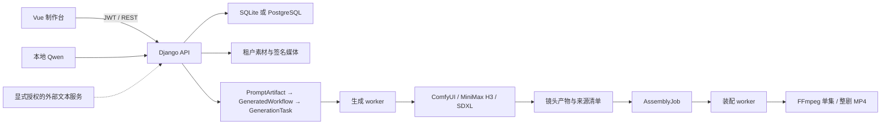

# 系统架构

## 1. 架构目标

AutoPrompt Studio 使用 Vue 负责制作交互，Django REST API 负责业务边界与持久化，数据库承担任务队列和恢复状态，独立 worker 调用 ComfyUI 与 FFmpeg。架构优先保证租户隔离、人工审核、输入可追溯、单 GPU 串行执行、提交幂等和中断恢复。



## 2. 运行组件

| 组件 | 职责 | 持久状态 |
| --- | --- | --- |
| Vue/Vite 前端 | 项目、Bible、分镜、候选审核、提示词预览、任务监控、产物与装配操作 | 浏览器仅保存交互状态，业务事实以 API 为准 |
| Django REST API | JWT、租户过滤、校验、候选门禁、提示词编译、工作流物化、任务入队、签名媒体和 OpenAPI | Django 模型与文件存储 |
| SQLite/PostgreSQL | 业务对象、不可变生产输入、任务状态、心跳、互斥租约、幂等键、来源选择 | 开发可用 SQLite，生产要求 PostgreSQL |
| 生成 worker | 串行领取 GenerationTask、暂存素材、实时契约预检、提交/轮询/取消/恢复 ComfyUI 任务、封存产物来源 | GenerationTask、ComfyUI prompt ID、暂存映射与输出清单 |
| ComfyUI | 执行 MiniMax H3 视频图和 SDXL 图片图，提供节点/模型枚举、队列、进度、执行记录和输出 | 独立进程及其 input/output 目录 |
| 装配 worker | 领取 AssemblyJob、维护心跳、执行 FFmpeg、原子发布成片、封存成片来源 | AssemblyJob、ffconcat、MP4 与来源清单 |
| 本地 Qwen 子进程 | 新建项目前故事基础、翻译、剧集创意、逐镜扩写、视觉规则和素材 Bible 候选 | 各业务入口定义的候选记录或浏览器待审数据；进程按需启动并退出 |
| Nginx 与外部 TLS 代理 | 前端静态文件、API 转发、内部素材路由、生产 HTTPS 边界 | 无业务状态 |

API 不承载长时间 GPU 或 FFmpeg 进程。浏览器只负责发起操作和读取状态，页面生命周期不影响持久任务。

## 3. 领域模型

### 3.1 租户与共享资源

- `User` 是租户标识。用户业务对象直接保存 `owner`，或通过 `project.owner` 解析归属。
- `Style`、`Asset`、`WorkflowTemplate` 的 `owner=null` 表示全局资源；普通用户只能读取全局资源。
- 普通用户可维护自己的 Style 与 Asset，但只有 staff 可写 WorkflowTemplate；普通用户的可执行范围进一步收敛为已启用的全局系统模板。
- 用户上传路径由服务端生成为 `assets/{owner}/{year}/{month}/{uuid}.{ext}`，不采用客户端文件名作为目录结构。

### 3.2 连续剧聚合

```text
SeriesProject
├─ Episode (project + number 唯一)
│  └─ Shot (episode + number 唯一)
├─ CharacterBible (project + slug、speaker ID 唯一)
├─ SceneBible (project + slug 唯一)
├─ PropBible (project + slug 唯一)
└─ ConsistencyLock (scope + target + key 唯一，带 version)
```

- Project 保存生产规格、风格、连续性种子、术语表、视觉规则、用户收藏标记和可空 `cover_asset`。封面是当前租户受控上传的 `reference` Asset；API 返回短期签名 `cover_url`，数据库不持久化签名 URL。列表管理中的“重做”通过创建只含故事基础与生产规格的新 Project 实现，不克隆封面、生产聚合、不可变审计记录或媒体，也不提交生成任务。
- Project 列表通过单次集合请求读取项目字段与服务端聚合计数，不逐项目加载 Bible、剧集、分镜或工作流子资源；用户进入项目详情或在生产操作中选定项目后，前端再按需加载这些完整子资源，避免列表规模扩大时产生逐项目请求。
- Project 删除由服务端在同一事务内锁定并检查从属 GenerationTask / AssemblyJob；活动任务或未终结远端提交会阻止删除，ReleaseBundle 的保护关系继续阻止删除发行证据仍在引用的项目。删除级联作用于数据库记录；物理产物按存储保留和清理策略另行处置。
- 封面上传先创建带 `metadata.usage=project_cover` 与 `project_id` 的专用 Asset。服务端验证原文件后按 EXIF 方向归一化并重新编码为同类静态格式，剥离 EXIF/GPS，同时在 metadata 记录 manifest schema、来源、处理后字节数与处理版本；Asset 本身保存 owner、object key、MIME、checksum、状态和时间。随后 API 在项目行锁事务内绑定。专用标记不可改写；服务端拒绝把专用封面绑定到 Bible、Shot 或生成参考输入，前端通用素材查询也过滤该类记录。替换、移除、直接删除封面或删除项目时，服务端在数据库提交后清理无引用的专用文件；普通 reference、Bible/Shot 引用及发行证据不会被该自动清理误删。
- Episode 保存剧本单元和跨集连续性边界。
- Shot 保存生产最小单元。`media_type` 决定视频或图片链路，`h3_mode` 与 `reference_bindings` 决定视频输入语义。
- Bible 的 anchor/reference assets 是身份锚点；锁定的 Bible 只能通过显式解锁后修改。
- `sync_consistency_locks` 从 Project、Style 和 Bible 生成版本化快照，并维护稳定的 Picture/Subject 槽位。提示词保存该快照，生产不会在执行时重新猜测身份。

### 3.3 候选模型

- 新建项目前的故事基础候选不落数据库：页面只收集正整数集数、每集镜数和可配置单集时长，并先展示所选模型的资源粗估；全剧作为一次业务/API 请求交给用户选择的模型，不按固定 token 数截断，也不按集或镜头自动分批。本地首轮 JSON 解码或完整结构校验失败时，隔离运行时最多额外执行一次携带完整请求的整份结构修复，始终重新生成全剧；两次推理 usage 聚合，修复或确定性空白恢复以审核 warning 显式呈现。模型结构版本 2 返回无数量上限的 `bible.characters/scenes/props` 与剧集镜头 IR；Django 统一校验逐镜时长、单集总预算和跨类型 NFKC 名称唯一性，并以 `deterministic-script-breakdown-v3` 确定性渲染闭合 `SCRIPT_BIBLE_V1` 前置块及拆解正文。浏览器独立编辑并显式复制到新建表单；既有 `POST /projects/` 仍是唯一正式创建入口。
- 母稿 Bible 建议不新增候选表：`GET /projects/{id}/script-bible-candidates/` 每次从完整 `master_script` 严格解析闭合前置块，返回整份来源指纹、逐行诊断、证据和现有/冲突投影，绝不写库。`POST .../apply/` 只接受带来源指纹的人工审核选择及可编辑最终字段，在锁定 Project 与三类 Bible 的单一事务中执行全成全败的追加创建；未选旧 Bible 不删除。整份来源指纹只负责陈旧请求防护与审计；确认身份使用候选 ID 加仅由实体类型和原声明规范字段计算的声明指纹，不依赖剧集正文。正式 Bible 的保留 metadata 保存这组身份、审核快照及其严格复算的内容哈希，使正文变化、人工改名和确认后的合法字段编辑不会撤销确认，同时让声明变化、伪造 provenance 或不同审核内容重放显式冲突。保留成员只有 apply 可以写，通用 CRUD、全量同步与管理后台不能注入、替换或删除。
- `PromptFieldTranslation` 以 scope、字段、源文哈希、上下文哈希、候选译文、状态和修订组织逐字段翻译。
- `EpisodeCreativeDraft` 保存整集分镜候选、上下文快照、校验结果、确认者和应用者。
- `ShotDetailDraft` 保存单镜高细节候选、相邻连续性边界、相关 Bible 快照、确认者和应用者。
- `ShotDetailDraftBatch` 保存整集 provider、幂等 request ID、源清单指纹、resolved policy、生成/应用状态和计数；`ShotDetailDraftBatchItem` 保存每镜冻结输入、claim/heartbeat、尝试、失败、候选关联和应用运行 ID。
- 全剧视觉规则候选由请求返回；应用接口使用上下文指纹和生成指纹复核后写入允许字段。
- 素材 Bible 候选由素材的文字元数据生成；返回的 provenance 包含素材 checksum、元数据哈希和更新时间，正式保存时再次复核。
- Bible 实体图片候选不新增候选表。`GET /projects/{id}/bible-image-candidates/` 从三类 Bible 与现有 `PromptArtifact → GeneratedWorkflow → GenerationTask` 链实时投影；POST 在 Project、实体与最新全局 system `minimax-reference-image` 模板锁内，一次事务物化三件套。请求只选择实体和排队参数，模板、模型、工作流与 text-only SDXL 契约由服务端冻结；source fingerprint 来自同一次编译实际采用的字段、确认译文证据、相关 canonical 碰撞输入和编译参数。通用 workflow/task 入口拒绝候选用途，worker 签名来源清单与 Prompt/Task 冻结目标在提升时三方校验。质量策略只给 advisory，不替代结构、租户、模板、幂等或队列门禁。候选 output 经人工确认后仍通过任务提升入口创建 Asset，并只追加到实体 reference assets。`source_current=false` 的历史候选不再被视为无效；默认返回需确认的 stale 冲突，用户显式接受后可入库，Asset metadata 保留冻结来源指纹、当前来源指纹和 stale 接受标记用于追溯。
- 实体图片候选的参考图提示词默认配置保存在 `SeriesProject.production_settings.bible_image_prompt_config`，创建项目时按所选风格生成默认值，页面可编辑项目风格、三类构图规则、负向规则和质量后缀。GET 投影返回当前与历史候选的 prompt 输入字段；POST 只接受这些字段的本次覆盖值并写入来源指纹，不允许前端直接提交最终 prompt 文本或改变模板/模型。
- 首尾帧连续依赖使用独立 `DeferredGenerationRequest`，不把 `GenerationTask`、`PromptArtifact` 或临时 Shot 绑定当作等待状态。创建请求时只冻结 source task、target shot、slot、目标模板 hash、目标输入 fingerprint 与临时提示词预览；正式 `PromptArtifact → GeneratedWorkflow → GenerationTask` 只有在 source task 成功、声明 `primary_video` manifest 通过、帧提取和目标 stale 复核完成后才能由 worker 物化。`frame_slot=first_frame` 的来源始终是上游视频尾帧；I2VA/FL2VA 使用严格首帧槽位，Ref2VA 在 `requires_first_frame_continuity=true` 时使用软 `first_frame_reference_asset_id`，并在 H3 多参考图中固定为 `<Picture 1>`。公开 API 覆盖建档、查询、详情、取消、删除保护和 worker 物化；前端不能传 output index、模板、模型、workflow 或参考素材绕过。

候选生成与正式写入分离。确认和应用使用数据库事务、行锁、`expected_revision` 或上下文指纹，避免过期页面覆盖已更新内容。确定性拆解先由共享 parser 分离 Bible 块与正文；完整原文继续保存在 Project，非法块失败，未确认块默认以 409 要求人工处理，只有显式的一次性 `continue_without_script_bible=true` 才可跳过候选后继续拆解。已确认 provenance 还会形成“原声明名 → 当前 Bible 行”的类型化可信别名，并显式传给唯一拆解服务，使人工改名不破坏对白、人物、场景、道具的正式 ID 绑定；冲突或未确认项不参与该映射。

## 4. H3 模式与模板路由

### 4.1 有效输入模式

`Shot.H3Mode` 定义 T2VA、I2VA、L2VA、FL2VA 和 Ref2VA。

- T2VA：`reference_bindings` 必须为空。
- I2VA：必须且只能有 `first_frame_asset_id`。
- L2VA：必须且只能有 `last_frame_asset_id`。
- FL2VA：允许首帧、尾帧或两者；执行时按实际槽位计算有效模式，无图为 T2VA，单首帧为 I2VA，单尾帧为 L2VA，双帧为 FL2VA；双帧不能引用同一素材。
- Ref2VA：不使用严格 `first_frame_asset_id / last_frame_asset_id`；分类图片、参考视频、独立音频和视频配对音频分别限量，素材 ID 必须唯一并属于用户可访问范围。若该镜头启用了首帧承接，延迟连续任务可临时注入 `first_frame_reference_asset_id` 作为软开场状态参考，固定占用 `<Picture 1>` 和 9 张 Picture 容量中的 1 张，普通人物/场景/道具参考从后续 Picture 槽位开始。

`resolve_group_reference_bindings` 把语义绑定转换为有序记录。图片使用连续 `<Picture N>`，视频和音频使用连续索引；工作流只为实际记录创建 `LoadImage`、`LoadVideo → GetVideoComponents` 或 `LoadAudio` 节点。

### 4.2 五份视频模板

| slug | `workflow_mode` | 源工作流 | 成熟度 |
| --- | --- | --- | --- |
| `minimax-h3-base-video` | `text_to_video` | `video_minimax_h3_i2v.json` 的安全审核 API 等价图 | 默认 |
| `minimax-h3-first-last-video` | `first_last_to_video` | `video_minimax_h3_i2v.json` 的安全审核 API 等价图 | 默认 |
| `minimax-h3-reference-video` | `reference_to_video` | `video_minimax_h3_r2v.json` 的安全审核 API 等价图 | 默认 |
| `minimax-h3-r2v-t8-dual-clock-4step` | `reference_to_video` | `video_minimax_h3_r2v_t8_dual_clock_4step.json` 的安全审核 API 等价图 | 实验；需在目标环境完成 GPU 端到端、稳定性、容量与画质验收 |
| `minimax-h3-r2v-turbo-lora` | `reference_to_video` | `video_minimax_h3_r2v_turbo_lora.json` 的安全审核 API 等价图 | 实验；需在目标环境完成 GPU 端到端、稳定性、容量与画质验收 |

模板声明允许模式、模型、节点、参数范围、参考策略和输出类型。路由优先使用请求中显式选择且兼容的模板，再选择相应模式的默认模板；不兼容、未启用或不可执行时立即失败，不做隐式降级。

图片镜头使用独立的 `minimax-reference-image` 系统模板和固定 SDXL Base 1.0 checkpoint。该图是文本与 Bible 锚点条件的文生图，不连接 Bible 图片像素。

## 5. 生产对象链

### 5.1 PromptArtifact

PromptArtifact 是提示词编译结果，保存：

- Project、Episode、可选 Shot 与创建者；
- 视频/图片类型、H3 请求模式、有效条件模式、是否多镜头与音频开关；
- 实际 `prompt_text`、负面提示词、结构化负载和连续性快照；
- 分镜 ID、时长覆盖、参考绑定覆盖、编译器/输入指纹版本、输入指纹；
- 递增修订号和 `SHA-256(prompt_text)` 内容哈希。

API 只读。生产构建可复用完全匹配的记录；任一输入、连续性、参考绑定、编译器版本或内容哈希不匹配时创建新修订。提示词优化器配置不会在后台改写记录。

### 5.2 GeneratedWorkflow

GeneratedWorkflow 将一个 PromptArtifact 注入一个版本化 WorkflowTemplate，保存确定的 API-format `workflow_json`、`injected_values` 和内容哈希。该记录同样通过只读 API 暴露。

工作流生成阶段用于预览和规划，可导出 API JSON 或转换为 ComfyUI UI 画布。同步到 ComfyUI 工作流库是显式操作，只保存画布，不入队执行。

### 5.3 GenerationTask

GenerationTask 引用 GeneratedWorkflow，并冻结执行参数：

- backend、model profile、模板版本、seed；
- 视频有效帧数和时长；
- 分辨率档位、尺寸倍数、宽高、实际 H3 条件模式和用户模板参数；
- 参考素材 ID/checksum/输入槽摘要；
- 批次、幂等、重试和实时契约预检快照；
- 状态、心跳、尝试次数、提交 token、ComfyUI prompt ID、进度和错误。

任务输入在创建后不变。状态与运行遥测可更新。重试创建新的 GenerationTask，并用 `retry_of` 指向来源任务。

### 5.4 Output、Assembly 与 Release

- Output 不是独立数据库表，而是 GenerationTask 的 `outputs` 列表。每项保存 ComfyUI 文件名、子目录、媒体类别、来源清单、SHA-256，以及可选的素材提升或受管发行状态。
- `persist_task_provenance` 在任务成功前封存任务、模板、Prompt 哈希、输入媒体哈希和输出哈希；封存失败时任务不能标记成功。
- 图片 Output 可复制到用户 Asset，重复请求返回同一提升结果，不修改 ComfyUI 母版。
- `generation_purpose=bible_image_candidate` 的图片提升只信任任务能力快照中的冻结实体目标，并要求 worker 已在生成时封存 provenance；客户端不能改绑。提升证据保存来源/请求指纹、Prompt/Workflow/模板 hash、artifact/manifest hash 与确认人/时间，anchor 不变；复制文件后的事务失败会清理未提交文件。
- `AssemblyJob` 选择成功视频任务，保存镜头顺序、输出路径、ffconcat、FFmpeg 参数、源签名、状态和领取令牌。
- `ReleaseBundle` 通过持久 ID 显式选择镜头产物与装配母版；封存后不可修改选择。

## 6. 生成时序与契约预检

1. API 在项目行锁内同步 ConsistencyLock，编译或复用 PromptArtifact。
2. API 依据媒体类型、H3 模式和显式选择解析 WorkflowTemplate，物化 GeneratedWorkflow。
3. 语言门禁、队列确认和生产批次幂等检查通过后，API 创建 GenerationTask。
4. 生成 worker 优先取得本地 Qwen 共享资源锁并领取一条 ComfyUI 任务；没有媒体任务时释放外层锁并串行领取一条整集高细节 item，单镜服务在需要本地 Qwen 时自行取得同一共享锁，DeepSeek item 走远程 provider。
5. worker 对每个参考素材重新核对 owner、授权快照、允许根目录和 checksum；视频统一暂存为 CFR 24，配对音频按有效视频时长归一化。
6. worker 将每次成功上传的 token → ComfyUI 路径立即写入 `staged_inputs`，重启后可按内容哈希验证并复用。
7. worker 对完整执行图调用实时 `/object_info` 与模型枚举，校验节点类、必需/自增长输入、输出槽和类型、连线、数值范围、widget/模型枚举及环路。
8. 预检通过后生成规范 UUID，先持久化为 submission token，再用同一 ID POST `/prompt`。
9. worker 使用 WebSocket 读取可用的节点进度，同时以 HTTP queue/history 作为终态依据。
10. 成功后提取输出、封存来源清单并更新任务终态；取消、明确失败、遥测不可用和连接不确定分别保存可区分状态。

实时模板可见性检查和执行图预检都不提交 GPU 任务，也不构成 GPU 端到端验收。T8 Dual-Clock 与 Turbo LoRA 均保持实验状态，是否可用以对应目标环境的实时 GPU 验收为准。

## 7. 并发、幂等与恢复

### 7.1 领取与容量

- `WorkerLease` 为生成容量、生成领取、装配入队和装配领取提供数据库互斥。
- 生成任务按优先级和入队时间领取，`TASK_MAX_CONCURRENT` 控制实际 worker 并发；全局待处理量和单用户活动任务量使用可配置推荐阈值，超过时要求用户明确确认后仍完整入队，不构成整集或整剧业务上限。
- 本地 Qwen 与生成 worker 共享文件锁。Qwen 占用资源时生成任务保持 queued；生成任务持锁时本地 Qwen 请求返回资源忙。
- 整集高细节批次以 `shot_version_key` 冻结一个明确的分镜版本；批次创建、历史查询、相邻镜头上下文、worker 陈旧校验和原子应用都只读取该版本，绝不回退到同剧集其他版本。分镜编辑器保存同样必须显式携带版本键，只同步该版本并保留其他版本；`creative_version_*` 是服务端维护的版本元数据，普通镜头更新不得改写。批次 item 对正式 Shot 使用 `RESTRICT`，已有高细节审计历史的镜头不能被普通同步硬删除。无法由历史 items 唯一证明归属的旧批次保留为只读审计事实，不会重新执行或应用。item 使用独立 claim token、heartbeat 和可配置重试；`shared_resource_busy` 只恢复为 pending，不消耗失败次数。批次生成允许逐镜部分失败并保留所有候选/失败记录；整集应用不允许部分写入，必须统一预检后在一个事务内写全或零写。

### 7.2 整集、选区与整剧幂等

生产入口把项目、最终剧集范围、连续性快照、顺序分镜、参考绑定、分辨率、模板选择和参数规范化后计算请求指纹。`idempotency_key + request_fingerprint` 唯一标识整集、单集选区或整剧批次：

- 相同键与相同指纹返回同一完整子任务集合；
- 相同键与不同指纹返回冲突；
- 批次不完整时拒绝复用并要求新的键；
- 整集批次固定为一镜一子任务；正式整剧页面同样逐镜提交，便于独立重试和审计。

### 7.3 ComfyUI 提交恢复

- submission token 在 POST 前持久化，避免 API 返回丢失导致无法识别远端任务。
- 已有 token 的任务先查询 ComfyUI history 与 queue；存在时接续同一 prompt，不再次 POST。
- POST 响应不确定、远端健康不可确认或 token 无法核实时，任务进入失败/降级状态并保留 token。队列的 unresolved-token 断路器阻止继续领取，避免同一 GPU 上存在不可见任务时叠加工作。
- 失联领取在没有 token 时可安全重新排队；有 token 且远端存在时恢复；健康的 ComfyUI 明确报告 token 不在队列和历史中时保留原失败记录并终结该 token，不自动重投，允许操作者通过显式重试创建新任务。
- 重试前必须证明远端明确失败、明确取消或在健康 ComfyUI 中不存在；远端仍在执行或已有成功结果时拒绝克隆任务。

### 7.4 FFmpeg 装配恢复

- 装配源签名包含 owner、Project、Episode、顺序 Shot、任务 ID、相对输出路径、裁切窗口、输入 SHA-256 和编码/标识参数。
- 相同源签名复用 queued、running 或文件与来源清单均有效的 succeeded 作业。
- assembly worker 用领取 UUID 写入 `.part-{token}`，FFmpeg 成功且文件非空后以 `os.replace` 原子发布。
- worker 定期更新心跳。失联作业若最终文件及来源清单有效则标记成功；否则在尝试上限内重新排队，达到上限后失败。领取令牌对应的临时文件会被清理。

## 8. 安全架构

### 8.1 身份与对象授权

- DRF 默认使用 JWT 和 `IsAuthenticated`。
- queryset 先按 owner 或 `project.owner` 收敛，object permission 再允许 owner 或 staff。
- 全局对象只在安全方法中向普通用户开放；系统模板写入只允许 staff，模板执行只允许 staff 或已启用的全局系统模板。
- 注册、上传和通用请求分别受限流策略控制。

### 8.2 文件与路径

- 图片通过 Pillow 验证实际格式、MIME、尺寸和像素数；视频/音频通过 ffprobe 验证流、MIME、扩展名和 2–15 秒时长。
- 非 staff 不能设置 `local_path`。staff 路径也必须位于 `ASSET_LIBRARY_ROOT` 或 `MEDIA_ROOT`。
- 任务参考输入只接受全局素材或任务 owner 的上传；绝对路径在读取前解析，并限制到素材库或 `media/assets/{owner}`。
- ComfyUI Output 使用服务端保存的 filename/subfolder 在配置输出根下解析；Assembly 使用 `media/assemblies/{owner}/{project}`；所有读取均复核 `is_relative_to`。
- 装配输出名只允许无目录的安全 `.mp4` 文件名；FFmpeg 使用参数数组启动，不经过 shell 拼接。

### 8.3 签名媒体与来源完整性

浏览器 ``、`<video>` 不携带 Bearer header，因此 API 生成短期签名 token。token 包含 purpose、object ID、owner ID 和按用途需要的 output index；媒体端点匿名可达，但必须同时通过：

1. Django 签名与有效期校验；
2. purpose 与对象类型校验；
3. owner、对象终态和 output index 校验；
4. 允许根目录与文件存在性校验；
5. 来源清单签名、产物 SHA-256 和相关源文件 SHA-256 校验。

任一校验失败统一返回不可用。响应使用 `private, no-store`、`nosniff` 和按用途限定的下载策略；生产中的 ComfyUI 母版只预览，公开下载使用受管发行副本。

### 8.4 ComfyUI 执行边界

- `COMFYUI_BASE_URL` 必须是 HTTP(S)。默认仅允许 localhost 或 IP loopback，远端地址要求显式 `COMFYUI_ALLOW_NON_LOOPBACK=true` 并由网络策略保护。
- 非 staff 不能把任意保存图变成执行路径。系统模板使用服务端节点白名单；扩展节点只通过管理员审核后的 `COMFYUI_EXTRA_ALLOWED_NODE_TYPES` 加入。
- 模板构建先验证无危险节点、无未知变量、图结构和模式契约，执行前再用目标 ComfyUI 的实时能力验证。

## 9. 外部网络与信任边界

| 边界 | 默认 | 显式启用后的数据流 |
| --- | --- | --- |
| ComfyUI | loopback | 可连接受控远端 HTTP(S) ComfyUI；工作流、暂存输入和任务元数据发送到该节点 |
| 本地 Qwen | 本地一次性子进程 | 无候选内容外发；模型安装需要单独下载模型与运行时 |
| DeepSeek API | 关闭且不选择 | 按次选择后，经 HTTPS 发送完成翻译/创意/扩写所需的项目、剧本、Bible、连续性或提示词上下文 |
| H3 Prompt Optimizer | 关闭 | 配置 HTTPS、API key 与非 loopback 授权后发送导演描述；对白、歌词和屏显文字以不可读占位符传输 |
| MiniMax Partner API 节点 | 不作为平台回退 | 平台不在本地失败时自动调用；采用外部付费链路需要独立、明确的产品授权与实现 |
| Web 公网入口 | 应用只监听受控地址 | 生产由可信 TLS 反向代理覆盖 Host、X-Forwarded-For 和 X-Forwarded-Proto 后转发到回环 Nginx |

外部服务密钥只从后端环境或 secret 注入，不返回浏览器、不写入 PromptArtifact、任务能力快照或来源清单。外部通道失败必须保留实际 provider 和错误，不能切换到未选择的通道。

## 10. 部署与可观测性

- 本地开发由 Django、生成 worker、装配 worker、Vue 和独立 ComfyUI 组成，入口绑定 `127.0.0.1`。
- Docker 生产由 PostgreSQL、Django/Gunicorn、生成 worker、装配 worker、readiness 和非 root Nginx/Vue 组成；ComfyUI 作为受控宿主机或私有网络进程。
- 容器使用只读根文件系统、非 root 用户、`no-new-privileges` 和删除 Linux capabilities；Nginx 只发布回环端口。
- `/api/v1/health/live/` 表示 API 进程存活；`/api/v1/health/ready/` 汇总数据库、迁移、存储、ComfyUI、生成 worker 和装配 worker。
- worker 持久化 heartbeat、claim token、远端状态、进度来源和错误。运行日志进入 `.runtime/logs/`，生产监控应采集队列深度、任务耗时、重试、失联 token、GPU/RAM、磁盘、装配失败和签名媒体拒绝。

## 11. 架构不变量

以下条件是实现和验收必须保持的不变量：

1. 正式 Project/Episode/Shot/Bible 只能由用户编辑或经人工审核后的显式应用写入；模型候选不能直接进入生产事实。
2. 任何 GenerationTask 都能追溯到一个 PromptArtifact、一个 GeneratedWorkflow、一个模板版本和一组确定的输入快照。
3. PromptArtifact 与 GeneratedWorkflow 不在后台改写；输入不匹配时建立新记录。
4. 普通用户不能执行任意 ComfyUI 图，也不能读取跨租户素材、任务或产物。
5. 参考素材语义必须来自显式绑定；未选输入不接线，服务端路径不从提示词或客户端路径猜测。
6. GPU 提交前必须通过语言门禁、模板兼容性、路径授权、素材哈希与实时 ComfyUI 契约校验。
7. 一个 submission token 最多对应一次 `/prompt` 提交；不确定状态必须停止自动重投。
8. 重试创建新任务，不能覆盖来源任务；成功产物在来源清单封存前不能标记成功。
9. 装配只能使用覆盖目标镜头的成功视频任务，并通过临时文件与原子替换发布最终 MP4。
10. 媒体访问必须同时满足短期签名、owner、允许目录与内容完整性校验。
11. 远端 ComfyUI、DeepSeek 和提示词优化器均需要显式授权；系统不执行未选择的外部回退。
12. `minimax-h3-r2v-t8-dual-clock-4step` 与 `minimax-h3-r2v-turbo-lora` 保持实验标识，且不得以节点/模型可见性代替 GPU 端到端生成验收。
