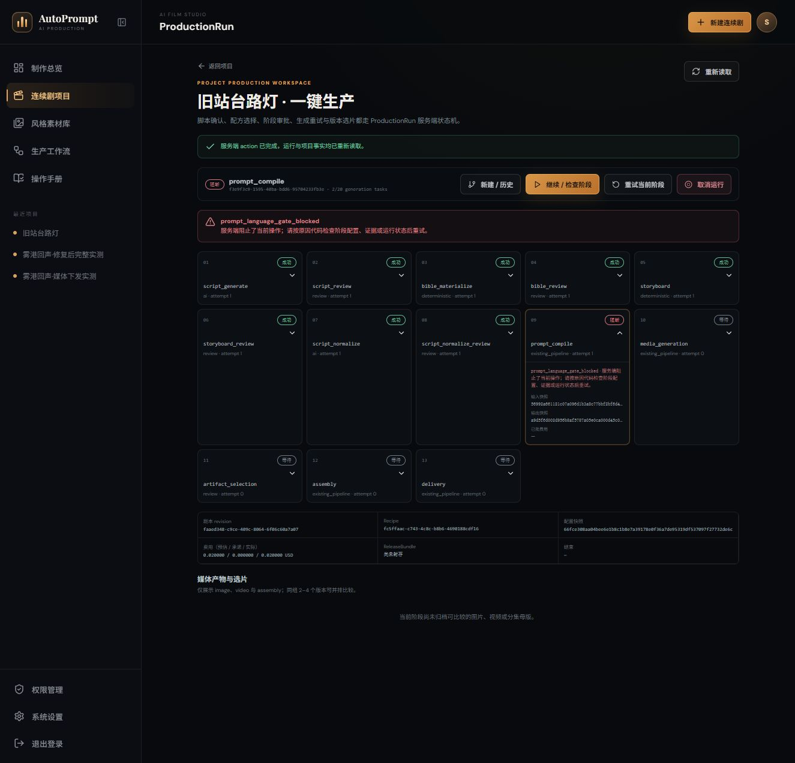
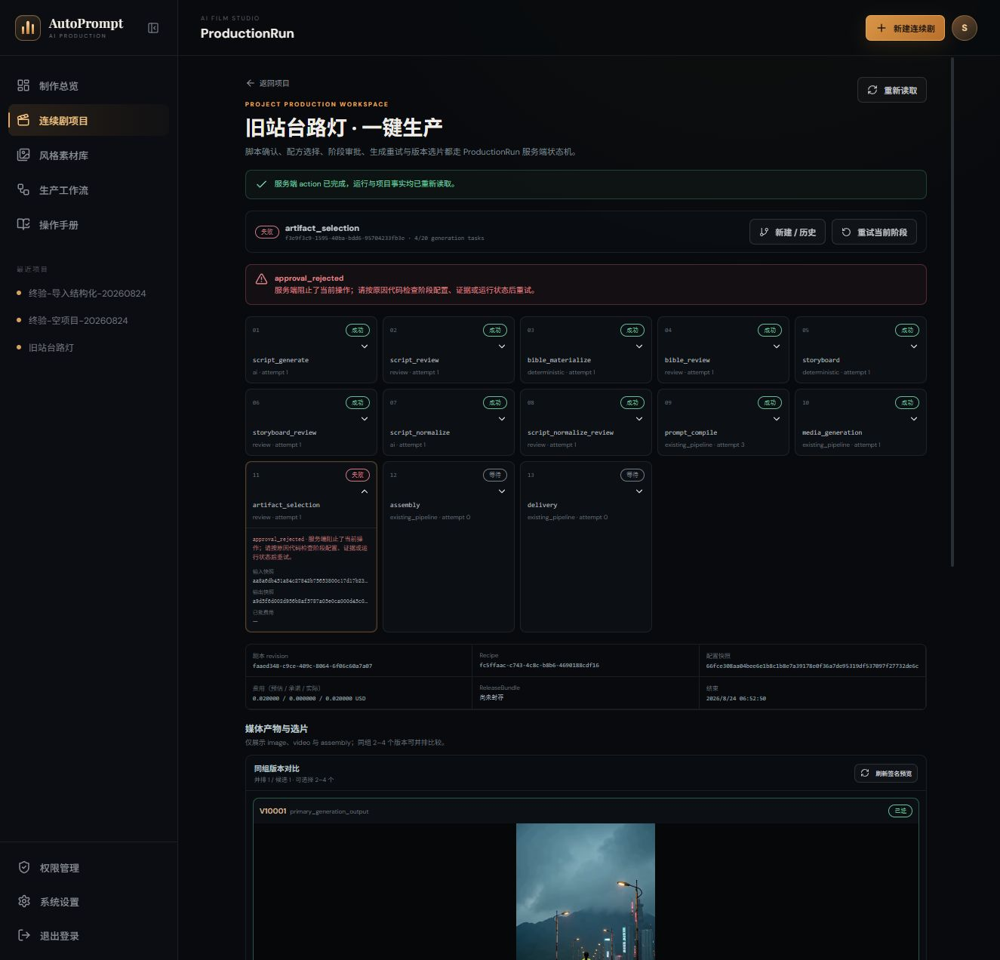
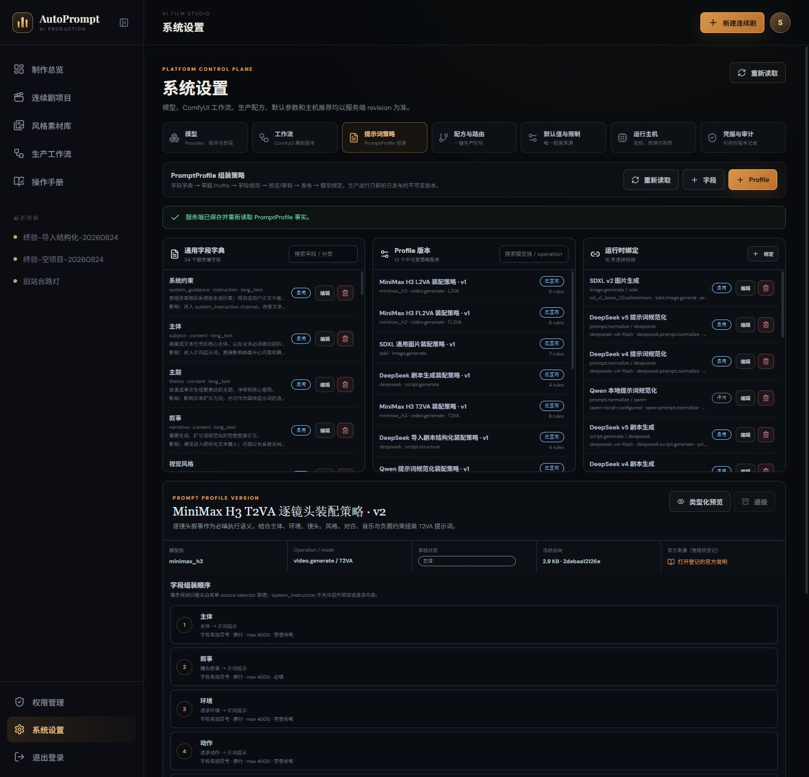
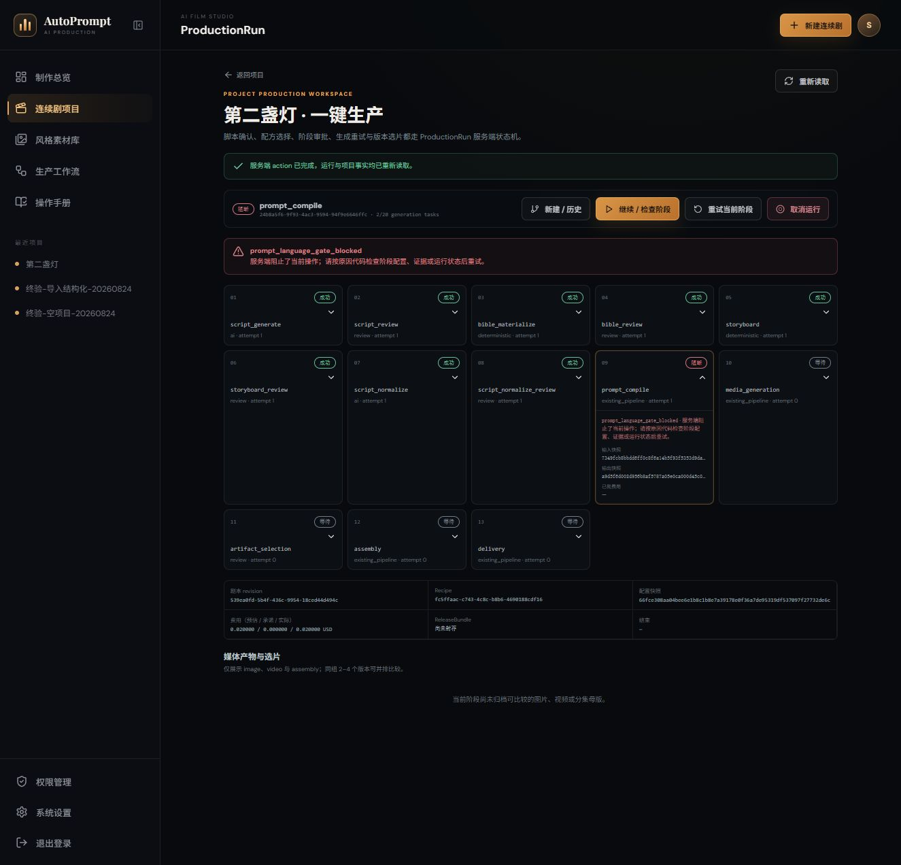
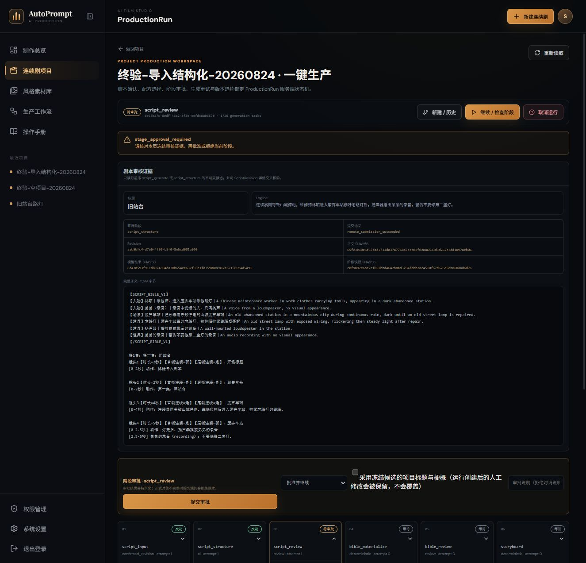
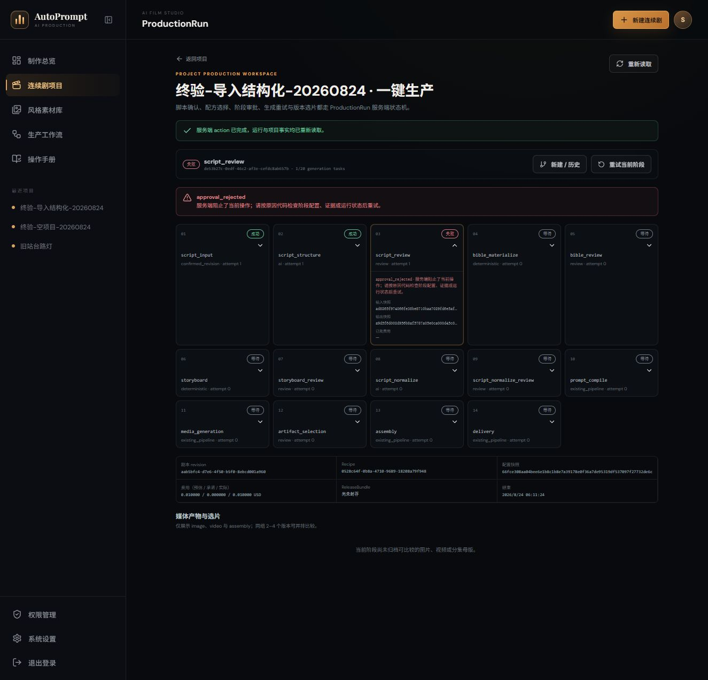
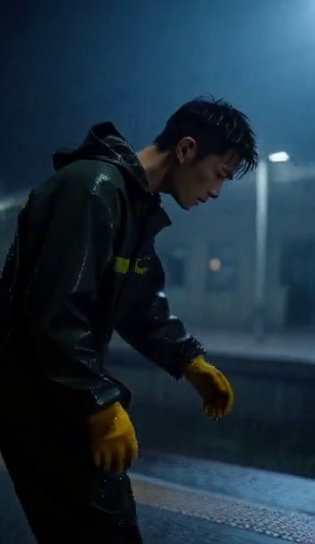
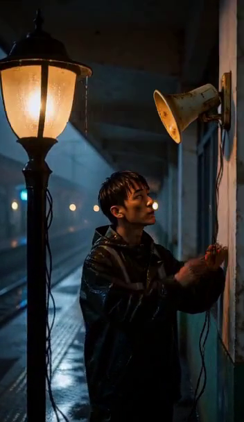
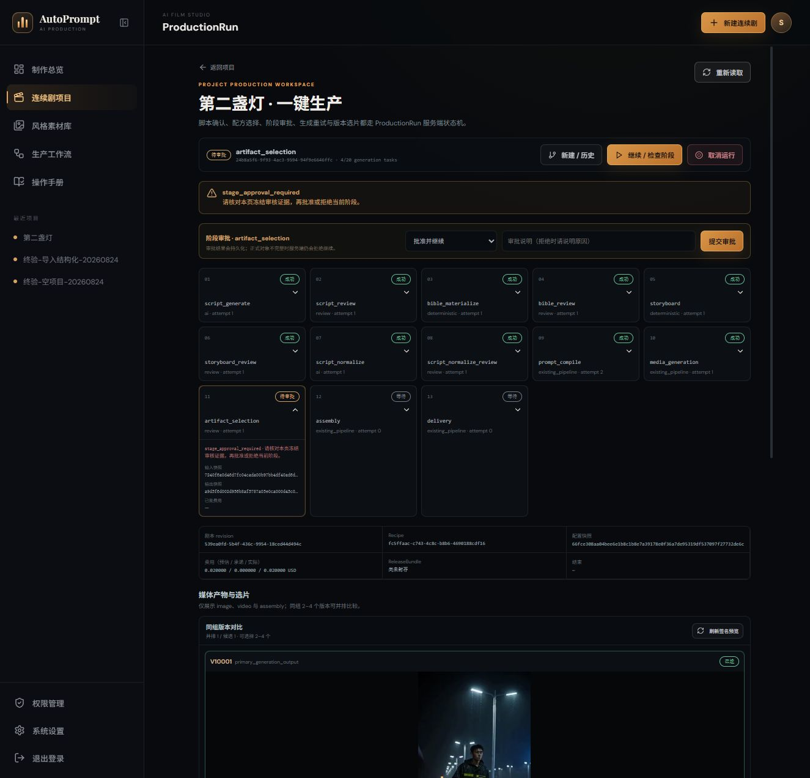
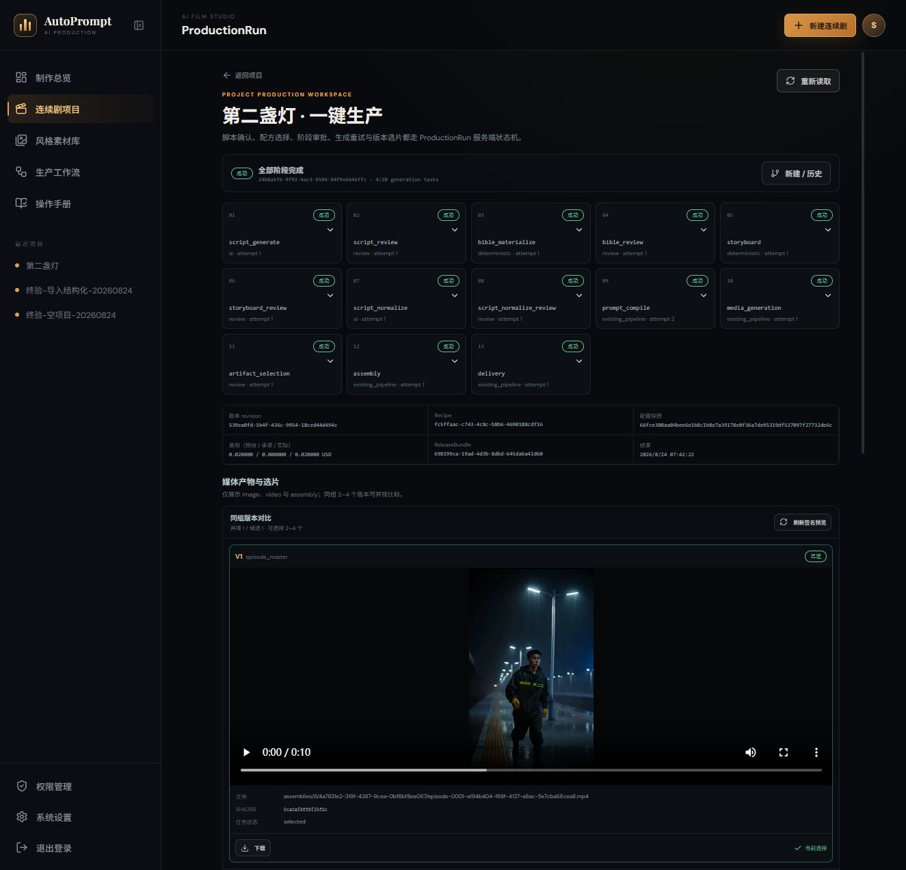

# 端到端生产修复与回归台账（2026-08-23 发现，2026-08-24 复测）

本文保留首次实操和二次终验发现的问题，并记录修复、自动验证与真实 UI/执行器回归。它是优化与验收台账，不替代当前主路径教程。状态分为“已修复·Live 通过”“已修复·自动验证”和“持续质量观察”；只有实际走到对应阶段的条目才标记 Live 通过。

## 1. 验证口径

| 状态 | 含义 |
| --- | --- |
| 已修复·Live 通过 | 修复已落地，并在真实页面或真实执行器上复测到预期终态 |
| 已修复·自动验证 | 修复已落地，测试、类型检查或构建通过，但本轮未再次覆盖对应真实终态 |
| 持续质量观察 | 技术链路可用，但媒体审美或业务质量不能由状态机自动判定 |

完整检查中，后端完整套件 763 项、前端 Node 123 项、`vue-tsc`、Vite build、OpenAPI 契约检查和正式重启健康检查均通过。完整 763 项是在最后两批媒体身份与观测合同补丁前执行；补丁落地后另有 84 项编排组合回归，以及 53 项核心和 60 项相关媒体回归通过。最终 live 运行 `24b8a5f6…` 的 13 个阶段全部 succeeded，但 live 结果不能替代未重跑的完整套件。

## 2. P0 阻断问题修复状态

| ID | 原问题 | 已落地修复 | 当前状态 | 验证证据或边界 |
| --- | --- | --- | --- | --- |
| E2E-P0-01 | 缺少受审 `prompt.normalize` 路由，AI 剧本不能稳定进入媒体生产 | 为精确模型配置 `script.generate`、`script.structure`、`prompt.normalize` PromptProfile binding；三类文本任务统一走可审计装配与持久 attempt | 已修复·Live 通过 | 三项真实 smoke 通过；成功主运行完成 normalize 和人工审核 |
| E2E-P0-02 | Assembly worker 将 Episode 标为 completed 后，被错误判成 `storyboard_snapshot_drift` | storyboard 冻结投影排除下游生命周期状态，创作事实仍保持防篡改比较 | 已修复·Live 通过 | 成功主运行完成 AssemblyJob `a194b404…`，未再触发 drift |
| E2E-P0-03 | 工作流编辑页不能完整维护合同，管理员曾需调用正式 API 补齐 | 工作流合同改为参数化编辑，依赖和发布门禁在页面显式呈现；保留受审导入而非日常 API 绕行 | 已修复·自动验证 | 前端测试、类型检查和构建通过；旧 API 绕行已从当前教程删除 |
| E2E-P0-04 | ComfyUI 节点元数据分页不完整，页面与服务端校验事实冲突 | 静态编辑提示与 live readiness 分层，发布事实统一以完整服务端校验结果为准 | 已修复·自动验证 | 相关测试通过；本轮未专门构造超过 200 节点的 live 工作流 |
| E2E-P0-05 | 外部调用提交状态不确定时可能被重复点击、重复计费 | 文本 smoke 和生产调用使用持久异步 attempt；提交中和不确定状态建立重放屏障，并提供管理员消歧 | 已修复·Live 通过 | 三项真实 smoke 各提交一次；导入运行只有一次 `script.structure` |
| E2E-P0-06 | 工作流 smoke 曾使用固定 300 秒总超时，长 H3 可能被提前误判 | 拆分连接、进度和总执行 deadline，并由受控配置与工作流能力解析 | 已修复·Live 通过 | 旧运行有约 406.99 秒 H3 任务成功，成功主运行两条 H3 也到达终态 |
| E2E-P0-07 | 新建项目后才可使用 AI；导入和 confirmed revision 缺少唯一 UI 主路径 | 新建页提供空项目、导入剧本、AI 描述创建；导入使用不可变 preview 和 confirmed revision；已创建项目可从正式 ProductionRun 入口恢复 | 已修复·Live 通过 | 三种入口均实测；stale smoke 400 后从已创建项目恢复且未重复建项目 |
| E2E-P0-08 | 混合图片/视频装配曾静默忽略图片镜头 | assembly 合同按 storyboard 顺序处理图片持有时长和视频片段，缺任一已批准镜头时 fail closed | 已修复·自动验证 | 自动测试通过；本轮 live 是双视频，混合媒体仍无 live 证据 |
| E2E-P0-09 | 不同 Shot 可能被旧 Profile 装配成相同 conditioning，并共用 seed/output 路径 | 物化前检测 `duplicate_shot_conditioning`；按 run/prompt/shot/variant 生成独立 seed 与 output prefix，并冻结进工作流、任务和 attempt | 已修复·Live 通过 | 成功主运行两条 prompt hash、seed、prefix 均不同，实际视频和音频解码流 hash 也不同 |
| E2E-P0-10 | 未通过语言门禁的 PromptArtifact 可能先被物化，给重试和选片留下不合格历史状态 | 先在内存装配并执行语言门禁，再原子物化；安全重试会拒绝历史不合格选择 | 已修复·Live 通过 | 成功主运行先安全阻断 subject，再仅重试当前阶段进入媒体生成 |

## 3. 二次终验发现与处置

### 3.1 本地化标签泄漏与原子门禁

旧主运行在 normalize 审批后进入 `prompt_compile`，真实暴露 `prompt_language_gate_blocked`。门禁准确显示错误且未下发媒体；根因是装配时把本地化展示标签带入执行提示词。修复后只使用不可变字段 key 渲染，并把装配、门禁、物化顺序收敛为一个原子主路径。

### 3.2 旧 Profile 造成重复媒体

旧 H3 T2VA Profile 未包含逐镜 `shot.narrative`，两个不同 Shot 形成相同可执行 conditioning，并使用相同 seed。两个 MP4 容器 hash 不同，但解码视频流 SHA 同为 `3223c615…`，音频流 SHA 同为 `2ebe2465…`；Shot 1 用时约 406.99 秒，Shot 2 约 2.446 秒，这组事实与 ComfyUI 上游缓存复用一致。管理员在 artifact selection 拒绝整批，运行 `f3e9f3c9…` 以 `approval_rejected` 终止，没有装配或发布。

当前 Profile `minimax_h3.video.t2va` v2 把 `shot.narrative` 设为必填，并启用 priority 200 exact-model binding；旧 priority 100 binding 已停用，但历史 Profile 和运行保持不可改写。

### 3.3 Subject overlay 安全失败

成功主线首次 prompt compile 发现 `request.subject` 仍含缺少有效 translation overlay 的中文主体来源。语言门禁正确 fail closed，未提交媒体。主体改为只读取已确认且 source hash 匹配的 canonical name、visual identity 和 wardrobe overlay；缺失或陈旧 overlay 继续保持可见并阻断，不能静默替换成内部 ID、默认值或伪英文。

### 3.4 请求计划与实际媒体事实混用

`GenerationTask.effective_frames/effective_duration_ms` 现在只表示冻结的请求计划；实际输出进入 `GeneratedArtifact.manifest_metadata.observed_media`。视频由 FFprobe 观测宽高、fps、frames、duration_ms 和 has_audio，在 provenance 封存前持久化，归档时重新探测并核对，API 与 manifest 返回同一事实。历史产物不静默回填。

## 4. P1 审核、安全与可靠性问题修复状态

| ID | 原问题 | 修复结果 | 状态 |
| --- | --- | --- | --- |
| E2E-P1-01 | 服务器原因只显示“未分类错误” | 页面按稳定错误码展示 `approval_rejected`、`prompt_language_gate_blocked`、`duplicate_shot_conditioning` 等可行动原因 | 已修复·Live 通过 |
| E2E-P1-02 | Ref2VA 缺引用只在真实 smoke 暴露 | mode、输出和引用输入进入工作流语义合同及创建前 route 校验 | 已修复·自动验证 |
| E2E-P1-03 | 文本 profile schema 与执行器合同不一致 | 发布和绑定时校验精确 capability/schema；不兼容 exact binding 由迁移停用 | 已修复·Live 通过 |
| E2E-P1-04 | 旧模型文件缺 hash 仍可能被误当作可用 | readiness 区分声明、探测、验证、过期，并要求当前主机快照和 hash | 已修复·Live 通过 |
| E2E-P1-05 | catalog 存在会被误写成生产 ready | static catalog 与 live readiness 分离，缺口按依赖项显示 | 已修复·Live 通过 |
| E2E-P1-06 | 分镜审核未充分展示冻结证据 | Script、Bible、Storyboard、Normalize 审核页显示来源、revision 和快照 hash | 已修复·Live 通过 |
| E2E-P1-07 | JWT HMAC key 强度不足 | 启动和 readiness 强制安全基线并支持受控轮换，不在页面或审计中回显密钥 | 已修复·自动验证 |
| E2E-P1-08 | 默认/旧配方乱码或 legacy 文案易被误选 | 旧 AI v1 与旧 confirmed v1 已退役，当前只发布 v2 AI 和 v1 structured import 配方 | 已修复·Live 通过 |
| E2E-P1-09 | 登录标识与审计主体口径不清 | 权限、操作主体和审计投影统一并补测试 | 已修复·自动验证 |
| E2E-P1-10 | Subject 名称、视觉身份和服装来源可能绕过语言门禁或泄漏内部 ID | 只消费已确认且 source hash 匹配的 canonical overlay；缺失/陈旧来源保持 fail closed | 已修复·Live 通过 |
| E2E-P1-11 | 实际媒体规格曾借用请求字段，无法证明返回文件事实 | 新增 `observed_media`，封存前探测、归档复核、API/manifest 同源 | 已修复·Live 通过 |

## 5. P2 体验与媒体质量问题修复状态

| ID | 原问题 | 修复结果 | 状态 |
| --- | --- | --- | --- |
| E2E-P2-01 | 配置需编辑 JSON，范围只在提交后报错 | 常用配置拆成带说明、影响、必填、默认值、单位、范围和依赖的字段 | 已修复·自动验证 |
| E2E-P2-02 | 长运行恢复入口难找 | 项目与 ProductionRun 页面保留进行中/需审核运行入口和历史列表 | 已修复·Live 通过 |
| E2E-P2-03 | 阶段成功后页面事实可能不刷新 | action 完成后重新读取运行与项目事实 | 已修复·Live 通过 |
| E2E-P2-04 | 图片镜头不计叙事时长 | 项目总览和 storyboard 使用图片持有时长与视频时长的统一叙事口径 | 已修复·自动验证 |
| E2E-P2-05 | SDXL 旧实测产物分块、畸变 | 保留人工选片与质量门禁；技术成功不自动等同于可交付 | 持续质量观察 |
| E2E-P2-06 | “启用/发布/smoke/任务/产物”状态容易混淆 | catalog、readiness、execution、artifact、approval 分层展示 | 已修复·Live 通过 |
| E2E-P2-07 | 新建项目后 ProductionRun 创建失败容易诱发重复建项目 | 保留已创建项目，刷新阻断的 smoke 后从项目正式入口恢复 | 已修复·Live 通过 |
| E2E-P2-08 | 容器 hash 不同容易被误判为内容不同 | 选片前同时检查媒体 manifest、解码流 hash 和实际画面 | 已修复·Live 通过 |

## 6. 新需求实现与回归

| 需求 | 当前实现 | 回归状态 |
| --- | --- | --- |
| 新建页支持 AI | AI 描述直接创建持久 ProductionRun，候选逐级审核 | 已修复·Live 通过，13 阶段成功 |
| 导入剧本自动建项目 | TXT/Markdown/Fountain/DOCX 服务端提取、不可变 preview、确认后运行 | 已修复·Live 通过 |
| 非规范剧本自动格式化 | `script.structure` 使用专用 PromptProfile、smoke、预算和人工 `script_review` | 已修复·Live 通过；受控拒绝证明不会越过审核 |
| 可配置自动完成后续步骤 | 配方自动推进非人工阶段，required review 明确暂停 | 已修复·Live 通过至 ReleaseBundle 封存 |
| 通用 PromptProfile | 34 个可扩展字段，支持 family/exact model/task/mode、多策略、binding 和运行冻结 | 文本三类操作及 H3 T2VA v2 已修复·Live 通过 |
| 参数化 Settings | 普通字段表单、说明、影响、必填、默认值和依赖下拉 | 已修复·自动验证；PromptProfile v2 配置页 live 通过 |
| 通过 ComfyUI 打开工作流 | 下载受审的 ComfyUI API JSON，由管理员在 ComfyUI 导入 | 已修复·自动验证 |
| 整集或逐镜头工作流 | 新建时冻结 uniform route；已有 Shot 支持 uniform/per-shot 和应用到本集 | uniform 双视频 live 通过；per-shot 自动验证通过 |

## 7. 三条真实运行的验收事实

### 7.1 导入候选受控拒绝

运行 `de53b27c…` 用于验证结构化候选的审核边界：原始导入 revision 经只读 preview 后确认，非规范正文触发一次 `script.structure`，新候选保持 preview；管理员拒绝后运行以 `approval_rejected` 终止。费用为预估 0.01 USD、承诺 0 USD、实际 0.01 USD；后续媒体、装配和 ReleaseBundle 均未产生。

### 7.2 旧重复媒体负向运行

运行 `f3e9f3c9…` 保留两个技术成功但内容重复的媒体产物。人工选片拒绝后，没有 AssemblyJob 或 ReleaseBundle。该历史事实证明状态机成功不能替代媒体质量审核，也不能只凭容器 hash 判断内容差异。

### 7.3 成功主运行

Project `4a7831e2-319f-4387-9cea-0bf8bf8ea067`、ProductionRun `24b8a5f6-f9f3-4ac3-9594-94f9c6646ffc` 的 13 个阶段全部 succeeded，文本实际费用 0.02 USD。两条 H3 视频计划均为 120 帧/5000ms，实际均为 352×608、24fps、124 帧、5167ms 且包含音频；两条视频和音频解码流 hash 均不同。

AssemblyJob `a194b404…` 生成 artifact `0dd04103…`，SHA-256 前缀 `0ca0af86…`，大小 4,945,527 bytes；FFprobe 为 768×1344、24fps、240 帧、10 秒并含 AAC。ReleaseBundle `698199ca…` 已 sealed，manifest SHA-256 前缀 `7ca0e295…`，`signature_verified=true`、`live_verified=true`，`delivery_scope=episode_masters`。

[查看最终 10 秒整集母版](images/67-final-episode.mp4)；文件 SHA-256 为 `0ca0af8658f3b52cc311275c2bd65be710e093b06d0908e883e723111f9ba087`，大小 4,945,527 bytes，H.264 768×1344、24fps、240 帧、10 秒，并包含 10 秒 AAC 音频。

## 8. 历史口径与剩余边界

以下内容不再是当前操作方式：

- 通过 API 补齐页面无法保存的工作流合同；
- 把 workflow smoke 写成固定 300 秒总超时；
- 把 Episode `draft → completed` 当作 storyboard 漂移；
- 要求用户在创作描述中手工强制所有导演字段英文；
- 仅凭任务 succeeded 或 MP4 容器 hash 不同批准媒体。

旧 smoke、旧失败运行、审计、模型版本和媒体文件继续保留为历史事实，不删除、不改写为成功。

本轮统一验收已经覆盖 AI 描述创建的双视频主路径、人工选片、assembly、delivery 与 ReleaseBundle。以下内容仍不得过度宣称：

1. E2E-P0-08 的一图一视频混合装配只有自动测试，没有 live 证据；
2. 超过 200 个 ComfyUI 节点的分页场景未在本轮专门 live 构造；
3. per-shot route 选择有自动验证，本轮成功 live 使用的是整集统一 route；
4. 历史 GeneratedArtifact 不会自动补写 `observed_media`；
5. 媒体审美仍需持续人工观察，ReleaseBundle 技术校验不代表所有创作质量偏好都已自动化。
