# 连续剧 0→1 生产实操教程

本文面向超级管理员，记录 2026-08-24 修复后的真实页面操作。空项目、导入剧本和 AI 描述创建三种入口均已实测；其中 AI 描述创建已完成从新建项目、人工审核、逐镜头视频生成、选片、整集装配到 ReleaseBundle 封存与实时校验的 13 阶段主路径。

业务生产的唯一入口仍是项目工作台中的 `ProductionRun`。管理员可在“系统设置”发布模型、PromptProfile、工作流和配方；普通生产过程不使用数据库命令、临时脚本或页面之外的旁路。

## 1. 当前验收结论

| 范围 | 当前事实 | 验证层级 |
| --- | --- | --- |
| 参数化系统设置 | 常用配置已拆成字段，包含含义、影响、必填、默认值和依赖选择 | 自动测试、类型检查、构建通过 |
| PromptProfile | 支持模型族、精确模型、任务和模式的多策略绑定；文本三类操作及 H3 T2VA v2 均实际参与生产 | 真实 smoke、配置页与 ProductionRun 通过 |
| 工作流管理 | 可下载 ComfyUI API 格式工作流并在 ComfyUI 导入；页面不再要求管理员拼接缺失合同 | 自动测试与配置页实测通过 |
| 工作流分配 | 新建时可冻结整集统一 route；已有正式 Shot 的运行可选择整集统一或逐镜头 route | 自动测试通过，整集统一双视频 live 通过 |
| 空项目 | 只创建项目，0 集、0 镜、0 秒，不创建 ProductionRun | 真实 UI 通过 |
| 导入剧本 | 服务端提取正文并生成不可变 preview，确认后才创建 ProductionRun | 真实 UI 通过 |
| `script.structure` | 非规范正文只提交一次云端结构化，生成独立 preview revision 后进入 `script_review` | 真实 UI 通过，实际费用 0.01 USD |
| 受控拒绝 | `script_review` 拒绝后运行以 `approval_rejected` 终止，后续 11 个阶段均未执行 | 真实 UI 通过 |
| AI 描述生产 | 成功运行 `24b8a5f6…` 的 13 个阶段全部成功，文本实际费用 0.02 USD | 真实 UI、云端 API、本地 H3、FFmpeg 通过 |
| AI 媒体、装配与交付 | 两条不同视频通过人工选片，装配为 10 秒整集，ReleaseBundle 已封存且实时校验通过 | 真实执行器与 UI 通过 |

完整检查中，后端完整套件 763 项、前端 Node 123 项、`vue-tsc`、Vite build、OpenAPI 契约检查和正式重启健康检查均通过。完整 763 项是在最后两批媒体身份与观测合同补丁前执行；补丁落地后另有 84 项编排组合回归，以及 53 项核心和 60 项相关媒体回归通过，不能把这些专项结果表述为重新执行了完整套件。

## 2. 上线前配置

### 2.1 推荐上线顺序

首次配置或更换模型时，按以下唯一顺序完成：

```text
Provider → 模型版本/文件 → 主机探测与文件核验 → Deployment
         → PromptProfile 与 binding → Workflow live validate / smoke / 发布
         → ProductionRecipe 发布 → ProductionRun
```

“已登记”“已发布”“smoke 通过”“任务成功”和“人工批准”是不同状态。只有所选配方的精确模型、部署、工作流、PromptProfile、凭据和 smoke 证据都满足时，readiness 才允许创建运行。

### 2.2 云端文本模型与 PromptProfile

本轮使用以下已发布配置：

| 对象 | 当前版本或标识 | 用途 |
| --- | --- | --- |
| 文本 ModelProfile | `29b388a3-1ad8-4d3d-a834-d7dc6455c5e0` | DeepSeek 文本模型 v5 |
| 文本 Deployment | `a49b0101-03f9-4d60-ab22-7d5c0d44b2db` | 受管云端文本调用 |
| 文本 PromptProfile binding | exact-model、priority 200 | `script.generate`、`script.structure`、`prompt.normalize` |
| H3 PromptProfile | `minimax_h3.video.t2va` v2，合同 hash 前缀 `2debaa12126e` | 逐镜头 T2VA 提示词装配 |
| H3 exact-model binding | `minimax-h3-t2va-profile-v2`、priority 200 | MiniMax H3 v2 `video.generate / T2VA` |

PromptProfile 是提示词的权威装配策略。它可按模型族、精确模型、任务和 H3 模式绑定多个已发布策略，并在运行创建时冻结实际选中的版本。通用字段覆盖主题、主体、身份与连续性、动作、环境、构图、镜头、灯光、色彩、风格、语言、文本、负面约束、对白、语调、音效和背景音乐等；模型没有对应输入时按策略省略，不能把不支持的字段静默发送给模型。

H3 T2VA v2 使用主体、逐镜叙事、环境、动作、镜头、视觉风格、对白、背景音乐和负面约束九条装配规则，其中 `shot.narrative` 是必填执行语义。新 exact-model binding 启用后，旧 priority 100 binding 已停用；旧 v1 Profile 仍作为不可改写的历史发布事实保留。


文本部署分别执行专用真实 smoke：

- `script.generate`：生成符合剧本合同的候选；
- `script.structure`：把非规范导入正文转换为可审核的正式结构；
- `prompt.normalize`：补全并规范化导演执行字段。

真实 smoke 和生产文本调用均使用持久化异步 attempt。页面收到 `202` 后只轮询同一任务；等待期间不要重复提交。若状态为 `uncertain_remote_response`，先由管理员核对 Provider 事实并追加消歧证据，不能普通重试。

### 2.3 参数化系统设置

“系统设置”中的常用 JSON 已拆为字段表单：

- 每个字段显示用途、影响、单位、范围和默认值；
- 会阻断任务的字段标记为必填；
- Provider、模型版本、Deployment、Workflow、PromptProfile 和 ProductionRecipe 等依赖使用下拉选项；
- 前置对象不存在时明确提示先完成依赖配置；
- 保存失败、依赖缺失、数据陈旧和权限不足均保持失败，不回退旧缓存或伪装成功；
- 仍需高级结构时，由受审 schema 校验，不让普通用户直接猜测内部 JSON。

### 2.4 工作流与 ComfyUI

已保存工作流提供“在 ComfyUI 打开”操作。浏览器安全边界内的准确语义是：平台下载已校验的 ComfyUI API 格式 JSON，管理员再在目标 ComfyUI 中导入。该操作不会伪装成已把工作流远程写入另一进程，也不会绕过发布、live validate、smoke 或模型文件检查。

发布工作流前依次核对：

1. Provider、模型版本和 live deployment；
2. ComfyUI API graph、语义输入、输出、模型要求和参数边界；
3. 服务端 live validate；
4. 真实 smoke 及媒体探测结果；
5. 合同 hash、当前版本和发布状态。

早期实操中“页面合同字段不完整，需用 API 补齐”的做法已经退役，不再作为当前教程步骤。

### 2.5 配方与整集/逐镜头工作流

当前发布的正式配方为：

| recipe_key | 版本 | 剧本入口 | 阶段 |
| --- | --- | --- | --- |
| `e2e-ai-dynamic-media-v2` | 2 | AI 描述生成 | 13 个阶段 |
| `e2e-import-structured-media` | 1 | confirmed revision + `script.structure` | 14 个阶段 |

新建页尚未物化正式 Shot，因此媒体配方必须选择“整集统一工作流”。页面按“视频输出 + 项目默认模式”过滤 route，并显示输出种类、H3 模式、工作流和部署。不要只看历史 route 名称；本轮选择的是合同明确显示“输出 video · 模式 T2VA”的 route 1。

项目已有正式 Shot 后，ProductionRun 创建页提供：

- `整集统一`：一个兼容 route 应用于所选全部镜头；
- `逐镜头`：每个 Shot 单独选择兼容 route，也可先“应用到本集”再逐项调整。

服务端会再次校验输出类型、H3 模式、引用输入、工作流 current/published、smoke 和 deployment 绑定，并把选择冻结在运行快照中。本轮 live 是两条视频使用同一 T2VA route；一图一视频混合装配仅有自动测试，不能据此写成 live 通过。

## 3. 新建连续剧的三种入口

进入“连续剧项目 → 新建连续剧”，页面提供三个正式入口：

| 入口 | 适用情况 | 关键边界 |
| --- | --- | --- |
| 空项目 / 手工设定 | 先建立项目和视觉规则 | 不保存旁路母稿，不调用模型，不创建 ProductionRun |
| 导入剧本 | 已有 TXT、Markdown、Fountain 或 DOCX 剧本 | 服务端提取 → 不可变 preview → 人工确认 → 可选 `script.structure` |
| AI 描述创建 | 只有创作需求，希望 AI 生成剧本 | 必须创建持久 ProductionRun，候选先进入人工审核 |

PDF 会被明确拒绝。导入和 AI 创建都进入同一条 ProductionRun 审计链；自动继续只推进非人工阶段，遇到 Script、Bible、Storyboard、Normalize 或选片 gate 会暂停等待审批。

## 4. 实测 A：创建空项目

1. 选择“空项目 / 手工设定”。
2. 项目名称填写“终验-空项目-20260824”。
3. 梗概填写“空项目入口回归：不导入剧本，不启动生产任务。”
4. 选择视觉风格，并确认 9:16、标准分辨率档和默认 T2VA。
5. 点击“创建并进入工作室”一次。

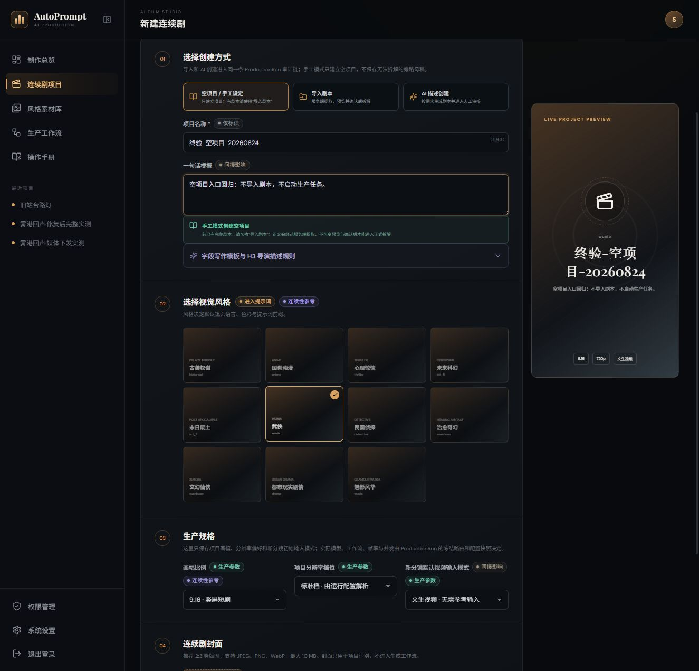

创建后项目工作室显示 0 集、0 镜、叙事总时长 0 秒、Bible 0 项，完整剧本为空；本次操作没有创建 ProductionRun、文本 attempt 或媒体任务，也没有外部费用。

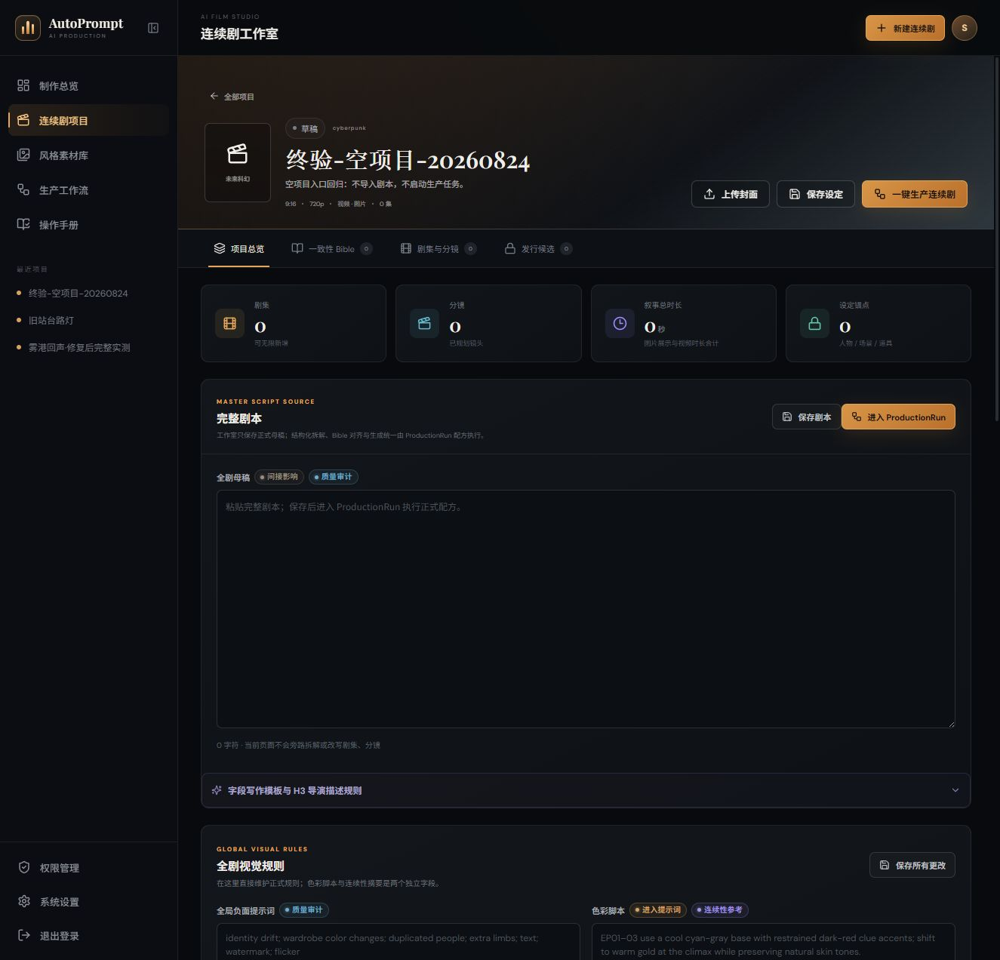

## 5. 实测 B：导入非规范剧本并受控拒绝

### 5.1 导入参数

本轮粘贴以下纯文本：

```text
终验导入剧本
第一集：旧站台
连续暴雨导致山城停电。维修师林昭进入废弃车站，拧紧老路灯的线路。
灯亮后，扬声器播放弟弟的录音：“不要修第二盏灯。”
```

页面选择：

- 创建后动作：确认剧本并启动正式 ProductionRun；
- 配方：`e2e-import-structured-media` v1；
- 允许云端文本 API：允许；
- 结构化预算上限：0.10 USD；
- 生成任务上限：20；
- 默认视频模式：T2VA；
- 整集统一工作流：route 1，合同显示输出 video、模式 T2VA。

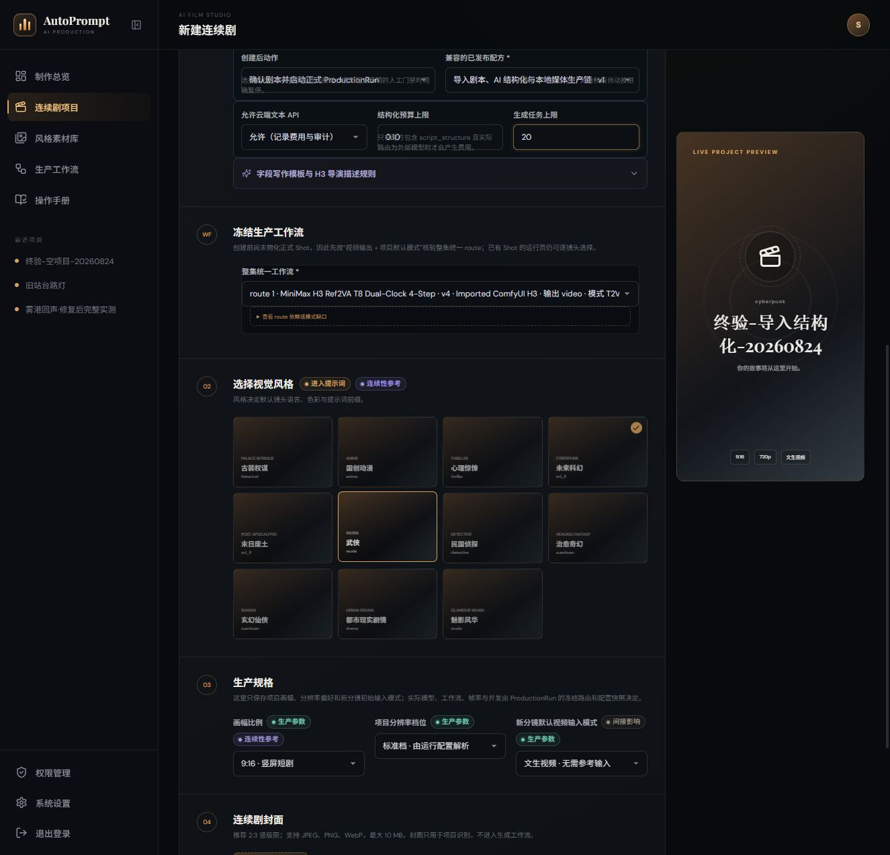

### 5.2 核对不可变 preview

点击“创建并预览剧本”后，项目先被创建，平台随后展示“服务端提取正文（只读）”、正文 bytes 和 SHA-256 摘要。只有点击“确认剧本并启动 ProductionRun”，原始 revision 才会被确认并用于创建运行；关闭弹窗不会删除已创建项目，也不能通过再次点击新建制造重复项目。

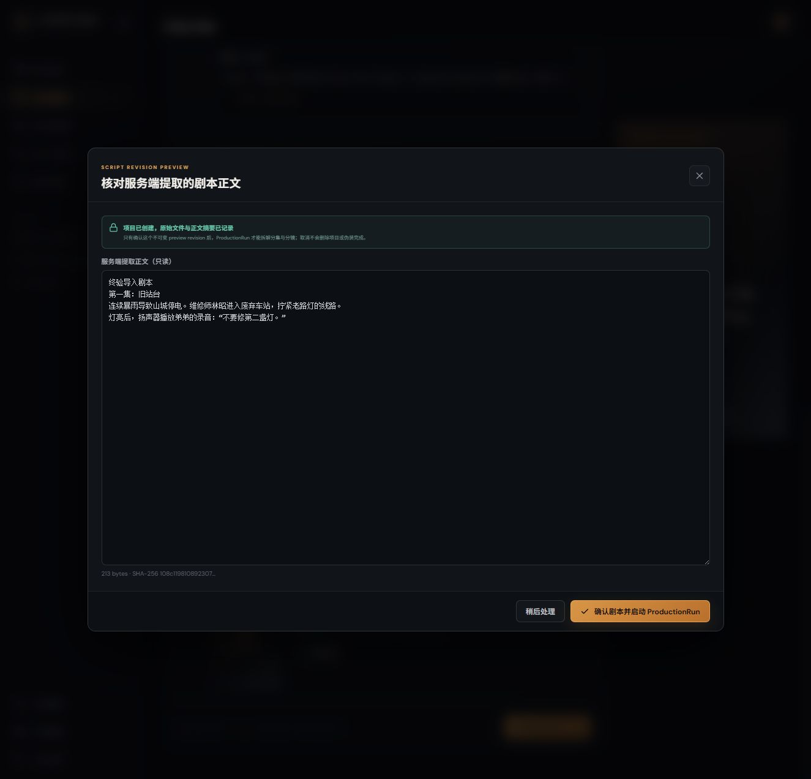

### 5.3 `script.structure` 与剧本审核

原文不符合平台 canonical 剧本格式，因此运行按以下顺序自动推进：

```text
script_input → script_structure → script_review
```

`script.structure` 只提交一次云端 attempt，生成独立的 AI preview revision；原始导入 revision 保持 confirmed，新候选在批准前保持 preview。剧本审核页展示来源阶段、提交语义、revision、正文 SHA-256、模型结果 SHA-256、阶段快照 SHA-256 和完整正文。本次页面明确显示来源为 `script_structure`、提交语义为 `remote_submission_succeeded`。


### 5.4 有意拒绝并验证终止语义

为验证审核边界，本轮在 `script_review` 选择“拒绝并终止”并填写明确的终验拒绝说明。运行 `de53b27c…` 随即以 `approval_rejected` 失败终止：

- `script_input`、`script_structure` 成功；
- `script_review` 失败并持久化审批说明；
- 结构化 script artifact 被标记 rejected，候选 revision 保持 preview；
- Bible、Storyboard、Normalize、Prompt、Media、Artifact selection、Assembly 和 Delivery 均未执行；
- ReleaseBundle 未封存；
- 预估 0.01 USD、承诺 0 USD、实际 0.01 USD；
- 没有图片或视频任务被下发。


该失败是预期验收结果，不是系统故障。它证明 AI 候选不会在未获人工批准时写成正式母稿或继续消耗媒体资源。

## 6. 实测 C：AI 描述创建并下发整集生产

### 6.1 创建参数与 stale smoke 恢复

成功主线使用：

- Project：`4a7831e2-319f-4387-9cea-0bf8bf8ea067`；
- ProductionRun：`24b8a5f6-f9f3-4ac3-9594-94f9c6646ffc`；
- AI 采纳标题：《第二盏灯》；
- 配方：`e2e-ai-dynamic-media-v2` v2；
- 规格：1 集、2 镜、总计划时长 10 秒；
- 预算：1 USD，生成任务上限 20；
- 工作流：整集统一 T2VA route。

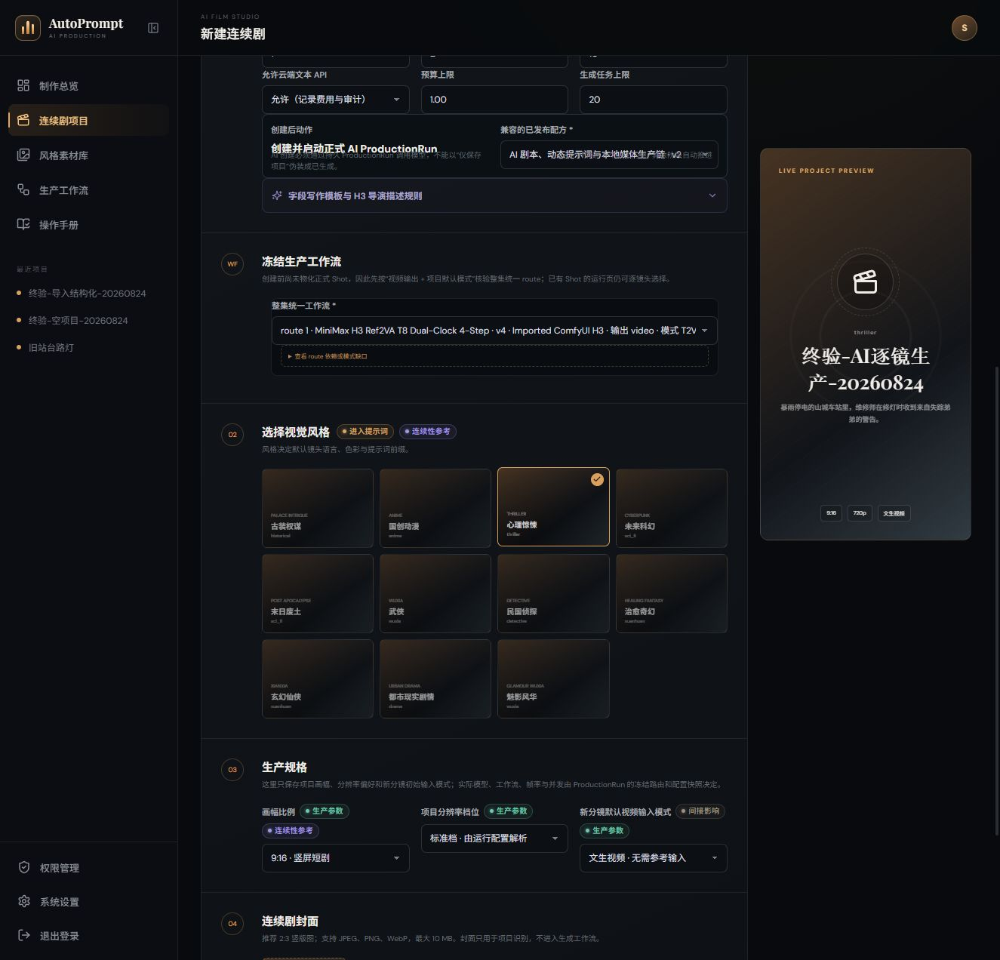

首次提交时项目已经创建，但创建 ProductionRun 因所选能力的 smoke 证据过期返回 HTTP 400。平台没有把 stale smoke 当成功，也没有删除已创建项目。管理员刷新对应的专用 smoke 后，从该项目恢复正式运行，没有重复创建项目或绕过 readiness。

### 6.2 Script、Bible、Storyboard 与 Normalize 审核

`script.generate` 生成一集两镜候选，人工审核后采纳《第二盏灯》。Bible、Storyboard 和 `script.normalize` 随后自动生成候选并分别停在 required review；审核页面展示来源、revision、字段来源、英文候选和冻结 hash。

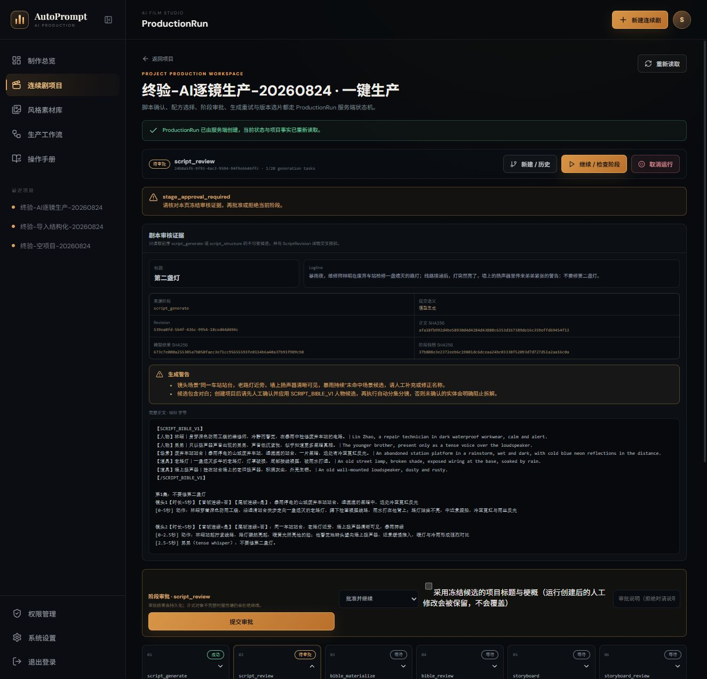

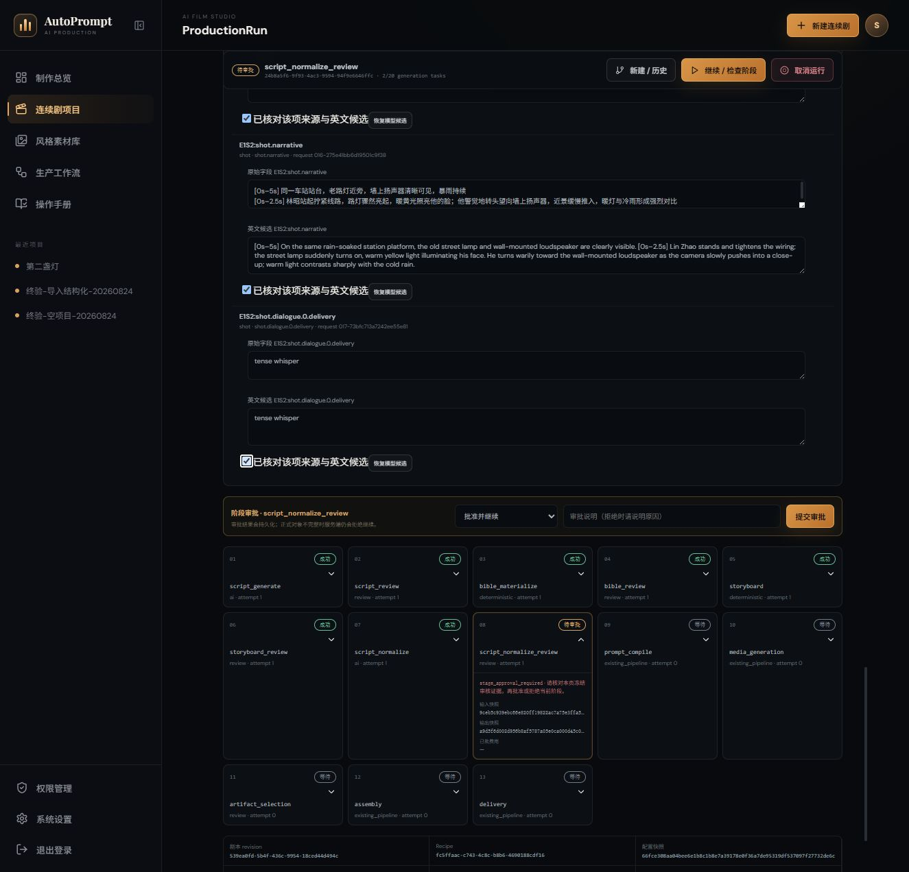

较早的旧主运行曾在 Normalize 后暴露 PromptProfile 本地化标签泄漏，语言门禁正确阻止媒体提交：

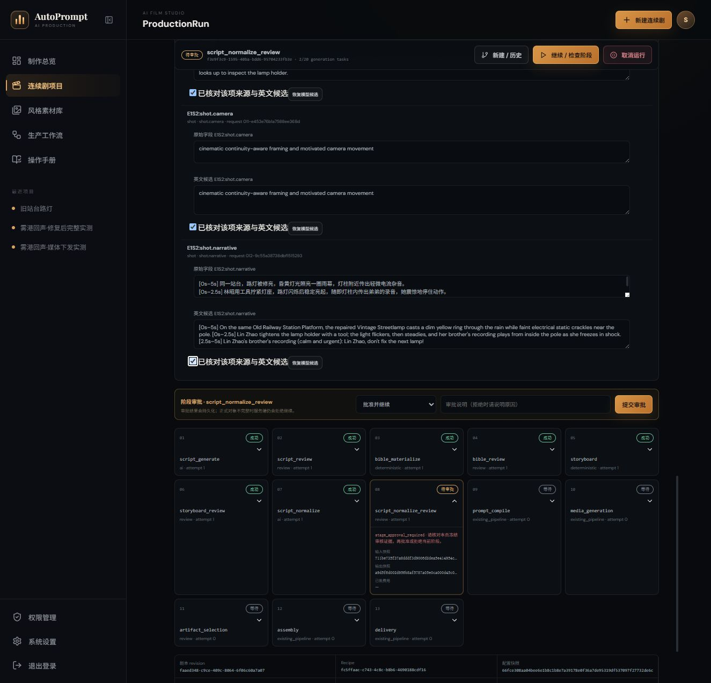


修复后，prompt compile 先在内存完成装配和语言门禁，再原子物化 PromptArtifact；历史已选中的不合格提示词会在安全重试时标为 rejected，不能先持久化再伪装通过。

成功主线首次 prompt compile 又发现 `request.subject` 仍含缺少有效 translation overlay 的中文主体来源。该次 `prompt_language_gate_blocked` 是预期安全失败，媒体任务没有下发：


主体来源修复为只使用已确认且 source hash 匹配的 canonical name、visual identity 和 wardrobe overlay；缺失或陈旧 overlay 继续暴露给语言门禁，不静默回退到内部 ID 或伪英文。随后只重试当前 prompt compile 阶段，运行进入媒体生成。

### 6.3 逐镜头提示词和执行身份

H3 T2VA v2 把每个 Shot 自己的 `shot.narrative` 纳入必填 conditioning。服务端还会在物化前比较不同镜头的可执行提示词与参考输入；如果完全相同，以 `duplicate_shot_conditioning` 阻断。

本次两个 PromptArtifact 的 content hash 各不相同。每个 run/prompt/shot/variant 还生成独立的稳定 63 位 seed，output prefix 包含 run、PromptArtifact 和 variant 身份；两条 seed 和两条 prefix 均不同，并冻结在 attempt、GeneratedWorkflow 和 GenerationTask 请求快照中。

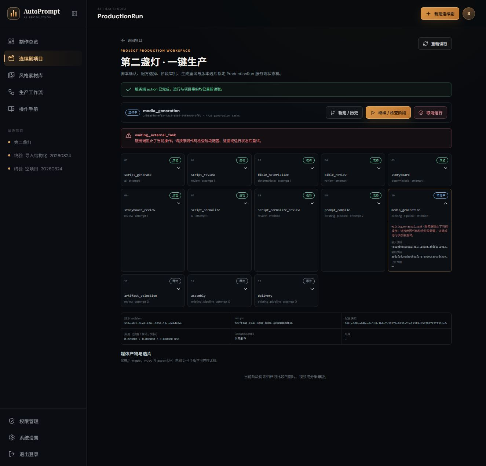

不同 prompt hash、seed 和 prefix 只证明执行输入身份不同；是否真的生成不同内容，仍需核对实际媒体与画面。

### 6.4 两条视频生成与人工选片

两条 H3 任务的冻结计划均为 120 帧、5000ms。产物经 FFprobe 得到的实际观测均为：

| 项目 | Shot 1 | Shot 2 |
| --- | --- | --- |
| 尺寸 | 352×608 | 352×608 |
| 帧率 | 24fps | 24fps |
| 实际帧数 | 124 | 124 |
| 实际时长 | 5167ms | 5167ms |
| 音频 | 有 | 有 |
| 内容结论 | 与 Shot 2 的视频、音频解码流 hash 均不同 | 与 Shot 1 的视频、音频解码流 hash 均不同 |


两个画面分别呈现雨夜站台上的维修师和已点亮路灯旁的维修动作，人工检查确认不是重复缓存结果。选片页逐镜选择后批准继续：


请求计划与实际输出必须分开记录：

- `GenerationTask.effective_frames/effective_duration_ms` 是冻结的对齐后请求计划；若只给 frames/fps，服务端按 120/24 推导 5000ms；
- `GeneratedArtifact.manifest_metadata.observed_media` 是 FFprobe 产生的实际事实，包含 `schema_version`、`observation_source=ffprobe`、宽高、fps、frames、duration_ms 和 has_audio；
- `observed_media` 在 provenance 封存前写入，并在归档时重新探测核对；API 和产物 manifest 对外提供同一事实；
- 历史产物不会静默回填新字段，因此旧运行不能被描述为已经拥有该观测合同。

### 6.5 Assembly、Delivery 与 ReleaseBundle

选片批准后，自动阶段完成整集装配和交付：

| 对象 | 真实结果 |
| --- | --- |
| AssemblyJob | `a194b404…`，succeeded |
| Assembly artifact | `0dd04103…`，SHA-256 前缀 `0ca0af86…`，4,945,527 bytes |
| FFprobe | 768×1344、24fps、240 帧、10 秒，包含 AAC 音频 |
| ReleaseBundle | `698199ca…`，sealed |
| Release manifest | SHA-256 前缀 `7ca0e295…` |
| 校验 | `signature_verified=true`、`live_verified=true` |
| 交付范围 | `delivery_scope=episode_masters` |


[查看最终 10 秒整集母版（MP4，4,945,527 bytes）](images/67-final-episode.mp4)

母版文件 SHA-256 为 `0ca0af8658f3b52cc311275c2bd65be710e093b06d0908e883e723111f9ba087`；媒体合同为 H.264、768×1344、24fps、240 帧、10 秒，并包含 10 秒 AAC 音频。

运行的 13 个阶段全部 succeeded，文本实际费用为 0.02 USD。ReleaseBundle 引用明确选择的逐镜媒体和不可变整集成片；不能用“最新文件”或目录扫描替代封存清单。

### 6.6 旧重复媒体运行是负向证据

旧运行 `f3e9f3c9-1595-40ba-bdd6-95704233fb3e` 在提示词问题修复后曾技术上生成两个视频，但旧 H3 Profile 没有装配逐镜 `shot.narrative`，两条任务使用相同 conditioning 和 seed。两个 MP4 容器 hash 不同，但解码视频流 SHA 同为 `3223c615…`，音频流 SHA 同为 `2ebe2465…`；Shot 1 用时约 406.99 秒，Shot 2 仅约 2.446 秒，这组证据与 ComfyUI 上游缓存复用一致。

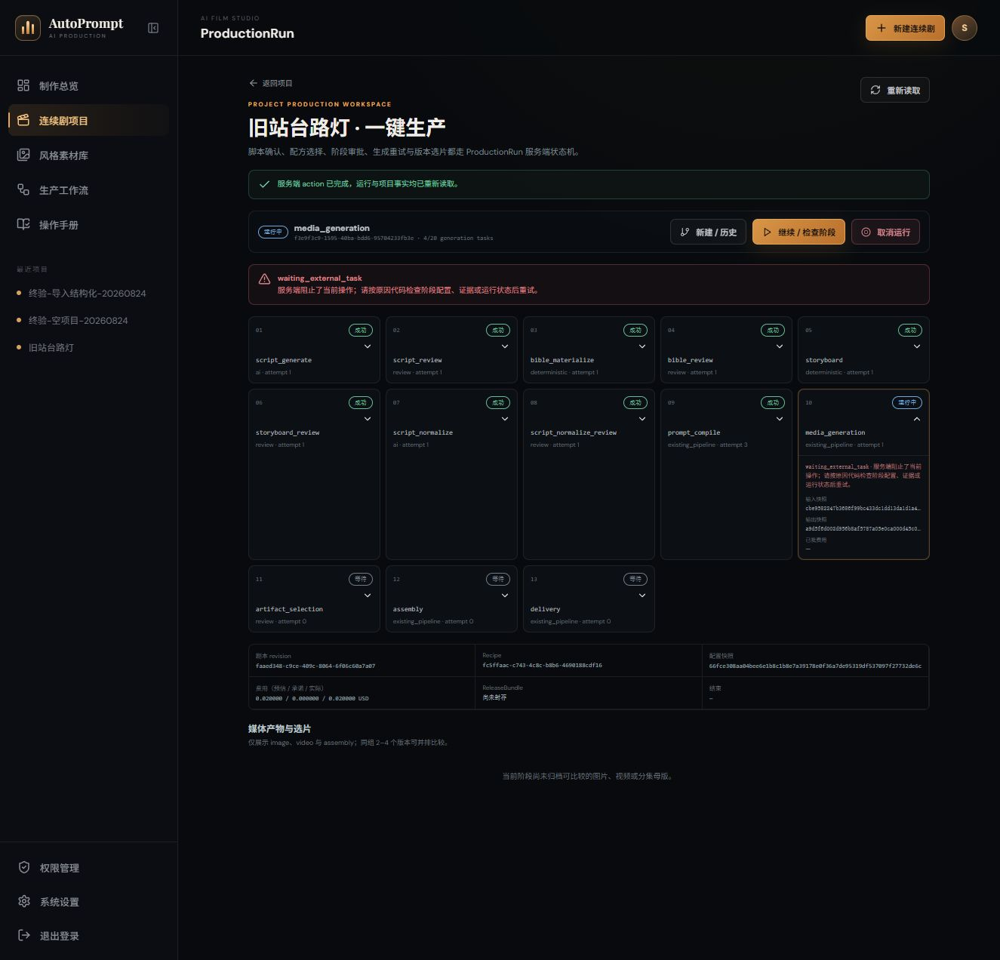


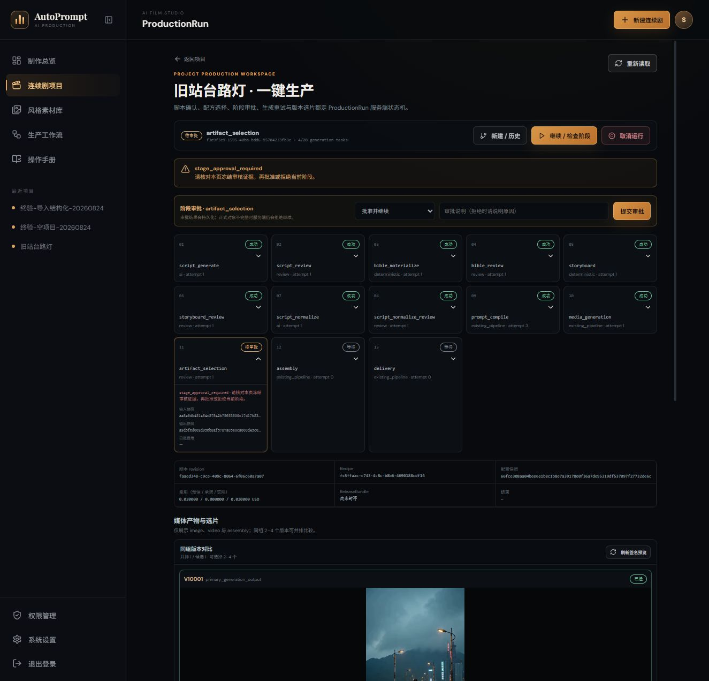

管理员没有因为任务状态 succeeded 就批准，而是在 artifact selection 拒绝整批；运行以 `approval_rejected` 终止，没有 AssemblyJob 或 ReleaseBundle。


该历史失败不被删除或改写成成功。它同时证明：容器 hash 不同不等于内容不同，执行成功也不等于可以交付。

## 7. 长任务和失败处理

- 文本或媒体任务处于 queued、running、submitted 或 `waiting_external_task` 时，等待 worker 自动推进，不连续点击“继续”或“重试”。
- `submission_uncertain` / `uncertain_remote_response`：先核对 Provider 请求和账单，再由管理员追加消歧证据。
- readiness 或 smoke 过期：若项目已创建，不要重复新建；刷新对应专用证据后从该项目的正式入口恢复 ProductionRun。
- `prompt_language_gate_blocked`：核对 PromptProfile 装配结果、canonical overlay 和实际字段来源，修复源头，不降低语言门禁。
- `duplicate_shot_conditioning`：在已审核策略中加入 `shot.narrative`、`shot.action` 或其他逐镜语义后创建新运行，不能绕过门禁提交相同 conditioning。
- 创作事实真实漂移：保持 fail closed，从受审的重新创建或重跑路径生成新快照。
- 短剧本地任务失败：从所属 ProductionRun 查看失败原因和有序 fallback；“生产工作流”中的短剧 Task 详情只做诊断。素材 AssetGenerationJob 另有明确的取消、失败/已取消重试和管理员人工消歧入口，不得套用到短剧 Task。
- 产物质量差：执行成功不等于可交付，必须经过人工选片和 ReleaseBundle gate。

问题、修复状态与未覆盖边界统一记录在 [端到端生产修复与回归台账](e2e-production-findings-20260823.md)。
