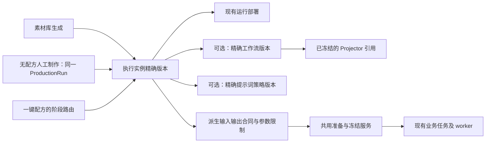

# 模型执行实例统一入口改造计划书

- 计划编号：`OPT-EXECUTION-INSTANCE-001`。
- 版本：1.3 单一新逻辑设计版；修订日期：2026-09-06；替代 1.2，不保留并行实施方案。
- 状态：已纳入可用性优先、无配方制作及不兼容数据直接清理要求，尚未开始业务实施；设计检查不等于功能或运行验收通过。
- 适用范围：AutoPrompt Studio 的 AI 调用选择、输入绑定、提示词处理、验收准入，以及素材库和 ProductionRun 的接入。
- 变更原则：可用性优先，复用已有任务、执行器和审计机制；只引用可被新逻辑原生读取的资源，不为保留旧代码、旧口径或历史数据增加兼容实现，包括审计数据。
- 授权边界：本次交付仅为计划书与待办整合。没有修改业务代码、Schema、真实配置或历史数据，没有迁移、重启、真实模型调用或清理。

## 1. 决策摘要

### 1.1 要达到的用户体验

素材库生成、人工逐步制作和一键配方中的每次 AI 调用，均选择一个明确的“模型执行实例版本”。业务用户不再分别组合 Deployment、Workflow、PromptProfile，也不需要理解 Projector 引用如何解析。

一个执行实例版本固定一个运行部署、一个能力操作及模式、至多一个工作流版本、一种提示词处理方式。策略组装方式固定一个精确策略版本。底层部署、工作流和策略可以被多个执行实例复用，不要求反向独占。

### 1.2 最小改造选择

1. 保留 `ModelDeployment` 表及其运行部署职责，不批量复制部署、凭据或模型文件；页面逐步将其称为“运行部署”，与“执行实例”区分。
2. 新增一个版本化组合对象；它不是新 Provider、调度器、模型服务或任务队列。
3. 增加一个共用的“解析、校验、准备与冻结”服务；已有业务入口继续创建各自的任务，已有 worker 继续执行。
4. 素材、提示词和节点端口使用同一份规范化绑定事实，不能各自重新排序或猜测。
5. Recipe 只简化执行目标，不删除阶段、依赖、审核、费用、候选、重试和交付语义。
6. 先改素材库，再改生产路由和人工体验；开发在隔离环境分阶段，正式切换只保留新路径，不为过渡新增双读、双写或兼容入口。

### 1.3 可用性与底线

- 本期实现无配方人工制作：无需创建或选择 Recipe，但仍创建同一 ProductionRun；不是隐藏生成一份 Recipe。每次人工动作通过正式页面/API冻结执行单元。
- 首期容量未知/规格未覆盖默认告警，不要求每一种 token 长度、参考数量或帧数组合先单独烟测。策略由配置中心管理，后续可收紧；不把未测标成已验证。
- 组合验收首期要求相同定义存在真实通过记录；单纯TTL过期默认提示复测，已知失败、目标漂移仍阻断。具体策略及优先级见第17节。
- 权限/版权、凭据与路径边界、必填和类型合同、真实费用授权、资源并发、幂等和uncertain不重复提交是首期底线，不提供“关闭所有检查”。模型必须满足的输入约束不是可延后的风险偏好。

### 1.4 本期不做

- 不重写 Projector、工作流编译器、通用原语、Provider 协议驱动、任务队列或媒体装配。
- 不安装、启动或守护新的模型推理运行时，不新增消息队列或通用 DAG 引擎。
- 不批量重建可被新逻辑原生读取的模型版本、Workflow、Projector 或 v21 策略；需要额外旧格式解析才能使用的不属于可复用资源。
- 不承诺任意新模型、协议或执行语义无需代码；可配置接入仅限现有受审能力覆盖范围。
- 不因统一入口而放开任意脚本、表达式、JSONPath、模板执行或隐式模型选择。
- 不增加第二套人工生产任务系统或通用DAG编辑器；本期只将ProductionRun扩展为recipe/manual两种明确来源。
- 不把统一视觉重做、自动素材理解、自动动作质量评估、复杂实体关系图谱捆绑进首期。

### 1.5 单一新逻辑与清理约束（本轮明确授权）

1. 不为兼容旧代码、旧接口、旧字段、旧 Schema 或历史数据增加代码。禁止旧版本只读解析器、字段别名、双协议标记、双读双写、隐式回退及专用历史浏览入口；切换后只支持当前合同。
2. 不兼容对象及其依赖可直接物理删除，包含历史 Run、任务、烟测、审批、审计与关联记录；审计或不可变标记不构成必须保留旧数据的例外。此前本计划中的“受保护历史保留”口径撤销。不改写旧结果为新结果，也不以退役、归档代替本次要求的删除。
3. 清理范围是改造涉及的不兼容对象及经核对的依赖闭包，不是全库、全部项目或全部素材。原生兼容且仍有业务价值的资源直接引用；共享的有效资源不得因清理一个旧依赖而被连带删除。具体边界见第11、21节。
4. 不为保存旧数据新建转换器、映射表、历史仓库或通用迁移平台。必要的新 Schema 仍用 Django migration；一次性清理复用现有 registry 预览、锁与删除服务，只补本次精确清理必需的能力。不会因同一已授权范围包含审计数据再次请求保留或逐项确认；未知范围与在途风险先查明。
5. 不新增业务硬编码：模型名、模型族、节点 ID/端口、模式、数量/帧数公式、提示词正文、默认选型及业务阈值都来自已有版本合同或配置目录，不能写进新分支。复用通用原语、受审协议驱动和配置中心，不另建一套规则引擎。
6. 通用算法、类型校验、事务、幂等和协议实现仍是代码职责，不要求把所有程序逻辑做成配置。配置项的初始值只登记到唯一配置来源，不在前端、worker或消费端复制兜底；缺少必要配置明确提示补齐。

本轮仅修改设计与台账。实施清理后应简要说明实际删除范围、数量及可恢复性；不默认创建永久备份、导出或历史档案来替代删除。

## 2. 当前基础与复用清单

以下为本次源码核对的结构事实，不代表每个目标环境均已完成真实验收。此前 168 项针对性测试证明的是各自覆盖范围，不是本计划的新模型已经实现。

| 已有能力／位置 | 当前职责 | 本次处理 |
| --- | --- | --- |
| `backend/studio/models.py`：ProviderProfile、ModelProfileVersion、ModelDeployment、SecretBinding、RuntimeHost | 协议、模型能力、部署、凭据、主机 | 保留，执行实例引用部署；不复制服务连接 |
| 同文件：WorkflowTemplateVersion、WorkflowProjectorVersion 及关联模型 | 冻结图、输入输出、模型依赖、Projector 身份 | 保留；校验执行实例与冻结工作流的部署／模型一致性 |
| `services/workflow_compiler.py`、`services/workflow_projectors.py` | 结构投影、固定及动态输入编译 | 复用；仅补统一绑定结果的接入，不新增模型专用编译器 |
| `services/prompt_profiles.py`、`prompt_profile_compiler.py`、`reference_context.py` | 策略校验、字段组装、引用文案、通用原语 | 复用；从精确执行实例引用获取策略，不再由消费端猜选 |
| `services/reference_bindings.py`、`prompt_generation_sources.py` | 素材引用解析、内容来源选项目录 | 提取最小公共部分；项目数据由生产侧适配，素材库不伪造 Shot／Bible |
| `services/asset_generation.py`、AssetGenerationJob | 素材生成、持久队列、取消、重试、费用和结果 | 保留；替换执行目标选择、内置业务文案及输入准备 |
| `services/production_runs.py`、`production_pipeline.py` | 阶段、人工门禁、路由、任务物化及交付 | 保留；将多目标组合解析换为执行实例引用 |
| `services/deployment_smoke.py`、`workflow_smoke_queue.py`、`readiness.py` | 异步烟测、精确目标验收、有效期和准入 | 复用任务机制；扩展版本／合同关联和共用准入，不兼容旧证据按范围清理 |
| `services/registry_relations.py`、`registry_deletion.py`、`registry_reference_lock.py` | 关联查看、影响预览、并发引用保护 | 扩展新实体；不新增删除旁路 |
| `WorkflowExecutionInputEditor.vue`、`workflowExecutionInputs.ts` | 合同驱动的参数与素材表单 | 提取可复用控件，不复制一套素材库专用规则 |
| `DeploymentCapabilitySmoke.vue`、`ModelDeploymentExecutionSummary.vue` | 烟测状态及关联摘要 | 接入执行实例精确组合，保留部署汇总视图 |

当前明确待替换的逻辑：素材库 `asset_generation.py::_text_payload` 仍有提示词候选／剧本文案硬编码；调用方存在 Deployment／Workflow 两类选择；生产请求仍需明确 Workflow／Deployment／策略绑定组合。不能把这些描述为已统一。

## 3. 目标对象与单一事实来源

### 3.1 对象关系

Projector 是工作流的来源依赖，不在执行实例上再保存一份可编辑引用。模型版本由部署及工作流引用核对，不额外增加可独立漂移的选择字段。

### 3.2 新增模型的职责

下列对象按第 15 节字段与约束实现；不是已经存在的 API 或数据表。具体 migration 序号以实施时仓库 head 分配，不预占历史编号。

| 对象／字段 | 建议形态 | 约束与意义 |
| --- | --- | --- |
| `ModelExecutionInstance` | UUID、稳定 key、名称、说明、启停 | 用户可识别的长期功能身份；不承载模型进程 |
| `ModelExecutionInstanceVersion` | FK instance、正整数 version、生命周期 | `(instance, version)` 唯一；已发布内容不可原地修改 |
| `deployment` | 必填 FK ModelDeployment，PROTECT | 一套运行连接；不复制凭据、地址或 GPU 状态 |
| `operation`、`mode` | 受控字符串，空 mode 仅在目录允许时有效 | 每版本恰好一个操作／模式，不以逗号存多个能力 |
| `workflow_version` | 可空 FK，PROTECT | ComfyUI 必填一个；直接 API 禁止误挂工作流 |
| `prompt_mode` | `profile`／`manual`／`none` | 分别为策略组装、人工完整提示词、无需提示词 |
| `prompt_profile_version` | 可空 FK，PROTECT | profile 模式必填；其余模式为空，不采用“缺省就回退” |
| 逻辑输入定义、参数限制／预设、辅助依赖 | 有稳定 key 的有序配置子表 | 实例只保存逻辑输入到执行目标的映射，不保存项目／配方上游来源 |
| 合同摘要 | schema、size、SHA、低频详情 | 引用与配置生成的发布快照；不是第二份可编辑规则 |
| 发布／复核信息 | 操作人、时间、状态、审计引用 | 沿现有生命周期模式实现，不复制历史验收为通过 |

不再增加“工作流与执行实例绑定表”“策略与执行实例优先级绑定表”。执行实例版本中的 FK 即唯一的当前选择事实。

存储沿现有 `json_contract` 边界：新增单字段序列化不超过 64 KiB，普通列表不读取完整合同；超限按正式子表或文件 manifest 承载。发布快照由配置生成，不允许独立编辑。容量和数量限制使用现有配置中心，不在新前端另写一套默认值。

现有 `PromptProfileBinding` 不进入目标数据模型。切换前只核对其中实际需要的新配置；通过正式作者入口创建精确实例引用，不建设旧绑定转换机制。切换时清理旧绑定及依赖它的不兼容任务/审计，再通过 migration 删除表及旧选择、校验、查询和历史展示代码。新资源的普通引用继续用 PROTECT；一次性清理按第11节核对依赖后有序删除，不因 PROTECT 保留旧执行协议。

### 3.3 版本与可执行性分开

- 采用 draft／published／retired 内容生命周期；发布表示配置已经复核、冻结，不等于当前可用于生产。
- 业务可执行性由精确烟测、配置身份、有效期、主机与文件状态、权限、预算和请求规格共同决定。
- 可对已发布但尚未就绪的执行实例发起组合 Smoke。基础资源验收保留原管理入口，不属于业务生成选择入口；完整状态矩阵见第 17 节。
- 现有 Workflow 自身的 Validate／基础 Smoke／发布门禁不放宽。组合 Smoke 可针对已发布 Workflow 执行，复用原任务与执行器，但禁止改写 Workflow 的基础验收状态。
- 显示名称不参与执行身份摘要。部署连接、模型、执行配置或凭据版本变化导致 target fingerprint 不匹配时，必须新建实例后继版本并重新验收；不能给同一个版本重新绑定另一份执行配置。健康变化只影响实时准入。
- 列表可显示当前推荐版本，但提交、重试和配方冻结必须使用精确版本 ID，不在 worker 运行时解析“最新版”。
- 多个执行实例共享部署时，主机／GPU 并发、Provider 限流和租户配额仍按底层真实资源统一计量；新增一个实例不能获得额外并发额度或绕过成本上限。实例级限制只能进一步收紧。

## 4. 输入素材、槽位与参数合同

### 4.1 三层职责

| 层 | 配置或事实 | 唯一负责人 |
| --- | --- | --- |
| 输入定义 | 槽位 key、类型、数量范围、是否必填、可用用途、时长／尺寸约束 | Workflow／API 能力合同；执行实例只能映射、命名及收紧 |
| 本次绑定 | 哪份素材、哪个实体／镜头、用途、顺序、父子／配对关系 | 上游映射或人工选择经共用解析服务规范化 |
| 执行表达 | 节点端口／API 字段及提示词中的 Picture／Video／Audio 标签 | 适配器和提示词编译器共同消费同一份规范化绑定结果 |

提示词策略定义“如何描述已确定的输入”，不独占数量合同、实际素材 ID 或节点端口。分类元数据也不能自动证明素材中确实出现某个人物；模型辅助建议需人工确认，首期不做视觉识别猜测。

### 4.2 输入定义与调用方来源映射

- 实例输入项定义稳定 key、类型、用途和底层目标槽位／策略输入 key。它不保存来源阶段、Shot ID、Asset ID 或某个项目的来源路径。
- 来源映射仅属于 Recipe 阶段或人工请求，指向实例输入 key；允许的来源目录与求值规则见第 16 节，不接受任意路径表达式。
- 生产侧来源可选择“当前镜头已采用的人物图”“指定上游阶段的选中产物”等；必须冻结选中记录，不使用未审核候选或运行时不断变化的 latest。
- 素材库来源可选择已有 Asset、正式上传后返回的 Asset、人工正文／说明；不为复用生产编译器而创建假的项目实体。
- 多个候选无法唯一解析时返回待选择；必需输入缺失时阻断；可选输入缺失时按合同明确省略，不替换为示例图片或随机素材。
- 具体请求保留素材稳定引用／checksum、语义角色、用途、镜头范围、顺序和配对引用。沿已有 Asset／产物事实记录，不发明独立媒体版本事实。
- 本地上传先完成受管 Asset 创建、权限与格式校验，再参与绑定；不把临时路径作为调用参数。

### 4.3 动态槽位分配

1. 按来源规则选出确定的素材集合，校验权限、类型、数量、重复策略和作用范围。
2. 由明确顺序分配逻辑槽位；一个素材多用途是否允许由合同约束，不能全局按 Asset ID 静默去重。
3. 建立输入标签、实体标签和配套音频关系。标签须唯一且受控；物理端口零起算与展示标签一起算由适配器转换，调用方不自行加减编号。
4. 生成一份有摘要的绑定清单，同时提供给提示词编译和工作流／API 请求准备。
5. 任务冻结后禁止重新排序。替换素材、改变用途或顺序构成新请求，重试使用原快照并重新核查必要的权限与安全状态。

建议页面示例：`人物参考图 → 人物甲 → 已选择素材 → 用于镜头 1 → <Picture 1>`。该示例仅说明交互，不是模型可识别身份的保证。

### 4.4 参数与输出合同

- 有效范围是模型、Workflow／API、执行实例限制及平台安全边界的交集；任何冲突应指明来源，不采用最后写入覆盖规则。
- 先处理限制和锁定，再处理默认值：范围只能收紧；底层、实例或阶段锁定值／锁定来源不可被本次输入覆盖。未锁定参数才按“本次显式值 → 阶段默认值 → 实例默认值 → 底层明示默认值”选择；每层带来源，必需值缺失报错。规则见第 16 节。
- 帧数、种子、CFG、LoRA 强度等只在底层明确开放时显示；范围、步长、余数对齐、单位与枚举复用现有校验。LoRA 文件与 LoRA 强度是不同职责，不因开放强度而允许换文件。
- 配方阶段不必把每个运行值都写死，但必须固定取值来源；来自上游的值在任务提交前求值并冻结。随机种子只允许明示生成规则，实际 seed 必须在首次提交前固定，重试不能换 seed。
- 输出必须明确媒体类型、业务用途、数量、文本／结构化 schema 和解析器。不能因为两个能力都返回文字就视为可以互换。
- “提示词候选”与“剧本生成”输出语义分别核对；若现有 operation 无法表达候选合同，在现有受控能力目录新增明确操作及策略，不借旧名称伪装兼容。

## 5. 提示词的三种方式与辅助 AI 调用

| 方式 | 输入与行为 | 必须保留的校验 |
| --- | --- | --- |
| 策略组装 profile | 一个精确策略；字段来自业务事实、人工填写或已配置的模型生成 | 必填、类型、通道、长度、保护标签、原语／来源合法性及审核 |
| 人工完整提示词 manual | 按当前操作的受控通道输入最终文本；不额外调用模型或自动改写 | 长度、实际素材标签一致性、权限和目标请求合同 |
| 无需提示词 none | 不创建空策略，拒绝多余提示词字段 | 模型／操作必须明确支持无提示词；不能绕开本应必填的文本 |

人工填写部分字段后按模板拼装属于 profile，不增加第四种状态。文本 API 的 system／user 通道、结构化返回约束也应由对应合同限定，不允许上传任意底层请求冒充人工模式。

策略中的模型生成字段继续复用当前字段生成、翻译、审核及编译链。所需辅助文本调用明确引用一个已发布的文本执行实例版本，费用、输入、输出与失败均可追踪；不能由核心代码按模型名选实例。

辅助依赖按 `generate_fields`、`translate_fields` 两种用途分别绑定至多一个精确文本实例版本，多个字段复用相同用途的实例。两种用途对应不同操作，必须分别使用不同的叶子实例版本，但可复用同一个底层 Deployment。辅助实例必须为无进一步辅助依赖的叶子，发布时拒绝循环。一次字段规则只能指定其中一种用途，模型生成后再次翻译须作为显式业务步骤，不暗中串联。提示词规范化等已有独立业务阶段继续独立选择实例。

字段结果归属逐次ExecutionPreparation，使用第18节ExecutionFieldValue与显式修订选择。素材库/组合Smoke辅助调用用子AssetGenerationJob，生产用GenerationAttempt，不放开stage_run必填约束。提取无项目依赖的纯字段校验器；素材字段审核与ProductionRun阶段批准分别授权，不能直接调用只接受unattended review StageRun的旧审核策略。

## 6. 共用服务与已有任务的接线

### 6.1 新增服务的职责边界

新增 `backend/studio/services/execution_instances.py`，将素材规范化提取到 `reference_bindings.py` 的无项目依赖部分。函数签名与事务边界见第 19 节，服务只负责：

1. 读取精确实例版本、依赖版本及当前运行身份，检查引用完整性。
2. 解析输入来源，规范化槽位、字段、参数与输出要求。
3. 调用现有提示词校验／组装与目标准备函数，不绕过人工审核。
4. 计算版本配置摘要、本次请求摘要及依赖指纹。
5. 在明确的逐次ExecutionPreparation中保存intent、字段选择及最终请求；由原业务服务物化原队列任务，不能在StageRun上只冻结一份请求。
6. worker 提交前共用同一套身份／权限／证据复核；不重新解析策略或素材。

纯解析与预览不调用付费模型、不排队。正式提交后的持久准备服务可以事务创建既有队列中的辅助任务，完成后继续准备；不写第二套任务队列，也不能把异步工作隐藏在 options、preview 或详情 GET 中。

### 6.2 保留的任务职责

| 消费端 | 继续作为事实源 | 必要调整 |
| --- | --- | --- |
| 素材库 | AssetGenerationJob、现有取消／重试／uncertain 解析及 Asset 落盘 | 增加执行实例版本关联，替换目标选择和请求准备 |
| 短剧生产 | ProductionRun、StageRun、GenerationAttempt、GenerationTask、候选／选片／装配事实 | 阶段引用实例版本；任务物化调用共用准备服务 |
| 实例烟测 | 现有 Deployment／Workflow Smoke Attempt 与证据 | 增加 resource／instance 作用域、版本关联和组合证据；不将多个调用复制成一个假 Attempt |
| 字段生成辅助调用 | 生产侧 GenerationAttempt；素材库／组合 Smoke 的子 AssetGenerationJob | 共用执行函数、ExecutionFieldValue 与审核规则，所有远端调用分别保留费用与提交身份 |

任务层仅在当前执行器或查询确有需要时保留deployment/workflow字段，由冻结实例派生写入，不允许客户端独立选择，也不作为旧任务兼容字段。不兼容历史任务按清单删除，不补造“当时不存在的实例版本”。

### 6.3 所有 AI 调用的收敛清单

P0 必须逐个登记业务调用者：素材库提示词候选／素材生成、剧本生成、剧本结构化、视觉规则、提示词规范化、字段生成／翻译、Bible 参考图、分镜媒体及实例组合 Smoke。基础资源 Smoke 单独登记为管理验收例外，不强迫它先引用尚不可发布的执行实例。每项记录入口、当前解析器、目标操作、输出合同、任务归属与新接线位置。

“只对接执行实例”指业务选型和执行准备的唯一入口；低层 Provider 驱动仍然接收已解析的部署与协议参数。健康探测、模型文件盘点、FFprobe、装配不是 AI 内容生成，不强迫它们通过执行实例，也不全仓库机械替换 `deployment_id`。

## 7. 验收、容量与错误处理

- 实例就绪条件必须包含精确 operation／mode、主执行目标、策略、提示词方式、参数／槽位合同及需要的辅助能力证据；任意另一项能力通过不能授权当前实例。
- 基础 Workflow Smoke 可能只证明图可运行，不证明策略组装及上游字段生成链通过。页面分开显示基础执行证据与组合链路覆盖情况，缺少覆盖时明确提示。
- 保留证据时间、到期时间、最近任务状态、配置变化原因及跳转。失效状态由现有证据事实计算，不新增一个可人工填写的“已通过”布尔值。
- 原生可用的resource证据不补造instance身份；需旧格式解析的历史证据清理。组合证据按精确配置身份匹配，样本规格单独展示；字段正文、素材ID、seed改变不等于组合配置改变。
- 纳入容量可观察最小闭环：采集当前请求规模与真实结果；未覆盖/未知显示警告。默认允许合同内请求执行，不能把“小样本通过”展示成整个范围已经认证。
- 第17节的规格向量用于证据与告警，不是首期强制逐样本准入。仅管理员显式启用require_evidence时，未知/未覆盖才阻断；范围认证后续实施，不推断任意较小组合必然安全。
- 保持提交不确定时不自动重发、取消需远端事实确认、幂等键冲突报错、费用授权及超时语义。队列超时、请求超时、证据 TTL 和容量覆盖不得混成一个状态。
- 手工预览和 APIClient 合成测试不得写为真实 Smoke。集成测试通过与模型输出质量通过分别报告。

## 8. 页面与接口调整范围

### 8.1 页面

1. 在现有系统设置中提供执行实例的创建、后继版本、只读配置、复核、发布、启停、烟测和关联查看；保留现有模型／部署资源入口，不另建平行控制台。
2. 表单按“能力和部署 → 工作流（适用时）→ 提示词方式 → 输入及参数 → 配置预览”组织；选项由后端返回。可自动补充的内容标明来源；不自动保存或发布推荐。
3. 素材库仅显示与任务输出合同匹配的执行实例；展示就绪原因和不可用原因。实例切换时清理或重新确认不兼容输入，防止旧表单值串用。
4. 扩展现有合同输入控件：素材库选择、本地上传、实体／镜头用途、动态数量、配对关系、参数范围和最终提示词预览。
5. 配方编辑器将部署／Workflow／策略多选项收敛为实例版本选择，保留阶段输入映射、失败策略和预算设置；不重建整个可视化编排器。
6. 在现有ProductionManualView／ProductionRunView／SeriesStudioView中实现无配方人工运行：直接创建、逐步选择实例、人工内容、字段审核、候选采用、装配与交付；流程合同与接口见第20、23节。Recipe模式保留原功能。
7. 本期只处理必要控件和关联展示；全局布局、主题、卡片密度及分块优化仍属于独立视觉待办。

### 8.2 API 设计任务（尚未实现）

| 接口职责 | 最小调整方向 | 副作用与验证要求 |
| --- | --- | --- |
| 执行实例目录及版本生命周期 | 在既有平台 registry 增加第 20 节指定资源 | 管理权限、不可变版本、乐观并发校验、审计 |
| 输入合同与预览 | 返回来源、范围、槽位、依赖及 blocker；预览返回规范化绑定与文本 | 不排队、不调用模型、不自动持久化业务配置 |
| 素材生成创建 | 保留现有任务端点，改为接收精确 execution instance version 及业务输入 | 新协议拒绝独立 deployment／workflow／binding 组合；返回持久任务 |
| Recipe 与 ProductionRun 创建 | 精确实例版本替代阶段执行目标组合；保留现有运行端点 | 版本冻结、幂等、预算、权限、人工审核不变 |
| Smoke、证据及关联查询 | 扩展现有 API 接收／返回执行实例上下文 | 复用 Attempt，不创建平行的 Smoke 任务系统 |
| 清理影响预览与执行 | 复用现有 registry 管理页面/API、摘要及事务锁，允许清单内历史/审计随依赖删除 | 不新建旧配置转换/映射系统；不提供任意 SQL 或无范围的强制删除 |

不新增一个覆盖全部业务状态机的 `/execute-anything` API。统一内部准备与校验，不等于把素材任务、生产运行、烟测揉成一个接口。

实施时同步根 `openapi.yaml`、`docs/api.md`、相关 Serializer、前端类型与调用适配器；本计划不在正式 API 文件中预先发布尚未实现的字段和路径。

## 9. 既有待办整合评估

本表是本次跨任务范围的唯一整合决策。原台账保留任务 ID、历史证据和完成状态；进入本计划不等于自动完成原任务。较早条目的“缺口”先复核当前代码，已解决的仅回归，不重复实现。

| 原待办 | 处理结论 | 并入范围／不并入范围 | 阶段与关闭依据 |
| --- | --- | --- | --- |
| OPT-ASSET-GENERATION-001 | 必须并入，原目标方案由本计划替代 | 双入口收敛、策略执行一致、动态表单、任务冻结 | P3；素材库端到端验收和旧选择路径移除 |
| OPT-CONFIG-GENERIC-001 | 必须并入相关尾项 | 内置文案、隐藏选型、原生可用的v21合同；不重做原语；不兼容旧策略及审计关联一并清理 | P0/P2/P5；无旧解析器/兼容分支残留；真实质量未验收仍单列 |
| OPT-CONTRACT-001 | 前置门禁 | 当前Schema、合同大小/一致性、新建库与一次性清理升级回归；旧入口测试删除或替换 | P0/P5；不可逆删除明确声明，不为恢复已授权删除数据实现逆转换；原任务不因局部通过关闭 |
| OPT-SMOKE-UI-001 | 必须并入精确组合展示 | 复用已存在逐能力组件，补实例版本和覆盖状态，不再造矩阵事实 | P1/P3；状态、过期及任务归属一致 |
| OPT-WORKFLOW-IMPORT-001 | 复用并验证依赖 | 候选、合同草稿、主输出、精确 Workflow 准入；不重写扫描 | P0/P1；相关目标环境缺口仍按原项验收 |
| OPT-WORKFLOW-PROJECTOR-001 | 复用并验证依赖 | 已冻结 Projector、动态端口、参数合同一致性 | P1/P2；不把实例当成另一套 Projector 配置 |
| OPT-RECIPE-UI-001 | 必须并入必要修复 | 各目录错误隔离，真实 limit 与 blocker 展示 | P4；确认现状后只修仍存在的缺口 |
| OPT-ROUTING-001 | 部分并入 | 接入执行实例选择和输入映射；完整 unattended 可视化作者工具不扩张 | P4；原项其余 UI 范围继续单列 |
| OPT-CAPACITY-001 | 部分并入，调整投入顺序 | 首期规格观测/告警、可配置准入和原资源并发；完整envelope/自动容量认证后续 | P1/P5验证warn/block切换；不以告警放行冒充容量已认证，完整认证不阻塞可用主链 |
| OPT-REF2VA-001 | 部分并入 | 用途、实体、镜头、顺序及视频／音频配对；不做动作识别和智能推荐 | P2；准确映射回归，智能匹配仍待办 |
| OPT-RELATION-001 | 只复用已知关联 | entity ID、镜头范围及配对关系；不新增佩戴／持有／组成图谱 | P2；不能声称完整关系合同已解决 |
| OPT-MANUAL-001 | 本次明确恢复并纳入 | ProductionRun来源manual、无Recipe创建、逐次动作冻结、人工采用与交付；不建第二队列 | P4；必须完成recipe_version为空的正式端到端验收 |
| OPT-SETTINGS-001 | 已有能力复用 | Provider／能力目录及选项 | P1；只做适配回归 |
| OPT-SETTINGS-UI-001 | 已有能力复用 | 搜索、过滤和历史版本默认折叠 | P1；不重新做列表框架 |
| OPT-SETTINGS-UI-002 | 已有能力复用 | 模型／Workflow 上下文跳转 | P1/P3；增加实例链接，不重复建关联表 |
| OPT-SETTINGS-UI-003 | 继续延期 | 本期仅必要表单与错误提示；统一视觉和全局布局仍单列 | 不占本期完成条件 |
| OPT-LOCAL-RUNTIME-001 | 继续条件触发 | 仅引用已运行的部署，不安装／守护推理进程 | 不并入 |
| OPT-REF2VA-002 | 继续观察 | 保留人工候选比较；不新增动作方向评估器 | 不并入 |
| OPT-DIST-001 | 继续观察 | 不因统一选型扩展外部分发环境 | 不并入 |
| OPT-NORMALIZE-001 | 继续观察 | 复用术语及人工审核，不重做名称自然度算法 | 不并入 |

## 10. 分阶段工作包与交付门禁

各阶段是开发依赖顺序，不代表已启动。单人维护时串行推进主链；测试可并行。暂不承诺日历工期，P0 完成调用清单和迁移规模后再估算，避免按历史对象数量猜测。

| 阶段 | 必要工作 | 主要交付 | 进入下一阶段的门禁 |
| --- | --- | --- | --- |
| P0：基线与最小差异确认 | 依据第15–23节盘点调用者、原生可复用资源、删除范围和测试漂移 | 调用接线清单、函数复用清单、删除依赖闭包、基线；不建迁移映射表 | 目标、共享边界和在途风险明确；不为旧数据扩大开发范围 |
| P1：版本化组合与准备合同 | 注册模型、逐次准备模型、字段选择、Run计划来源、目录与容量/验收配置项 | Schema、管理表单、只读预览、OpenAPI与测试 | 单一配置事实；逐镜/候选不混用；无发布/Smoke循环 |
| P2：统一绑定与提示词接线 | 槽位来源、动态排序、配对、参数收紧、三种提示词方式、辅助实例叶子依赖 | 规范化绑定清单、复用编译器／字段审核链、合成输出对照 | 提示词标签与实际端口一一对应；无隐式 AI 请求或回退 |
| P3：素材库首个完整消费者 | 改目录／表单／创建，保留 Job 与 worker，替换内置文案；覆盖支持的四类输出 | 从实例选择到任务、结果、取消／重试的完整路径 | 不同入口同配置产生相同准备合同；无双目标新写入口 |
| P4：配方与无配方生产接入 | Recipe schema3；manual Run来源、逐次动作/审核/采用/装配/交付，沿同一生产主链 | 两种来源ProductionRun及正式人工制作台 | 无Recipe行仍能完成交付；配方路径回归；逐次请求重试不漂移 |
| P5：单次维护切换与清理 | 停写处理在途、按清单删除不兼容数据含审计、应用Schema/新配置、同步切换并删除旧代码 | 新建库/切换验证、原生复用及删除对账、真实验收与简要清理结果 | 只有当前合同/执行/读取路径；不保留旧解析器，真实证据与模拟测试分离 |

首个纵向切片建议选择“人工完整提示词 + 已兼容的图片执行目标”，先证明统一输入和任务接线；随后验证单一文本策略，再覆盖 v21 动态参考和辅助字段生成。若没有当前有效的对应部署／工作流，不为实现切片编造配置或生成成功证据。

API 音频仅对当前受审协议实际支持的输出合同实施；目标环境没有可用音频部署时，完成合成接口测试并明确实测缺口，不标为全媒体真实验收通过。

## 11. 资源复用、切换与直接清理

### 11.1 原生复用或删除重建，不做兼容转换

1. 对每类受影响对象只做两种判断：当前合同可以原生读取且有用途，直接复用；否则纳入清理，按新合同重建确实需要的配置。不按名称相似、模型族或接口地址推断兼容，也不等于只保留最大版本号；不同业务策略只要原生符合当前合同均可引用，不能写死只认v21或某组ID。
2. 现有 Deployment、模型版本、Workflow、Projector、策略满足新合同可继续引用；不会仅因新建执行实例就复制它们。缺少合同的对象不加默认值或旧解析适配器来保住数据。
3. 通过现有正式作者入口按实际用途创建实例草稿，选择精确资源、operation/mode、提示词方式和参数；只配置用得到的组合，不生成笛卡尔积，也不编写通用旧配置自动转换工具。
4. Recipe 只保留目标 schema3。需要的配方用正式编辑器重新创建当前合同版本，再清理不兼容版本及关联；不原地改写旧快照，不为schema1/2保留解析/展示代码。原生兼容策略可作为新配置参考，但不能伪装曾经执行过的新组合。
5. 不兼容 Run、Job、Attempt、Smoke、审批和审计等整条依赖链可删除，不强制填充实例FK、转换旧快照或构造旧历史RunPlan。没有精确的新组合通过记录就显示未验收，不能把旧资源证据改成实例通过。
6. 新Run可显式采用仍有效的独立素材/内容修订；使用真实来源，不继承旧阶段完成状态或审批。若源产物必须依赖将删除的旧Run且无法原生独立存在，则随依赖清理，不临时发明新的来源类型保留它。

### 11.2 单次维护切换

- P1–P4在隔离环境实现并验证新主链，不在正式环境逐步开放兼容入口。所有业务消费者在一个维护窗口切换；详见第21节，不宣称跨数据库、文件和进程的操作是一笔原子事务。
- 切换前暂停受影响的新写与任务领取；在现有正式入口处理在途、远端提交和uncertain。不能仅清空数据库便让远端继续执行，也不能把真实状态改成成功/失败来通过检查。
- 按核对过的依赖顺序执行清理、Django migration和新配置创建/复核；旧数据不会为了迁移被补成假新结构。配置仍通过原正式管理入口，不在migration里外呼模型或自动发布含糊组合。
- 同步前后端与原worker，按唯一`scripts/restart.ps1`恢复服务，检查当前接口、合同、配置及队列。失败保持维护状态并说明实际完成部分，不回退旧业务协议继续服务。
- 授权删除本身可以不可恢复，不以“必须可逆”引入导出/归档/逆转换。已有灾备文件不自动纳入本次删除，也不为本次创建永久旧数据档案；灾难恢复若恢复了旧库，须停写完成同一清理/升级后才开放当前代码，不能恢复旧路径作为长期方案。
- 新事实产生后的修复不得随意回滚数据库抹去其他有效结果；优先暂停新提交并前向修复。需要额外恢复范围时先查明，不借本次授权删除无关新业务。

### 11.3 精确清理，包括审计

本轮已明确允许删除不兼容的历史与审计数据，无需再以“审计必须保留”为由阻断或请求同一授权。本次交付仍只是设计，不代表已实际删除。

清理复用现有registry影响预览、引用锁和删除服务。清单包含准确对象ID、所属合同/版本、不兼容原因、引用闭包、共享资源与在途检查结果；执行前在锁内重新核对摘要，范围变化则重新计算，不凭旧清单盲删。

| 类别 | 处理要求 |
| --- | --- |
| 旧配置与关联 | 不兼容的策略/Recipe/Workflow等版本、Binding、失效配置引用及选项目录按范围删除；有效共享资源保留，不做全库按名称匹配删除 |
| 历史与审计 | 依赖这些旧合同的Run、Stage、Attempt、Job、Smoke、审批/选择决定、审计及关联快照可一并物理删除；不另外复制到历史表或留只读兼容接口 |
| 被当前配置引用的旧对象 | 对仍需使用的业务配置，通过正常作者入口新建当前版本或明确解除；受影响的不兼容旧关联纳入清理。不修改旧执行快照伪造历史，也不误删闭包外有效业务 |
| 受管文件 | 只有清单内且不再被有效对象共享引用的产物/manifest才可清理；解析真实存储路径和对象键，禁止通配整个存储根、项目根或ComfyUI目录 |

普通业务的不可变约束和PROTECT仍保护当前有效数据；本次专用维护清理允许在现有删除服务中最小扩展“闭包内历史/审计一起删除”的受限操作。按依赖顺序清理，再执行删字段/删表migration；不全局移除PROTECT、不把普通DELETE变成任意级联清库，不建立第二套常驻清理平台。

数据库删除按明确批次事务执行；文件删除在数据库提交后按精确清单完成。失败返回已完成/未完成范围并可安全重试，不把部分成功标成全部完成。只保留必要的清理数量和结果说明，不要求保留已删除审计正文或永久导出副本。

### 11.4 同步删除旧实现

同步删除旧目标选择字段、旧Binding解析、旧Recipe/策略Schema读写和展示分支、旧接口/选项、内置业务文案、旧协议专用测试及失效文档。目标代码不增加双协议字段或仅供历史读取的反序列化器。

新建库和从实际当前库切换都只能通过Django migration。现有migration依赖链是建库工具历史，不是业务兼容层；不得为清理运行数据直接删坏该依赖链，也不顺带建设全历史版本升级支持。不可逆数据清理明确声明不可逆，测试验证当前建库与本次升级，不为还原已删审计实现逆迁移。

## 12. 验收矩阵与完成定义

| 验收项 | 必测场景 | 通过标准 |
| --- | --- | --- |
| 实例生命周期 | 草稿、发布、后继、并发修改、停用、退役 | 已发布不可变；错版本及冲突明确拒绝 |
| 引用一致性 | 错模型、错部署、缺 Projector、多策略歧义 | 保存／发布／提交相应门禁阻断，不回退首项 |
| 槽位绑定 | 零／最小／最大／超限、混合素材、配对音频、同素材多用途 | 合同一致；标签、实体与实际端口匹配 |
| 参数 | 边界、越界、固定值、步长／余数、随机 seed | 服务端和页面一致；第一次实际值冻结，重试稳定 |
| 提示词 | profile／manual／none、人工字段、辅助生成、未知占位符 | 无重复装配、无隐式调用；审核结果及引用不丢失 |
| v21 回归 | 六段顺序、用途摘要、视频／音频保留、镜头时间码、通道限制 | 保存配置驱动结果；与确认规则逐项对照，不要求与旧文案逐字相同 |
| 跨入口一致性 | 相同版本、相同输入分别走素材库与生产准备 | 排除业务归属信息后，目标、绑定、参数和提示词摘要一致 |
| 精确验收 | 另一能力/策略通过、过期、配置变化、辅助链 | 身份不匹配阻断；过期按显式策略warn/block，证据事实不改 |
| 容量 | 小样本对大请求、未知规格、策略调整 | 默认告警可运行；require_evidence显式阻断；不把可运行标为已认证 |
| 持久任务 | 幂等、字段修订、取消、重试、阻断恢复、uncertain、重启 | 不重复外呼/计费，不丢任务，不重跑已完成辅助调用 |
| 权限与输入安全 | 越权 Asset、跨项目产物、路径注入、模板表达式 | 按现有权限和白名单拒绝，错误不泄露密钥／原响应 |
| 切换和删除 | 不兼容Run/配置/审计闭包、有效共享资源、重复清理、影响变化、文件失败 | 清单内物理删除，闭包外不受影响；数据库失败回滚本批，部分失败如实呈现；不生成兼容映射 |
| 无配方人工制作 | recipe FK为空、逐镜不同实例、人工输入/采用、候选、装配、交付 | 同一Run/Stage/Attempt/Artifact链，不能隐藏造Recipe或跳过事实校验 |
| 页面与文档 | 选择／切换／错误／刷新／只读版本／关联跳转 | UI、API、Schema、文档一致，未覆盖状态清晰 |

验证分层：

1. 单元和合同测试：复用 `test_reference_context`、`test_prompt_profile_compiler`、`test_workflow_projectors` 等，补新增模型／共用服务测试。
2. 隔离 API 验收：复用 `test_asset_generation`、`test_production_runs_api`、`test_production_run_orchestration`、`test_deployment_text_smoke_queue`、`test_acceptance_smoke_overview`、`test_registry_deletion`；外部响应 Mock，明确不是真实 Smoke。
3. Schema／接口／前端：`scripts/check.ps1`为统一入口；按影响执行Django check、迁移一致性、新建库/当前库清理升级测试、相关Node tests、vue-tsc和Vite build。可逆Schema变更验证往返；明确不可逆的清理验证删除结果及不可逆声明，不要求恢复旧审计。真实PostgreSQL约束/并发不得仅以SQLite通过替代。
4. 正式页面与目标环境：验证保存、配置预览、任务提交、失败展示、取消和结果追溯。真实模型／GPU 调用按实施时有效授权与预算执行，记录具体组合和规格；没有真实验证则保留该项未验证，不扩大结论。

最终完成必须同时满足：所有登记的AI内容调用已接入；业务只选实例版本；三种提示词方式与动态素材链一致；无配方人工Run可正式交付；清单内旧数据含审计已删除且可对账；旧执行/读取/展示和兼容字段已移除；当前合同所需业务规则来自配置而非新增模型专用分支；相关主文档同步；无伪造就绪、Smoke或历史映射。

## 13. 实施文件清单与风险控制

### 13.1 最小落点

- Schema：`backend/studio/models.py`、`backend/studio/migrations/`。只增加必要实体、关联、约束和受限合同，不创建第二套模型资源。
- 平台 registry：`backend/studio/platform_serializers.py`、`platform_views.py`；新服务建议为 `services/execution_instances.py`。
- 素材库：`asset_generation_serializers.py`、`asset_generation_views.py`、`services/asset_generation.py`；保留 Job 生命周期。
- 生产：`services/production_runs.py`、`production_pipeline.py`、`prompt_profile_compiler.py`、`reference_bindings.py`、`prompt_generation_sources.py`；小范围提取公共函数，避免整文件重写。
- 验收与清理：`services/deployment_smoke.py`、`workflow_smoke_queue.py`、`readiness.py`、`registry_relations.py`、`registry_deletion.py`、`registry_reference_lock.py` 及实际调用方。
- 页面：`frontend/src/views/SettingsView.vue`、`AssetLibraryView.vue`、`ProductionRunView.vue`、`ProductionManualView.vue`、`SeriesStudioView.vue`；合同控件与现有提示词／烟测组件复用。
- 文档：根 `openapi.yaml`、`docs/api.md`、`docs/architecture.md`、`docs/operations.md` 以及仓库实际存在的相关主文档；不因计划而创建缺失的 README 或空目录。

### 13.2 重点风险

| 风险 | 控制措施 |
| --- | --- |
| 新组合层反而增加概念 | 普通业务页面只展示执行实例；部署／策略／Projector 留在配置详情及管理入口 |
| 对全部关联强制互斥导致复制 | 只限制实例的出向引用数量，不限制同一底层对象被复用 |
| 新旧两份规则漂移 | 原合同是权威；实例只保存引用和明示限制，派生合同只读且带来源 SHA |
| 组合与版本数量爆炸 | 按真实用途和兼容组合建实例；连续参数不按每个值建实例；不做笛卡尔积 |
| 发布与验收互相依赖 | 内容冻结和生产就绪分离；Smoke 走已有受控任务，不要求预先业务就绪 |
| 辅助文本调用导致隐藏成本／循环 | 显式叶子依赖、持久任务、预算与审批；禁止递归选型 |
| 老待办描述已经过时 | P0 按现状重新核对；完成项只回归，避免重复实现 |
| 改造覆盖范围失控 | P1–P3 先形成最小切片；与统一入口无关的视觉、运行时和智能推荐继续延期 |

### 13.3 P0 必须定稿但不阻止计划交付的事项

P0盘点所需实例组合、旧运行、默认引用、stage handler的Recipe依赖、外部可用目标、删除依赖闭包和有效共享边界；编码规则以第15–23节为准。旧数据保留不是设计目标。若现有受支持业务无法由目标合同表达，先补最小配置合同与回归用例，不使用隐藏默认值或模型专用分支绕过。只读盘点本身不改数据。

## 14. 与台账的维护关系

[优化台账](README.md) 保留总状态、原任务 ID 和历史验收；本文件独占统一改造的详细范围、工作包及整合评估。今后修改范围先更新本计划，再更新受影响条目的当前操作口径，不复制第二份改造路线。

本次交付只验证文档路径、范围一致性、任务映射及必要源码依据；没有执行本计划的功能测试、迁移或真实模型验收。进入实施后，每个阶段补录实际完成项、测试结果、未验证风险和清理影响，不能以计划签收替代上线验收。

## 15. 编码规格：注册对象、逐次准备与运行来源

第15–23节为1.3编码合同。所有新增模型、字段及端点均为拟实现内容，不是当前已上线事实。逐次准备、明确字段采用与同一ProductionRun为目标；不包含双协议、旧记录只读或历史数据转换实现。

### 15.1 执行实例注册

| 对象 | 必须实现的字段 | 约束 |
| --- | --- | --- |
| ModelExecutionInstance | UUID、key varchar(100)、name varchar(160)、description、is_active、revision、created/updated | key唯一且创建后不改；停用是运行门禁，不改历史定义SHA |
| ModelExecutionInstanceVersion | instance FK、version正整数、status draft/published/retired、deployment FK、operation varchar(100)、mode varchar(40)、prompt_mode profile/manual/none、prompt_profile_version FK nullable、workflow_version FK nullable、revision、published_at/by | instance+version唯一；一个版本一个operation/mode；profile恰有一个策略；ComfyUI恰有一个Workflow，直接API无Workflow |
| ExecutionInputSpec | version FK、key、position、kind text/json/image/video/audio、required、min_items/max_items、semantic_contract | version+key及version+position唯一；0<=min<=max；文本/JSON单值；required时min>=1 |
| ExecutionInputTarget | input_spec FK、target_kind workflow_slot/operation_input/profile_input、target_key、is_primary | input+kind+key唯一；执行素材恰有一个primary；额外profile_input复用同一事实；不同逻辑输入不能争写同一物理槽位 |
| ExecutionParameterSpec | version FK、key、value_type boolean/integer/number/string、min/max、enum_values、step/remainder、policy overridable/locked、default_value/locked_value | version+key唯一；布尔值不当整数；locked与default互斥；范围只能收紧已有硬合同 |
| ExecutionAuxiliaryBinding | version FK、purpose generate_fields/translate_fields、target_version FK | version+purpose唯一；各用途绑定对应operation的已发布叶子；无递归/自环；两种用途可共享Deployment但不是同一单能力版本 |
| ExecutionVersionContract | version OneToOne、definition JSON、schema_version/size_bytes/sha256、target_fingerprint | 派生只读详情；草稿随配置重建，发布后不可变；不独立编辑 |

semantic_contract schema1只允许allowed_purposes、allowed_subject_kinds、allowed_scope_kinds数组、paired_with_input_key可空字符串、allow_repeated_asset布尔值，选项均来自受控目录。数量/类型不在JSON重复声明。仅作策略上下文的输入可只有profile_input；执行素材必须有primary，不能让提示词自行决定物理槽位。

实例不设置field_review_mode/field_review_policy_key。字段内容校验属于策略合同，谁能批准及是否自动批准属于本次业务上下文，不能固定在可跨素材库/人工/配方复用的执行实例上。具体审核规则见第18节。

父版本行锁保护全部子表的修改、发布、clone和清理；expected_revision必填，冲突409。已发布内容及子项不可修改，只能后继。模型版本从部署推导；Projector从Workflow冻结引用推导，不重复提供选择器。

### 15.2 逐次ExecutionPreparation

新增准备对象是一个执行请求的可恢复准备记录，不是新远端队列。解决“一个StageRun里有多个镜头、候选、路线和重试”的粒度问题。

| 对象 | 字段 | 约束与事实职责 |
| --- | --- | --- |
| ExecutionPreparation | id、stage_run/asset_job/deployment_smoke/workflow_smoke四个nullable FK、execution_instance_version nullable FK、purpose production/instance_smoke/resource_smoke、unit_key varchar(191)、request_key varchar(191)、revision、status、created_by、next_check_at、claim_token/claim_until、intent_sha256、request_sha256 nullable、request_frozen_at nullable | owner四选一；stage+unit_key+request_key唯一；另三种根owner各最多一个准备；resource_smoke实例为空，其余非空；状态仅描述准备，不伪装远端运行状态 |
| ExecutionPreparationContract | preparation OneToOne、intent、resolved_inputs、review_contract、prepared_request nullable、schema/size/SHA元数据或正式manifest引用 | 低频详情；intent/解析事实/审核规则首次写入后不可改，prepared_request仅finalize写一次；正文不塞高频主表 |
| ExecutionFieldValue | preparation FK、unit_key、field_key、revision、source_sha256、field_contract_sha256、text/text_sha256、origin_kind server/manual/model、origin_attempt/origin_asset_job nullable、created_by、status pending/confirmed/rejected、approval_kind human/policy/server_derived nullable、reviewed_by/at、approval_policy_sha256 nullable | preparation+unit+field+revision唯一；origin最多一个，AI生成必须有真实origin；文本不可改，修订新建；批准来源如实记录 |
| ExecutionFieldSelection | preparation FK、unit_key、field_key、field_value FK、revision、selected_by/at | preparation+unit+field唯一；只选confirmed且来源/合同匹配的值；不能自动取“最新confirmed” |

StageRun只保存阶段入口事实、路由规则和摘要，不再保存唯一实例ID、唯一intent或唯一最终请求。单次实例与最终合同由Preparation承载，GenerationAttempt引用它。逐镜选A/B实例、候选2、路线fallback分别创建准备；已失败的实例A不能在原准备上改成实例B。

准备状态为awaiting_input、preparing、awaiting_review、blocked、ready、dispatched、cancelled。准备只冻结一次；新素材/实例/参数/生成变体使用新request_key。原请求重放返回原准备，不能使用新键伪装网络重试。

所有parent/field/selection写入先锁Preparation，再按稳定ID锁字段；所有新来源需核查owner权限。新增单字段按64KiB边界处理；大内容必须走正式manifest，缺少承载实现则明确拒绝，不读临时文件。为owner自然键、状态+next_check_at建立必要索引，不对正文建普通索引。

### 15.3 原任务的最小调整

- AssetGenerationJob、GenerationAttempt增加必填execution_instance_version FK，GenerationAttempt另加必填preparation FK；先清理不兼容历史，再建立约束，不用nullable字段承接旧AI任务。Job的准备只通过Preparation.asset_job的唯一反向关系读取，不保存第二份preparation FK；根Job与准备同事务建立。实例/准备必须匹配，不增加旧/新协议判别字段。
- Job的主准备通过Preparation.asset_job关联；子Job通过parent_preparation FK关联，二者语义不同，不循环生成子级准备依赖。子Job按叶子实例构建自己的已就绪准备并执行。
- GenerationAttempt.stage_run保持必填。增加role primary/auxiliary与auxiliary_purpose/field_batch_key可空字段；主/辅都按原stage+unit+attempt_number唯一分配，辅助使用服务端稳定命名空间的unit_key。
- 一个Preparation的主调用可有多个明确重试Attempt，但同一时刻只允许一个有效在途主调用；重试继续用已冻结payload。不会把不同远端提交ID并成一个Attempt。
- Job/Smoke增加preparing状态用于尚未提交主请求；页面将其与Preparation的待填写/待审核/阻断细项一起展示。远端queued/running/succeeded/failed等仍来自原队列。
- 子Job字段：parent_preparation、auxiliary_purpose、field_batch_key、attempt_number；parent+purpose+batch+attempt_number唯一，编号从1开始；job_type=field、media_type=text仅内部API可创建。
- WorkflowSmokeAttempt的fixture_values及冻结字段继续不可变；通过Preparation.workflow_smoke反向读取准备，不往fixture追加字段结果。ModelDeploymentSmokeAttempt同理，由准备完成后生成当前执行快照；无法原生满足目标合同的旧Smoke清理。
- parent取消先停止准备，再沿原队列取消子/主调用；uncertain未消歧不能抹成cancelled。父/子真实费用分别记账，总额仅聚合一次。

### 15.4 无配方Run与单一执行计划

ProductionRun新增plan_source recipe/manual，recipe_version改nullable；DB Check：recipe来源恰有Recipe，manual来源恰无Recipe。两种来源是当前业务模式，均使用同一新执行合同，不是兼容协议。不兼容历史Run先清理，不回填来源或历史RunPlan；所有保留/新建Run都必须有当前合同的RunPlan。

新增ProductionRunPlan：run OneToOne、source、schema_version、stage_catalog_key及版本SHA、definition/size/SHA、created_by。两种来源都通过唯一builder产生并冻结此计划：
- recipe来源复制已发布schema3 Recipe的完整阶段/路由/审核合同，保留Recipe FK作为来源；后续执行读取RunPlan，不再到Recipe读取current。
- manual来源由受控阶段目录生成手动计划，只冻结阶段职责/前置事实/允许动作、项目范围和人工审核方式，不提前填入模型目标；不创建隐形Recipe。
- RunPlan是该Run执行合同唯一来源；Recipe/目录是生成来源，StageRun快照只是各自阶段事实，不再独立维护另一份可变计划。

新增ProductionManualCommand作为正式动作的幂等回执，不是任务队列：run FK、stage_run FK可空、action enum、idempotency_key、request_sha256、created_by、result_kind/target_id及有界result_refs。run+idempotency_key唯一；与创建Preparation/Decision/原任务同事务提交。状态读取目标对象，不另存第二套running/succeeded状态。回执只记录引用，不能承载模型输出正文。

### 15.5 摘要与漂移

| 摘要 | 内容与冻结时间 |
| --- | --- |
| definition_sha256 | 单能力实例配置、策略/Workflow/Projector、辅助版本SHA及受审编译器身份；发布冻结，不含展示名/审核方式/运行准入策略 |
| target_fingerprint | 部署/Provider执行配置、模型合同/文件、Workflow/adapter、凭据引用版本；不包含密钥正文、探测时间或TTL风险偏好 |
| intent_sha256 | 实例身份、已解析输入、参数来源、主seed及辅助参数规则、审核合同、本次业务幂等范围；创建准备时冻结，实际辅助seed在各子准备冻结 |
| request_sha256 | intent、显式字段选择、实际参数及规范化最终请求；finalize时冻结 |
| execution_payload_sha256 | 不含owner/本次审计ID的实际内容合同；用于跨入口对照，不承担幂等身份 |
| admission_decision | 每次提交保存当前ConfigRevision、证据引用、警告/阻断、批准和费用范围；是决策记录，不改上述SHA |

部署执行身份或编译器语义改变需实例后继。只改变TTL/容量策略不克隆实例，由下一次准入决策使用当前受审配置。排队后收紧策略可阻断尚未提交的新外呼，但不改请求、不撤回已执行事实，不因重新检查自动扣费。

## 16. 输入、参数、辅助操作与输出

### 16.1 唯一来源映射

实例只声明逻辑输入及目标。Recipe阶段保存来源规则；无配方人工步骤/素材任务直接提交本次来源；三者都只通过同一规范化器。

| kind | 必填与可选字段 | 规则 |
| --- | --- | --- |
| literal | value | text/json按受控schema校验，不执行表达式 |
| asset | item_key、asset_id、purpose；subject_ref/scope_ref/paired_to可选 | 正式Asset、checksum、媒体探测及访问权；不可用路径代替ID |
| selected_output | stage_key、output_key、scope、selection_policy=reviewed_selected | Recipe可保存未求值规则；人工只能在本Run有效已采用输出目录里选择并提交精确Decision/Artifact ID |
| context_field | selector_key、scope、content_revision_id（求值后必有） | 受控目录；不接受任意JSONPath；人工端可显式选择真实上下文，不借此跨项目访问 |

媒体以items有序数组提交；item_key在请求内唯一，paired_to引用它；若提供order必须等于数组位置。subject_ref为character/scene/prop/external+稳定UUID，external取本次subject_facts，不能伪造Bible。scope包含request/当前真实镜头/剧集/项目；无项目素材请求只允许request或获授权的明确真实引用。

数量校验以来源展开后的实际数量进行。selected_output多选但目标单值时阻断；一个选择产生多个产物时item_key由DecisionID+ArtifactID+用途生成，不能只用DecisionID导致碰撞。相同Asset多用途由合同决定，禁止全局静默去重。

规范化记录含input_key、item_id、position、Asset/Artifact及checksum、media_facts、实体/范围/用途、配对、logical_label、target_port_ref。提示词与执行器消费相同顺序；标签及物理端口只由受控适配器派生。图端口的零起算与展示标签的一起算不得由用户自行换算。

未来输出在阶段就绪、创建该单元准备时解析，不在创建Run时猜测。准备建立后不追随“最新选片”；重新选片后显式创建新准备。缺失正式素材、必需checksum或必需解码信息是硬错误；缺少用于性能估算的tokenizer/容量测量只是第17节的观测未知。

### 16.2 参数

1. 硬类型/范围/枚举/步长取模型、Workflow/API、实例及阶段明示限制的交集；多组整数余数约束必须同时满足，不只取最大step。
2. 底层固定、实例locked和步骤locked_source/locked_value相冲突即报错，不按覆盖顺序掩盖。
3. 无锁定时按本次值、步骤default、实例default、底层明示default取值；必需缺失报错，可选省略。不注入隐藏模型名默认值。
4. 有锁定时同值可接受、不同值拒绝；boolean不能当integer，禁止NaN/Infinity。
5. seed_policy=fixed/generate_once是明确的受控参数元数据。首次持久准备产生实际seed并纳入intent，幂等重放/辅助等待/重试不变；“再生成一个候选”是新准备，可生成新seed。

步骤parameter_policies为有界{key, policy:default/locked_value/locked_source, value?, source?}集合；不同policy的字段互斥。风险偏好不能修改模型必需的对齐公式、端口类型、固定模型文件或输出解析规则。

### 16.3 提示词与辅助操作

- profile：精确策略组装，含服务器事实、人工字段、生成/翻译字段；人工覆盖仅限策略明确开放的字段。
- manual：提交受控通道中的完整提示词，不额外调用AI、不自动改写；校验长度、实际引用标签及输出合同。
- none：只有能力合同明确不需要提示词才可用；拒绝多余提示词参数。

新增受控操作prompt.fields.generate、prompt.fields.translate、prompt.draft。模型没有这些能力声明时创建后继能力合同，不能借script.generate伪装兼容。不同用途叶子可共享部署，但必须分别绑定对应操作。

字段操作输入items含request_id、field_contract、source_text、context_facts、reference_facts；输出严格{items:[{request_id,text}]}，ID集合必须一致。field_contract由父策略冻结规则派生，不接受普通调用方任意注入。叶子Smoke可选择已发布主策略的精确字段规则作为fixture来源，不需要先有父实例Smoke，不形成循环。

prompt.draft返回{text:string}。script.generate、script.structure、visual_rules.generate、prompt.normalize保留原业务输出schema。API/ComfyUI均按受审adapter判断能否执行对应operation，不统一改成随意字符串返回。

共用上下文为值对象：logical_inputs、subject_facts、ordered_units、reviewed_fields及数量/时间合同。ordered_units既可是真实镜头，也可为素材请求单元；不要求伪Django Shot/SeriesProject。

## 17. 可用性优先的验收与配置

### 17.1 不同层面的结论

| 层次 | 首期行为 | 是否允许配置放宽 |
| --- | --- | --- |
| 定义与协议正确性 | 发布依赖、target身份、必填/类型/数量/对齐、受审节点/路径和输出解析必须合法 | 不可通过容量或Smoke开关绕过 |
| 权限、版权、预算、幂等与远端不确定 | 保留原正式检查、资源并发与费用授权 | 不提供关闭全部检查的开关 |
| 组合通过记录 | 默认要求当前精确组合至少真实通过一次；最近同身份明确失败阻断 | require_passed可收紧到require_fresh；不新增“伪通过” |
| 证据TTL | 默认过期告警、可继续使用同身份真实通过记录 | 可配置require_fresh |
| 本次规格容量 | 未覆盖/未知默认告警，可在硬合同及预算内执行 | 可配置require_evidence；完整范围认证后续 |

实例发布只冻结配置，不要求自己的Smoke。组合Smoke可对published实例执行，主实例的组合证据门禁豁免；其本次新调用的辅助叶子仍须符合相应策略。叶子没有辅助依赖，先验收叶子再验收主链。Workflow自身仍走Live Validate→基础Smoke→发布，未通过的图不冒充可用依赖。

真实成功/失败证据只由对应任务完成产生。正常业务成功可作为规格观测，但首期不自动将业务任务改成组合Smoke通过；组合结果仍走正式Smoke证据链。

### 17.2 配置项与决策顺序

下列新增键统一放入ConfigDefinition/ConfigRevision及“默认值与限制”页面，本次仅设计，未修改运行配置：

| 配置键 | 值/初始默认 | 生效与说明 |
| --- | --- | --- |
| execution.admission.smoke_policy | require_passed / require_fresh；默认require_passed | 系统级管理员修改；缺少精确通过记录或最近同身份失败仍阻断；仅TTL过期可在require_passed下警告 |
| execution.admission.capacity_policy | warn / require_evidence；默认warn | 所有新协议消费者同口径；unknown/uncovered在warn下不阻断 |
| execution.preparation.recheck_interval_seconds | integer，默认10，范围1–300 | 原worker的准备扫描间隔，不启动另一守护进程 |
| execution.preparation.claim_timeout_seconds | integer，默认60，范围10–600 | 纯数据库准备工作租约；不作为远端提交超时 |

配置缺失、非法或读取失败不能静默当warn。初始值通过迁移/正式配置修订明确登记；用户可以在上线后统一调整。本轮授权不是现在就修改真实服务配置。

所有新协议消费者及其底层readiness调用都使用此唯一准入决策。旧函数中独立强制Smoke TTL或逐样本覆盖的运行阻断必须收敛，不能页面显示warn、worker又按另一规则拒绝；也不能通过吞异常达成放行。Workflow首次发布仍保留基础真实验收，已发布资源的运行证据TTL按统一策略处理；主机不可用、凭据失效及文件不完整仍是硬阻断。

决策顺序：硬错误 → 实例精确身份/真实通过 → 当前策略对应TTL处理 → 本次规格观测 → 当前预算/并发 → 保存admission_decision并提交。普通客户端无skip_checks、ignore_capacity等越权字段。人工Run可以要求更严格，但不能覆盖管理员更严格规则；unattended采用同一系统配置并在创建预算授权时展示可能存在未认证规格，不额外隐藏另一套强制门禁。

选证据先按实例definition/target/operation/mode及scope匹配；不混用不同策略。按真实完成时间选择最近适用结果：failed不能被较早passed覆盖；未完成任务本身不是failed。TTL只影响expires_at判定，不改历史结果。

### 17.3 容量观测而非逐token强制验收

统一capacity_signature_v1记录已能可靠取得的输出尺寸/帧数/时长/steps/batch、参考数量和实际有效尺寸、必要token数量及主机/运行时。缺少性能观测维度标unknown，不造数据；Asset坏文件、缺失必需媒体信息仍是输入硬错误。

首期covered只表示相同规格有真实样本，uncovered/unknown表示没证据，默认warn允许继续。文本正文、seed、Asset UUID不直接作为规格身份；token长度变化不会在默认策略下阻断主链。托管API显示provider_managed和登记上限，不推测服务商GPU能力。

将capacity_policy设require_evidence后，未覆盖/未知才阻断，并显示差异。页面可从已完成字段准备导出精确fixture启动规格Smoke；复用已确认字段选择及来源，不重复付费生成字段。Smoke通过后按正式恢复动作继续原主请求。新的范围/envelope匹配算法不纳入本期，不能未经实测声称较小组合必然安全。

### 17.4 基础资源Smoke去Binding

两类原SmokeAttempt增加scope resource/instance及nullable execution_instance_version；准备引用由Preparation对应owner FK的唯一反向关系读取，不另写第二FK。resource时无实例FK，instance时有。仅可原生满足当前合同的证据继续使用；不把旧行批量改标resource以保住历史，需补造字段或旧解析才能读取的证据清理。组合结果不能更新Workflow基础验收状态。

文本基础Smoke新增明确的profile/manual请求联合：profile提交精确prompt_profile_version_id和受控fixture来源；manual只在能力合同允许时提交完整受控通道。不再调用select_smoke_profile、旧Binding选择或frozen Binding验证函数。基础图Smoke继续使用固定fixture及图合同，无需先选择执行实例。

资源Smoke与组合Smoke都经同一纯请求/字段服务，但由服务端动作确定purpose；客户端不能伪造resource scope跳过业务门禁。resource事实不能授权instance组合。发布、options、执行、证据查询及所有基础Smoke都完成去Binding接线；旧选择、冻结Binding校验和历史只读解析一并删除。

预备中的Smoke纳入原活动唯一约束，防止重复创建。主调用deadline在真正进入原提交队列时初始化，人工等待不消耗它；未提交可为空，已提交沿原超时/取消/消歧规则。准备扫描/恢复见第19节。

## 18. 字段输入、采用、审核与费用

### 18.1 完整人工路径

创建任务/人工步骤时可以提交field_values=[{unit_key,field_key,text}]，由服务器按主策略验证并创建pending修订。也允许缺少人工字段时创建Preparation(awaiting_input)及父preparing任务，再通过正式字段接口填写，不因缺少待填写字段形成“先有鸡还是先有蛋”的死循环。

输入素材、实例和固定参数必须足以建立intent；缺少这些结构事实仍400。待人工填写的字段正文是后续修订，不要求在intent中伪造。若未提供待生成字段，显示可调用的辅助用途和估算，只有原请求明确allow_external_calls且预算授权涵盖时才排队子调用。

模板服务器锁定的事实字段不能被人工覆盖。manual完整提示词与profile人工字段是不同输入联合，不能同时提交，不能对完整提示词再套一次策略。

从真实已冻结来源确定性派生的服务器字段可记origin_kind=server、approval_kind=server_derived并由服务端选择，不要求用户重复确认Asset ID等技术事实；这不是对模型生成文案的自动批准。人工/模型字段按第18.3节处理，不能把模型结果标server_derived绕审核。

### 18.2 确认与实际采用分离

字段pending可转confirmed/rejected；正文修改创建新revision，不修改旧正文。确认只表示该修订通过批准，ExecutionFieldSelection明确本次采用哪一修订：
- 初次确认可显式select_for_execution=true建立选择；不传则只确认。
- 已有选择时更换必须带expected_selection_revision及明确replace，不因产生较新confirmed自动替换。
- 每次执行的每个必需unit/field恰有一个选择，source_sha256、field_contract_sha256、实际实例/主策略上下文一致，不能串用镜头或候选。
- finalize事务锁准备及选择，一次冻结最终选择ID和SHA；冻结后新建/改选/确认影响本请求的动作409。需要修改就建立新业务准备。
- 明确重试/规格Smoke允许选择原准备的既有confirmed结果，但必须携带来源Preparation、字段ID并重新核查owner权限、来源/合同一致性；只引用原结果，不伪造新的生成调用或重复收费。

确认不直接调用模型。人工审核场景由“确认并继续”动作锁内完成确认选择并finalize；只保存确认可以继续编辑选择。自动审核场景在所有字段齐全时由同一推进服务finalize。

### 18.3 审核职责与来源

提取validate_execution_field纯校验器，负责类型、空值、保护标签、长度、来源和策略必需项；它不负责决定谁批准。

本期新增受控字段批准策略execution_fields.accept_valid_v1，冻结其版本/实现SHA，不冒充现有阶段decision_policy。该策略只可采用已通过纯校验且来源正确的结果，不声称AI文案语义质量已被证明。

| 业务上下文 | 批准方式 |
| --- | --- |
| 素材库/无配方人工Run/单独发起的Smoke | manual；用户可单项或批量“确认并继续”；无隐式自动批准 |
| Recipe assisted/manual | 复用其人工批准要求；字段确认不替代阶段批准 |
| Recipe unattended | schema3显式配置字段批准策略execution_fields.accept_valid_v1，并保留原阶段decision_policy及其门禁 |
| 已确认字段用于重试/规格Smoke | 复核已选修订与来源，复用原批准；不要求用户再次确认相同正文 |

审核合同来自这次请求所属的RunPlan或素材库/Smoke正式动作，不由实例决定；新字段自动策略的权限、适用范围和冻结身份必须明确。原_verified_unattended_decision_policy只用于真实unattended review stage，不传假Run/Stage绕过。

### 18.4 辅助任务与预算

生产侧使用真实GenerationAttempt(stage_run必填)，素材库/Smoke用子AssetGenerationJob。公共服务build_field_request、validate_field_response、save_field_revisions只接受标准上下文，不复制整个生产worker，也不增加第三套远端队列。

字段结果逐批次落入其父准备；字段批次身份包含有序unit/field及source/contract SHA。子成功不自动证明主模型可执行；主请求若因预算/证据阻断，保留已确认字段，不重跑辅助。

主调用和每次辅助外呼分别预留/结算；父total只聚合，不能既把子actual_cost写入父又汇总。明确预算不足时保存blocked，不偷偷缩减内容或降模型。用户解除预算阻断只授权尚未调用部分，不重复占用已结算费用；uncertain继续占用可能已消费的预算，沿正式消歧结算。

## 19. 准备状态机、恢复与事务

### 19.1 状态转移

| 情况 | Preparation状态及动作 |
| --- | --- |
| 缺少可后填的人工字段 | awaiting_input；可保存字段，不调用主模型 |
| 已授权辅助生成/翻译 | preparing；原队列创建唯一子批次 |
| 字段齐全但未批准/未选择 | awaiting_review |
| 子失败/uncertain、预算不足、当前策略阻断或前置事实失效 | blocked；保存具体原因及已完成工作 |
| 全部字段采用、硬合同/当前准入通过 | finalize冻结request，ready |
| 已事务物化原主任务 | dispatched；后续远端状态来自原Job/Attempt |
| 尚未dispatch且用户取消 | cancelled；涉及在途子调用时父先cancel_requested，待取消/消歧后收口 |

ready之后冻结内容不可变；worker提交前准入收紧可阻断原任务而不改payload。子失败需用户正式重试；uncertain需消歧；不能被通用扫描自动重发。

### 19.2 服务与锁

| 服务 | 职责与副作用 |
| --- | --- |
| resolve_execution_definition / resolve_input_sources / resolve_execution_parameters | 只读和纯解析，禁止解析current、外呼模型或上传临时素材 |
| create_preparation | 父对象与幂等锁内解析/冻结intent、产生一次seed、创建pending字段及授权子任务 |
| validate_execution_field / confirm_and_select_fields | 校验/批准/选择分层；锁准备及字段；expected_revision控制并发 |
| advance_preparation | 汇聚子结果，判定awaiting_input/review/blocked，符合明确审批条件后finalize |
| finalize_execution | 一次保存选择集/规范化请求及SHA，ready；不外呼 |
| check_execution_admission | 当前策略+硬门禁；返回warnings/blockers及决策事实 |
| dispatch_existing_task | 事务防重物化原任务/关联；真正网络提交只在原worker发生 |
| get_run_execution_plan | Recipe/manual共用读取；不在stage handler中猜Recipe为空时的替代值 |

锁顺序为业务Run/根owner→Preparation→按ID排序字段/selection→预算/任务。远端调用不持有长数据库事务；沿原submission token、取消和uncertain规则处理数据库无法覆盖的网络窗口。

### 19.3 恢复机制必须可验证

三种触发共同调用同一advance_preparation：
1. 子任务完成、字段“确认并继续”、预算授权/证据更新后的事务提交通知。
2. 正式POST /execution-preparations/{id}/continue/，覆盖Job、生产单元及两类Smoke。
3. 现有worker按next_check_at扫描到期且可推进的准备，claim租约避免竞争，进程重启可恢复。

事务通知只是加速，不是唯一恢复来源。GET/页面刷新不触发推进或模型调用。人工awaiting_review不会被扫描自动批准；cancelled不恢复；失败子调用不会因扫描重试；合格请求也只能物化一次主调用。

父Job/Smoke的preparing是“主请求尚未排队”的粗状态，精确阻断来自Preparation；StageRun保持原阶段生命周期并汇总它的多个准备。不能把整个Stage的一个blocked状态当作所有镜头的唯一输入合同。

## 20. API、页面和生产接线

### 20.1 公共规则

以下均为计划接口，实施时同步根OpenAPI、Serializer、前端类型与docs/api。统一/api/v1前缀及既有错误信封、分页/鉴权/CSRF：
- 管理配置与Smoke需管理员；素材/生产/字段需真实owner权限，跨项目不可借ID越权。
- 配置写expected_revision，版本动作expected_definition_sha256；字段/恢复写expected_preparation_revision，选择写expected_selection_revision。
- 幂等同key异body409，相同body返回原对象及当前真实状态；检查幂等重放先于失效旧revision检查，但仍校验读取权限。
- 配置创建201、修改200；异步首次202+Location、重放200；结构错误400、权限403、不可见404、冲突/冻结409。
- 准入返回configuration_state、evidence_state、capacity_state、warnings、blockers、can_submit。可执行但未认证时can_submit=true且warnings非空，不能显示为验收通过。

### 20.2 注册与执行准备接口

| Method / Path | 核心请求 | 结果及调用入口 |
| --- | --- | --- |
| GET, POST /model-execution-instances/；GET, PATCH /.../{id}/ | key/name/description/is_active及revision | 系统设置注册、启停与只读详情 |
| GET, POST /model-execution-instance-versions/；GET, PATCH /.../{id}/ | 精确部署、operation/mode、prompt_mode、策略/Workflow及inputs/parameters/auxiliaries | draft创建或原子配置更新，返回派生合同及SHA |
| POST /model-execution-instance-versions/{id}/publish/、clone-successor/、retire/ | revision、definition SHA、reason（适用时） | 原生命周期；不自动Smoke |
| GET /model-execution-instance-versions/{id}/input-contract/ | 无 | 动态表单、范围和来源；不改配置 |
| POST /model-execution-instance-versions/{id}/preview/ | inputs、parameters、field_values或manual_channels、subject_facts | 纯预览+缺字段，不保存确认/不调用AI |
| POST /model-execution-instance-versions/{id}/smoke-test/ | fixture、definition SHA、幂等/预算授权；可带reuse_preparation_id及明确字段选择 | 原SmokeAttempt+Preparation，缺字段可awaiting_input |
| GET /model-execution-instance-versions/{id}/evidence/ | 状态/分页 | 精确组合证据，不混入其他能力 |
| POST /asset-generation-jobs/ | execution_instance_version_id、inputs、parameters、field_values或manual_channels、subject_facts、原素材业务字段、幂等/费用 | 根Job及Preparation；缺人工字段也可创建preparing |
| GET /execution-preparations/{id}/ | 无 | 状态、只读intent/最终请求、字段选择、子任务、费用及warnings/blockers |
| POST /execution-preparations/{id}/continue/ | expected_preparation_revision、可选confirm_and_select列表 | 幂等确认推进；不重复子外呼，不改已冻结请求 |
| GET, POST /execution-field-values/ | preparation_id；POST unit_key/field_key/text/revision | 有权修订列表/创建pending |
| POST /execution-field-values/{id}/confirm/、reject/ | expected_source/text SHA、expected_preparation_revision、select_for_execution、选择并发值 | 确认与采用，旧confirmed不自动替换 |
| 原Job/Run/Smoke取消、重试、预算授权、消歧接口 | 保留本身字段，补准备上下文 | 原正式动作；成功解除阻断通知advance，不触发隐式付费重试 |

普通请求不接受deployment_id/workflow_id/binding_id独立组合，不接受parent_preparation、resource scope或自动批准伪造字段。删除走registry影响预览与执行；清单内历史/审计闭包可删除，规则见第11节，不添加无范围的强制DELETE。

字段批量确认在同一准备事务原子执行；确认后不继续时仍可调整未冻结选择。“确认并继续”明确包含最终组装动作，不隐藏在只读预览中。

### 20.3 Recipe与默认值

Recipe只支持schema3，复用原阶段/依赖/审核/预算/fallback业务语义，不保留schema1/2运行或展示解析。AI路线引用execution_instance_version_id及expected_definition_sha256，input_sources和parameter_policies属于路线/步骤，不属于实例。新增显式字段审核合同，不把阶段批准当成字段批准。

每个单元选路后创建自己的Preparation。冻结后重试不改路线；fallback创建新准备并记录StageRouteEvent。多候选、多镜头不能共用Stage级唯一prepared_request。非AI装配/审核/交付不制造虚拟实例。

新recipe Run接受已发布schema3；新manual Run不接收Recipe，合同见第23节。两者调用get_run_execution_plan与同一stage handler。去除handler、options、readiness、字段来源与交付中对run.recipe_version直接必填访问，不以空对象/隐藏Recipe兜底。

指定Deployment的AI默认配置键改为精确实例版本引用；只作为明确选择候选/默认推荐，不在worker里隐式替换。ConfigRevision仍是唯一配置来源。清理旧键和相关不兼容修订/引用，不保留旧名称别名或旧Run展示入口。

### 20.4 错误合同

新增execution_definition_conflict、execution_target_drift、input_mapping_invalid、parameter_locked、field_review_stale、field_selection_conflict、preparation_frozen、manual_action_not_ready、run_plan_source_conflict。沿原信封返回具体path、原因和下一步；不泄露凭据或原始第三方错误正文。已删对象返回普通404，非法Schema/字段返回标准400；不为已移除旧协议新增专用处理器或重定向适配。

execution_evidence_expired和execution_capacity_unknown/uncovered在默认策略下可为warning，策略要求时才为blocker；响应必须带severity及policy来源，不能一边200放行一边用“失败”样式。缺少真实组合通过、已知失败或硬合同错误仍明确拒绝外呼。

## 21. 迁移、切换与清理

### 21.1 Schema与配置顺序

先在隔离环境验证下列完整顺序，再在单次维护窗口执行。结构与清理是一次性升级，不要求维护多个历史库版本的适配矩阵：

1. 停止受影响新写和任务领取，以当前Schema下的现有registry服务预览精确清单。若现有删除服务阻止闭包内审计删除，只补第11节限定的维护清理能力，先完成清理再改变表结构，不写旧数据转换器。
2. 删除清单内不兼容配置、任务、审批/审计及关联；核对有效共享资源不变。移除旧表前完成依赖删除，不能先破坏FK再临时处理数据。数据库与文件失败按第11节报告，未完成不开放业务。
3. Django migration增加实例注册/合同、Preparation、字段修订/选择和原AI任务必填关联；增加ProductionRun.plan_source、仅manual可空Recipe、RunPlan与ManualCommand。对保留数据建立当前约束，不写虚假实例、默认旧协议或历史RunPlan。
4. 同一升级增加Smoke scope与当前约束、登记初始ConfigDefinition/Revision、移除PromptProfileBinding及淘汰字段/旧配置键。新配置从当前合同完整写入，不沿旧修订做运行时补丁；不兼容旧修订及其审计引用按清单删除。
5. 同步部署唯一当前代码、schema3和manual作者入口；维护期间通过正式管理API创建实际需要的实例/配方草稿、复核发布并验收。直接引用可用的原生资源；缺合同则建立当前版本，不自动转换/发布旧组合。

具体migration编号按实施时head分配；迁移无外部模型调用。空库安装与本次实际当前库升级都须通过。必要清理仅报告ID、原因和计数，不为它保留旧读取字段、旧快照Schema或历史页面。

### 21.2 未完成旧工作

清点Run、Job、Smoke的执行、等待审核、blocked、可重试及uncertain；队列零不等于没有远端工作。只为停止/确认在途使用现有取消、消歧和查询机制，不为完成旧业务新增代码。

远端正在执行或无法确认是否提交时，先用现有正式入口取消/消歧，必要时等待其终止，再清理数据库。未知远端状态是避免重复消费/失控任务的运行风险，不是历史数据保留理由。无在途的旧等待审核、失败可重试等对象可直接随清单删除，不必先完成旧流程。

切换后不兼容对象已不存在，当前worker、continue/retry/authorize无需判断旧协议；所有请求只读当前合同。后续继续制作新建manual或recipe Run，可明确采用仍独立有效的素材，不继承旧完成/通过状态。

### 21.3 正式窗口与恢复

- 先在隔离库验证当前建库、清理升级、人工/配方主链和配置策略切换；新代码不包含旧协议回退。
- 维护窗口按21.1执行；仅`scripts/restart.ps1`恢复服务，保持业务写入关闭直至检查完成。不修改ComfyUI或模型服务，除非实施确有相应授权需求。
- 验证已删对象404、旧字段/Schema按当前合同拒绝、manual无需Recipe、warn/block一致，以及有效共享配置/素材未丢失。
- 清理失败、关联未收敛或新主链不通过时保持维护状态并前向修复，不临时恢复兼容代码。不默认备份旧历史来换取“可回滚”；具体恢复边界见11.2。
- 交付简要删除范围/数量、不可恢复项及实际验收结果；清理授权不扩大为全部项目、任务、备份或模型文件。新建审计继续按当前机制真实记录，但旧审计无需为此永久保留。

## 22. 复核问题映射与编码验收

| 问题/新增目标 | 1.3处理 | 必须通过的回归 |
| --- | --- | --- |
| Stage单请求与多镜头冲突 | 每次Preparation，Stage只聚合 | 两镜头不同实例、同镜头多候选、fallback与重试互不覆盖 |
| 素材字段误复用阶段自动审核 | 纯校验器+本次审核合同+独立受控字段批准策略 | 无项目手动确认；unattended自动字段与阶段批准分别有真实证据 |
| 人工字段创建死循环 | 缺字段可创建awaiting_input，创建body支持field_values | 不配置辅助AI也能填字段、确认、执行 |
| 逐token容量拦截 | 默认warn，严格要求显式配置 | 变更文本长度/素材数量不因无样本自动失败；require_evidence真阻断 |
| 基础Smoke仍依赖旧Binding | resource请求精确profile/manual，删除Binding及全部读取函数 | 无Binding表仍可基础验收；不伪造instance证据 |
| 多confirmed修订歧义 | ExecutionFieldSelection显式采用 | 不自动latest，串镜头拒绝，冻结后改选409 |
| Smoke/准备解除阻断无法恢复 | 共用continue+原worker持久扫描 | 预算补足/证据刷新/重启可恢复，不重复已成功辅助任务 |
| 无配方人工制作 | manual RunPlan+同一Stage/Attempt/Artifact链 | 无Recipe行完成生成、人工采用、装配和ReleaseBundle |
| 审核/容量放行与证据混淆 | warnings/blockers/policy与实际证据分层 | 告警放行不写假passed，配置读取失败不静默放行 |
| 旧版本迁移/重试复活 | 清理不兼容配置/任务/审计，删除旧执行及只读解析 | 已删对象404；没有旧协议分支、别名或历史格式兜底 |
| 为保护审计反复增加工作 | 同一清理授权覆盖审计依赖，沿原删除服务一次收敛 | 闭包内物理删除，闭包外共享资源不变，不创建历史存档/转换系统 |
| 新业务规则又被写死 | 原合同/配置中心为唯一来源，复用通用原语 | 改配置可改变声明式规则；更换资源名称/ID不会触发私有分支；缺合同明确失败 |

发布/Smoke循环、输入双来源、部署漂移、锁定/默认冲突、辅助递归等当前仍适用的约束继续回归。只服务于已移除旧接口/Schema/历史兼容行为的测试删除或改为当前合同用例，不为旧测试通过重新增加兼容代码。

新增测试模块建议：test_execution_instances、test_execution_inputs、test_execution_preparation、test_execution_field_review、test_execution_admission_policy、test_execution_instance_smoke、test_manual_production_runs、test_execution_instance_migration。扩展现有Recipe、asset、production、registry、assembly与delivery测试；前端覆盖无配方创建、字段选择与恢复交互。具体文件按现有test目录命名规范创建。

验收必须包含一条无Recipe且有真实模型/媒体结果的人工生产链及一条schema3 Recipe链。合成API测试可先证明接线和错误合同，但不能写成模型质量或容量认证通过。开发可先交付warn模式的可用主链，再配置严格容量，完整envelope不是首期上线前提。

## 23. 无配方人工制作的完整路径

### 23.1 创建及页面

项目工作台提供并列“使用配方生产”和“人工逐步制作”。后者直接选择项目/剧集范围、已有内容或从空白开始、交付目标和预算，不展示必选Recipe，不自动创建Recipe，也不预选模型。沿现有ProductionManualView管理同一ProductionRun。

POST /production-runs/增加严格联合：
- plan_source=recipe：recipe_version_id必填，manual_plan禁止。
- plan_source=manual：recipe_version_id必须缺省/空；manual_plan含受控stage_catalog_key、期望目录SHA、项目/剧集范围、已存在内容修订引用及交付选项；不允许客户端上传任意handler/DAG。
两者均使用原幂等、权限、预算字段，返回同一Run详情URL。新增GET /production-runs/manual-options/返回目录、可用步骤、真实前置缺口及版本；不做模型调用。

manual Run创建后等待明确动作，不自动执行AI、装配或发布。没有剧本/素材是待完成事项，不伪造ScriptRevision；首次AI调用仍需明确实例、输入和费用授权。用户可以直接提供人工剧本或采用现有素材满足前置，不强制先跑AI。

### 23.2 阶段目录与执行动作

将现有阶段职责/输入输出合同从Recipe解析和stage handlers之间提取成唯一受控目录。manual与schema3 Recipe都引用它；目录是已实现业务操作集合，不是隐藏配方。首期复用已有剧本、结构化/Bible/镜头内容、提示词、参考/镜头媒体、审核/选片、装配、交付职责；步骤配置只引用已有受审handler，具体组合/输入来源进入显式计划，不新写模型专用阶段模板或任意DAG作者工具。

POST /production-runs/{id}/manual-actions/：
- 公共字段：action、stage_key、scope/unit_key、expected_run_plan_sha256、expected_selection_revision（影响选片时）、idempotency_key。
- generate：精确execution_instance_version_id、inputs、parameters、field_values或manual_channels、source revisions及本次费用授权。创建该单元Preparation，返回202及其URL。
- adopt：精确已拥有的Asset/Artifact/内容修订及用途，或者人工文本（走现有正式内容修订服务）；类型/权限/版权/前置检查后记录真实来源与既有Decision，返回200/201，不造AI Attempt。
- approve：明确待批准对象/修订及理由，复用现有正式人工审核，不能通用“全部通过”。
- assemble、deliver：引用本Run已采用的精确产物与交付范围，沿原AssemblyJob/ProductionAssemblyLink/ReleaseBundle服务；返回原异步任务引用，禁止直接写完成状态。
- 同key异body409；回执与任务/决策同事务写，重放返回相同引用。非manual Run拒绝此动作入口，继续原Recipe控制API。

manual动作只授权当前步骤；完成后更新可操作事项，不自动选择下一模型。两个镜头可以并行有不同实例；一个镜头多个候选由不同准备区分，原ArtifactSelectionDecision管理采用，不能用“最后完成的产物”替代人工选择。

### 23.3 冻结范围与修改规则

RunPlan冻结项目/剧集边界、阶段目录及交付合同。每个步骤使用明确的当前内容修订及已采用上游；每次Preparation独立冻结。人工维护内容仍经现有ContentRevision/ScriptRevision等正式入口，不直接改准备快照。

更改上游采用结果不会覆盖旧Attempt/Decision。以新Decision修订为当前选择；下游显示其依据已变化，需要明确重做或重新审核采用，不能静默标为仍匹配。UI展示受影响镜头和任务，批量重做仍需明确数量/费用授权。

为复用现有每Run/剧集唯一装配关联，首期一次Run只封存一套正式交付：
- 装配提交前允许重生成/改选，保存修订与影响关系。
- 装配提交时冻结准确选片集；之后需要换片/重剪，使用“新建人工制作轮次”，创建新manual Run并显式引用可复用真实输入，不能覆写原装配成员。
- 已完成Run只读；不把新一轮制作当作原任务网络重试，不复制已通过阶段状态。
该边界必须在页面提示，避免宣称首期提供任意无限次原地剪辑能力。

### 23.4 前置、完成与失败

只有需要的真实前置事实已满足，步骤才可执行；允许通过人工输入/采用满足，不要求每个前置都来自AI。素材来自既有Asset时，GeneratedArtifact记录source=adopted及真实来源，不假称本Run模型生成。

manual模式的“继续”只重新检查/恢复已经授权的准备或确定性在途任务，不自动执行下一AI步骤。未操作阶段显示待处理，不能因缺少Recipe而自动skip。采用既有结果满足的步骤需正式Decision证明，不伪造生成成功。

Run成功需所选交付范围的有效选片、已完成媒体探测/装配、真实ReleaseBundle及必要批准；不以任务队列为空判成功。单镜失败可重试该准备或创建新候选；取消/uncertain/费用均沿原链，部分结果保留真实状态。

### 23.5 最小改动落点与正式文档

必须修改：ProductionRun模型/Serializer与创建服务、统一RunPlan读取、Recipe解析及人工阶段目录、逐单元prepare调用、Approval/Selection接入、assembly/delivery前置校验和三个已有工作台页面。P0逐项搜索run.recipe_version与recipe_definition_sha256，收敛到明确plan_source/plan SHA；新人工路径不得通过空Recipe对象兜底。

正式实施时同步根openapi.yaml、docs/api.md、docs/architecture.md、docs/operations.md及相关主文档，说明ProductionRun仍是唯一生产入口，但不再普遍必选Recipe。本次设计不提前把当前主文档改成已经支持。

## 24. 本次交付边界

本文件是1.3单一完整设计源，第1.5、11、21节明确无旧兼容与审计可清理，第9节承接全部既有待办，第10节定义开发顺序，第15–23节定义编码合同。仅完成计划/台账修订与文档检查；没有实现Schema、接口或页面，没有执行迁移、重启、真实调用或清理。

进入实施后按实际主链和本轮验收用例反馈修订，不以“设计已写全”代替可运行证据。可用性优先、无配方制作、删除不兼容数据含审计及不新增业务硬编码均为明确范围；不再为旧数据投入兼容维护。完整容量认证及无关视觉/智能推荐仍延期。
