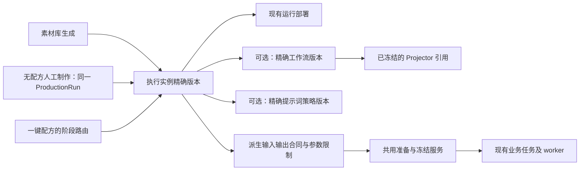

# 3. 目标对象与单一事实来源

> 历史方案／登记依据，不是当前施工清单；取消或延期事项不会因本次整理恢复。

[总索引](../../README.md) · [当前续接](../../current.md) · [按日期查证据](../../records/README.md)

<!-- source-section 89374d5bc691 -->

## 3. 目标对象与单一事实来源

### 3.1 对象关系

Projector 是工作流的来源依赖，不在执行实例上再保存一份可编辑引用。模型版本由部署及工作流引用核对，不额外增加可独立漂移的选择字段。

### 3.2 新增模型的职责

下列对象按第 15 节字段与约束实现；不是已经存在的 API 或数据表。具体 migration 序号以实施时仓库 head 分配，不预占历史编号。

| 对象／字段 | 建议形态 | 约束与意义 |
| --- | --- | --- |
| `ModelExecutionInstance` | UUID、稳定 key、名称、说明、启停 | 用户可识别的长期功能身份；不承载模型进程 |
| `ModelExecutionInstanceVersion` | FK instance、正整数 version、生命周期 | `(instance, version)` 唯一；已发布内容不可原地修改 |
| `deployment` | 必填 FK ModelDeployment，PROTECT | 一套运行连接；不复制凭据、地址或 GPU 状态 |
| `operation`、`mode` | 受控字符串，空 mode 仅在目录允许时有效 | 每版本恰好一个执行能力／模式；operation 对应模型／Workflow 精确能力，不是提示词用途 |
| `workflow_version` | 可空 FK，PROTECT | ComfyUI 必填一个；直接 API 禁止误挂工作流 |
| `prompt_mode` | `profile`／`manual`／`none` | 分别为策略组装、人工完整提示词、无需提示词 |
| `prompt_profile_version` | 可空 FK，PROTECT | profile 模式必填；其余模式为空，不采用“缺省就回退” |
| 逻辑输入定义、参数限制／预设、辅助依赖 | 有稳定 key 的有序配置子表 | 实例只保存逻辑输入到执行目标的映射，不保存项目／配方上游来源 |
| 合同摘要 | schema、size、SHA、低频详情 | 引用与配置生成的发布快照；不是第二份可编辑规则 |
| 发布／复核信息 | 操作人、时间、状态、审计引用 | 沿现有生命周期模式实现，不复制历史验收为通过 |

不再增加“工作流与执行实例绑定表”“策略与执行实例优先级绑定表”。执行实例版本中的 FK 即唯一的当前选择事实。

存储沿现有 `json_contract` 边界：新增单字段序列化不超过 64 KiB，普通列表不读取完整合同；超限按正式子表或文件 manifest 承载。发布快照由配置生成，不允许独立编辑。容量和数量限制使用现有配置中心，不在新前端另写一套默认值。

现有 `PromptProfileBinding` 不进入目标数据模型。切换前只核对其中实际需要的新配置；通过正式作者入口创建精确实例引用，不建设旧绑定转换机制。切换时清理旧绑定及依赖它的不兼容任务/审计，再通过 migration 删除表及旧选择、校验、查询和历史展示代码。新资源的普通引用继续用 PROTECT；一次性清理按第11节核对依赖后有序删除，不因 PROTECT 保留旧执行协议。

### 3.3 版本与可执行性分开

- 采用 draft／published／retired 内容生命周期；发布表示配置已经复核、冻结，不等于当前可用于生产。
- 业务可执行性由精确烟测、配置身份、有效期、主机与文件状态、权限、预算和请求规格共同决定。
- 可对已发布但尚未就绪的执行实例发起组合 Smoke。基础资源验收保留原管理入口，不属于业务生成选择入口；完整状态矩阵见第 17 节。
- 现有 Workflow 自身的 Validate／基础 Smoke／发布门禁不放宽。组合 Smoke 可针对已发布 Workflow 执行，复用原任务与执行器，但禁止改写 Workflow 的基础验收状态。
- 显示名称不参与执行身份摘要。部署连接、模型、执行配置或凭据版本变化导致 target fingerprint 不匹配时，必须新建实例后继版本并重新验收；不能给同一个版本重新绑定另一份执行配置。健康变化只影响实时准入。
- 列表可显示当前推荐版本，但提交、重试和配方冻结必须使用精确版本 ID，不在 worker 运行时解析“最新版”。
- 多个执行实例共享部署时，主机／GPU 并发、Provider 限流和租户配额仍按底层真实资源统一计量；新增一个实例不能获得额外并发额度或绕过成本上限。实例级限制只能进一步收紧。

<!-- source-section 1796892b5e65 -->

## 15. 编码规格：注册对象、逐次准备与运行来源

第15–23节为1.3编码合同；已实现且经过隔离验证的子集见第25节持续进展，其余仍是拟实现内容，均不能直接表述为已经上线。逐次准备、明确字段采用与同一ProductionRun为目标；不包含双协议、旧记录只读或历史数据转换实现。

### 15.1 执行实例注册

| 对象 | 必须实现的字段 | 约束 |
| --- | --- | --- |
| ModelExecutionInstance | UUID、key varchar(100)、name varchar(160)、description、is_active、revision、created/updated | key唯一且创建后不改；停用是运行门禁，不改历史定义SHA |
| ModelExecutionInstanceVersion | instance FK、version正整数、status draft/published/retired、deployment FK、operation varchar(100)、mode varchar(40)、prompt_mode profile/manual/none、prompt_profile_version FK nullable、workflow_version FK nullable、revision、published_at/by | instance+version唯一；一个版本一个operation/mode；profile恰有一个策略；ComfyUI恰有一个Workflow，直接API无Workflow |
| ExecutionInputSpec | version FK、key、position、kind text/json/image/video/audio、required、min_items/max_items、semantic_contract | version+key及version+position唯一；0<=min<=max；文本/JSON单值；required时min>=1 |
| ExecutionInputTarget | input_spec FK、target_kind workflow_slot/operation_input/profile_input、target_key、is_primary | input+kind+key唯一；执行素材恰有一个primary；额外profile_input复用同一事实；不同逻辑输入不能争写同一物理槽位 |
| ExecutionParameterSpec | version FK、key、value_type boolean/integer/number/string、min/max、enum_values、step/remainder、policy overridable/locked、default_value/locked_value、seed_policy nullable fixed/generate_once | version+key唯一；布尔值不当整数；locked与default互斥；范围只能收紧已有硬合同；种子策略仅用于明确整数参数 |
| ExecutionAuxiliaryBinding | version FK、purpose generate_fields/translate_fields、target_version FK | version+purpose唯一；各用途绑定对应operation的已发布叶子；无递归/自环；两种用途可共享Deployment但不是同一单能力版本 |
| ExecutionVersionContract | version OneToOne、definition JSON、schema_version/size_bytes/sha256、target_fingerprint | 派生只读详情；草稿随配置重建，发布后不可变；不独立编辑 |

semantic_contract schema1只允许allowed_purposes、allowed_subject_kinds、allowed_scope_kinds数组、paired_with_input_key可空字符串、allow_repeated_asset布尔值，选项均来自受控目录。数量/类型不在JSON重复声明。仅作策略上下文的输入可只有profile_input；执行素材必须有primary，不能让提示词自行决定物理槽位。

实例不设置field_review_mode/field_review_policy_key。字段内容校验属于策略合同，谁能批准及是否自动批准属于本次业务上下文，不能固定在可跨素材库/人工/配方复用的执行实例上。具体审核规则见第18节。

父版本行锁保护全部子表的修改、发布、clone和清理；expected_revision必填，冲突409。已发布内容及子项不可修改，只能后继。模型版本从部署推导；Projector从Workflow冻结引用推导，不重复提供选择器。

#### 15.1.1 执行能力与提示词用途（已确认）

- 实例`operation`唯一表示实际执行能力，必须由所选模型明确声明；ComfyUI还必须与所选Workflow的`input_contract.capability`精确一致。执行、路由及组合Smoke使用这个字段，不能从输出媒体类型猜能力。
- 策略`operation`表示提示词用途，由所选`prompt_profile_version`读取；不是第二个用户输入，也不另存可编辑副本。编译器使用该策略自己的operation，不把实例operation覆盖进去。
- 两者不做字符串相等校验，也不通过名称前缀、模型名或私有映射表自动换算。`video.reference_to_video`执行能力与`video.generate`提示词用途可以组成有效配置；仅因名称不同不重建v21。
- 组合有效性仍须逐项校验：已发布模型/策略及Workflow的合同完整性、精确模型引用、策略模型族、非空策略mode与实例mode、目标支持的模式/素材数量、输入来源完整性、策略输出通道与执行输入的接线、模板限制、输出解析合同。已有受审能力/编译器负责语义，实例配置负责显式接线；不以“关联成功”或“名称相同”代替这些检查。
- 同名也不能绕过上述校验。目标合同缺少必要声明或当前编译器不支持时返回带来源路径的配置错误，不补默认能力、不静默省略输入、不宣称兼容；需要扩展超出本计划的受审执行能力时先确认。
- `definition`冻结执行operation/mode与精确策略ID/合同SHA及其派生的提示词operation/mode；策略用途不是Smoke的替代能力。列表/预览分别标为“执行能力”和“提示词用途”，后者只读，不新增第二套策略绑定。
- 最小回归：异名但合同匹配可通过；同名但模式/通道/模型不符必须拒绝；另一能力的Smoke不能授权当前实例；没有策略的manual/none模式不推导隐藏策略。

### 15.2 逐次ExecutionPreparation

新增准备对象是一个执行请求的可恢复准备记录，不是新远端队列。解决“一个StageRun里有多个镜头、候选、路线和重试”的粒度问题。

| 对象 | 字段 | 约束与事实职责 |
| --- | --- | --- |
| ExecutionPreparation | id、stage_run/asset_job/deployment_smoke/workflow_smoke四个nullable FK、execution_instance_version nullable FK、purpose production/instance_smoke/resource_smoke、unit_key varchar(191)、request_key varchar(191)、revision、status、created_by、next_check_at、claim_token/claim_until、intent_sha256、request_sha256 nullable、request_frozen_at nullable、reason_code varchar(100)、reason varchar(500)、evaluation_revision/evaluated_at nullable | owner四选一；stage+unit_key+request_key唯一；另三种根owner各最多一个准备；resource_smoke实例为空，其余非空；状态仅描述准备，不伪装远端运行状态；评估修订/时间同时存在且不超过当前修订 |
| ExecutionPreparationContract | preparation OneToOne、intent、resolved_inputs、review_contract、prepared_request nullable、evaluation nullable、schema/size/SHA元数据或正式manifest引用 | 低频详情；intent/解析事实/审核规则首次写入后不可改，prepared_request仅finalize写一次；evaluation保存最近一次推进的判断和原因，带当时修订/时间；正文不塞高频主表 |
| ExecutionFieldValue | preparation FK、unit_key、field_key、revision、source_sha256、field_contract_sha256、text/text_sha256、origin_kind server/manual/model、origin_attempt/origin_asset_job nullable、created_by、status pending/confirmed/rejected、approval_kind human/policy/server_derived nullable、reviewed_by/at、approval_policy_sha256 nullable | preparation+unit+field+revision唯一；origin最多一个，AI生成必须有真实origin；文本不可改，修订新建；批准来源如实记录 |
| ExecutionFieldSelection | preparation FK、unit_key、field_key、field_value FK、revision、selected_by/at | preparation+unit+field唯一；只选confirmed且来源/合同匹配的值；不能自动取“最新confirmed” |

StageRun只保存阶段入口事实、路由规则和摘要，不再保存唯一实例ID、唯一intent或唯一最终请求。单次实例与最终合同由Preparation承载，GenerationAttempt引用它。逐镜选A/B实例、候选2、路线fallback分别创建准备；已失败的实例A不能在原准备上改成实例B。

准备状态为awaiting_input、preparing、awaiting_review、blocked、ready、dispatched、cancelled。准备只冻结一次；新素材/实例/参数/生成变体使用新request_key。原请求重放返回原准备，不能使用新键伪装网络重试。

所有parent/field/selection写入先锁Preparation，再按稳定ID锁字段；所有新来源需核查owner权限。新增单字段按64KiB边界处理；大内容必须走正式manifest，缺少承载实现则明确拒绝，不读临时文件。为owner自然键、状态+next_check_at建立必要索引，不对正文建普通索引。

字段修改使旧评估失效：状态回到preparing、清除当前原因并安排下次检查；保留旧evaluation及时间，evaluation_revision小于revision时仅为历史判断。读取不重算、不补评估；只有正式推进写入新评估。evaluation不是无限追加的事件数组，也不替代每次真实提交的admission_decision。

### 15.3 原任务的最小调整

- AssetGenerationJob、GenerationAttempt增加必填execution_instance_version FK，GenerationAttempt另加必填preparation FK；先清理不兼容历史，再建立约束，不用nullable字段承接旧AI任务。Job的准备只通过Preparation.asset_job的唯一反向关系读取，不保存第二份preparation FK；根Job与准备同事务建立。实例/准备必须匹配，不增加旧/新协议判别字段。
- Job的主准备通过Preparation.asset_job关联；子Job通过parent_preparation FK关联，二者语义不同，不循环生成子级准备依赖。子Job按叶子实例构建自己的已就绪准备并执行。
- GenerationAttempt.stage_run保持必填。增加role primary/auxiliary与auxiliary_purpose/field_batch_key可空字段；主/辅都按原stage+unit+attempt_number唯一分配，辅助使用服务端稳定命名空间的unit_key。parent_preparation仅auxiliary必填、primary为空；preparation始终是本次外呼自身的准备，parent_preparation是接收字段的主准备，二者不能相同且必须属于同一Stage/Run。parent+field_batch_key+attempt_number唯一；批次SHA已经包含精确用途。冻结的父实例辅助定义、用途、批次及叶子实例必须一致。
- 一个Preparation的主调用可有多个明确重试Attempt，但同一时刻只允许一个有效在途主调用；重试继续用已冻结payload。不会把不同远端提交ID并成一个Attempt。
- Job/Smoke增加preparing状态用于尚未提交主请求；页面将其与Preparation的待填写/待审核/阻断细项一起展示。远端queued/running/succeeded/failed等仍来自原队列。
- 子Job字段：parent_preparation、auxiliary_purpose、field_batch_key、attempt_number；parent+purpose+batch+attempt_number唯一，编号从1开始；job_type=field、media_type=text仅内部API可创建。
- WorkflowSmokeAttempt的fixture_values及冻结字段继续不可变；通过Preparation.workflow_smoke反向读取准备，不往fixture追加字段结果。ModelDeploymentSmokeAttempt同理，由准备完成后生成当前执行快照；无法原生满足目标合同的旧Smoke清理。
- parent取消先停止准备，再沿原队列取消子/主调用；uncertain未消歧不能抹成cancelled。父/子真实费用分别记账，总额仅聚合一次。

### 15.4 无配方Run与单一执行计划

ProductionRun新增plan_source recipe/manual，recipe_version改nullable；DB Check：recipe来源恰有Recipe，manual来源恰无Recipe。两种来源是当前业务模式，均使用同一新执行合同，不是兼容协议。不兼容历史Run先清理，不回填来源或历史RunPlan；所有保留/新建Run都必须有当前合同的RunPlan。

新增ProductionRunPlan：run OneToOne、source、schema_version、stage_catalog_key及版本SHA、definition/size/SHA、created_by。两种来源都通过唯一builder产生并冻结此计划：
- recipe来源复制已发布schema3 Recipe的完整阶段/路由/审核合同，保留Recipe FK作为来源；后续执行读取RunPlan，不再到Recipe读取current。
- manual来源由受控阶段目录生成手动计划，只冻结阶段职责/前置事实/允许动作、项目范围和人工审核方式，不提前填入模型目标；不创建隐形Recipe。
- RunPlan是该Run执行合同唯一来源；Recipe/目录是生成来源，StageRun快照只是各自阶段事实，不再独立维护另一份可变计划。

新增ProductionManualCommand作为正式动作的幂等回执，不是任务队列：run FK、stage_run FK可空、action enum、idempotency_key、request_sha256、created_by、result_kind/target_id及有界result_refs。run+idempotency_key唯一；与创建Preparation/Decision/原任务同事务提交。状态读取目标对象，不另存第二套running/succeeded状态。回执只记录引用，不能承载模型输出正文。

### 15.5 摘要与漂移

| 摘要 | 内容与冻结时间 |
| --- | --- |
| definition_sha256 | 单执行能力实例配置、精确策略及其提示词用途、Workflow/Projector、辅助版本SHA及受审编译器身份；发布冻结，不含展示名/审核方式/运行准入策略 |
| target_fingerprint | 部署/Provider执行配置、模型合同/文件、Workflow/adapter、凭据引用版本；不包含密钥正文、探测时间或TTL风险偏好 |
| intent_sha256 | 实例身份、已解析输入、参数来源、主seed及辅助参数规则、审核合同、本次业务幂等范围；创建准备时冻结，实际辅助seed在各子准备冻结 |
| request_sha256 | intent、显式字段选择、实际参数及规范化最终请求；finalize时冻结 |
| execution_payload_sha256 | 不含owner/本次审计ID的实际内容合同；用于跨入口对照，不承担幂等身份 |
| admission_decision | 每次提交保存当前ConfigRevision、证据引用、警告/阻断、批准和费用范围；是决策记录，不改上述SHA |

部署执行身份或编译器语义改变需实例后继。只改变TTL/容量策略不克隆实例，由下一次准入决策使用当前受审配置。排队后收紧策略可阻断尚未提交的新外呼，但不改请求、不撤回已执行事实，不因重新检查自动扣费。
