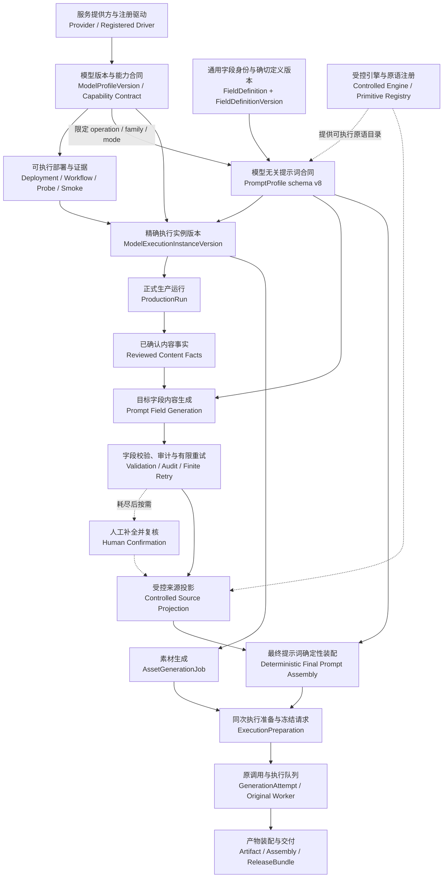
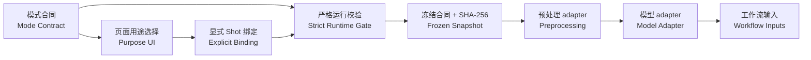

# Production Operator Manual

操作员的权威逐步手册位于前端“生产手册”页面；其结构化源文件是 [frontend/src/content/productionManual.ts](../frontend/src/content/productionManual.ts)。本文只说明入口、范围和维护规则，避免形成第二套会漂移的步骤正文。

系统设置另有面向新用户的独立图文指南：前端路由 `/manual/settings`，可打印版本为 [system-settings-beginner-guide.md](system-settings-beginner-guide.md)。该指南正文唯一来源是 [frontend/src/content/systemSettingsGuide.json](../frontend/src/content/systemSettingsGuide.json)，Markdown 由 `npm run docs:settings-guide` 生成，不手工维护第二份正文。

## 使用入口

1. 使用 `scripts/restart.ps1` 启动服务。
2. 打开前端并进入“生产手册”。
3. 按手册核对Schema及服务版本，配置Provider/模型部署、必要的Workflow/Projector和策略；在“管理执行实例”固定精确组合，分别完成基础资源和组合验收。业务入口不再选择独立Binding。
4. 在“新建连续剧”选择空项目、导入脚本或 AI 创建。导入先核对 `ScriptSource` 预览并确认修订；含 `script_structure/ai` 的配方可显式配置三项 `planning` 计划。AI 模式明确填写集数、每集镜数和单集时长，配方用 `run.*` 来源映射读取本轮创建回执，不读项目默认值。每次请求按精确实例核验范围，结果必须满足集数、镜数和逐镜时长总和；原稿明确时间不能改写。外发授权与费用沿原预算检查，完整入口开放状态以统一改造台账为准。
5. 配方在各阶段声明精确执行实例、输入来源与参数策略；无配方按剧本、Bible 与影视规则、分镜、媒体生成与选用、装配与交付分区操作，任务与记录集中找回执行准备及恢复处理。分区不新增顺序门槛；对象选项来自本轮服务端目录，唯一对象直接说明，多对象明确选择，不自动选择执行实例。每个镜头只解析其明确来源，不另外选择整集/逐镜Workflow组合。需要在ComfyUI核对图时下载`download_import` JSON并手动导入，不期待浏览器直接打开。
6. 在 ProductionRun 内处理 AI/结构化脚本与 Bible 审核、route、cost、候选、重试、不确定响应和交付 gate。worker 会自动继续非人工阶段，required review 必然暂停。
7. “任务中心”统一展示项目生产、素材生成与Smoke验收，支持类别／精确实例版本等筛选；详情查看冻结核心参数、实际提示词、输出及原主／辅助调用。短剧任务、装配和发布包提供证据与结果，创建、重试、取消和有序fallback回到所属ProductionRun；素材AssetGenerationJob沿自身操作入口处理取消、明确重试和管理员消歧。旧延迟续接入口已移除。
8. 最终交付检查每集 episode master 和 ReleaseBundle，不寻找整季单条长视频。

项目页先读取风格目录与项目正文，本轮制作记录独立加载；Bible 参考素材/候选及参考输入要求、剧集装配记录、发行版本在进入对应页签时读取。局部加载或失败不阻塞其他区域，也不表示“没有数据”；失败时使用该区域的重试入口。返回项目会重新读取正文，延后返回的旧项目响应不会覆盖当前编辑；此调整不改变生产准入或模型调用。

进入已有一轮的生产工作台时，项目正文与该轮记录分别读取，不等待任务历史、配方目录、素材库剧本或全平台能力检查。制作历史、新建无配方、新建配方各读取自身需要的数据；配方运行的分镜审核或结果消歧需要当前服务端限制时再单独加载，缺失时相关审核仍不能提交。记录读取失败显示错误，可用页首“重新读取”重试，不会跳成新建页面。自动刷新不会与尚未结束的详情读取重叠。

## 当前能力边界

页面手册必须清楚区分：

- 已实现：空项目、导入脚本与 AI 创建三种新建入口；
- 已实现：`ScriptSource`安全预览→确认修订；规范确认稿确定性拆稿，显式AI结构化则经精确实例生成候选→明确审核，不制造no-op候选；
- 已实现：AI script → review → deterministic Bible → review；
- 已实现：PromptProfile schema v6、受控来源与逐字段上下文、声明式原语与模板；策略由精确执行实例引用，缺失/漂移明确失败，不提供旧策略Schema或Binding兼容读取；
- 已实现：模型版本级 `prompt_normalization` 四项必填硬容量、必填但可为空对象的 `chat_request_options`，以及可选 `input_byte_warning_threshold` / `output_token_warning_threshold`；输入字节、建议长度、通道预警和输出 token 建议阈值只记录 warning，硬合同失败才有限重试，耗尽后转人工；
- 已实现：Settings 类型化参数与经服务端核验的 `resource_ref` 依赖下拉；
- 已实现：`script.generate`、`script.structure`、`prompt.normalize`、`visual_rules.generate` 与媒体 Deployment Smoke 统一返回持久 HTTP `202` task，Settings 恢复/轮询终态，单提交不确定状态只允许追加管理员消歧证据；
- 已实现：semantic Comfy workflow；
- 已实现：ComfyUI 安全 `download_import` 导出，精确绑定 validated deployment，不伪造 direct-open；
- 已实现：三类业务入口统一选择执行实例；配方按阶段声明来源，人工逐镜动作独立配置，同次Preparation冻结真实输入；
- 已实现：worker 终态事实提交后幂等 auto-advance，required review/成本/选择 gate 暂停；
- 已实现：外部调用显式授权、币种/预算门禁与运行审计链；
- 已实现：async REST T2I/T2V；
- 已实现：managed artifact、逐集 master、ReleaseBundle；
- 已实现：归档时从冻结事实白名单生成 GeneratedArtifact `comparison_parameters`，候选参数差异不使用 manifest 身份/hash；
- 已实现：ProductionRecipe 发布要求完整 content → storyboard → prompt → media → selection → assembly → delivery 闭包；
- 已实现：五层配置、new-boot activation、host probe/recommend draft；
- 已实现：recommendation decide 由服务端复验陈旧快照、目录、配置和候选兼容性；
- 阻断：I2V/reference upload 尚无统一 provider contract；
- 未实现：跨节点/多 GPU scheduler；
- 不会执行：自动下载模型、自动发布 workflow/推荐、自动激活配置；
- 初始状态：bootstrap workflow catalog 是 `needs_review` 草案；
- 验收边界：真实外部 provider/GPU 通过范围只以对应日期的 E2E 报告及持久化 Run、Attempt、Artifact、媒体探测和 ReleaseBundle 证据为准，不能由单元测试或手册文字推导。
- 当前三线复验边界：开发、隔离回归、精确清理、迁移与服务切换由代理处理；纯人工、半自动和无人值守的实际模型验收由用户按页面手册执行。代理不提交真实Provider/ComfyUI生成请求，也不把历史Run充当本轮证据。
- 0127 尺寸倍数准入：缺少冻结 `required_dimension_multiple` 证明的旧 current/published 媒体 Workflow 会保留历史证据但退出生产候选；操作员不得恢复旧证据或原地改写，须按第 15 步导入新不可变版本并重新 Live Validate、真实 Smoke、Publish。

catalog 或 adapter 中出现 H3/SDXL 等词不代表它是固定生产后端、已经启用或已经通过许可审查。

## 能力合同、模型无关提示词合同与受控原语

主路径先用能力合同确认模型能否执行目标操作和模式，再用PromptProfile描述提示词用途与内容，两者分别核对。Provider自由文本运营标记不会注册驱动或授予能力；实际能力由注册驱动、模型版本、Deployment/Workflow合同及相应证据核验。Probe不能替代Smoke，策略名称不能授予模型能力。精确实例固定组合，实际请求由同次Preparation冻结并准入。

独立素材的异步 API 路由使用精确的 `async_rest` 能力：图片 `image.text_to_image`、视频 `video.text_to_video`、音频 `audio.text_to_audio`；Bible 图片提示词使用另一条 `image.generate` PromptProfile 合同。它们不是 Provider 自由文本“声明操作”授予的能力，也不能互相替代。ComfyUI Workflow 则以 current/published、Live Validate、真实 Workflow Smoke、输出合同和当前 hash 证据进入候选。

ProductionRun 编排器不按模型名称、段落名称或固定六段分支。新模型如果能复用现有 capability、事实词汇和 `direct_v1`，或复用 `declarative_v1` 下已注册的来源投影原语，只需在系统设置中新建版本化资源，不修改主编排源码。

### 组件调用先后关系



配置顺序为底层资源与必要的策略→精确执行实例→业务使用；策略组装在同次准备内依次完成来源解析、明确辅助调用、字段审核和最终装配。人工完整通道不经过隐式改写，无提示词方式不强制附加策略。配方、人工和素材任务共用准备与执行服务。

配方作者入口为“系统设置 → 生产配方”：在需要生成的步骤直接选择已发布执行实例，再配置输入来源与步骤参数，不再先配置路线或分别组合模型、工作流、策略。普通步骤使用一个实例；需要多个备选时展开“高级设置：多实例切换”，选择按失败顺序切换或运行时人工选择，并维护每项输入与排序。更换实例先确认清除该项映射；多实例切回单实例必须明确选择保留项，取消不改原配置。已发布配方只读，调整须创建后继草稿。底层 `routing/routes` 仍表示步骤内的实例引用与选择规则，不是独立配置资源；没有改变运行时失败、待审或结果未知的处理。

配方中的“本步骤参数（默认继承实例）”无需逐项填写：只选择确实需要本步骤单独配置的参数，再指定默认值、固定值或受控来源。仅在选择器中浏览不会写入覆盖；“恢复继承实例”移除这一项覆盖，其他项不变。继承项折叠为只读，可展开查看模型/工作流/实例的约束来源；合同缺少默认值的必填项仍须明确提供，不会自动补数。目标固定值、一次生成种子不允许步骤改写。已保存但失效的覆盖会保留提示，须明确处理。

实例配置的“实例输入接线”负责把一个逻辑输入连到策略/模型端口；“实例参数覆盖（可选）”只维护相对于目标的额外约束或取值。字段含义在字段维护，结构在数据结构，装配规则在提示词策略，实际业务来源在配方。并非所有帧数/素材端口都来自业务字段字典，详见[输入输出维护归属](architecture.md#输入输出和参数的维护归属2026-10-07核对)。

“模型部署”是模型版本连接主机或服务的运行位置和连接配置，不是业务执行方案；“执行实例”才固定部署、可选工作流、提示词处理与输入接线。混合连接模型和策略的输入自动继承该策略的确切结构，页面只读展示，不再另选同一结构；不同结构冲突须修正接线，不能按名称覆盖。输入表单合并时完全相同的 Schema 只应用一次，不同目标的约束继续共同校验。

模型的响应格式若选 `json_schema`，只维护名称、strict 等接口选项，无需另填 Schema；请求中的 Schema 自动来自执行实例所选业务输出的确切结构，与解析器同源。没有业务输出的固定协议不能使用此格式；旧内联 schema 明确报错，须在新草稿中显式移除，不改写已发布版本或历史请求。格式设置不等于模型实际支持或 Smoke 通过。

### 模型无关提示词合同

1. 已确认内容事实形成并确认剧本、视觉规则、逐镜头叙事、Bible、对白、旁白/配音、声景和音乐。
2. 目标字段内容生成按每条 PromptProfile schema-v6 规则取得或生成目标字段，并执行冻结的主要内容来源、额外上下文、语言、长度和校验合同。
3. 来源投影把通用事实或审核通过的字段贡献转换为装配来源；最终通道进入同次Preparation及其冻结请求，不另存旧PromptArtifact或独立编译阶段。

关键配置口径如下：

| 配置 | 作用 | 边界 |
| --- | --- | --- |
| `field_definition.key` / `profile_field_key` | 本条规则要产出的稳定目标字段（destination） | 不是输入路径 |
| `generation_source_selector` | 生成目标字段时首先读取的主要业务事实 | model-generated/translate-only 选择服务端执行读者目录，或 `request.structured_input` 的确切结构路径；逐单元贡献只读本单元结构原值；server-locked/passthrough 自动跟随 `source_selector`；不是文件路径或自由文本 |
| `generation_context_selectors` | 逐字段额外读取的已确认上下文 | 空数组只使用主要内容来源；结构化主要来源可在“来自本次输入结构的附加字段（多选）”逐项选择同一结构字段，不读取未选项；逐镜只读本镜输入。`target_shot.dialogue_metadata` 不含对白原文，需台词时显式选择 `target_shot.dialogue_authored_text`；跨镜范围必须显式开启 |
| `generation_mode` | `server_locked`、`model_generated`、`translate_only`、`passthrough` | 当前只有 `image.generate` / `video.generate` ProductionRun 执行字段级模型处理；其他 operation 只能选择服务端锁定或原值透传 |
| `generation_instruction` | 描述单个目标字段必须包含与禁止的内容 | 版本化说明文本，不可执行，模型处理模式必填 |
| `generation_output_semantics` | `final` 直接形成目标字段；`contribution` 作为受控投影输入 | contribution 必须被本规则选择的原语明确支持 |
| `generation_required`、`language_policy`、`length_unit`、`generation_min/max`、`generation_validator_keys` | 字段内容结果验收合同；受保护引用默认保持来源次数，也可显式配置为至少一次 | 未知或冲突组合 fail closed；两种引用计数策略不能同时启用 |
| `source_projection_key` | Profile 级来源投影选择 | 普通策略使用 `direct_v1`；页面组合代码原语使用 `declarative_v1` |
| `channel_limits.<channel>.max_chars / warn_at_chars` | 最终通道阻断上限与可选预警阈值 | 未配置即不限制；没有代码内隐藏默认值 |
| `source_selector` | 最终提示词装配读取的来源 | 与 `generation_source_selector` 职责不同；声明式原语规则固定选 `projection.output`；server-locked/passthrough 的主要内容来源由页面自动与它保持一致 |
| `projection_primitive` | 本字段规则选择的注册原语 | 仅 `projection.output` 必填；原语结果写入所选 `field_definition.key`，业务字段映射不写死在代码里 |
| `position`、`channel`、`label_style`、`separator`、`max_chars`、`required`、`omit_if_empty` | 最终字段取舍、顺序、通道、标签、分隔和长度 | 只做确定性装配，不重新创作已确认内容事实 |

`direct_v1` 不做额外协议转换，适用于现有通用来源可以直接装配的模型。`declarative_v1` 允许操作员在页面逐字段选择代码中已注册的确定性原语，并配置原语引擎的受限参数；原语结果、目标字段、顺序、标签、分隔和 channel 仍由 PromptProfile 决定。配置不能执行任意代码。只有现有原语无法表达的新确定性算法，才新增一个范围明确、可测试、经审查并注册的 engine/primitive。

已发布策略不能原地修改。“创建后继草稿”核对精确来源SHA、复制原生支持的配置和规则并回到`needs_review`。发布后在执行实例后继草稿中明确引用新策略，不改变既有已发布实例或Preparation。已退役投影不提供兼容运行或克隆入口；不兼容对象按核定维护清单清理。

### 哪些只需配置，哪些需要 adapter

| 变化类型 | 处理方式 | 是否改主编排 |
| --- | --- | --- |
| 新模型复用现有驱动 capability、事实来源和 `direct_v1` | 配置必要的模型/部署、可选Workflow/策略及执行实例；有配方用途再配置Recipe，原生有效资源可共享 | 否 |
| 模型只改变字段名称、单字段生成说明、语言、长度、validator 组合、顺序、标签、分隔或 channel | 按职责创建字段定义新版本或PromptProfile新版本；引用确切定义，不重建已有字段身份 | 否 |
| 模型复用一个或多个已注册 source projection primitives | 选择 `declarative_v1`，按字段规则组合 `projection.output` 与原语 | 否 |
| Provider 出现平台尚不能解释的请求、鉴权、轮询或响应协议 | 新增并测试受控 Provider driver/adapter，再登记配置 | 不改 ProductionRun；需扩展受控适配层 |
| 现有 source projection primitive 无法表达新的确定性转换 | 新增、测试、审查并注册 engine/primitive，再由页面选择 | 不改 ProductionRun；需扩展受控适配层 |
| 需要新的可执行 validator | 在平台增加受控 validator 实现和测试，再供 Profile 选择 | 不允许把脚本/正则塞进配置 |
| 状态机、审计、幂等、引用安全或权限规则变化 | 按代码安全合同变更并验证 | 不能降级为可执行配置 |

### H3 六段与通道配置案例

使用合同 schema v6 并选择 `source_projection_key=declarative_v1`，可以在页面建立[MiniMax H3 官方提示词 Skill](https://github.com/MiniMax-AI/MiniMax-H3/blob/main/skills/h3-prompt-writing/SKILL.md)六段合同；它不是所有视频模型的默认合同。每条规则的最终提示词取值选择 `projection.output`，再从服务端目录选择对应 `reference_context.*` 原语。前三段由服务器锁定，后三段由文本模型逐字段生成；字段名称、顺序、标签、分隔符、通道和校验等级全部来自本次选择并冻结的 Profile 数据。三个模型生成字段的 `generation_context_selectors` 可显式选择 `project.style`、`target_shot.core`、`target_shot.dialogue_metadata`、`target_shot.linked_bible`，不隐式读取相邻镜头或全剧。这里的 `dialogue_metadata` 仍不含对白原文；其他模型或字段确需读取已确认台词时，必须显式增加 `target_shot.dialogue_authored_text`。

当前声明式投影配置通过页面维护原语、模板及允许的占位符；具体结构版本以该策略及服务端目录为准。Subject/Shot关系、风格开场、引用用途与配对都来自明确来源和版本化配置，不由模型名触发。模板只做受限占位符替换，不执行脚本；旧专用投影不保留运行时兼容。

| # | 目标字段 | 最终来源 / 原语 | 主要内容来源 | 标签 | 字段内容合同 |
| --- | --- | --- | --- | --- | --- |
| 1 | `subject_definitions` | `projection.output` / `reference_context.subject_definitions` | `projection.output` | `label_block` | `server_locked`、`final`、`language=any`、`length=none`、无 validator |
| 2 | `summary` | `projection.output` / `reference_context.summary` | `projection.output` | `label_colon` | `server_locked`、`final`、`language=any`、`length=none`、无 validator |
| 3 | `retention_analysis` | `projection.output` / `reference_context.retention_analysis` | `projection.output` | `label_block` | `server_locked`、`final`、`language=any`、`length=none`、无 validator |
| 4 | `detailed_description` | `projection.output` / `reference_context.detailed_description` | `shot.detailed_description` | `label_block` | `model_generated`、`contribution`、`en`、`english_words=350–500`、`length_advisory` + 严格非空/字符/引用校验 |
| 5 | `overall_soundscape` | `projection.output` / `reference_context.overall_soundscape` | `shot.sound_effects` | `label_colon` | `model_generated`、`contribution`、`en`、`english_words=1–80`、`length_advisory` + 严格基础校验 |
| 6 | `non_diegetic_music` | `projection.output` / `reference_context.non_diegetic_music` | `shot.music` | `label_colon` | `model_generated`、`contribution`、`en`、`english_words=1–60`、`length_advisory` + 严格基础校验 |

三条 `model_generated` 规则分别填写版本化、不可执行的 `generation_instruction`：导演描述只能扩展已冻结的可见镜头事实并保持精确时长、时序、连续性和引用身份；对白、歌词与画面文字保留原语言，对白使用稳定 `(Sx)` 说话人和 `<d>[Language] ...</d>` 标签；总体声景只描述已冻结事实支持的画内环境声与同步音效；非画内音乐只描述已冻结事实支持的音乐风格、强度、转场和静默。注册原语只把贡献与冻结事实投影为完整段，最终字段、顺序、标签、分隔和 channel 仍由 Profile 数据决定。通用主编排不识别 H3 或“六段”。

实际操作时分别配置视频和Bible图片用途的执行实例，核对各自冻结资源及参数范围；配方或人工动作只选对应实例，具体尺寸、帧数等按本次参数策略冻结。历史0.2MP案例不是新Run默认值，相似尺寸或steps不能让另一组合的证据自动有效。

### prompt.normalize 容量、受控请求选项、分批与失败接管

精确声明 `prompt.normalize` 的 `ModelProfileVersion` 必须冻结四项必填硬容量和 `chat_request_options`（无额外选项时填 `{}`），可额外包含 `input_byte_warning_threshold` 与 `output_token_warning_threshold`。`max_input_bytes`/`max_output_tokens` 是请求硬上限；两个 warning threshold 是人工调优建议值，完整请求或正常完成的响应超过它们只记录警告。Provider 返回 `finish_reason=length` 表示输出已经截断，仍必须失败，不能用“建议值”口径掩盖。

| 字段 | 运行职责 | 失败边界 |
| --- | --- | --- |
| `max_input_bytes` | 限制实际 chat messages 的 UTF-8 字节数 | 单项字段独立装配仍超限时，在创建 Provider Attempt 前阻断 |
| `input_byte_warning_threshold` | 可选输入字节建议阈值，超过后记录人工优化 warning | 必须在 `1..max_input_bytes`；不拆批、不重试、不阻断 |
| `max_output_tokens` | 冻结每批模型响应预算 | Provider 请求不得另用隐藏值覆盖 |
| `output_token_warning_threshold` | 可选建议阈值，超过后记录人工优化 warning | 必须在 `1..max_output_tokens`；不阻断完整响应 |
| `max_items_per_batch` | 限制每批字段数 | 与字节上限同时满足，不是只按条数切分 |
| `timeout_seconds` | 冻结每批传输执行超时 | 只控制该模型调用，不改变 Run 的任务硬时限 |
| `chat_request_options` | 必填的受控 JSON 对象；可为 `{}`，也可冻结 `temperature`、`response_format`、`thinking` 等已支持选项 | 不得覆盖核心请求、传输地址/超时或包含凭据；字节和结构上限来自安全配置 |

`chat_request_options` 必须是可规范化的 JSON 对象。字段名必须以 ASCII 字母开头，只能使用字母、数字、`_`、`.` 和 `-`；值只能是 JSON 基础类型。禁止凭据类字段，也禁止覆盖 `model`、`messages`、输出预算、`stream`、`seed`、传输地址/超时、`chat_request_options` 及已退役的 `chat_completion_options`。`temperature` 和 `response_format` 是可声明的模型选项，但必须通过当前 Provider 驱动验证。嵌套深度、字段/数组数量、字符串和总大小的绝对上限均读取“安全边界”当前配置；违反任一边界会在 Provider POST 前以稳定合同错误阻断。

生产字段不再经过独立规范化生成/审核阶段。打开本阶段的执行准备，核对字段来源、生成/翻译批次及正文；辅助调用结果写回主准备，人工字段也使用相同校验。只有明确确认并采用的字段才参与最终通道组装，查看与确认不提交模型。

容量、建议阈值与 Chat Completions 选项必须从本次选择的已发布 ModelProfileVersion 按 operation 读取并冻结，不能复制退役版本或文档案例中的数值。`visual_rules.generate` 的可选 `quality_advisories` 也是这一冻结合同的一部分；配置的颜色数量、负面约束数量/单项长度和内容长度建议只进入候选 `warnings` / `advisory_audit`。`recommended_negative_clauses` 只在配置存在时合并到候选，人工可以移除且移除项仅记录告警；省略对象或字段就不启用隐含建议或代码默认清单。数组类型、允许枚举、结构化列表唯一性及安全字符、来源回显、Provider JSON/请求绝对资源上限仍为硬合同。自由文本语言由策略指导，不按ASCII或正文语种阻断。新模型可在设置中发布自己的合同而不修改主编排；`script.generate`、`script.structure`、`prompt.normalize` 和 `visual_rules.generate` 必须分别取得当前 target 的新鲜真实 Smoke。

### 动态参考合同与调用关系

动态参考用途不是平台全局枚举。工作流/模型的 `input_contract.conditioning_contract.modes[].dynamic_reference_topology` 是唯一解释来源，页面从这里显示双语名称、帮助和明确默认值；Shot 只保存安全 purpose key。创建 ProductionRun 后冻结所选 mode contract 与 SHA-256，服务端按同一份合同校验数量、用途、配对和互斥，再调用合同指定的预处理 adapter，最后交给所选模型 adapter。缺合同、未知用途或规则冲突都会停止并要求修正，不猜默认用途。



以下可直接作为 H3 Ref2VA 模式的 `dynamic_reference_topology` 实例；外层 `inputs` 同时配置 `reference_videos=0–3`、`paired_video_audios=0–3`、`reference_audios=0–3`。H3 只是一个配置实例，新模型应替换用途、显示说明、基数和 adapter key。

```json
{
  "schema_version": 1,
  "videos": {
    "minimum_items": 0,
    "maximum_items": 3,
    "default_purpose_key": "motion_camera_reference",
    "purposes": [
      { "key": "motion_camera_reference", "label": "同故事动作与运镜参考 / Same-story Motion-Camera Reference", "description": "原生 Ref2VA 读取完整视频；此用途只表达希望侧重动作节奏与镜头运动，不隔离视频内容。只能选择同故事且人物、场景、道具不与目标镜头冲突的生产素材。", "minimum_items": 0, "maximum_items": 3 },
      { "key": "video_editing", "label": "视频编辑参考 / Video Editing", "description": "参考剪辑结构与时序。", "minimum_items": 0, "maximum_items": 3 },
      { "key": "video_continuation", "label": "视频续写参考 / Video Continuation", "description": "从参考视频末态继续发展。", "minimum_items": 0, "maximum_items": 3 }
    ]
  },
  "audios": {
    "minimum_items": 0,
    "maximum_items": 3,
    "default_purpose_key": "audio_reference",
    "purposes": [
      { "key": "audio_reference", "label": "音频参考 / Audio Reference", "description": "参考声音节奏与声景。", "minimum_items": 0, "maximum_items": 3 },
      { "key": "audio_reuse", "label": "音频复用 / Audio Reuse", "description": "复用已批准音轨。", "minimum_items": 0, "maximum_items": 3 }
    ]
  },
  "preprocessing": {
    "videos": { "adapter_key": "cfr_video_v1", "minimum_duration_ms": 2000, "maximum_duration_ms": 15000, "target_fps": 24, "requires_source_fps": true },
    "paired_video_audios": { "adapter_key": "aligned_audio_v1", "minimum_duration_ms": 2000, "maximum_duration_ms": 15000 },
    "reference_audios": { "adapter_key": "passthrough_audio_v1", "minimum_duration_ms": 2000, "maximum_duration_ms": 15000 }
  },
  "pairing_rules": [{
    "key": "video_audio_pairing",
    "label": "视频与音轨配对 / Video-Audio Pairing",
    "description": "每条视频最多一个内嵌或外配音轨。",
    "source_media_kind": "video",
    "target_media_kind": "audio",
    "source_purpose_keys": ["motion_camera_reference", "video_editing", "video_continuation"],
    "target_purpose_keys": ["audio_reference", "audio_reuse"],
    "default_target_purpose_key": "audio_reference",
    "minimum_targets_per_source": 0,
    "maximum_targets_per_source": 1,
    "allow_embedded_source": true,
    "allow_external_target": true,
    "source_and_external_mutually_exclusive": true
  }],
  "mutual_exclusion_rules": [{
    "key": "editing_or_continuation",
    "label": "编辑与续写互斥 / Editing or Continuation",
    "description": "同一绑定集合不能同时使用编辑和续写语义。",
    "media_kind": "video",
    "purpose_keys": ["video_editing", "video_continuation"],
    "maximum_distinct_purposes": 1
  }]
}
```

字段批次失败后，在执行准备详情中核对真实辅助调用和原因，再明确重试此批次，或人工保存、确认并采用替代字段。成功批次不重跑；取消或冻结的准备不能改字段，不确定远端结果必须先消歧。本次字段不读旧规范化阶段的重试配置或历史候选；完整准备与费用授权仍由原任务处理。

## 实例输入的填写方式

人工制作选择步骤和精确实例后，按字段名称填写本次内容。集数、每集镜数和单集时长使用整数框，不需要选择“分组”。名称、格式和约束由后端依据实例目标与原生协议提供；没有配置名称的字段保留原标识，不猜测业务含义。

- “内容从哪里来”：选择本次填写，或明确的已有项目内容修订；不会自动拿项目名称、梗概替代。
- 生成剧本时，“本轮创意”可以点“使用项目梗概”，“本轮风格要求”可以点“使用项目视觉风格”。先预览已保存的正文，再点填入；已有内容需明确确认替换。引用后可修改正文或在末尾补充本轮要求，不会改动项目原内容。风格只引用视觉提示词，不包含选择卡片简介或负向约束，也不会自动翻译。
- 两项均提供“查看填写范例”。范例仅帮助理解写法，不会自动填入或发给模型。项目正文为空会明确报错；可以补全项目后重新引用，也可以直接手写。
- 填入后会显示引用来源及是否修改。创建准备时保存引用时的正文、来源和最终填写内容，后续项目修改不会自动改动这份准备；需要新内容时重新预览引用。已创建准备中，展开“输入与运行参数”核对保存的值；其底部“查看来源、映射与完整记录（技术信息）”可追溯来源。
- “字段集合（对象）”：多个带名称的子字段，例如姓名与年龄；不是制作步骤分组。
- “多项列表（数组）”：按顺序填写多条内容；不是单选列表。
- “空值”：明确提交null，不等于省略可选输入；类型不允许时不能提交。
- “查看输入要求”：核对技术标识与映射目标。后端仍核对必填、类型、范围、来源和权限，不因页面隐藏技术细节而跳过验证。

保存生成准备时，若服务端明确拒绝本次输入（例如单集时长不足以容纳每集镜数），窗口保留已填正文、引用来源和参数，并恢复编辑；修改后可直接重新提交，无需关闭窗口。时长仍按服务端的镜头时长配置核验，不会自动增加时长或减少镜数。

准备保存后，核对区只读展示已解析输入和实际运行参数，不提供内容格式、添加或删除操作，也不会重新读取项目内容来替换保存值。字段标识沿用实例定义，不猜测未提供的业务名称；0、否、空文本、null与缺失分别显示。复杂内容、完整审核规则和技术记录按需展开，正文可滚动查看，不截断证据。审核方式使用服务端返回的中文说明；查看或展开不会确认字段、采用结果或调用模型。仍需明确勾选并点击“检查并继续此任务”才能推进。

若已有准备等待资源确认或外部调用授权，不需再次点击“AI剧本生成”新建准备。工作台“系统资源提醒与本轮授权”核对当前策略与外发授权；预算金额、调用次数、平台输出额度统一在“系统设置→默认值与限制”的系统资源策略中调整，不再编辑本轮或配方预算。

配置金额时，先选择币种并点击“添加币种”，再在出现的“每轮累计费用提醒”中填金额；仅选择币种并未新增金额配置。保存草稿后须按原系统配置流程核对、发布并启用。不同币种分别计量，不自动换算；未配置币种不代表无限预算，0也是明确提醒值。读取选项失败时重试，不默认选择美元或第一项。

超额时进入原准备查看具体暴露并明确确认；确认只记录审核，不立即调用模型。之后再次明确“检查并继续此任务”才进行原准入与提交。系统调额不改写已保存的输出参数或已提交请求；需要新输出额度应明确新建候选，不重放成功或未知结果。原输入、已记录费用、候选和审计保持真实。

### 查看完整提示词

项目生产运行 → 主准备 · 正文审核 → 对应镜头“查看正文 / 审核字段” → “完整提示词与系统组装”。点击“预览完整提示词与人物、对白”，可同时查看冻结的参考素材对应关系、原对白、采用/候选修订和完整通道正文。导演描述、声景、配乐等是组成字段，不等于最终提示词，也不是新剧本。

未冻结时明确显示“完整提示词预览”：已采用修订优先，其余仅展示最新可用候选；不会替你确认、采用或发起调用。仍需逐项或通过下述单镜/多镜复核明确确认并采用所需版本。缺少必需正文或最新候选已拒绝时显示原因，不自动复用旧候选。已有冻结请求时按钮为“查看最终冻结的完整提示词”，读取当时保存原文，不随新候选或配置变化；是否真正已发送/成功仍以实际调用状态为准。

若完整通道超过策略上限，仍可通过同一按钮查看“组装诊断 · 未通过校验，不可提交”：展示未截断原文、总字符数、上限、超出数，以及每个组装字段与分隔符的长度明细。下方“此字段正文”只统计单个采用/候选正文，不包含主体定义、参考关系、原对白、标签等额外段落；不要将其与完整通道上限直接比较。诊断不是已冻结/已发送请求，不能据此继续超限提交；其他准入检查尚未完成。可据明细定位来源或冗余后按正式策略/修订流程处理，不以重试、截断正文或自动提高限制掩盖问题。该能力不改变原采用决定或已成功请求。

#### 单镜一键与多镜批量确认

- 单镜：在镜头主准备的“审核提示词组成字段”区点击“本镜字段一键确认并采用”。
- 多镜：在生产运行“主准备 · 正文审核”列表勾选镜头，或“全选 / 清空本页可复核镜头”，再点击“批量确认并采用”。一次最多50镜，选择仅限当前页，翻页清空；同镜执行历史不自动加入。
- 复核面板列出所选镜头、准备修订、待采用的字段修订、完整正文和质量提醒。核对后勾选确认声明，点击“确认并采用 N 镜 / M 字段”。打开/取消面板不写审核记录；本操作只采用输入字段，不直接提交模型调用，也不批准整个阶段。已获授权的自动运行在字段齐备后可能继续执行并产生费用，仍须通过原资源检查；本面板不会新增外发授权。
- 已采用字段保持不变；缺正文、硬校验不合、多个可选修订等显示具体原因，该镜头需回到逐字段审核；不会自动选择最新版本。冻结/取消准备不可修改，全部已采用无需重复确认。提交期间任何版本变化都会让整批失败且不写部分审核，重新读取复核清单后再决定。
- 保存成功后可按原流程核对完整提示词及“继续 / 检查阶段”；处于人工等待的运行需要明确继续。此后的模型调用仍遵循原授权和资源确认，不因批量采用而自动豁免。

“提示词处理”的语言选项按所选精确策略显示：需要声明时选择中文名称，旁边标明必填或使用相应可选字段时填写，并列出作用字段；不使用时显示“无需填写”，策略固定语言只读展示。没有自动选择、检测或翻译；其他语言可从高级入口填写语言代码。创意和风格均为英文时，需声明的输入语言选“英文”；若策略未使用目标语言则无需填写。输入语言只约束列出的保留原文语言字段，其他业务输入不因此被改写；多个受约束字段使用不同语言时，当前共用声明不能逐字段表达，应先统一这些字段的语言。这里不是最终剧本、对白或视频的输出语言设置，详细边界可展开“语言如何选择？”查看。

若网络中断、服务异常或请求冲突导致结果尚未确认，输入暂时锁定并显示原因；点击“重试同一准备请求”使用原内容和同一请求标识核对结果，避免重复创建。已有未知结果不会因核对再次失败而被当成未创建。保存准备及此处重试均不调用模型。

## 维护

更新生产流程时，应在同一改动中同步：

- `frontend/src/content/productionManual.ts`；
- `frontend/tests/productionManual.test.ts`；
- `frontend/src/content/systemSettingsGuide.json` 与 `frontend/tests/systemSettingsGuide.test.ts`（设置流程或术语变化时）；
- 根 `openapi.yaml`（仅当 API 契约实际改变）；
- 本页和受影响的正式文档。

验证：

```powershell
Push-Location frontend
npm run test:manual
npm run test:settings-guide
npm run typecheck
npm run build
Pop-Location
```

不得在 Markdown 中复制整份页面手册，也不得把旧路由或历史操作按钮保留为“备用入口”。
