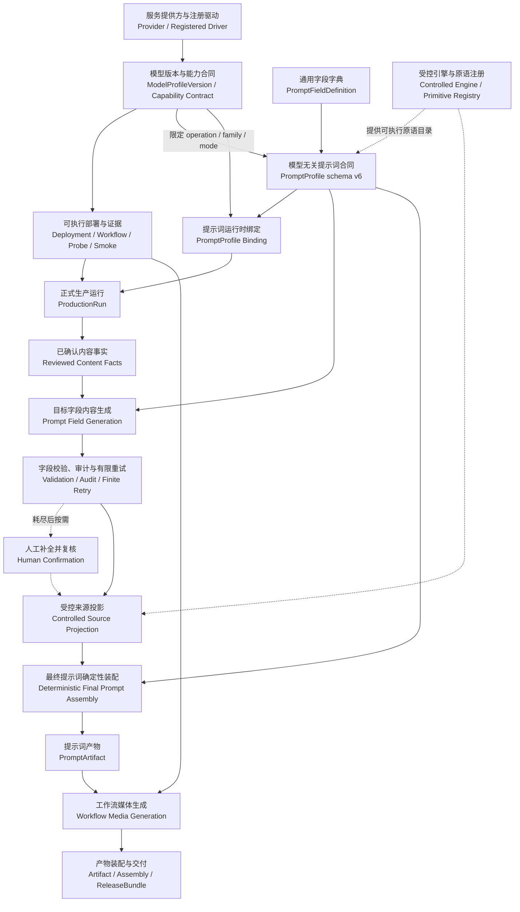
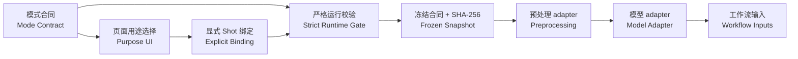

# Production Operator Manual

操作员的权威逐步手册位于前端“生产手册”页面；其结构化源文件是 [frontend/src/content/productionManual.ts](../frontend/src/content/productionManual.ts)。本文只说明入口、范围和维护规则，避免形成第二套会漂移的步骤正文。

系统设置另有面向新用户的独立图文指南：前端路由 `/manual/settings`，可打印版本为 [system-settings-beginner-guide.md](system-settings-beginner-guide.md)。该指南正文唯一来源是 [frontend/src/content/systemSettingsGuide.json](../frontend/src/content/systemSettingsGuide.json)，Markdown 由 `npm run docs:settings-guide` 生成，不手工维护第二份正文。

## 使用入口

1. 使用 `scripts/restart.ps1` 启动服务。
2. 打开前端并进入“生产手册”。
3. 按手册先完成 migrations、provider/deployment、PromptProfile 字段目录/策略/binding、workflow validation/real smoke、配置 activation 和 host readiness。
4. 在“新建连续剧”选择空项目、导入脚本或 AI 创建。导入模式必须先核对 `ScriptSource` 预览并确认 revision；所选配方含 `script_structure/ai` 时还要填写集数、每集镜数和单集时长，服务端与全部冻结文本 route 的镜头时长策略求交并冻结 `structured_shot_duration_contract`。AI 模式同样必须填写结构化计划，并显式选择外发授权、币种和预算；合同冲突会在任何模型调用前拒绝。
5. 有媒体阶段的运行选择整集统一 workflow 或逐镜 workflow；AI/导入时 Shot 尚未建立，先选统一 route。需要在 ComfyUI 核对工作流时，下载 `download_import` JSON 并手动导入，不期待浏览器直接打开。
6. 在 ProductionRun 内处理 AI/结构化脚本与 Bible 审核、route、cost、候选、重试、不确定响应和交付 gate。worker 会自动继续非人工阶段，required review 必然暂停。
7. “生产工作流”统一展示素材、短剧与独立媒体任务。短剧 Tasks、Deferred requests、Assemblies、ReleaseBundles 仍完全只读，所有短剧创建、重试、取消和有序 fallback 都回到所属 ProductionRun；独立的素材 AssetGenerationJob 只在该页保留取消、失败/已取消重试和管理员人工消歧入口，成功产物与提示词候选返回素材库继续处理。
8. 最终交付检查每集 episode master 和 ReleaseBundle，不寻找整季单条长视频。

## 当前能力边界

页面手册必须清楚区分：

- 已实现：空项目、导入脚本与 AI 创建三种新建入口；
- 已实现：`ScriptSource` 安全 preview → confirmed revision，以及确定性 `script.structure` no-op/文本模型结构化 preview → required review；
- 已实现：AI script → review → deterministic Bible → review；
- 已实现：PromptProfile 合同 schema v6 的通用提示词合同、受控主要内容来源与逐字段 `generation_context_selectors`、声明式 `projection.output + projection_primitive`、受限 `source_projection_config`、多策略 Profile/binding 与缺少/歧义 fail-closed；历史 schema v1–v5 只读审计；
- 已实现：模型版本级 `prompt_normalization` 四项必填硬容量、必填但可为空对象的 `chat_request_options`，以及可选 `input_byte_warning_threshold` / `output_token_warning_threshold`；输入字节、建议长度、通道预警和输出 token 建议阈值只记录 warning，硬合同失败才有限重试，耗尽后转人工；
- 已实现：Settings 类型化参数与经服务端核验的 `resource_ref` 依赖下拉；
- 已实现：`script.generate`、`script.structure`、`prompt.normalize`、`visual_rules.generate` 与媒体 Deployment Smoke 统一返回持久 HTTP `202` task，Settings 恢复/轮询终态，单提交不确定状态只允许追加管理员消歧证据；
- 已实现：semantic Comfy workflow；
- 已实现：ComfyUI 安全 `download_import` 导出，精确绑定 validated deployment，不伪造 direct-open；
- 已实现：整集统一或逐镜 workflow selection；
- 已实现：worker 终态事实提交后幂等 auto-advance，required review/成本/选择 gate 暂停；
- 已实现：外部调用显式授权、币种/预算门禁与运行审计链；
- 已实现：async REST T2I/T2V；
- 已实现：managed artifact、逐集 master、ReleaseBundle；
- 已实现：归档时从冻结事实白名单生成 GeneratedArtifact `comparison_parameters`，候选参数差异不使用 manifest 身份/hash；
- 已实现：ProductionRecipe 发布要求完整 content → storyboard → prompt → media → selection → assembly → delivery 闭包；
- 已实现：五层配置、new-boot activation、host probe/recommend draft；
- 已实现：recommendation decide 由服务端复验陈旧快照、目录、配置和候选兼容性；
- 阻断：I2V/reference upload 尚无统一 provider contract；
- 未实现：跨节点/多 GPU scheduler；
- 不会执行：自动下载模型、自动发布 workflow/推荐、自动激活配置；
- 初始状态：bootstrap workflow catalog 是 `needs_review` 草案；
- 验收边界：真实外部 provider/GPU 通过范围只以对应日期的 E2E 报告及持久化 Run、Attempt、Artifact、媒体探测和 ReleaseBundle 证据为准，不能由单元测试或手册文字推导。
- 当前三线复验边界：纯人工、半自动和无人值守的动态 Ref2VA 连续验收由操作员在页面手册第 15 步手动执行；自动化只做本地合同回归，不启动服务、不提交 Provider/ComfyUI 请求，也不把历史零动态视频 Run 充当本轮证据。
- 0127 尺寸倍数准入：缺少冻结 `required_dimension_multiple` 证明的旧 current/published 媒体 Workflow 会保留历史证据但退出生产候选；操作员不得恢复旧证据或原地改写，须按第 15 步导入新不可变版本并重新 Live Validate、真实 Smoke、Publish。

catalog 或 adapter 中出现 H3/SDXL 等词不代表它是固定生产后端、已经启用或已经通过许可审查。

## 能力合同、模型无关提示词合同与受控原语

主路径先用能力合同（Capability Contract）确认模型能否执行目标 `operation`/`mode`，再用版本化 PromptProfile 描述提示词内容。Provider 的“支持模态（Supported modalities）/声明操作（Declared operations）”只是说明、展示和人工审核用的运营标记，不参与服务端执行授权、能力兼容性校验或候选筛选，任意输入文本不会注册驱动或获得新能力；实际能力由注册驱动、`ModelProfileVersion` capabilities、Deployment/Workflow 合同和新鲜真实 Smoke 证据共同证明。Probe 只确认健康和能力快照，不能替代 Smoke。PromptProfile 名称或 Binding 优先级同样不能授予模型能力。

独立素材的异步 API 路由使用精确的 `async_rest` 能力：图片 `image.text_to_image`、视频 `video.text_to_video`、音频 `audio.text_to_audio`；Bible 图片提示词使用另一条 `image.generate` PromptProfile 合同。它们不是 Provider 自由文本“声明操作”授予的能力，也不能互相替代。ComfyUI Workflow 则以 current/published、Live Validate、真实 Workflow Smoke、输出合同和当前 hash 证据进入候选。

ProductionRun 编排器不按模型名称、段落名称或固定六段分支。新模型如果能复用现有 capability、事实词汇和 `direct_v1`，或复用 `declarative_v1` 下已注册的来源投影原语，只需在系统设置中新建版本化资源，不修改主编排源码。

### 组件调用先后关系



推荐顺序是：先形成能力合同和执行证据；再维护字段字典、判断是否需要 adapter、创建 PromptProfile 并发布 Binding；创建 ProductionRun 后依次确认内容事实、生成与校验目标字段、执行来源投影、装配最终提示词。

### 模型无关提示词合同

1. 已确认内容事实形成并确认剧本、视觉规则、逐镜头叙事、Bible、对白、旁白/配音、声景和音乐。
2. 目标字段内容生成按每条 PromptProfile schema-v6 规则取得或生成目标字段，并执行冻结的主要内容来源、额外上下文、语言、长度和校验合同。
3. 来源投影（Source Projection）把通用事实或审核通过的字段贡献转换为装配来源；最终提示词确定性装配再按 Profile 配置生成 PromptArtifact，交给下一阶段。

关键配置口径如下：

| 配置 | 作用 | 边界 |
| --- | --- | --- |
| `field_definition.key` / `profile_field_key` | 本条规则要产出的稳定目标字段（destination） | 不是输入路径 |
| `generation_source_selector` | 生成目标字段时首先读取的主要业务事实 | model-generated/translate-only 只能从服务端 `generation_source_selectors` 分组目录选择；server-locked/passthrough 自动跟随 `source_selector`；不是文件路径或自由文本 |
| `generation_context_selectors` | 逐字段额外读取的已确认上下文 | 空数组只使用主要内容来源；`target_shot.dialogue_metadata` 不含对白原文，需台词时显式选择 `target_shot.dialogue_authored_text`；`adjacent_shots.core`、`all_shots.core` 必须显式开启 |
| `generation_mode` | `server_locked`、`model_generated`、`translate_only`、`passthrough` | 当前只有 `image.generate` / `video.generate` ProductionRun 执行字段级模型处理；其他 operation 只能选择服务端锁定或原值透传 |
| `generation_instruction` | 描述单个目标字段必须包含与禁止的内容 | 版本化说明文本，不可执行，模型处理模式必填 |
| `generation_output_semantics` | `final` 直接形成目标字段；`contribution` 作为受控投影输入 | contribution 必须被本规则选择的原语明确支持 |
| `generation_required`、`language_policy`、`length_unit`、`generation_min/max`、`generation_validator_keys` | 字段内容结果验收合同；受保护引用默认保持来源次数，也可显式配置为至少一次 | 未知或冲突组合 fail closed；两种引用计数策略不能同时启用 |
| `source_projection_key` | Profile 级来源投影选择 | 普通策略使用 `direct_v1`；页面组合代码原语使用 `declarative_v1` |
| `channel_limits.<channel>.max_chars / warn_at_chars` | 最终通道阻断上限与可选预警阈值 | 未配置即不限制；没有代码内隐藏默认值 |
| `source_selector` | 最终提示词装配读取的来源 | 与 `generation_source_selector` 职责不同；声明式原语规则固定选 `projection.output`；server-locked/passthrough 的主要内容来源由页面自动与它保持一致 |
| `projection_primitive` | 本字段规则选择的注册原语 | 仅 `projection.output` 必填；原语结果写入所选 `field_definition.key`，业务字段映射不写死在代码里 |
| `position`、`channel`、`label_style`、`separator`、`max_chars`、`required`、`omit_if_empty` | 最终字段取舍、顺序、通道、标签、分隔和长度 | 只做确定性装配，不重新创作已确认内容事实 |

`direct_v1` 不做额外协议转换，适用于现有通用来源可以直接装配的模型。`declarative_v1` 允许操作员在页面逐字段选择代码中已注册的确定性原语，并配置原语引擎的受限参数；原语结果、目标字段、顺序、标签、分隔和 channel 仍由 PromptProfile 决定。配置不能执行任意代码。只有现有原语无法表达的新确定性算法，才新增一个范围明确、可测试、经审查并注册的 engine/primitive。

已发布策略不能原地修改。在系统设置中对当前可写的 published/retired Profile 使用“创建后继草稿”，页面会提交所见来源合同 SHA-256；服务端精确复制配置和全部规则、自动递增版本并回到 `needs_review`。后继草稿不会自动改变 Binding。完成页面配置、preview、审核和发布后，再创建或切换新 Binding；旧 Binding 与 Profile 保持原指向供历史 ProductionRun 复验。`classified_reference_context_ir_v1` 这类 legacy Profile 不能作为 clone successor 来源。

### 哪些只需配置，哪些需要 adapter

| 变化类型 | 处理方式 | 是否改主编排 |
| --- | --- | --- |
| 新模型复用现有驱动 capability、事实来源和 `direct_v1` | 新建/发布 ModelProfileVersion、Deployment/Workflow、PromptProfile、Binding、Recipe 和配置 Revision | 否 |
| 模型只改变字段名称、单字段生成说明、语言、长度、validator 组合、顺序、标签、分隔或 channel | 新建 PromptFieldDefinition 和 PromptProfile 版本 | 否 |
| 模型复用一个或多个已注册 source projection primitives | 选择 `declarative_v1`，按字段规则组合 `projection.output` 与原语 | 否 |
| Provider 出现平台尚不能解释的请求、鉴权、轮询或响应协议 | 新增并测试受控 Provider driver/adapter，再登记配置 | 不改 ProductionRun；需扩展受控适配层 |
| 现有 source projection primitive 无法表达新的确定性转换 | 新增、测试、审查并注册 engine/primitive，再由页面选择 | 不改 ProductionRun；需扩展受控适配层 |
| 需要新的可执行 validator | 在平台增加受控 validator 实现和测试，再供 Profile 选择 | 不允许把脚本/正则塞进配置 |
| 状态机、审计、幂等、引用安全或权限规则变化 | 按代码安全合同变更并验证 | 不能降级为可执行配置 |

### H3 六段与通道配置案例

使用合同 schema v6 并选择 `source_projection_key=declarative_v1`，可以在页面建立[MiniMax H3 官方提示词 Skill](https://github.com/MiniMax-AI/MiniMax-H3/blob/main/skills/h3-prompt-writing/SKILL.md)六段合同；它不是所有视频模型的默认合同。每条规则的最终提示词取值选择 `projection.output`，再从服务端目录选择对应 `reference_context.*` 原语。前三段由服务器锁定，后三段由文本模型逐字段生成；字段名称、顺序、标签、分隔符、通道和校验等级全部来自本次选择并冻结的 Profile 数据。三个模型生成字段的 `generation_context_selectors` 可显式选择 `project.style`、`target_shot.core`、`target_shot.dialogue_metadata`、`target_shot.linked_bible`，不隐式读取相邻镜头或全剧。这里的 `dialogue_metadata` 仍不含对白原文；其他模型或字段确需读取已确认台词时，必须显式增加 `target_shot.dialogue_authored_text`。

Profile 的 `source_projection_config.schema_version=3` 在 `primitive_options.reference_context_ir_v1.reference_context_policy` 下配置 retention 的 Subject/Shot 使用关系与字面量分隔符、`[Shot 1]` 前 1–2 句锁定风格开场，以及 Subject 首次清晰出现位置；页面保存的是受限数据，不是模板或脚本。`classified_reference_context_ir_v1` 只为冻结的历史 Profile/Run 保留运行时读取，不再用于新建、发布或克隆后继策略。

| # | 目标字段 | 最终来源 / 原语 | 主要内容来源 | 标签 | 字段内容合同 |
| --- | --- | --- | --- | --- | --- |
| 1 | `subject_definitions` | `projection.output` / `reference_context.subject_definitions` | `projection.output` | `label_block` | `server_locked`、`final`、`language=any`、`length=none`、无 validator |
| 2 | `summary` | `projection.output` / `reference_context.summary` | `projection.output` | `label_colon` | `server_locked`、`final`、`language=any`、`length=none`、无 validator |
| 3 | `retention_analysis` | `projection.output` / `reference_context.retention_analysis` | `projection.output` | `label_block` | `server_locked`、`final`、`language=any`、`length=none`、无 validator |
| 4 | `detailed_description` | `projection.output` / `reference_context.detailed_description` | `shot.detailed_description` | `label_block` | `model_generated`、`contribution`、`en`、`english_words=350–500`、`length_advisory` + 严格非空/字符/引用校验 |
| 5 | `overall_soundscape` | `projection.output` / `reference_context.overall_soundscape` | `shot.sound_effects` | `label_colon` | `model_generated`、`contribution`、`en`、`english_words=1–80`、`length_advisory` + 严格基础校验 |
| 6 | `non_diegetic_music` | `projection.output` / `reference_context.non_diegetic_music` | `shot.music` | `label_colon` | `model_generated`、`contribution`、`en`、`english_words=1–60`、`length_advisory` + 严格基础校验 |

三条 `model_generated` 规则分别填写版本化、不可执行的 `generation_instruction`：导演描述只能扩展已冻结的可见镜头事实并保持精确时长、时序、连续性和引用身份；对白、歌词与画面文字保留原语言，对白使用稳定 `(Sx)` 说话人和 `<d>[Language] ...</d>` 标签；总体声景只描述已冻结事实支持的画内环境声与同步音效；非画内音乐只描述已冻结事实支持的音乐风格、强度、转场和静默。注册原语只把贡献与冻结事实投影为完整段，最终字段、顺序、标签、分隔和 channel 仍由 Profile 数据决定。通用主编排不识别 H3 或“六段”。

实际操作时先分别选择当前可用的视频 Workflow 与 Bible 图片 Workflow，再读取并冻结各自的尺寸、帧数、帧率、steps、Live Validate、真实 Smoke、PromptProfile Binding 与合同 SHA-256。历史 0.2MP 验收案例中的参数只证明对应的精确版本和 attempt，不是新 Run 的默认值；即使两个工作流碰巧使用相同尺寸或 steps，也不能复用另一工作流的证据。

### prompt.normalize 容量、受控请求选项、分批与失败接管

精确声明 `prompt.normalize` 的 `ModelProfileVersion` 必须冻结四项必填硬容量和 `chat_request_options`（无额外选项时填 `{}`），可额外包含 `input_byte_warning_threshold` 与 `output_token_warning_threshold`。`max_input_bytes`/`max_output_tokens` 是请求硬上限；两个 warning threshold 是人工调优建议值，完整请求或正常完成的响应超过它们只记录警告。Provider 返回 `finish_reason=length` 表示输出已经截断，仍必须失败，不能用“建议值”口径掩盖。

| 字段 | 运行职责 | 失败边界 |
| --- | --- | --- |
| `max_input_bytes` | 限制实际 chat messages 的 UTF-8 字节数 | 单项字段独立装配仍超限时，在创建 Provider Attempt 前阻断 |
| `input_byte_warning_threshold` | 可选输入字节建议阈值，超过后记录人工优化 warning | 必须在 `1..max_input_bytes`；不拆批、不重试、不阻断 |
| `max_output_tokens` | 冻结每批模型响应预算 | Provider 请求不得另用隐藏值覆盖 |
| `output_token_warning_threshold` | 可选建议阈值，超过后记录人工优化 warning | 必须在 `1..max_output_tokens`；不阻断完整响应 |
| `max_items_per_batch` | 限制每批字段数 | 与字节上限同时满足，不是只按条数切分 |
| `timeout_seconds` | 冻结每批传输执行超时 | 只控制该模型调用，不改变 Run 的任务硬时限 |
| `chat_request_options` | 必填的受控 JSON 对象；可为 `{}`，也可冻结 `temperature`、`response_format`、`thinking` 等已支持选项 | 不得覆盖核心请求、传输地址/超时或包含凭据；字节和结构上限来自安全配置 |

`chat_request_options` 必须是可规范化的 JSON 对象。字段名必须以 ASCII 字母开头，只能使用字母、数字、`_`、`.` 和 `-`；值只能是 JSON 基础类型。禁止凭据类字段，也禁止覆盖 `model`、`messages`、输出预算、`stream`、`seed`、传输地址/超时、`chat_request_options` 及已退役的 `chat_completion_options`。`temperature` 和 `response_format` 是可声明的模型选项，但必须通过当前 Provider 驱动验证。嵌套深度、字段/数组数量、字符串和总大小的绝对上限均读取“安全边界”当前配置；违反任一边界会在 Provider POST 前以稳定合同错误阻断。

`script_normalize` 在第一次提交前冻结完整 batch plan；每批独立 Attempt，已成功批不重跑。输入字节建议阈值、`length_advisory`、通道 `warn_at_chars` 和输出 token 建议阈值只进入候选的建议审计并继续；真实输入硬容量、required、JSON 形状、语言、受保护内容、未解析占位符、内容过滤和响应截断仍为硬合同。只有硬失败批在唯一审计完整时消费有限重试，耗尽后转人工确认。

容量、建议阈值与 Chat Completions 选项必须从本次选择的已发布 ModelProfileVersion 按 operation 读取并冻结，不能复制退役版本或文档案例中的数值。`visual_rules.generate` 的可选 `quality_advisories` 也是这一冻结合同的一部分；配置的颜色数量、负面约束数量/单项长度和内容长度建议只进入候选 `warnings` / `advisory_audit`。`recommended_negative_clauses` 只在配置存在时合并到候选，人工可以移除且移除项仅记录告警；省略对象或字段就不启用隐含建议或代码默认清单。数组类型、允许枚举、唯一性、可打印英文与控制字符、来源回显、Provider JSON/请求绝对资源上限仍为硬合同。新模型可在设置中发布自己的合同而不修改主编排；`script.generate`、`script.structure`、`prompt.normalize` 和 `visual_rules.generate` 必须分别取得当前 target 的新鲜真实 Smoke。

### 动态参考合同与调用关系

动态参考用途不是平台全局枚举。工作流/模型的 `input_contract.conditioning_contract.modes[].dynamic_reference_topology` 是唯一解释来源，页面从这里显示双语名称、帮助和明确默认值；Shot 只保存安全 purpose key。创建 ProductionRun 后冻结所选 mode contract 与 SHA-256，服务端按同一份合同校验数量、用途、配对和互斥，再调用合同指定的预处理 adapter，最后交给所选模型 adapter。缺合同、未知用途或规则冲突都会停止并要求修正，不猜默认用途。



以下可直接作为 H3 Ref2VA 模式的 `dynamic_reference_topology` 实例；外层 `inputs` 同时配置 `reference_videos=0–3`、`paired_video_audios=0–3`、`reference_audios=0–3`。H3 只是一个配置实例，新模型应替换用途、显示说明、基数和 adapter key。

```json
{
  "schema_version": 1,
  "videos": {
    "minimum_items": 0,
    "maximum_items": 3,
    "default_purpose_key": "motion_camera_reference",
    "purposes": [
      { "key": "motion_camera_reference", "label": "同故事动作与运镜参考 / Same-story Motion-Camera Reference", "description": "原生 Ref2VA 读取完整视频；此用途只表达希望侧重动作节奏与镜头运动，不隔离视频内容。只能选择同故事且人物、场景、道具不与目标镜头冲突的生产素材。", "minimum_items": 0, "maximum_items": 3 },
      { "key": "video_editing", "label": "视频编辑参考 / Video Editing", "description": "参考剪辑结构与时序。", "minimum_items": 0, "maximum_items": 3 },
      { "key": "video_continuation", "label": "视频续写参考 / Video Continuation", "description": "从参考视频末态继续发展。", "minimum_items": 0, "maximum_items": 3 }
    ]
  },
  "audios": {
    "minimum_items": 0,
    "maximum_items": 3,
    "default_purpose_key": "audio_reference",
    "purposes": [
      { "key": "audio_reference", "label": "音频参考 / Audio Reference", "description": "参考声音节奏与声景。", "minimum_items": 0, "maximum_items": 3 },
      { "key": "audio_reuse", "label": "音频复用 / Audio Reuse", "description": "复用已批准音轨。", "minimum_items": 0, "maximum_items": 3 }
    ]
  },
  "preprocessing": {
    "videos": { "adapter_key": "cfr_video_v1", "minimum_duration_ms": 2000, "maximum_duration_ms": 15000, "target_fps": 24, "requires_source_fps": true },
    "paired_video_audios": { "adapter_key": "aligned_audio_v1", "minimum_duration_ms": 2000, "maximum_duration_ms": 15000 },
    "reference_audios": { "adapter_key": "passthrough_audio_v1", "minimum_duration_ms": 2000, "maximum_duration_ms": 15000 }
  },
  "pairing_rules": [{
    "key": "video_audio_pairing",
    "label": "视频与音轨配对 / Video-Audio Pairing",
    "description": "每条视频最多一个内嵌或外配音轨。",
    "source_media_kind": "video",
    "target_media_kind": "audio",
    "source_purpose_keys": ["motion_camera_reference", "video_editing", "video_continuation"],
    "target_purpose_keys": ["audio_reference", "audio_reuse"],
    "default_target_purpose_key": "audio_reference",
    "minimum_targets_per_source": 0,
    "maximum_targets_per_source": 1,
    "allow_embedded_source": true,
    "allow_external_target": true,
    "source_and_external_mutually_exclusive": true
  }],
  "mutual_exclusion_rules": [{
    "key": "editing_or_continuation",
    "label": "编辑与续写互斥 / Editing or Continuation",
    "description": "同一绑定集合不能同时使用编辑和续写语义。",
    "media_kind": "video",
    "purpose_keys": ["video_editing", "video_continuation"],
    "maximum_distinct_purposes": 1
  }]
}
```

字段生成失败不会无限重试。`production.prompt_field_retry_limit` 在新 ProductionRun 创建时冻结，取值由普通配置决定并受 `security.production.max_automatic_retries` 封顶；只允许当前失败批的 `provider_response_invalid` 和 `prompt_normalize_contract_failed` 在唯一 `KNOWN_RESPONSE_REJECTED` 审计完整时消费，已成功批不重跑。`retry_feedback` 不是可人工编辑的配置项：仅当前一次失败含可与冻结 `item_generation_rule` 反校验的 `length_out_of_range` 时，服务端才从受控 `reason_code`、数值 `validation_context` 与 `request_index` 派生反馈，并通过下一 attempt 的 `repair_of_attempt_id` 和 `retry_feedback_sha256` 留证。ProductionRun 只读显示关系与 hash，不显示或允许编辑反馈正文，也不会把模型原文带回下一次请求。耗尽后失败输出不成为候选，运行进入人工确认，人工补全仍需通过同一冻结 PromptProfile schema-v6 字段合同。`chat_request_options` 配置校验失败、`uncertain`、其他提交前门禁、请求拒绝、Smoke/配置/合同漂移和审计缺失不走该自动重试，也不转人工补字段；必须修正源模型版本或证据后再创建新运行。

## 维护

更新生产流程时，应在同一改动中同步：

- `frontend/src/content/productionManual.ts`；
- `frontend/tests/productionManual.test.ts`；
- `frontend/src/content/systemSettingsGuide.json` 与 `frontend/tests/systemSettingsGuide.test.ts`（设置流程或术语变化时）；
- 根 `openapi.yaml`（仅当 API 契约实际改变）；
- 本页和受影响的正式文档。

验证：

```powershell
Push-Location frontend
npm run test:manual
npm run test:settings-guide
npm run typecheck
npm run build
Pop-Location
```

不得在 Markdown 中复制整份页面手册，也不得把旧路由或历史操作按钮保留为“备用入口”。
