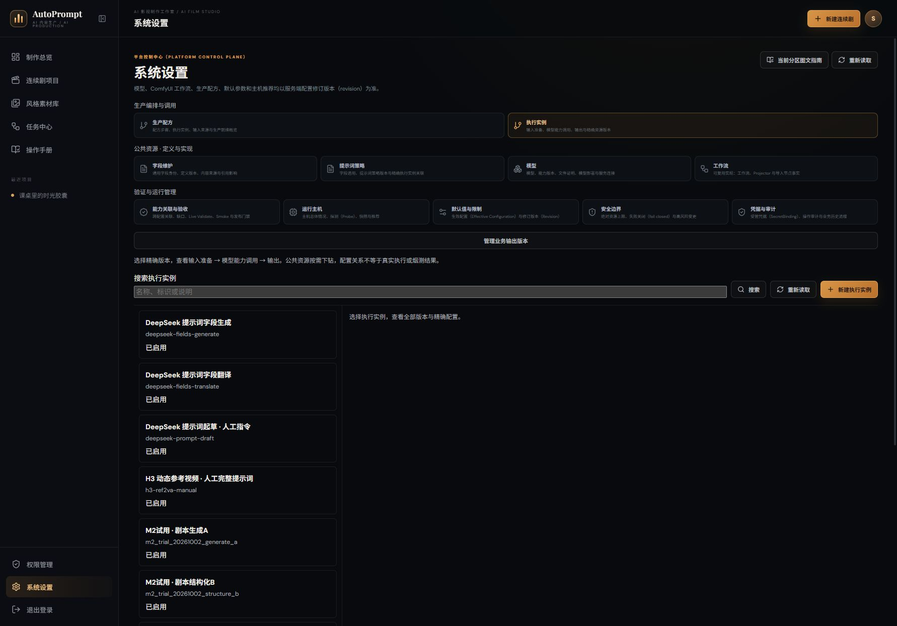
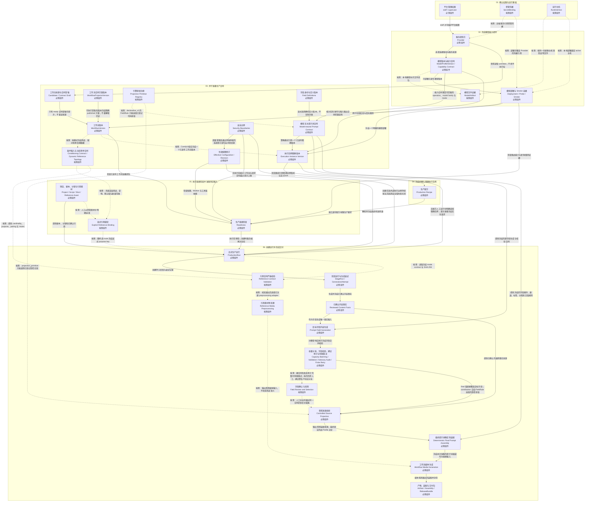
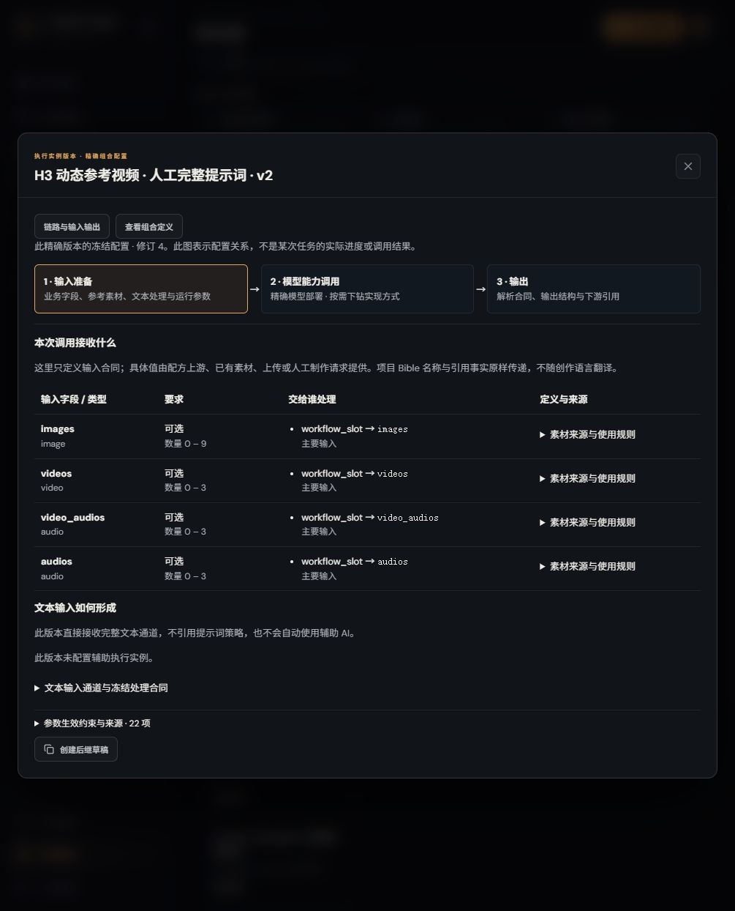
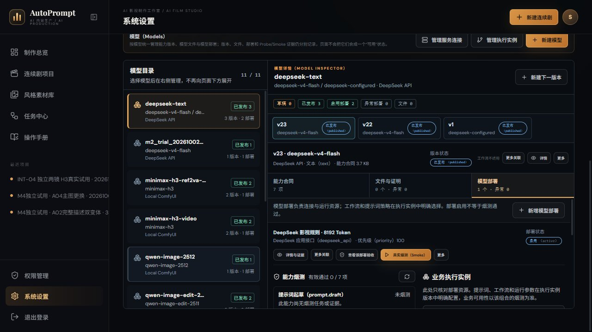
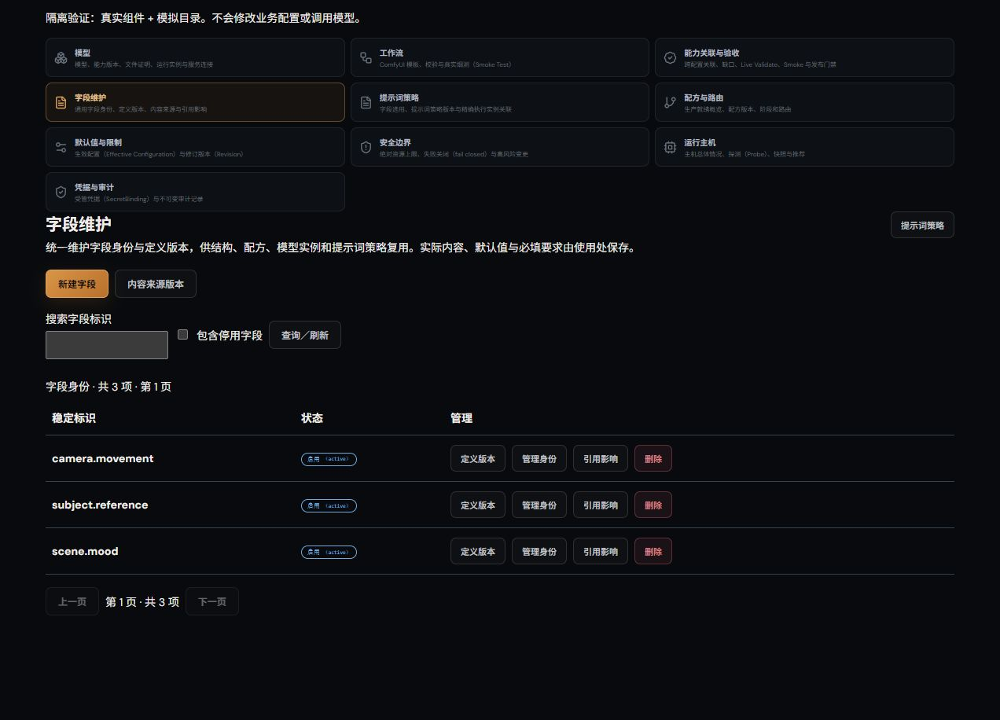
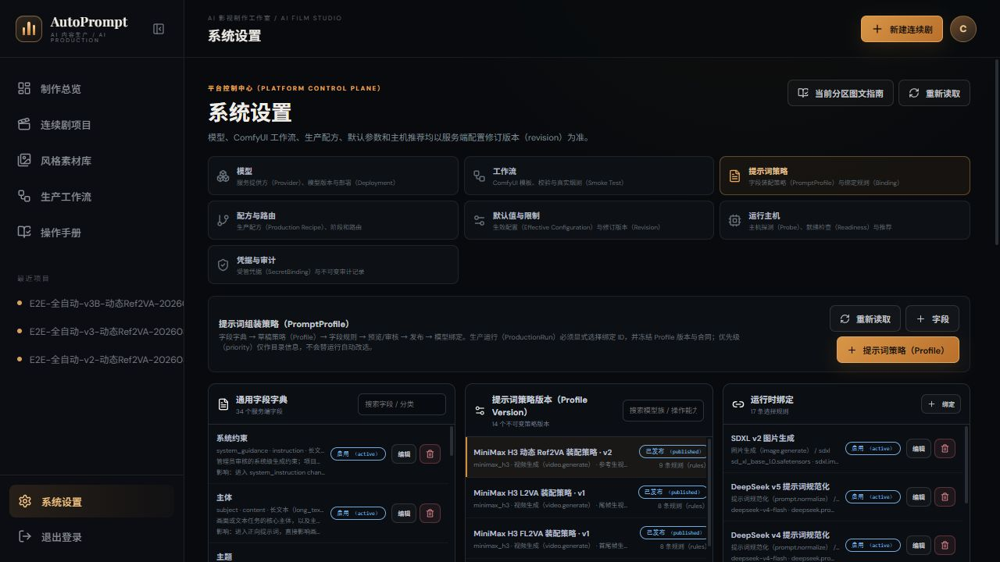
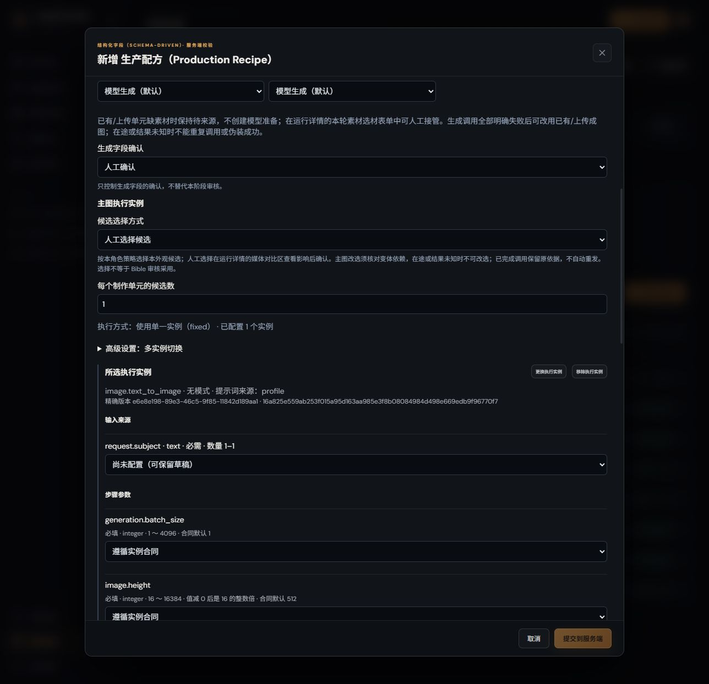
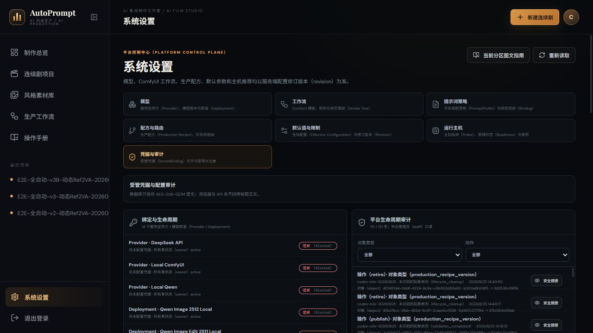
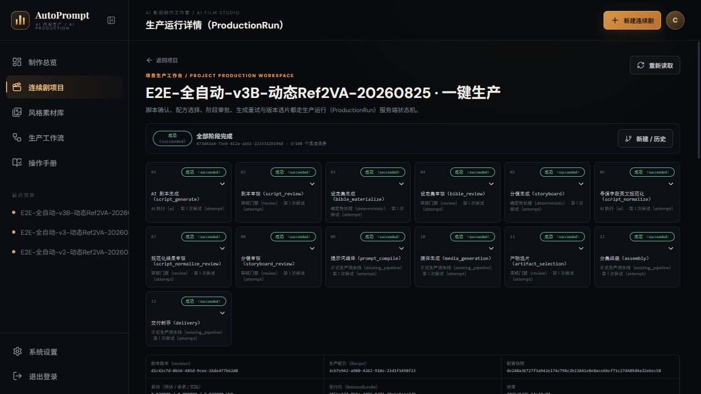

<!-- 此文件由 frontend/src/content/systemSettingsGuide.json 生成，请勿手工维护正文。 -->
# 系统设置新手图文指南

> 从看懂页面到完成一次可审计配置，按按钮、成功标志和故障恢复逐步说明

版本：1.3.35　更新日期：2026-10-15　页面入口：`/manual/settings`

## 如何使用本指南

适用对象：

- 第一次接触 AutoPrompt 的平台管理员
- 需要配置模型、工作流、提示词策略或运行主机的运营人员
- 只想复核已有配置、不希望误触高风险操作的审核人员

权限边界：

- 能力关联与验收 → 能力与关联总览：点击对象的“查看定义与使用方”，在当前页查看精确版本的含义、输入输出或约束，并继续下钻依赖和使用方。点击“返回关联目录”保留搜索、分页与展开状态；修改使用“前往维护（新窗口）”，原目录不离开，也不会自动改选新版本。这里展示当前配置，不代替任务冻结记录或真实执行验收。
- 普通登录用户可以阅读本指南，但真正进入“系统设置”并修改配置需要平台管理员（staff）权限。
- 创建、轮换或停用受管凭据（SecretBinding）需要超级管理员（superuser）权限。
- 安全边界（Security Boundaries）对平台管理员只读；只有超级管理员可以新增定义、修改值、发布或激活相关配置修订。
- 系统设置的 Provider、Model、Deployment、Workflow、Recipe、PromptProfile、SecretBinding、默认值和安全边界列表共用同一搜索规则；已退役或停用记录默认隐藏，页面会显示隐藏数量，需要复核历史时再主动开启显示。
- 所有新增/编辑表单只要求填写有业务意义的字段；受控值从服务端 options 目录选择，版本、合同 Schema、排序及新记录生命周期等技术字段只读或由服务端分配。目录缺失或无效时停止打开和提交，不回退自由文本；仅 custom_entry_fields 明确授权时显示高级登记入口。
- 切换设置分区只读取当前目录，不等待全平台生产能力检查。模型部署验收证据、配方生产链核对独立加载；读取中或失败不代表通过，可在对应区域重试。配方编辑目录读取失败会显示具体原因并禁止新建/保存，可点“重新读取配方目录”恢复；已有配方仍可查看，重试仅重新读取，不提交配方或执行生产。模型版本编辑和烟测消歧打开后才读取所需限制，未读取成功不能提交；重新读取会刷新当前分区，提示词分区也会重新读取字段、版本与规则。
- 看见按钮不代表一定有权限；最终权限、依赖和状态都由服务端复核，页面不会伪装成功。

### 状态不是一回事

- **启用（active）**：对象允许参与选择，但不代表已完成真实调用验证。
- **已发布（published）**：版本已冻结，不能原地覆盖；后续变更要新建下一版。
- **已校验（validated）**：结构和绑定已通过在线校验，不等于真实生成已经成功。
- **烟测通过（smoke passed）**：用最小真实请求执行成功；证据仍要检查是否过期（fresh）。
- **待消歧（uncertain）**：远端是否接收请求无法确认。先查服务商控制台和账单，不能自动或人工直接重复提交。
- **建议警告（advisory warning）**：结果偏离推荐目标，但事实完整且仍可执行；记录到审核页供人工评估，不阻断主流程，也不消费失败重试次数。
- **待人工确认（awaiting approval）**：阶段审核或执行准备的字段正在等待人工决定。打开对应对象核对来源、正文和校验；确认与采用是明确动作，查看和确认本身不提交模型。
- **阻断（blocked）**：依赖、权限、预算或证据不完整，必须先处理页面给出的原因代码。



_图 0：系统设置按使用层级分组。执行实例是独立入口；模型、字段、策略、工作流作为公共资源复用，不重复登记。_

## 三分钟配置顺序

1. **先确认权限**：使用 staff 登录；只有处理秘密凭据时才切换到 superuser。
2. **先看运行主机**：选择目标主机并确认最近探测快照有效，避免在离线主机上继续配置。
3. **配置模型闭环**：Provider → 草稿模型版本/文件 → 发布 → Deployment → Probe → Smoke。
4. **配置工作流闭环**：扫描 → 纳管 candidate → 生成合同草稿 → 提升版本 → 在线校验 → 真实烟测 → 发布；candidate/draft 不能直接生产。
5. **配置执行实例与配方**：在独立“执行实例”分区固定部署、可选工作流及提示词方式；文本处理属于输入准备，配方步骤选择精确实例版本。
6. **核对默认值**：只修改实际需要的配置。字段生成与翻译使用本次执行准备冻结的辅助实例和批次；失败后明确重试该批次，或人工补齐并确认采用。
7. **复核安全边界**：确认真实工作流参数没有超过绝对上限。staff 只读复核；确需变更时由 superuser 单独审核、发布并重新验收。

> 探测（Probe）只确认健康与能力；真实烟测（Smoke Test）会提交真实低成本请求并可能产生费用。两者不能互相替代。

## 配置准备顺序与依赖关系（不是运行路径）

下面是管理员准备配置的顺序，不是一次模型调用的执行顺序，也不表示各节点同级。业务从配方到执行实例下钻；实例内部是输入准备（含提示词处理）→模型能力调用→输出，工作流／Projector位于可选实现层。字段、结构、策略等公共资源可跨层复用。

- 必需：正式 ProductionRun 的主链路必须具备
- 按需：仅远端鉴权、本地执行或对应媒体阶段需要
- Probe 与 Smoke 是两个独立门禁，不能互相替代
- 纯配置接入（Configuration-only）：复用现有驱动能力、事实来源和已登记原语，只新增 schema v8 版本化资源
- 原语开发（Primitive-required）：只有出现现有原语无法解释的新外部协议、新确定性投影或新可执行校验时才需要代码



_关系图 A：核心组件从能力合同、模型无关提示词合同到正式交付的调用关系。节点可跳转到对应设置章节或真实案例；虚线“按需”关系表示只有新协议或对应执行方式才需要。_

### 不支持关系图时，按阶段阅读

#### 1. 确认权限与运行基础

先保证人有权限、服务有凭据、本地主机可连接。
- **平台管理权限（staff / superuser）**：staff 负责平台配置；只有创建、轮换或停用秘密正文时才需要 superuser。
- **受管凭据（SecretBinding）〔按需〕**：远端服务需要鉴权时创建；Provider 与 Deployment 只保存引用，秘密正文不回显。
- **运行主机（RuntimeHost）〔按需〕**：本地 ComfyUI 部署需要 active 主机和新鲜 Probe；纯远端服务可以不绑定主机。
- **完成标志**：staff 可进入设置；所需 SecretBinding 可用；本地 RuntimeHost 最近探测成功。
- **再继续**：基础条件明确后，才登记模型能力。

#### 2. 完成模型能力闭环

先登记连接方式，再冻结真实模型版本，最后建立可执行部署。
- **服务提供方（Provider）**：登记驱动、服务根地址和凭据引用；驱动、支持模态和声明操作从服务端注册目录选择，但仍只是说明性运营标记，不参与执行授权、能力兼容性校验或候选筛选。
- **模型版本与能力合同（ModelProfileVersion / Capability Contract）**：冻结真实 model identifier、媒体类型、业务 capabilities 和可选的通用 execution_monitoring；它与驱动注册能力、Deployment/Workflow 真实证据共同决定哪些 operation/mode 可以执行，Provider 的说明性运营标记不能授予能力。
- **模型文件证据（ModelArtifact）〔按需〕**：本地模型补齐文件角色、大小和 SHA-256；远端模型明确为不适用。
- **模型部署与 Smoke 证据（Deployment / Probe / Smoke）**：把已发布模型绑定到主机或远端服务；部署生命周期与 Smoke 证据分别展示，Probe 查健康能力，Smoke 提交最小真实调用。部署不负责组装业务提示词；执行实例引用部署并固定具体调用方案。
- **完成标志**：ModelProfileVersion 已发布，Deployment active，Probe 与真实 Smoke 分别通过且证据 fresh。
- **再继续**：可执行部署就绪后，工作流与提示词策略才有可靠绑定目标。

#### 3. 并行准备生产合同

工作流、提示词策略和默认值可并行准备，但都必须在创建正式运行前发布或生效。
- **工作流来源与合同草稿（Candidate / Contract Draft）**：先把受控目录中的合法 JSON 冻结成不可执行 candidate，再用实时 `object_info` 生成不可变合同草稿。candidate 不要求目标 Deployment、published 模型或 projector；未解释项以 blocker 保留。
- **工作流合同方案版本（WorkflowProjectorVersion）**：candidate 纳管阶段不要求 Projector；要形成可提升的执行合同则必须唯一冻结一个 published 版本（generic fallback 也属于 Projector）。超级管理员版本化维护节点角色/连接、参数策略、模型文件角色和素材拓扑；Engine 自动锁定注册 adapter。具体 H3 T2VA/FL2VA/Ref2VA 是版本数据，发布新方案不会改写历史工作流。
- **工作流版本（WorkflowVersion）**：只有 `ready_for_executable_import` 草稿可提升；提升冻结节点图、参数 Schema、素材槽、主输出、模型和精确 projector identity，不重读本地源。随后依次完成 Live Validate、真实 Smoke、Publish。
- **条件输入与动态参考合同（Conditioning Contract / Dynamic Reference Topology）〔按需〕**：模型能力版本声明条件模式、用途、基数、pairing、mutex 和 preprocessing；冻结的 published projector 将其与实时节点动态插槽一致性核对后写入草稿/版本。页面只读，不接受人工填写 key、节点 ID 或 JSON。
- **引擎原语注册（Projection Primitive Registry）〔按需〕**：服务端代码只登记已实现、已测试的确定性原语；页面 FieldRule 选择原语并决定业务字段、顺序、格式和通道。配置页不能上传脚本、模板或自定义执行器。
- **字段身份与定义版本（Field Definitions）**：统一字段维护入口；实际值及使用规则仍由消费者保存。
- **模型无关提示词合同（Model-neutral Prompt Contract）**：PromptProfile 合同 schema v8 冻结已确认事实引用、逐字段内容生成/校验、source_projection_key、字段级 projection_primitive、受限 source_projection_config，以及最终提示词的顺序、通道、标签、分隔和长度合同。H3 六段是 declarative_v1 的可复制 Profile 实例，不是主编排硬编码。
- **执行实例精确版本（Execution Instance Version）**：到独立“执行实例”分区选择部署、一个可选工作流及提示词方式；策略模式引用一个已发布策略。补齐槽位、参数和辅助目标后复核发布，不使用运行时Binding或priority自动选策略。“查看配置→复核完整合同→参数生效约束与来源”可查看合并范围、枚举、对齐及每层来源；草稿表单的来源约束尚不包含未保存覆盖。同页“参数目标映射→读取参数目标映射”核对精确工作流节点输入或async REST顶层字段，不按同名猜接线；无记录或配置漂移会明确提示。它是编译前声明，实际请求仍在任务中心查看。任务中心“准备与调用→输入与运行参数”显示当时保存的实际值与来源，不把今天的默认值补进历史。
- **生效配置修订（Effective Configuration / Revision）**：解析系统、项目和请求层默认值；每次变更形成不可变 Revision。
- **安全边界（Security Boundaries）**：保存仅 system 作用域的绝对资源上限。staff 只读，只有 superuser 可变更；命中时失败关闭，且不会被项目、Run、模型或工作流默认值放宽。
- **完成标志**：工作流、所需策略与执行实例精确版本已发布；资源和组合烟测分别可查，有效配置可解释。
- **再继续**：配方路线引用精确执行实例；无配方和素材生成也选择精确实例，每次请求再冻结实际输入、参数及字段选择。

#### 4. 冻结步骤与精确执行实例

把阶段顺序、已验证的精确执行实例版本和人工/自动门禁写入版本化配方；Recipe 不负责冻结项目输入或本次运行的有效配置。
- **生产配方（Production Recipe）**：冻结阶段顺序、执行模式、审批方式、变体数及精确执行实例版本；不包含尚未创建的 Run 输入快照。
- **完成标志**：Production Recipe 已发布，阶段从 script_input 到 delivery 闭环，精确实例版本与输入配置可追溯。
- **再继续**：配方发布后，再用真实项目输入创建一次运行。

#### 5. 执行就绪检查并准备项目输入

先用 Readiness 汇总当前系统闭环，再准备剧本、分镜和明确用途的引用资产。
- **生产就绪检查（Readiness）**：按全部仍处于 published 的 Recipe 汇总部署、工作流、烟测、Worker、工具链和配置依赖；blocked 时先在生产配方处理聚合原因。
- **项目、剧本、分镜与引用素材（Project / Script / Shot / Reference Asset）**：业务事实与生成输入的来源；系统不会猜测素材用途，也不会把空字段伪装成有效提示词。
- **显式引用绑定（Explicit Reference Binding）〔按需〕**：人工按当前 mode 合同选择素材与 purpose key；Shot 只保存安全标识符，不能自行解释或补默认用途。
- **完成标志**：目标配方 Readiness=ready；Project、Script、Episode、Shot 与 Reference Asset 数据完整，引用用途已人工确认。
- **再继续**：输入和所有系统合同同时就绪后，才创建 ProductionRun。

#### 6. 创建运行并形成交付

运行开始时冻结版本、路由、输入、参数和预算；先形成已确认内容事实，再按 PromptProfile schema v8 的逐字段来源与显式上下文合同取得或生成目标字段，declarative_v1 按每条 FieldRule 选择的代码原语产生 projection.output，最后按页面配置的顺序、格式和通道确定性装配，随后进入媒体与交付。
- **正式生产运行（ProductionRun）**：配方或人工计划均冻结到RunPlan；每次AI调用以精确实例创建Preparation，冻结输入、参数、字段选择及费用授权，不使用旧提示词Binding。
- **阶段运行与生成尝试（StageRun / GenerationAttempt）**：持久记录 queued、running、blocked、uncertain、awaiting approval、completed 等状态及恢复动作。
- **已确认内容事实（Reviewed Content Facts）**：生成并确认剧本、视觉规则、Bible及分镜；创作字段保留结构化输出或人工填写的独立原值、确切结构版本和字段来源，提示词策略按明确路径读取和组装，不预拼正文或填回固定旧列。
- **目标字段内容生成（Prompt Field Generation）**：field_definition.key/profile_field_key 是目标字段；generation_source_selector 从服务端 generation_source_selectors 目录选择主要内容来源，generation_context_selectors 是逐字段显式勾选的额外已确认信息。空数组只使用主要内容来源；相邻镜头和全剧不会隐式注入。generation_mode、generation_instruction、output semantics、语言、长度和受控 validators 全部读取冻结 PromptProfile，不在主逻辑写模型专属段名。
- **容量分批、字段校验、建议审计与有限重试（Capacity Batching / Validation / Advisory Audit / Finite Retry）**：目标执行实例固定策略。执行准备按冻结规则产生生成或翻译批次，由对应辅助实例执行；结果写回主准备，确认并采用后组装最终通道。
- **字段确认与采用（Field Review and Selection）〔按需〕**：人工或辅助制作需要明确确认并采用字段；无人值守按本次冻结字段审核策略处理完整有效批次。人工可直接填写，不需要等待失败或耗尽重试次数。
- **受控来源投影（Controlled Source Projection）**：Profile 通过 source_projection_key 选择 direct_v1 或 declarative_v1。direct_v1 直接使用通用事实；declarative_v1 读取每条 FieldRule 的 projection_primitive 并产生 projection.output。最终字段、顺序、标签、分隔符和通道仍由 Profile 页面规则决定。
- **最终提示词确定性装配（Deterministic Final Prompt Assembly）**：source_selector 指向装配来源；field_definition.key 是稳定目标字段。按冻结 Profile 配置的 position、channel、label_style、separator、max_chars 与空值策略组装本次 ExecutionPreparation 的最终提示词通道，不创建独立旧提示词产物。
- **引用合同严格校验（Reference Contract Validation）〔按需〕**：从冻结 mode contract 校验数量、用途、配对和互斥；缺合同或未知用途直接停止，不按模型名称猜测。
- **引用素材预处理（Reference Media Preprocessing）〔按需〕**：仅调用冻结合同注册的 video、paired audio、standalone audio adapter；素材入库只保存源事实，不预先套用 H3 CFR。
- **工作流媒体生成（Workflow Media Generation）**：把本次准备冻结的提示词通道和已批准素材交给精确执行实例所固定的执行器与工作流；H3 Ref2VA 只是案例。素材库、人工制作和配方生产都按实例输入合同映射素材，并由服务端核验用途、顺序、数量与配对。
- **产物、装配与交付包（Artifact / Assembly / ReleaseBundle）**：校验媒体后登记受管产物，装配分集母版并封存交付包。
- **完成标志**：已确认事实、字段来源/目标/生成/校验、source projection 和本次准备冻结的最终提示词通道均可追溯；ProductionRun 完成且 ReleaseBundle 可审计。
- **再继续**：完成后从 Run 快照和产物证据复盘；需要变更时新建版本或新 Run，不改写历史。

### 关键调用关系

- **字段身份与定义版本 → 模型无关提示词合同**：显式选用确切定义版本，不复制字典
- **平台管理权限 → 服务提供方**：staff 才可维护平台配置
- **受管凭据 → 服务提供方**〔按需〕：远端服务引用受管凭据
- **受管凭据 → 模型部署与 Smoke 证据**〔按需〕：部署可覆盖 Provider 的凭据引用
- **服务提供方 → 模型版本与能力合同**：选择连接驱动与服务来源
- **模型版本与能力合同 → 模型文件证据**〔按需〕：本地模型补齐文件闭包
- **运行主机 → 模型文件证据**〔按需〕：按同一份新鲜主机快照证明文件
- **模型版本与能力合同 → 模型部署与 Smoke 证据**：只部署已发布模型版本
- **运行主机 → 模型部署与 Smoke 证据**〔按需〕：本地部署绑定 active 主机
- **模型部署与 Smoke 证据 → 工作流版本**：用于在线校验与真实烟测
- **工作流版本 → 条件输入与动态参考合同**〔按需〕：按模式冻结用途、配对和预处理数据
- **模型版本与能力合同 → 模型无关提示词合同**：能力合同限定可匹配的 operation、model family 与 mode
- **引擎原语注册 → 模型无关提示词合同**〔按需〕：declarative_v1 的 FieldRule 只能选择已登记代码原语
- **模型无关提示词合同 → 执行实例精确版本**：策略模式引用一个已发布精确版本
- **模型版本与能力合同 → 执行实例精确版本**：核对实际操作与输入输出合同的兼容性
- **模型部署与 Smoke 证据 → 执行实例精确版本**：冻结一个明确的模型部署
- **工作流版本 → 执行实例精确版本**〔按需〕：ComfyUI组合冻结一个已发布工作流版本
- **执行实例精确版本 → 生产配方**：阶段路线引用精确实例版本与定义SHA
- **模型部署与 Smoke 证据 → 生产就绪检查**：检查路由能力与新鲜烟测证据
- **工作流版本 → 生产就绪检查**：检查已发布工作流证据闭包
- **生效配置修订 → 生产就绪检查**：检查配置、Worker 与工具链依赖
- **安全边界 → 生效配置修订**：超级管理员通过单独审核的系统修订发布高风险变更
- **安全边界 → 生产就绪检查**：在执行前核对工作流与请求没有越过绝对上限
- **生产配方 → 生产就绪检查**：按已发布配方收集生产要求
- **生产就绪检查 → 正式生产运行**：执行前预检；创建时服务端再次复验
- **执行实例精确版本 → 正式生产运行**：无配方人工运行也明确选择精确实例；逐次准备冻结实际请求
- **生效配置修订 → 正式生产运行**：解析并冻结最终有效参数
- **安全边界 → 正式生产运行**：创建前及外部执行边界持续按当前启用安全值失败关闭
- **项目、剧本、分镜与引用素材 → 正式生产运行**：提供剧本、分镜和已确认引用
- **条件输入与动态参考合同 → 显式引用绑定**〔按需〕：页面渲染用途、说明、默认值与数量范围
- **项目、剧本、分镜与引用素材 → 显式引用绑定**〔按需〕：人工从受管素材中明确选择
- **显式引用绑定 → 正式生产运行**〔按需〕：随所选 route 冻结显式 purpose key
- **正式生产运行 → 阶段运行与生成尝试**：创建持久阶段与尝试记录
- **阶段运行与生成尝试 → 已确认内容事实**：生成并冻结已确认内容事实
- **模型无关提示词合同 → 目标字段内容生成**：提供冻结的逐字段生成与校验合同
- **已确认内容事实 → 目标字段内容生成**：作为字段生成唯一事实输入
- **目标字段内容生成 → 容量分批、字段校验、建议审计与有限重试**：对模型响应执行冻结字段合同校验
- **容量分批、字段校验、建议审计与有限重试 → 字段确认与采用**〔按需〕：硬合同失败且审计完整时有限重试；耗尽后转人工，建议警告不走此分支
- **已确认内容事实 → 受控来源投影**：提供已确认的通用事实来源
- **容量分批、字段校验、建议审计与有限重试 → 受控来源投影**：final 值直接覆盖目标字段；contribution 交给 FieldRule 选择的受控原语
- **字段确认与采用 → 受控来源投影**〔按需〕：人工补全并通过同一合同后恢复主链路
- **引擎原语注册 → 受控来源投影**〔按需〕：projection_primitive 只能调用已登记受控实现
- **受控来源投影 → 最终提示词确定性装配**：输出受控装配来源，最终语法仍由 Profile 决定
- **模型无关提示词合同 → 最终提示词确定性装配**：提供冻结的字段顺序、通道、标签、分隔和空值规则
- **最终提示词确定性装配 → 工作流媒体生成**：冻结本次准备的提示词通道作为视频输入
- **正式生产运行 → 引用合同严格校验**〔按需〕：读取冻结 mode contract 与 SHA-256
- **条件输入与动态参考合同 → 引用合同严格校验**〔按需〕：提供 cardinality、purpose、pairing 与 mutex
- **引用合同严格校验 → 引用素材预处理**〔按需〕：校验通过后选择已注册 preprocessing adapter
- **引用素材预处理 → 工作流媒体生成**〔按需〕：输出受控媒体输入，不改变用途语义
- **工作流媒体生成 → 产物、装配与交付包**：媒体探测通过后装配并封存
- **服务提供方 → 工作流来源与合同草稿**：受控读取 userdata；不授予执行权
- **工作流来源与合同草稿 → 工作流版本**：只有 ready 合同草稿可提升；不重读来源
- **工作流合同方案版本 → 工作流版本**：可执行草稿和版本冻结精确 published 方案；不重解释历史

### 阅读提示

- 这是推荐配置顺序，不表示所有组件只能串行创建；工作流、提示词策略、配置修订和项目素材可以并行准备。
- Recipe冻结阶段和精确执行实例路线；RunPlan冻结本次计划，逐次Preparation冻结单元输入、参数及字段选择。无配方Run不创建隐藏Recipe。
- 安全边界不属于可被 Project/Run 覆盖的建议值：只有 superuser 可修改，运行创建前和外部提交边界会按当前启用值重新检查，收紧后也保护已排队任务。
- Readiness 是汇总检查结果，不是执行器；正式创建 ProductionRun 时，服务端仍会重新核对依赖。
- 修改已发布版本、默认值或优先级不会静默改写历史 Run；要让新配置生效，应创建新版本或新的 ProductionRun。
- 同一媒体请求只使用一份主准备。辅助生成、翻译各有自身准备和真实调用记录，结果写回主准备。字段辅助任务只在明确请求后重试失败批次，成功批次不重跑；远端结果不确定时先消歧，人工补齐仍须通过同一冻结字段合同。
- 能力合同（Capability Contract）先回答“模型能不能执行该 operation/mode”，提示词合同再回答“字段从哪里来、怎样生成校验、怎样装配”；PromptProfile 或 Provider 说明文本不能越权增加模型能力。
- 纯配置接入包括模型/部署、Workflow、字段字典、策略、执行实例、Recipe及配置修订，前提是复用已有驱动、事实来源和原语。
- 只有全新的 Provider 请求/响应协议、现有 projection primitive 无法表达的确定性转换，或新的可执行 validator 才需要开发、审查并登记代码原语；不要在 ProductionRun 主编排复制模型名分支，配置也不能执行脚本或任意代码。

## 关系图 B：从空项目到交付

这张图只描述一次短剧生产中的业务先后关系。先冻结已确认内容事实；再按 PromptProfile schema v8 的逐字段来源与显式上下文合同取得或生成目标字段；来源投影按 FieldRule 选择的原语产生装配值；最后由同一 PromptProfile 确定性装配。不要跳过文本 Bible、唯一实体锚点或 Shot 绑定，让视频模型自行猜测一致性。

```mermaid
flowchart TD
  node_production_empty_project["01. 新建空项目<br/>Empty Project"]
  node_production_ai_script["02. 生成候选并确认叙事事实<br/>Reviewed Narrative Facts"]
  node_production_text_bible["03. 生成文本 Bible<br/>Text Consistency Bible"]
  node_production_bible_candidates["04. 生成 Bible 候选图<br/>z-image-turbo Bible Candidates"]
  node_production_entity_anchors["05. 确认唯一实体锚点<br/>Canonical Entity Anchors"]
  node_production_shot_bindings["06. 绑定 Shot 实体与工作流素材<br/>Shot Bindings + Workflow Inputs"]
  node_production_prompt_field_generation["07. 生成目标字段内容<br/>Prompt Field Generation"]
  node_production_prompt_field_validation["08. 按容量分批、区分建议与硬校验并有限重试<br/>Capacity Batching / Advisory vs Required Validation / Finite Retry"]
  node_production_prompt_human_confirmation["09. 字段确认与采用<br/>Field Review and Selection"]
  node_production_prompt_compile["10. 来源投影与最终提示词装配<br/>Source Projection + Final Prompt Assembly"]
  node_production_h3_ref2va["11. H3 动态参考生视频<br/>H3 Dynamic Ref2VA"]
  node_production_artifact_selection["12. 选片<br/>Artifact Selection"]
  node_production_assembly["13. 装配分集母版<br/>Episode Assembly"]
  node_production_release_bundle["14. 封存交付包<br/>ReleaseBundle"]
  node_production_empty_project -->|读取已确认事实| node_production_ai_script
  node_production_ai_script -->|读取已确认事实| node_production_text_bible
  node_production_text_bible -->|读取已确认事实| node_production_bible_candidates
  node_production_bible_candidates -->|读取已确认事实| node_production_entity_anchors
  node_production_entity_anchors -->|读取已确认事实| node_production_shot_bindings
  node_production_shot_bindings -->|读取已确认事实| node_production_prompt_field_generation
  node_production_prompt_field_generation -->|读取已确认事实| node_production_prompt_field_validation
  node_production_prompt_field_validation -->|读取已确认事实| node_production_prompt_human_confirmation
  node_production_prompt_human_confirmation -->|读取已确认事实| node_production_prompt_compile
  node_production_prompt_compile -->|读取已确认事实| node_production_h3_ref2va
  node_production_h3_ref2va -->|读取已确认事实| node_production_artifact_selection
  node_production_artifact_selection -->|读取已确认事实| node_production_assembly
  node_production_assembly -->|读取已确认事实| node_production_release_bundle
```



_关系图 B：从空项目到 ReleaseBundle 的正式生产顺序。箭头表示事实依赖，不表示可以用测试动态视频替代剧情素材。_

### 不支持关系图时，按生产步骤阅读

1. **新建空项目（Empty Project）**：建立项目范围与生产目标；此时可以是 0 集、0 分镜。AI 创建必须填写集数、每集镜数和单集时长；导入剧本只有选中的配方含 script_structure/ai 时才显示并要求同一组结构化计划。
2. **生成候选并确认叙事事实（Reviewed Narrative Facts）**：从本轮创意生成，或把已确认导入原文格式化为规范剧本；通过精确实例生成候选后明确审核采用。配方把本轮集数、每集镜数和单集时长映射到实例输入（导入结构化为 planning 对象），原生协议核验计划和原稿明确时间；镜头时长可以不同，不按平均值等分。分镜中的叙事、对白和声景沿原审核与物化链传递，缺少事实不能由后续模型擅自补造。
3. **生成文本 Bible（Text Consistency Bible）**：从剧本提取人物、场景、道具和影视规则；先确认文字实体，再生成图片。
4. **生成 Bible 候选图（z-image-turbo Bible Candidates）**：用 z-image-turbo 生成实体候选图；可用 Bible 选择的模型重新生成，也可从素材库选择。
5. **确认唯一实体锚点（Canonical Entity Anchors）**：每个人物、场景和道具各确认一张正式参考图，形成跨镜头共享的唯一视觉锚点。
6. **绑定 Shot 实体与工作流素材（Shot Bindings + Workflow Inputs）**：每个 Shot 显式绑定同一组实体锚点。动态视频合同来自 input_contract.conditioning_contract.modes[].dynamic_reference_topology.videos，并按当前 conditioning_mode 选中唯一模式：minimum_items=0 可留空，maximum_items=0 禁止选择，其他组合按 minimum_items..maximum_items 接受完整集合。人工、辅助和全自动三条线都执行冻结 route 的同一 0..N 合同，不再额外限制为最多一条。
7. **生成目标字段内容（Prompt Field Generation）**：field_definition.key/profile_field_key 定义目标字段。依次配置 generation mode、generation source、generation_context_selectors、generation_instruction、output semantics、required、language、length 和受控 validators。dialogue_metadata 不含对白原文；需要原文时显式选择 dialogue_authored_text，相邻/全剧上下文也必须显式开启。模型专属规则来自冻结 Profile 数据。
8. **按容量分批、区分建议与硬校验并有限重试（Capacity Batching / Advisory vs Required Validation / Finite Retry）**：在本阶段执行准备中查看生成、翻译和人工字段，按当前策略与来源校验并确认采用。人工最终通道不强制另做AI规范化；参数和槽位仍按本次合同校验。
9. **字段确认与采用（Field Review and Selection）**：根据本次冻结字段审核方式，人工明确确认采用或由注册策略核对完整有效批次。没有有效采用项时不能组装最终通道；失败正文不会伪装成成功字段。
10. **来源投影与最终提示词装配（Source Projection + Final Prompt Assembly）**：先按 source_projection_key 选择 direct_v1 或 declarative_v1。声明式策略从每条 FieldRule 读取已注册 projection_primitive，产生 projection.output；再按冻结 Profile 的 source_selector、channel、position、label_style、separator、字段 max_chars、空值规则和 channel_limits 组装并校验本次准备的最终提示词通道。
11. **H3 动态参考生视频（H3 Dynamic Ref2VA）**：使用本次明确选择并冻结的 H3 动态 Ref2VA 双时钟 Workflow；尺寸、帧率、帧数和 steps 全部读取该 Workflow 合同。视频基数读取冻结的 minimum_items/maximum_items，因此合同允许 0 条时可以只使用 Bible 图片锚点；提示词读取本次冻结的 schema v8 Profile，按 declarative_v1 + projection.output + 六个 reference_context.* 原语形成六段。历史 0.2MP 参数只属于对应版本化验收案例，不是这里的默认值。
12. **选片（Artifact Selection）**：按镜头复核叙事、实体一致性、运动质量和媒体探测结果，选择正式变体。
13. **装配分集母版（Episode Assembly）**：按 Shot 顺序装配所选视频、音轨与时长，形成可探测的 Episode Master。
14. **封存交付包（ReleaseBundle）**：将母版、清单、校验值与运行快照封存为可审计交付事实。

### 生产边界提醒

- 原生 Ref2VA 会读取完整参考视频；purpose 只向提示词装配表达希望侧重的意图，不构成模型级内容隔离。正式生产必须选择与本剧同一故事宇宙、且人物、场景、道具不与目标镜头冲突的素材。三条生产线均按 conditioning_mode 读取冻结工作流 input_contract.conditioning_contract.modes[].dynamic_reference_topology.videos；人工/辅助逐镜页按所选 route 显示允许范围并在页面与服务端双重校验。
- metadata.fixture_scope=workflow_smoke 的测试视频只用于工作流版本验收页的真实烟测候选；普通素材列表、项目新建、分镜与 ProductionRun 选择器均不显示，服务端也拒绝把它冻结为生产输入。
- 某次版本化 0.2MP 验收案例中的图片和视频均使用 352×608 / 4 steps；这些数值只证明对应的精确 Workflow、fixture、target 与 attempt。实际操作必须分别读取本次选择并冻结的视频 Workflow 和 Bible 图片 Workflow，两套发布、校验、真实 Smoke 与路由证据不能互相复用。
- 图片生成明确选择身份与外观设定；参考生视频沿确切素材引用名和结构化创作字段装配，不自动追加外观锚点。创作字段通过 request.structured_input 的确切结构路径读取，不使用已退役镜头固定列。
- 同一媒体请求只使用一份主准备。辅助生成、翻译各有自身准备和真实调用记录，结果写回主准备。字段辅助任务只在明确请求后重试失败批次，成功批次不重跑；远端结果不确定时先消歧，人工补齐仍须通过同一冻结字段合同。
- H3六段是声明式原语的配置案例，不是通用编排固定分支；已有原语能表达的新模型通过字段规则、策略和执行实例接入。

## 执行实例（Execution Instances）

生成任务的可复用调用方案：先看输入准备、模型能力调用和输出，再下钻公共资源的精确版本。

设置深链：`/settings?section=executions`



_图：2026-10-09正式页面，只读查看H3人工提示词v2的冻结配置；入口为系统设置 → 执行实例。不代表新增真实调用或当前验收通过。_

### 这个部分具体做什么

- 统一供配方、素材库和人工制作选择精确调用方案，不属于某个模型的私有子对象。
- 查看合同中的字段输入、文本准备、辅助目标、参数来源和输出；查看本身不会运行模型。

### 操作前准备

- 拥有平台管理员权限。
- 要查看的精确版本存在；目录中包含草稿、发布与退役版本，状态不等于可调用。
- 配置新版本时准备必要模型部署和适用的工作流、提示词策略；不自动选最新版。

### 逐步操作

#### 1. 选择精确实例版本

- **怎么做**：在系统设置 → 执行实例搜索并选择实例，打开具体版本。
- **成功标志**：发布版本默认展示链路与输入输出，草稿默认进入编辑。
- **卡住时**：查看持续错误并重新读取，不用其他版本顶替。

#### 2. 理解输入到输出

- **怎么做**：依次点输入准备、模型能力调用、输出；按需展开参数生效约束与来源，或进入资源定义。
- **成功标志**：输入接线、来源要求、文本处理及适用实现均来自同一版本合同。
- **卡住时**：合同缺失或修订变化时停止展示，重新读取该确切版本。

#### 3. 新建身份，再配置首个版本

- **怎么做**：点击“新建执行实例”，填写标识、名称和说明；点击“创建实例并配置首个版本”。已有实例直接点击“新建版本”，不要重复登记同一身份。
- **成功标志**：身份和版本分开保存；进入版本作者时按“能力与实现→输入准备→输出约定”配置。身份保存成功不代表首个版本已保存。
- **卡住时**：身份保存失败保留原值；结果待核对时先回读，不再次新建。新版本未保存时离开可能丢失填写内容。

#### 4. 先保存组合，再配置输入

- **怎么做**：从目录选择模型部署、执行能力、声明的执行模式及适用工作流，明确选择提示词方式；新版本点击“创建草稿并配置输入”。已有草稿更换组合后，按提示点击“保存组合并配置输入”，再从新合同配置逻辑字段／素材来源、参数覆盖和按需辅助实例。
- **成功标志**：精确组合保存后才读取它的输入目录。人工完整提示词、提示词策略或无需提示词只使用目标支持的方式，不要求重复配置全部分支；原值和约束来自当前合同。
- **卡住时**：目录失败可重读，不能手填未知枚举或沿用旧组合的输入目录。更换组合会影响已有映射，先核对页内影响提示；保存失败保留输入，结果未知先回读。

#### 5. 编辑草稿或创建独立后继

- **怎么做**：草稿进入“编辑组合配置”，按分段修改并“保存草稿”。要从已有版本继续，核对来源的精确版本并点击“创建后继草稿”，在新草稿查看相对来源的变更范围。
- **成功标志**：草稿修改沿原保存接口；后继是独立版本，不覆盖原发布版本，也不自动更新配方、素材任务等使用方的引用。
- **卡住时**：先处理未保存修改、来源变更或待核对请求，再切换或创建后继；不要用同名版本代替确切来源。

#### 6. 下钻公共资源并返回

- **怎么做**：使用“查看所选部署”“查看模型能力定义”等入口下钻确切资源；需要修改时用“前往维护（新窗口）”。返回原作者后刷新所需目录，由自己明确选择新版本。
- **成功标志**：查看与返回保留原表单、选择、展开和焦点；新资源不会自动替换旧引用。模型、工作流和策略在各自唯一维护页修改，不在实例里复制其定义。
- **卡住时**：目标不可见或读取失败时保留原引用并重试，不能改用第一项。返回与重新读取整个页面不同，整页刷新可能丢失未提交内容。

#### 7. 复核发布，调用另行发起

- **怎么做**：保存后复核精确组合和输入输出，按页面发布流程办理；组合烟测在对应精确版本的“烟测与验收”单独发起。发布后的实例由配方步骤或素材生成入口选择，并提供本次字段值和素材。
- **成功标志**：保存草稿、发布、烟测与启动生成是独立动作；阅读指南和查看配置都不会调用模型。任务实际输入、结果及冻结记录到任务中心核对。
- **卡住时**：配置读取成功不等于当前准入通过；缺少输入、依赖或真实验收时按具体原因处理，不改写已发布版本或重复结果未知的请求。

### 字段怎么理解

- **实例输入**：本次调用的逻辑字段，映射到策略输入或实际接口槽位；具体值由业务入口提供。
- **文本准备**：提示词策略按配置处理并组装文本输入；只有需要生成或翻译时才使用配置的辅助执行实例。
- **模型能力调用**：固定模型版本及部署；工作流是适用时的实现工具，Projector负责识别和映射，不是第二次AI调用。
- **输出与使用方**：按声明解析输出并由下游引用；静态依赖数量不是实际运行次数。
- **H3参考生视频：可配置示例**：例如先在字段与结构中定义“动作／运镜”等创作字段，策略选择其精确版本并配置处理与提示词通道；实例选择兼容H3部署及工作流，并映射这些逻辑输入、参考素材和按需辅助实例。配方步骤把当前镜头字段和已选素材传给实例，独立素材任务也可直接提供。本次具体值不写入公共字段定义；参考槽位、用途、数量、帧数及输出均读所选合同，不写死示例值、不按字段名猜接线。若选择人工完整提示词或无需提示词，不强制经过策略。这是配置流转示例，不是已执行结果。

### 新手最常见卡点

- **以为模型页里仍要另配执行实例**：使用独立执行实例分区；模型页只维护模型能力及部署资源。
- **把链路图当成任务已执行或所有字段来自AI**：此图只读配置合同；实际值、生成批次、审核、请求和结果到任务中心查询。

## 模型（Models）

以模型为中心登记调用来源、能力版本、所需文件，以及最终由哪些模型部署执行。

设置深链：`/settings?section=models`



_图 1：模型分区。Provider 在独立弹窗中管理；左侧模型目录独立滚动，右侧只显示当前模型与精确版本，并在能力合同、文件与证明、模型部署三个页签间切换。_

### 这个部分具体做什么

- “能力合同”页签直接展示所选版本 `specification` 中的声明能力、模型族、素材模式与数量表，以及已声明的媒体规格、文本容量和执行监控限制。“用途、预处理与配对规则”可展开查看；其他扩展字段也按层级展示，“查看完整 JSON”保留原始规格核对入口。0–0 表示不支持，非零的相同上下限表示固定数量，不同上下限表示可变；图片总数约束各图片槽合计，不是额外素材槽。页面不补缺失字段或默认范围，也不把能力声明当成烟测结论；工作流实际可用范围仍以其冻结合同为准。此处只读，修改已发布合同需创建新模型版本。
- 编辑模型草稿或新建下一版本时，在“模型素材数量合同”展开“视频／音频用途、预处理与配对规则”。用途标识、名称、说明与数量属于模型能力声明；默认用途、配对和互斥规则从已声明用途中选择，预处理器从服务端已实现目录选择。时长使用毫秒；恒定帧率视频须指定目标fps，原样视频须留空。改名或删除用途不自动改写引用，失效引用会阻止保存；完整JSON仅可核对素材合同，不能重复编辑。修改不会覆盖已发布模型、工作流或历史任务；Projector仍按精确版本／模式／槽位读取，必须通过组合验收后用于生产。
- 服务提供方（Provider）登记调用驱动、基础地址和受管凭据引用；驱动、支持模态和声明操作从服务端注册目录选择，仍只是说明、展示和人工审核用的运营标记，不参与服务端执行授权、能力兼容性校验或候选筛选。
- 模型能力版本冻结真实标识、媒体类型、操作及规格合同；Workflow和执行实例组合必须相容，提示词策略不能给模型增加能力。
- 精确声明 prompt.normalize 的文本模型版本必须在 specification.prompt_normalization 冻结 max_input_bytes、max_items_per_batch、timeout_seconds 三项输入与传输合同，并显式冻结 chat_request_options（模型无额外选项时填空对象 {}）；每个 max_input_bytes 只覆盖所属 operation 的完整冻结输入，不能跨 operation 复用；可选 input_byte_warning_threshold 是输入字节建议阈值；输出长度及额度提醒统一在系统设置 execution.resources.review_policy 配置，超过只告警，不拆批、不重试、不阻断完整响应。
- 精确声明 visual_rules.generate 的文本模型版本必须在 specification.visual_rules 冻结 max_input_bytes 和 timeout_seconds 两项输入与传输合同，并显式冻结 chat_request_options（可为 {}）；可独立配置输入字节建议阈值与 quality_advisories；输出额度只能在统一系统资源策略配置。quality_advisories 推荐主色数量、负面短语数量/长度、连续性摘要等内容长度及 recommended_negative_clauses；数量/长度命中只写候选 warning 与 advisory audit，建议短语只合并到可人工移除的候选。省略对象或字段时，不启用隐含建议或代码默认清单。它与 prompt_normalization 是两个按 operation 分离的规格对象，不能把一项的请求选项、容量或建议静默套到另一项。
- 媒体模型可在规格合同中声明执行监控（execution_monitoring）的默认静默时限和节点类型覆盖；模型层不能填写具体工作流节点 ID。
- 模型草稿的“尺寸、帧率与时长”提供固定数字字段：宽高范围与倍数、短长边上限、帧率列表、成对的时长范围（毫秒）。“设置固定宽高”让宽高各填一次，明确应用后同时写入原上下限，不新增固定模式字段；不相等的范围不会自动选端点，取消不改原值。暂存期间须先应用或取消才能保存，外部约束变化会取消暂存；倍数及短长边等其他约束仍保留并参与实际执行校验。字段及合法范围来自后端目录，不需要手写 Key 或 JSON；留空表示未声明，不能认定为无限。完整规格 JSON 可核对这些值，但修改须回到表单；其他尚未表单化的扩展仍可在高级区维护。约束沿原 specification 保存，发布版本不可变，Projector 接线不能放宽模型能力；预算提醒仍在系统资源策略。
- 执行实例 → 管理业务输出版本可新建、保存、发布、创建后继及退役输出版本；保存和发布不调用模型。影视专用协议的三项响应格式均从选项选择：连续性说明或要点数组、结构化色彩设计或英文说明、负面约束数组或英文逗号分隔的短语。页面显示转换规则；要点按原顺序连接，负面短语拆分后校验并与版本建议去重合并，空字符串表示无负面约束，不猜格式或丢弃无效项。执行实例须明确选择精确版本，不自动跟随最新版。色彩允许值从平台选项选择，不手填Key；不限定表示全部合法值，限定后至少选一项，false也是实际取值。格式示例不是生成结果；请求、预检与正式解析使用同一版本。数量和长度超建议仅提醒、不截断；经人工审核采用后才可作为下游来源。模型页旧质量建议只读，不修改原发布版本。
- 模型响应来源 → 业务输出字段提供受控下拉：色彩可选 color_design（结构化设计，由平台渲染）或 color_script（模型英文说明，校验后保留原文），其余两项来源固定。不是同时接受两种格式。切换英文说明后若还有限定色彩取值或基础色数量建议，须明确清除或选回结构化来源，不会自动丢弃配置。文本模式不提供色彩枚举／基础色数量配置，其他长度及负面建议仍有效。两种表示均进入同一审核字段和 reviewed_visual_rules.color_script，必须审核采用后下游才能读取；上述限制仅针对影视专用协议；通用字段/层级应选择“通用 JSON 结构”及对应确切结构版本，不向影视审核字段强塞新含义。
- 业务输出作者按用途与协议、响应结构、解析与处理规则、复核与使用四段组织；已发布与退役版展示语义详情。所选结构可下钻并返回，不丢原输入；结构字段在公共定义维护，不在输出页复制。后继沿当前确切来源创建，原接口只允许同家族最新的已发布或退役版本；不会偷偷替换来源。保存失败保留输入，结果未知时禁止再次提交，先只读核对精确身份、内容与修订，再显式载入现存版本；同名结果不证明原请求成功。发布、预检和真实生成是不同操作。
- 复杂业务输出先看响应结构、业务含义与下游使用概览，再展开精确来源与映射；概览只解释配置，不表示解析成功。剧本语义存在未完成局部输入时，旧预览立即失效；更换响应结构前提示其影响，取消保留输入，确认不自动转换已有映射。影视规则清除质量建议或用格式示例替换已填正文时，先在页内说明影响；建议短语需要添加或清空后再保存。输出允许值、响应路径和建议仍按原合同独立维护，不改公共结构或历史结果。
- 剧本结构与语义映射：在原业务输出版本管理中新建此协议，选择字段维护中已发布的响应结构，再用共用映射编辑器声明实体、主图/变体、分集和镜头的字段来源；支持路径、对象/列表、逐项映射与稳定key引用，不固定模型返回字段名或名称语言。保存草稿后粘贴样例JSON预览，分别查看完整来源值（含自定义字段）、语义投影、默认及来源路径。修改配置先保存再预览，错误不丢原文，发布后新建后继改配置。此处仅配置和结构映射预览，不调用模型、不创建或采用剧本/Bible/素材；不能用于通用结构化文本实例。
- 通用结构化文本：在模型版本声明此能力后，通过原文本执行策略配置输入容量与请求选项，不新增专用模型或队列。在执行实例编辑器选择“通用结构化文本”，再选一个已发布的“通用 JSON 结构”业务输出确切版本；字段、层级和默认值由该版本引用的共享数据结构维护，不能把影视规则输出版本混用于此能力。原资源烟测表单也须选择确切输出版本；更换能力会清除旧输出选择，更换模式不会静默改绑版本。当前已接配置、冻结请求、共享解析及原 worker 的候选和原文留存；配方目录、顺序步骤、自动/人工选择与配置组件已接，运行详情的阶段展开区可查看实际结果及原文入口，配方路线的字段装配现可选择前置步骤的确切输出，再从同源结构选嵌套字段；通用文本组合已完成隔离验证，现用迁移、真实模型及后续媒体交付尚未验收；保存配置或只读预检不调用模型，提交烟测是单独操作。
- 媒体来源方式：执行实例 → 编辑草稿 → 实例输入接线 → 配置媒体来源方式。允许来源、默认来源和本次改选随实例版本保存；数量/用途沿用该输入，不填第二份。创建请求时，素材库与本地上传入口按所选方式显示；上传仍先正式入库，上游产物由业务入口提供确切运行上下文。默认只指定方式，不选图；失败不换来源。配方和声明式策略复用本次已解析素材及实际槽位，策略负责原事实引用和渲染，不能按名字重新选图。固定素材是生成输入，不直接等同成片。
- 输入结构只维护一次：混合连接模型端口和策略的输入继承策略确切结构，页面只读展示；纯策略输入仍由后台派生。相同输入 Schema 合并去重，不同目标限制保留。业务字段和结构在字段维护，帧数等执行参数仍由模型/工作流及实例约束管理，不强行合并成业务字段。
- 模型响应格式选择 json_schema 时，只填 name、strict、description 等接口选项；schema 从执行实例的确切业务输出结构自动派生，与输出解析同源。模型页不再重复定义输出结构，旧内联 schema 须明确移除。没有业务输出的固定协议不能使用此格式；配置并不证明模型已支持。
- 参数按来源维护：实例参数覆盖（可选）只配置相对于目标的必要差异；配方的本步骤参数默认继承实例，只有明确选择并配置后才保存覆盖。继承项只读展示约束和来源，恢复继承只移除当前覆盖，不改上游。已配置项和固定参数不重复添加；0、false不是缺失值。字段维护管理业务含义与结构，不替代模型接口能力、Projector接线或本次素材选择。
- 输出版本详情读取该版本独立存储的解析合同与格式示例，不按当前目录重新拼装旧版本。同一表单的“输出样例校验（不调用模型）”可粘贴完整响应；已保存版本按 ID、修订和摘要预检，发布或退役后也可只读校验。先保存草稿修改，再校验该版本；未保存的新定义仅做临时预检。页面显示具体错误、质量提醒及三项解析预览，建议未达到不会截断正文。改变样例、建议或版本后须重新校验；版本冲突或请求失败保留输入，不用旧成功结果代替。此动作无模型调用、费用、正文持久化或审核副作用，格式有效不等于创作内容达标，也不产生 Smoke 通过证据。
- 新建或编辑模型时，“特定节点等待时限（高级）”默认折叠，通常无需设置。需要时选择同一服务提供方下的启用 ComfyUI 部署读取节点目录，再选择节点类型并填写分钟数；目录来源只供查询，不给新模型建立模型部署关联。页面同时显示将保存的整数秒，规则仍写入同一 `specification.execution_monitoring.node_type_overrides`，不改变任务总超时。已有规则不因目录缺失或读取失败而清空；没有目录时不能添加新类型，未完成或重复规则不能保存。条数与时长上限取自当前服务端安全配置。移除全部规则后沿用生效的默认等待时限，0 不表示无限等待；完整模型规格 JSON 仍可用于高级核对并与表单同步。
- 模型文件（Model Artifact）记录本地模型文件的角色、相对文件名、大小和 SHA-256 证据；标准角色可留空库存选择器并由平台解析默认目录，自定义 ComfyUI 模型目录才需要显式节点选择器；远端模型可以明确为不适用。注册表不保存机器绝对路径，也不会移动或删除磁盘文件。
- 模型部署（Model Deployment）把已发布模型版本绑定到运行主机或远端服务，并保存探测与真实烟测证据。页面把它收进所属模型版本，但不会合并后台对象或生命周期。active/error 可停用；无证据和引用的 disabled 空记录可删除，其他 disabled 记录应在替换活动引用后退役保留历史。
- 直接调用的模型部署按每个能力展示烟测状态、证据时间和到期时间，并汇总有效通过项数。通过且有效、已过期、配置已变更、失败和未烟测分别展示；最近任务排队或执行中不会覆盖仍然有效的证据。可点击重新读取能力烟测更新状态。ComfyUI 部署继续按关联工作流分别验收。
- ComfyUI 部署可以配置通用的“新提交前资源释放”合同：只在全新的 POST /prompt 前调用 /free，不按模型名称分支；恢复、轮询和收集旧请求不会触发。

### 操作前准备

- 准备 Provider 的正式基础地址；不要把 Token、密码或 Secret 粘贴到普通文本或高级 JSON。
- 本地 ComfyUI 模型先确认运行主机已登记并可探测；远端文本或异步接口准备好对应 SecretBinding。
- 先确认注册驱动实际支持的 capabilities，再在 ModelProfileVersion 声明业务能力，例如剧本生成（script.generate）、剧本结构化（script.structure）、提示词规范化（prompt.normalize）、影视规则生成（visual_rules.generate）或参考生视频（video.reference_to_video）。

### 逐步操作

#### 1. 新增服务连接

- **怎么做**：点击“管理服务连接”，再点“新增服务连接”，填写唯一键、名称、基础地址和超时；驱动类型使用服务端单选，“支持模态 / Supported modalities”和“声明操作 / Declared operations”使用该注册驱动给出的多选项。需要凭据时只选择受管凭据绑定（SecretBinding）引用。运营标记不会被当成执行授权。
- **成功标志**：服务连接区出现新 Provider，状态为启用（active），详情中不出现秘密正文；驱动、模态和传输操作没有自由文本旁路。
- **卡住时**：若模型选项目录读取失败，新增/编辑会失败关闭而不是回退自由输入；重新读取后再操作。若提示基础地址、请求映射或终态缺失，按字段旁说明补齐。

#### 2. 建立草稿模型版本

- **怎么做**：点击页面主按钮“新建模型”，依次查看“模型身份与连接／能力与输入输出／运行约束／实现详情与复核”。填写新的模型版本族标识（Profile Key）和真实 model identifier；Provider、主模态、能力列表和提示词策略族均从服务端目录选择。新模型可在选择器中显式选择由合法 Profile Key 派生的同名新策略族，其他自定义文本会被拒绝。版本号及模型规格结构版本由服务端分配，不填写。已有模型须先明确选中族内最高 published/retired 版本，再点“新建下一版本”；选择旧版时按钮解释限制，不会自动换来源。服务端校验源合同完整性后，按该族全部历史（包括退役版本）原子分配下一号。最高版本已是草稿时直接继续编辑。能力多选加入 prompt.normalize 或 visual_rules.generate 后，页面才显示各自的类型化容量合同。
- **成功标志**：模型卡片内出现由服务端分配编号的草稿版本；模型版本族和版本号锁定，完整 specification 的大小与 SHA-256 一致。发布后调整合同必须再次新建下一版本并对新 target 重跑真实 Smoke。
- **卡住时**：选项目录、Provider 或必填能力合同缺失时页面失败关闭；旧源或并发创建由服务端返回冲突，刷新后读取实际版本，不要人工改号。建议阈值越界、选项含敏感/保留字段或真实硬合同失败时按服务端错误修正。

#### 3. 声明并证明本地模型文件

- **怎么做**：在左侧模型目录选择目标模型，再在右侧选择草稿版本并切换到“文件与证明”页签，点击“新增文件声明”；文件角色从服务端列表选择，再填写逻辑名称、相对文件名、预期 SHA-256 和字节数。使用 checkpoints、diffusion_models、text_encoders、vae、loras 等标准角色目录时，把库存目录（Inventory folder）、库存节点类型（Inventory node type）和库存节点输入名（Inventory input name）三个选择器全部留空；只有自定义 ComfyUI models 子目录才同时填写真实 object_info 节点选择器。随后在已保存工作流审阅卡片中点击“证明所需模型文件”。
- **成功标志**：证明任务只创建一次并进入 queued/running，完成后该版本的文件区显示 available，且 size/SHA 与同一份主机快照一致；标准角色留空不会被误判为目录不一致。
- **卡住时**：三个库存字段不能只填一个；自定义目录必须同时有 inventory_folder、inventory_node_type 和 inventory_input_name，三个字段要成对成组填写。若提示主机已有探测任务，等待当前任务结束，不要重复点击；大型模型可达几十 GB，证明可能需要数分钟。

#### 4. 发布模型版本

- **怎么做**：在草稿版本点击“核对并发布”。本地模型必须先形成完整文件闭包；远端模型不要伪造本地文件。
- **成功标志**：状态变为已发布（published）；编辑按钮消失，只能退役或新建下一版。
- **卡住时**：发布失败通常是能力合同、配置默认值、文件角色或 SHA/大小证据不完整；按服务端错误回到草稿修正。

#### 5. 新建模型部署

- **怎么做**：在左侧模型目录选择目标模型，再在右侧选择已发布版本并切换到“模型部署”页签，点击“新增模型部署”；模型版本会精确预选。本地模型选择 active 运行主机，远端模型可不选主机；设置优先级和运行时配置。
- **成功标志**：模型部署出现在所属版本内，部署状态为启用（active），但“Smoke 证据”仍可能显示未执行。
- **卡住时**：若模型版本不是 published、主机未 active 或凭据不可用，先处理依赖，不能用默认第一项替代。

#### 6. 维护路径与清理历史

- **怎么做**：模型目录与右侧详情分别滚动；右侧只显示一个精确版本，并用能力合同、文件与证明、模型部署三个页签切换。搜索只缩小左侧目录，点击命中模型后才定位到实际命中的版本和页签，不会在输入时静默切换对象。draft 文件声明改变相对路径/库存选择器/大小/SHA 后重新探测和核验；published 文件新建更高模型版本。先停用部署，仅无证据/引用的误建空记录可删除，其余记录应退役保留历史。
- **成功标志**：连续切换模型、版本和页签不会增加主页面高度；旧观测、Smoke 和生产引用仍可审计，页面清理不会移动或删除真实模型文件。
- **卡住时**：删除返回冲突表示已有核验、主机观测或引用，不要清数据库绕过；按提示改走新版本、替换引用或退役流程。

#### 7. 按需配置 ComfyUI 新提交前资源释放

- **怎么做**：仅对需要在同一 GPU 上切换模型的 ComfyUI Deployment，填写四个类型化字段：合同版本=1、启用=true、卸载已加载模型=true、回收空闲显存=true。四项必须一次填完整；不要把它写到模型名称或工作流专用代码中。保存后 Deployment target SHA 会变化。
- **成功标志**：新任务通过校验后、冻结 submission token 与调用 POST /prompt 前，worker 先调用一次 POST /free；成功或失败形成受限审计。已提交任务的恢复、poll、collect 不调用 /free。
- **卡住时**：该操作会改变 ComfyUI 进程的全局 GPU 状态，因此 TASK_MAX_CONCURRENT 必须为 1；否则系统在任何 /free 或 /prompt 前明确失败。/free 被拒绝或响应无法确认时也 fail closed，不会自动重复提交。修改合同后必须重新 Live validate、真实 Smoke 并发布 Workflow。

#### 8. 区分部署状态、探测与真实烟测

- **怎么做**：在具体模型部署上先点“探测（Probe）”确认健康和能力，再点“真实烟测（Smoke）”提交真实请求。页面分别显示部署生命周期和“Smoke 证据”，不能因 active 就推断 Smoke 已通过。script.generate、script.structure、prompt.normalize 与 visual_rules.generate 是四项独立文本 operation；prompt.normalize 会按当前已发布生成字段 Profile 组装代表性完整合同，visual_rules.generate 会按自己的严格 JSON 输出合同烟测。真实硬容量、批次数量、结构、引用和 Provider 终止原因属于硬验证，输入字节建议阈值与建议长度只进入警告审计。任何 ModelProfileVersion 规格、凭据或 Deployment 目标变化都会改变 target SHA。
- **成功标志**：Probe 形成能力快照；四项文本 operation 的 Smoke 分别通过并绑定当前 target SHA。页面显示本次选择的已发布 ModelProfileVersion，并按 operation 读取 prompt_normalization、visual_rules 等各自冻结的硬容量、建议阈值和 chat_request_options；即使属于同一模型版本，也不能假定不同 operation 的规格或选项相同。
- **卡住时**：uncertain 先人工消歧；超过真实硬容量、结构、未声明引用、截断或内容过滤等硬失败需修复源合同或模型配置。不要把建议范围越界当成失败，也不要复用旧 hash 证据。

### 通用 prompt.normalize 容量与 Chat Completions 选项实例 / Generic Prompt Normalization Options

```json
{
  "prompt_normalization": {
    "max_input_bytes": 65536,
    "input_byte_warning_threshold": 16000,
    "max_items_per_batch": 1,
    "timeout_seconds": 600,
    "chat_request_options": {
      "thinking": { "type": "enabled" },
      "reasoning_effort": "low"
    }
  }
}
```

### 当前 visual_rules.generate 容量与 Chat Completions 选项实例 / Current Visual Rules Options

```json
{
  "visual_rules": {
    "max_input_bytes": 65536,
    "input_byte_warning_threshold": 16000,
    "timeout_seconds": 600,
    "quality_advisories": {
      "schema_version": 1,
      "base_colors_min_items": 1,
      "base_colors_max_items": 3,
      "negative_constraints_min_items": 0,
      "negative_constraints_max_items": 32,
      "negative_constraint_max_chars": 120,
      "recommended_negative_clauses": [
        "identity drift",
        "face drift",
        "age drift",
        "hairstyle change",
        "wardrobe change",
        "prop mutation",
        "inconsistent architecture",
        "duplicate person",
        "extra limbs",
        "extra fingers",
        "deformed hands",
        "readable text",
        "subtitles",
        "watermark",
        "logo",
        "flicker",
        "jitter",
        "camera teleport",
        "low detail"
      ],
      "continuity_summary_max_chars": 3000,
      "negative_prompt_max_chars": 8000,
      "color_script_max_chars": 2000
    },
    "chat_request_options": {
      "thinking": { "type": "disabled" }
    }
  }
}
```

### ComfyUI 新提交前资源释放合同 / Pre-submit Resource Release

```json
{
  "pre_submit_resource_release": {
    "schema_version": 1,
    "enabled": true,
    "unload_models": true,
    "free_memory": true
  }
}
```

### 字段怎么理解

- **模型版本族与提示词策略族**：Profile Key 是模型记录跨版本的稳定身份；model_family 是 PromptProfile 匹配使用的策略族。两者不是同一字段。新建下一版本时前者锁定，后者从服务端目录选择；新模型可在选择器中显式选择与合法 Profile Key 同名的新策略族，除此之外不接受自定义文本。
- **作者反馈与精确引用**：模型、部署、服务连接和文件声明按各自身份、依赖、配置及实现复核分段，不复制下层定义。模型作者可查看服务连接，部署作者可查看绑定主机；服务连接、文件和主机列表的详情复用同一只读面板。连接只列当前模型目录的明确引用，主机只列当前绑定部署，文件只追到所属精确模型版本；不冒充全部历史消费者。唯一维护入口在新窗口定位指定资源，返回原表单保留未保存内容、引用和焦点，不自动换版本。不存在的资源明确报错，不改选默认项。详情不展示连接地址、驱动配置、凭据正文或文件存储地址，也不发起探测。明确字段错误保留内容并定位；结果未知时先只读核对、检查确切记录后显式载入，不重复提交。目录没有记录不表示原请求未执行。关闭可继续编辑或放弃本地输入，但刷新后不保证恢复；保存不会自动探测或调用模型。
- **版本号与规格结构版本**：两者都由服务端维护：首次创建固定为 v1，下一版按该模型族全部历史原子递增；规格结构版本使用当前受支持值。浏览器只读显示，不接受人工输入。
- **优先级（priority）**：数值越高越适合推荐/默认目录，但不会覆盖已发布 Recipe 中冻结的精确实例配置。
- **默认部署（is_default）**：用于目录展示与推荐，不代表生产运行可以忽略显式选择。
- **运行时配置（runtime_config）**：空对象表示继承 Provider；只放非秘密的驱动扩展字段。ComfyUI 的 pre_submit_resource_release 是部署级、版本化的通用执行合同，不属于模型名或工作流名。
- **新提交前资源释放（pre_submit_resource_release）**：严格四字段合同：schema_version、enabled、unload_models、free_memory；没有隐藏默认值。启用时至少选择一项动作，停用时两项动作都必须为 false。它只隔离新提交前的 GPU 状态，不能替代合理的分辨率、帧数、时长和工作流容量设计。
- **Provider 支持模态 / 声明操作（Supported Modalities / Declared Operations）**：它们从当前注册驱动目录选择，只是说明、展示和人工审核用的运营标记，不参与服务端执行授权、能力兼容性校验或候选筛选。真实能力来自注册驱动 capabilities、已发布 ModelProfileVersion、Deployment/Workflow 合同和新鲜真实 Smoke；历史任意输入文本不会注册驱动或增加驱动能力，也不会执行代码、生成候选或绕过门禁。
- **能力合同（Capability Contract）**：由注册驱动能力、ModelProfileVersion capabilities、Deployment/Workflow 合同和当前 Probe/Smoke 证据共同形成。它先回答模型能否执行 operation/mode；PromptProfile 只约束提示词内容，不能授予能力。
- **提示词规范化合同（specification.prompt_normalization）**：精确属于一个已发布 ModelProfileVersion；输入字节、分批数量、传输超时与 chat_request_options 必填，无扩展时选项对象填 {}；input_byte_warning_threshold 可选且只告警。输出长度由系统资源策略提供。生产返回 length 时保留正文等待人工处理，不自动重试；不完整响应不能作为 Smoke 通过证据。
- **受控请求选项（chat_request_options）**：必须显式冻结、纯 JSON 的模型版本请求合同；可为 {}，也可表达服务商已支持的非敏感顶层选项，例如 temperature、response_format、thinking.type 与 reasoning_effort。它不能覆盖 model、messages、max_tokens、stream、seed、timeout_seconds、endpoint 或请求包装字段，不能包含凭据；大小和结构上限来自当前安全配置。
- **当前已选 prompt.normalize 合同**：从本次选择的已发布 ModelProfileVersion 读取 prompt_normalization 输入字节、分批数量、传输超时、必填 chat_request_options 和可选输入字节建议阈值，并冻结到运行快照；不要复制退役版本或文档案例中的数值。
- **当前已选 visual_rules.generate 合同**：模型版本提供输入硬容量、必填 chat_request_options、超时和可选输入建议阈值；独立业务输出版本提供解析协议及 quality_advisories，由执行实例精确引用并冻结。quality_advisories 的数量/长度命中只写候选 warnings/advisory audit；recommended_negative_clauses 只在配置存在时合并且人工可移除。省略对象或字段就不启用隐含建议，不存在代码默认清单，不再从旧模型读取质量项。数组类型、允许枚举、唯一性、可打印英文/控制字符与绝对 JSON/请求资源上限仍硬阻断。主逻辑按 operation 读取冻结规格，不按模型名、版本号或另一 operation 推断。旧请求保持原快照，新版本不自动改绑。
- **执行监控合同（Execution Monitoring）**：纯数据的长节点静默窗口规则。模型层可配默认值和精确 class_type（允许空格/括号）；不会按模型名称写分支，也不会改变任务不可续期的 hard deadline。
- **模型库存选择器（Model Inventory Selector）**：用于证明 ComfyUI 实际能枚举到模型文件。标准角色目录的三个选择器字段全部留空，由平台按角色映射；自定义目录才填写 inventory_folder，并且 inventory_node_type 与 inventory_input_name 必须成对来自真实 object_info，主逻辑不会按模型名称猜测。filename 始终是受控 models 根下的安全相对文件名。
- **Deployment 退役（retired）**：不可逆的只读生命周期终态，用于保留已有 probe、Smoke、可用性和运行证据；它不会继续参与新路由，也不是删除物理模型文件。
- **证据有效（fresh）**：烟测证据仍在有效期内且相关配置未漂移。

### 新手最常见卡点

- **Provider 显示 configured，但调用仍失败**：configured 只表示已绑定凭据；同时检查 SecretBinding active、owner active、版本可解密和最新 Probe/Smoke。
- **在 Provider 的受控操作中输入新 operation，以为能力已经启用**：该输入只是运营说明，不会给驱动增加能力，也不会进入服务端候选筛选。先检查驱动注册能力，再在模型版本声明业务 capability，并通过 Deployment/Workflow 的真实烟测；不要把输入框内容当作可执行证据。
- **想在模型版本或工作流页面填写 Comfy 节点 10**：模型版本不认识具体 graph，工作流版本页也不提供 node_overrides。公共规则只能按受控节点类型选择；确需节点专属规则时，由注册 workflow-family projector 从新的 ComfyUI 源修订确定性派生。
- **模型文件在主机上存在，页面却不能发布**：先重新探测主机，再按同一份新鲜快照核验 Model Artifact；文件存在不等于数据库已有可信证据。
- **移动本地目录后仍显示旧可用状态，或核验没有候选**：旧状态是历史核验，不代表当前主机。只迁移 ComfyUI 根时更新 COMFYUI_OUTPUT_DIR/端点并重启，再 Probe/Verify；相对路径或文件内容改变时，draft 更新声明并重新证明，published 新建更高版本。平台不会猜新路径或回退旧快照。
- **模型文件或部署删除按钮不可用/删除返回冲突**：published/retired 文件和有证据的部署必须保留。文件只删 pristine draft 声明；部署先停用，无证据空记录才删除，其余在替换活动引用后退役。
- **添加 chat_request_options 后仍想复用旧 passed Smoke**：选项已改变 ModelProfileVersion specification SHA 和 Deployment target SHA。保留旧证据做历史审计，但必须在当前版本与目标上重跑所需 operation 的真实 Smoke；不能手工改 fresh 状态。
- **开启提交前资源释放后仍出现 OOM**：先区分工作负载本身与模型残留。资源释放只处理新提交前的模型/空闲显存隔离；过长时长、过多帧、分辨率或工作流临时张量仍可能超过显存。用目标合同的新任务重新实测，不要把旧长任务 OOM 单一归因于未释放。

## 工作流（Workflows）

把 ComfyUI 工作流冻结为版本化结构合同，并用真实素材和参数证明它可以执行。

设置深链：`/settings?section=workflows`


_图 2：工作流分区。来源 candidate、执行合同草稿、版本提升、在线校验、真实烟测和发布是不同门禁。_

### 这个部分具体做什么

- 扫描只发现受控目录文件；显式纳管后形成不可执行 candidate。candidate 可在目标模型、执行 Deployment 或 projector 尚未就绪时保留来源证据。
- 选定主输出后的 preview 会持久化不可变合同草稿；只有 `ready_for_executable_import` 草稿可提升为工作流版本。提升只消费草稿，不重新读取本地文件或 `object_info`。
- 导入与后继作者按“选择能力与输出→复核输入与处理规则→保存去向与下一步”分段。各段导航只定位，不丢弃原选择；合同预览出错保留字段并提供定位。先看对外素材槽、参数范围与输出，节点接线及哈希留在技术证据中。保存去向显示服务端匹配的模板，后继可在新窗口查看精确原前驱，不自动替换为最新版。仅候选合同、选择变更或未满足提升条件时不显示就绪。
- 批量提升显示正在提交第几批、已有回执与尚未提交批次；已保存项提供精确版本入口。来源扫描失败不会显示为空目录，其他成功来源仍可处理。按来源与服务端上限分批，已确认回执列出来源名称与标识，区分不同来源的同名文件；未提交或结果未知的批次不计入。逐项来源与原请求核对后才解除待核对状态，来源错误的回执不会解除原请求。列表刷新失败不会抹掉保存回执；部分成功保留各项结果。候选登记、合同生成和批量提升在提交前按账号保留原请求，跨刷新仍可核对，跨页面协调避免覆盖未确认记录；同一来源不会因更换扫描部署而绕过重复提交保护。结果未知时点击“只读核对原请求”，仅查询平台记录，不扫描ComfyUI或重新提交。来源登记／版本提升核对精确来源、原前驱、完整导入摘要与保存去向后提供版本入口；合同生成按提交前保存的请求键读取原完整合同；回执身份与当前候选、模型及主输出均一致时恢复当前表单。未载入原候选或选择已改变时只展示原合同，不覆盖输入；恢复相同选择后再次只读核对。恢复成功也不会自动提升，仍需复核后明确提交。旧请求没有回执时不补造结果。空结果、摘要不符或读取失败都不能证明原请求未写入；不自动续发未提交批次。浏览器记录只是恢复线索，不是后台成功证据。保存草稿不代表发布、Live Validate、Smoke 或生产成功。
- 工作流版本冻结节点图、参数 Schema、素材槽数量和媒体类型、模型要求、主输出和精确 `WorkflowProjectorVersion` identity；冻结合同只读，但版本页提供显式 Live Validate、Smoke 和发布动作。
- 列表的“详情与证据”和工作流版本页先展示对外素材输入、可调参数与输出；Projector、节点及资源放在按需展开的实现详情。导入候选的合同预览复用同一摘要，画布原值、节点目录默认值与服务端建议值分开列出，均不代表本次任务已填值。范围、枚举、倍数和对齐条件同时显示；输入说明缺失或读取失败明确报错，不解释为无需输入。主输出只显示已明确选择的节点，不替换成第一个候选。
- Projector新建按用途与身份、来源与实现、对外合同与规则分段；草稿与后继沿同一合同编辑器维护，优先展示对外输入和参数，识别节点及高级JSON按需下钻。进入扫描区再返回会保留未应用JSON和本地字段输入，不会自动扫描或写入。创建分为方案族和v1两个阶段，明确显示当前步骤；提交结果未知时锁定重复提交，先只读核对，再明确选择精确记录载入，空结果不等于未写入。字段错误可定位到对应分区，未保存内容离开前确认；发布规则与原API不变。
- 复杂素材规则按同一层级查看和编辑：动态多素材先看组Key、媒体类型和数量来源，顺序端口或逐项合并的节点角色放在“实现详情”；分类参考先看能力、模式、四类媒体数量与提示词模板键，再展开接收角色和各组端口映射。折叠不清空规则，发布版本只读。具体素材文件仍在任务中选择；模型对照只解释精确合同，不能把显示数量当作运行验证成功。
- 查看Projector默认显示方案输入、参数提供规则与输出，不再默认展开禁用表单；节点接线及完整配置在实现详情中按需打开。来自工作流时先核对冻结版本与定义SHA，再显示该工作流的冻结数量及绑定模型；公共目录查看不推测模型归属。模型能力可原位下钻，返回保留原概览及展开状态；唯一维护页在新窗口打开，不改绑原工作流。模型来源的数量不在方案中重复填写，未另设参数范围也不等于合同错误；完整执行约束仍查看冻结工作流合同。草稿与后继保持原作者和保存入口。
- 条件输入合同（Conditioning Contract）由模型能力版本与 frozen projector 共同投影。动态参考拓扑保存用途、基数、默认值、配对、互斥和预处理 adapter；页面与服务端读取同一合同，不接受人工 JSON。
- 分类参考的“Projector 中配置”只能在精确模型数量范围内收窄；图片还同时受 total_images 的最少与最多数量约束。表单显示对照模型及数量冲突，但数量匹配不等于节点验证或 Smoke 通过。收窄后如与用途、配对或预处理冲突，需调整 Projector 或新建修正后的模型版本，不会自动删除规则。通用动态数量映射必须使用同媒体类型输入，不能借用另一种媒体的数量。
- 通用动态组选择“模型版本合同”后，展开“选择模型数量声明 / 查看来源”，读取精确模型版本，从其实际模式与同媒体数量输入中选择，再点击“应用所选数量声明到本组”。切换版本只查看，不自动改值；应用只修改模式／输入Key，不绑定模型或复制数量。0–0、不匹配、无效或未注册输入不列为可选；失败不沿用旧结果。原值保留可核对，实际绑定版本仍须通过合同生成与组合验收。动态组及槽声明只在执行引擎表单修改，高级JSON仅核对这一部分。
- 执行监控合同（execution_monitoring）的公共规则通过模型版本类型化选项维护；确需节点专属规则时只由注册 projector 派生。新 Run 会冻结合并后的合同和 SHA-256。
- 在线校验（Live Validate）核对 Deployment、object_info、节点和语义绑定。
- 真实烟测（Smoke Test）用一次明确的 fixture 绑定真实素材和值并运行，不会改写版本合同。

### 操作前准备

- 确保平台可以通过受控 source scope 读取 ComfyUI userdata；内部 source Deployment 只是目录和 `object_info` 的传输代理。目标执行 Deployment、published 模型与文件证明可在 candidate 之后、Live Validate 之前补齐。
- 工作流文件必须来自系统配置 workflow.comfyui_saved_workflow_directory 指定的 ComfyUI userdata 相对目录；初始值为 workflows，也可收窄到 workflows/team-a 等子目录。这里不能填写 Windows/Linux 绝对路径；原始 UI JSON 请自行保管。
- 准备满足当前条件模式合同的最小烟测素材。在只读验收页选择当前 conditioning_mode，再查看 dynamic_reference_topology 的数量、用途、时长、帧率、配对和互斥；没有合同就停止，不能套用 H3 默认值。下方只读证据示例来自某次 H3 版本化验收；这些数字不是平台默认值。

### 逐步操作

#### 1. 扫描并纳管来源 candidate

- **怎么做**：核对 `userdata/<有效目录>` 和同步预算，执行扫描；再勾选需要保留的合法文件并执行“纳管来源候选”。平台按 Provider、运行主机、规范化 endpoint 与有效目录去重扫描。
- **成功标志**：行内出现精确 candidate source ID、source/document SHA 与“已纳管候选”。这一步只检查受控目录、JSON、大小和敏感字段，不要求模型已发布、目标 Deployment 或 projector。
- **卡住时**：目录/JSON/大小/敏感字段错误先修来源。`source_scope_changed` 重新扫描；本地文件变化后纳管新的 revision，不覆盖旧 candidate。请求 `partial` 时逐项检查 result/code/detail。

#### 2. 生成平台执行合同草稿

- **怎么做**：先对已纳管 candidate 读取主输出候选；从服务端候选中选择唯一主输出后再次 preview。可选择 draft/published 模型版本作为解释上下文，但不能手填节点或 projector。
- **成功标志**：出现 contract draft ID/revision、projection SHA、converted graph/parameter/structural SHA、projector identity、`admission_tier` 与 `actionability`。preview 在选定主输出后会写入/复用不可变 draft，不是纯只读动作。
- **卡住时**：`candidate_only` 不是来源导入失败；按 blockers、`live_validate_requirements` 和 recovery actions 补模型、projector 或运行证据。超级管理员也可以对已经由 fallback 自动匹配、甚至已经提升为工作流版本的候选点击“基于此候选生成专用 Projector 建议”。若结构无法确定图片/视频/音频/文本，先在页面确认产物类型。建议只填入未保存表单，不会发布或执行工作流。未选主输出时不会创建 draft。

#### 3. 提升为工作流版本

- **怎么做**：只有 `ready_for_executable_import` draft 可以选择新模板或追加到原模板，再提交提升。请求携带精确 draft、candidate/source scope/hash、模型、主输出和四类审阅 SHA。仅需重新取得运行证据时，可直接使用当前已发布 Projector 生成后继合同，不必另建专用方案；显式后继固定原版本 `successor_of`。
- **成功标志**：普通导入按结构创建或复用；显式后继即使结构相同也追加到原模板，且不继承旧验收。同一完整请求重放返回原后继；旧前驱不能另开分支。服务端从冻结 draft 提升，不重新读取本地文件或实时 `object_info`。响应未知先回读，刷新后不要用新版本作前驱重试。
- **卡住时**：`workflow_contract_draft_mismatch` 表示 draft 与请求身份/SHA 不一致；`workflow_contract_blocked` 表示仍有结构阻断。不要修改浏览器 JSON，回到 candidate 生成新 draft。HTTP 200 仍逐项检查结果。

#### 4. 新建与调整工作流合同方案

- **怎么做**：普通用户只读查看草稿/工作流冻结的 projector key、version、definition SHA 和 engine identity。超级管理员在“工作流合同方案目录”按工作流识别、输出与模型、节点与连接、参数与素材、执行引擎与接线等分区编辑；候选建议提供节点类型和输入名选项，完整 JSON 只在最后的高级复核区。新图族创建 family + v1 草稿，已有图族调整则创建后继草稿。误建的最高、未发布且未被合同草稿引用的版本可点击“放弃草稿”，经二次确认和审计原因后删除；已发布版本和历史引用不能删除。新建提供三种初始化：从工作流推荐（默认）、复制已有方案、空白新建。空白新建只选择注册引擎，不依赖已有版本，也不夹带旧业务规则；三种方式共用一个编辑器。方式选择不会执行扫描；无候选时点击“前往扫描工作流”，在扫描区显式扫描、纳管并确认主输出，再点击“生成推荐配置”。扫描区的“返回新建方案”保留当前页表单内容，关闭或刷新页面不保留。Engine 自动锁定 adapter 和 projection 类型；切换前确认覆盖未保存的修改。对于已经导入的候选，先生成并调整专用建议、保存并发布方案，再点击“用当前已发布 Projector 生成后继合同”，核对后提升到原模板的新工作流版本。
- **成功标志**：推荐只初始化未保存的规则；参数范围与固定值、节点角色及连接共用这一份草稿，保存失败保留输入。返回扫描区改变候选主输出、产物类型或来源证据后需重新生成对应推荐；切换到其他编辑对象时，迟到推荐不会关闭或覆盖该编辑器。保存草稿不等于发布；每个新投影精确引用一个 current published projector，旧工作流仍引用原版本。
- **卡住时**：未知/歧义 projector 只形成 `candidate_only` draft。候选建议中的必需节点来自单份快照，optional node、长期语义 key/name、关键 discriminator 和发布优先级仍需人工确认。已有 fallback 命中不是生成专用建议的阻断条件，也不要为了显示推荐入口而停用 fallback。发布新 projector 后，可从同一不可变 candidate 重新生成 draft 并 promote 新版本；只有 saved workflow 字节变化时才重新扫描并纳管新的 candidate revision。旧 draft/version 不会被重解释或覆盖。

#### 5. 配置长节点静默窗口

- **怎么做**：在模型能力版本的类型化执行监控字段中配置公共 default 和节点类型覆盖，例如 SamplerCustomAdvanced=5400 秒；工作流版本验收页只读展示最终冻结结果，不接受节点 ID 或 JSON 手填。
- **成功标志**：字段校验通过，时限符合当前服务端配置的允许范围；新模型、工作流和执行实例版本发布后，页面明确展示本次冻结的节点切换与硬时限语义。
- **卡住时**：已发布模型或工作流版本不能原地改；先创建下一模型版本，或为确需节点专属适配的 compiler 增加受审合同实现，再从 ComfyUI 新源修订导入并创建新 Run。

#### 6. 按冻结合同选择本次参考素材

- **怎么做**：打开工作流版本验收页只读核对当前 conditioning mode 的图片、视频、配套音频和独立音频范围。实际生成时，在素材新增、ProductionRun 或本次 Smoke 表单中使用“添加/移除”控件，按 0..N、1..N 或 N..N 范围选择素材；不要修改合同 JSON。
- **成功标志**：页面与服务端按同一冻结 mode 展示并复验实际数量、用途、配对和互斥规则；任务创建后冻结完整节点参数、本次素材绑定、mode contract 与 SHA-256。
- **卡住时**：若现有范围或拓扑不适用，停止提交；创建并发布新的 WorkflowProjectorVersion（只有现有受审原语无法表达时才开发新 engine/adapter）。来源字节未变时直接复用同一 candidate 重新 draft → promote；只有 ComfyUI 工作流源本身变化时才保存新 revision 并重新 scan → candidate。随后完成 Live Validate → Smoke → publish。

#### 7. 核对条件输入合同与动态参考拓扑

- **怎么做**：在只读验收摘要中核对服务端返回的 conditioning mode、dynamic_reference_topology、purpose、默认用途、pairing、mutual exclusion 和 preprocessing；运行页面只提供这些受控选项，不允许输入任意 key、节点 ID 或 adapter。H3 数量与 24fps 仅是对应版本案例，不是平台默认。
- **成功标志**：素材新增、分镜与运行页按 conditioning mode 显示同一用途名称、说明、默认值和范围；ProductionRun 冻结 conditioning contract、选中 mode contract 与 SHA-256，执行器使用注册 adapter。
- **卡住时**：视频 route 缺 conditioning_contract、adapter 未注册或动态拓扑不完整都会直接阻断；回到模型/工作流权威来源创建新版本，不给 Shot 猜默认用途，也不在页面手改高级 JSON。

#### 8. 在线校验

- **怎么做**：打开版本验收与发布页，选择兼容 Deployment，复核只读节点绑定和参数合同后执行在线校验。
- **成功标志**：校验状态为已通过，保存 validated Deployment 和 object_info 证据。
- **卡住时**：若模型路径只是 `/` 与 `\\` 的目录分隔符写法不同，平台会按同一安全相对路径识别，并冻结目标 `object_info` 的唯一精确原值供执行提交，不需要为此修改或重导工作流。真实模型文件名、目录或模型身份不同仍会阻断；这时修正 ComfyUI 源并形成新的 candidate → draft → version。Deployment 变化则重新 Live Validate。不要把旧 hash 当成当前事实。

#### 9. 真实烟测并发布

- **怎么做**：填写当前 smoke fixture 的具体参数与素材，执行真实烟测；成功后再审核发布。
- **成功标志**：smoke=passed、证据 fresh，版本状态 published/current。
- **卡住时**：注意版本参数默认值、单次 fixture、系统有效配置和 ProductionRun 最终冻结值不是同一层；不要因数字不同就直接覆盖版本合同。

### H3 只读验收中的参考素材数量证据 / H3 Read-only Reference Cardinality

```jsonc
// 页面只读证据；由模型合同与注册 projector 派生，不可粘贴或编辑
{
  "total_images": { "minimum_items": 0, "maximum_items": 10 },
  "first_frame": { "minimum_items": 0, "maximum_items": 1 },
  "last_frame": { "minimum_items": 0, "maximum_items": 0 },
  "entity_images": { "minimum_items": 0, "maximum_items": 9 },
  "reference_videos": { "minimum_items": 0, "maximum_items": 3 },
  "paired_video_audios": { "minimum_items": 0, "maximum_items": 3 },
  "reference_audios": { "minimum_items": 0, "maximum_items": 3 }
}
```

### H3 只读验收中的动态参考拓扑证据 / H3 Read-only Dynamic Topology

```jsonc
// 页面只读证据；运行表单仅提供这里声明的用途和数量选项
{
  "schema_version": 1,
  "videos": {
    "minimum_items": 0,
    "maximum_items": 3,
    "default_purpose_key": "motion_camera_reference",
    "purposes": [
      { "key": "motion_camera_reference", "label": "动作与运镜参考 / Motion & Camera Reference", "description": "原生 Ref2VA 读取完整视频；此用途只表达希望侧重动作节奏与镜头运动，不隔离视频内容。", "minimum_items": 0, "maximum_items": 3 },
      { "key": "video_editing", "label": "视频编辑参考 / Video Editing", "description": "参考剪辑结构与时序。", "minimum_items": 0, "maximum_items": 3 },
      { "key": "video_continuation", "label": "视频续写参考 / Video Continuation", "description": "从参考视频末态继续发展。", "minimum_items": 0, "maximum_items": 3 }
    ]
  },
  "audios": {
    "minimum_items": 0,
    "maximum_items": 3,
    "default_purpose_key": "audio_reference",
    "purposes": [
      { "key": "audio_reference", "label": "音频参考 / Audio Reference", "description": "参考声音节奏与声景。", "minimum_items": 0, "maximum_items": 3 },
      { "key": "audio_reuse", "label": "音频复用 / Audio Reuse", "description": "复用已批准音轨。", "minimum_items": 0, "maximum_items": 3 }
    ]
  },
  "preprocessing": {
    "videos": { "adapter_key": "cfr_video_v1", "minimum_duration_ms": 2000, "maximum_duration_ms": 15000, "target_fps": 24, "requires_source_fps": true },
    "paired_video_audios": { "adapter_key": "aligned_audio_v1", "minimum_duration_ms": 2000, "maximum_duration_ms": 15000 },
    "reference_audios": { "adapter_key": "passthrough_audio_v1", "minimum_duration_ms": 2000, "maximum_duration_ms": 15000 }
  },
  "pairing_rules": [{
    "key": "video_audio_pairing",
    "label": "视频与音轨配对 / Video-Audio Pairing",
    "description": "每条视频最多一个内嵌或外配音轨。",
    "source_media_kind": "video",
    "target_media_kind": "audio",
    "source_purpose_keys": ["motion_camera_reference", "video_editing", "video_continuation"],
    "target_purpose_keys": ["audio_reference", "audio_reuse"],
    "default_target_purpose_key": "audio_reference",
    "minimum_targets_per_source": 0,
    "maximum_targets_per_source": 1,
    "allow_embedded_source": true,
    "allow_external_target": true,
    "source_and_external_mutually_exclusive": true
  }],
  "mutual_exclusion_rules": [{
    "key": "editing_or_continuation",
    "label": "编辑与续写互斥 / Editing or Continuation",
    "description": "同一绑定集合不能同时使用编辑和续写语义。",
    "media_kind": "video",
    "purpose_keys": ["video_editing", "video_continuation"],
    "maximum_distinct_purposes": 1
  }]
}
```

### H3 模型类型化执行监控实例 / H3 Typed Execution Monitoring

```json
{
  "schema_version": 1,
  "default_idle_timeout_seconds": 1800,
  "node_type_overrides": { "SamplerCustomAdvanced": 5400 }
}
```

### 字段怎么理解

- **object_info**：ComfyUI 当前节点目录与输入定义，用于确认节点类型和默认值。
- **语义绑定（Semantic Binding）**：把业务参数如 width、frames、steps 映射到具体 API 节点输入。
- **执行快照（Execution Snapshot）**：某次真实任务导出的来源证据，不等于可复用模板版本。
- **条件输入合同（Conditioning Contract）**：位于 input_contract.conditioning_contract。schema_version 和 adapter_key 选择已注册解释器，modes[] 用通用字段声明条件模式、输入类型、是否要求实体 Bible、原生音频支持与各输入槽基数；当前 Shot 的 conditioning_mode 必须精确命中其中一项。
- **静默时限（Idle Deadline）**：任务进入新节点时设置一次的最晚无进度时间；同节点 running 心跳和采样百分比不会反复续期。运行时按节点 ID、节点类型、默认值依次解析，但节点 ID 规则只能由注册 projector 派生并在验收页只读展示。
- **硬时限（Hard Deadline）**：任务冻结的不可续期上限。任何节点静默窗口都会被它截断，execution_monitoring 不能延长它。
- **主输出（Primary Output）**：最终交付视频/图片/音频对应的唯一输出节点。
- **动态参考拓扑（Dynamic Reference Topology）**：位于 input_contract.conditioning_contract.modes[].dynamic_reference_topology，是当前条件模式唯一的数据合同：videos/audios 保存双语 purposes 与显式 default_purpose_key；pairing_rules 保存视频到音轨的来源、允许用途、默认目标用途和内嵌/外配互斥；mutual_exclusion_rules 限制不能共存的用途；preprocessing 为三类媒体选择受控 adapter、时长和可选目标 FPS。
- **H3 可复制动态参考实例（H3 Copyable Reference Instance）**：外层 inputs 配 reference_videos=0–3、paired_video_audios=0–3、reference_audios=0–3；videos default=motion_camera_reference，purposes=motion_camera_reference/video_editing/video_continuation；audios default=audio_reference，purposes=audio_reference/audio_reuse；preprocessing videos={adapter_key:cfr_video_v1, minimum_duration_ms:2000, maximum_duration_ms:15000, target_fps:24, requires_source_fps:true}，paired={adapter_key:aligned_audio_v1, 2000–15000}，reference={adapter_key:passthrough_audio_v1, 2000–15000}；pairing 每视频 0–1 个内嵌或外配音轨且二者互斥；video_editing 与 video_continuation 最多同时出现一种。H3 只是实例，新模型替换这些配置而不改主编排。
- **动态参考调用关系（Reference Call Chain）**：Mode Contract → 页面渲染 Purpose/Help/Default → 人工显式 Shot Binding → 服务端 Cardinality/Pairing/Mutex 校验 → ProductionRun 冻结合同与 SHA-256 → 合同指定 Preprocessing Adapter → 所选 Model Adapter → Workflow Graph Inputs。任何一环缺合同都会停止。

### 新手最常见卡点

- **点击“在 ComfyUI 中打开”没有自动跳转**：该功能只下载服务端转换并校验的 UI JSON；把文件拖入 ComfyUI 画布。浏览器不会向另一个页面直接注入。
- **长采样节点仍在 30 分钟被判 idle**：不要原地修改旧任务；开发环境统一清理旧任务/产物必须先采用已确认的清理策略。先在下一模型能力版本选择足够的默认/节点类型窗口；工作流专属节点 ID 规则只能进入新的 WorkflowProjectorVersion。若图源字节未变，复用原 candidate 重新生成草稿；图源确实变化时才保存新的 ComfyUI revision 并重新纳管。随后重新 Live Validate、真实 Smoke 和发布，再让新 Recipe/New Run 使用它；同时确认 hard deadline 更长。验收页只读，不手填节点 ID 或 JSON。
- **看到 56 frames，以为 1 秒实际测试就是 56 帧**：56 帧是单元测试 fixture；本指南历史实测案例的 1 秒业务镜头按该次冻结 Workflow 的 24fps 和 5+17n 规则对齐为 22 帧 / 917ms。

## 字段维护（Fields）

跨剧本、素材和提示词共用一个字段身份与定义版本入口；这里维护含义，不填写任务内容，也不会自动替换已有引用。

设置深链：`/settings?section=fields`



_字段维护独立入口：截图使用明确标注的模拟目录，不代表现用配置已切换或真实模型验收。_

### 这个部分具体做什么

- 统一维护稳定字段身份，显示名称、含义、类型、单位、枚举在确切定义版本中保存。Profile只选用版本，不再维护第二份字典。
- 从策略规则查看字段定义并前往唯一维护页后，原规则仍保留未提交内容。新版本启用后，返回点击“刷新字段版本目录”：只重新读取候选，保持原精确引用；需要使用新版本时再明确选择。内容来源的结构引用同样使用“查询／刷新结构”后显式选择，不自动升级。
- 新建字段先按稳定身份→影响与后续登记唯一键；初始启停与排序由服务端决定，保存后进入该字段的定义版本。管理身份只修改启停，不改名、不重写已有定义或任务内容；查看身份与使用关系后返回保留未保存选择。
- 身份保存结果未知时不要重复提交，可只读核对原唯一键（包含停用、按服务端分页）或原身份，再明确载入现存记录；空结果或同名记录不证明上次写入成功或失败。明确错误保留输入并可定位，关闭前可继续编辑；核对上下文仅在当前窗口有效，不承诺跨刷新恢复。
- 字段定义版本的新建、草稿修改和精确后继按语义与用途→类型与单位→复核与使用填写；已启用版本显示语义详情，不再用灰色完整表单充当详情。查看所属字段或此版本的使用关系后，返回保留未保存值和焦点；关闭弹窗或离开路由前可继续编辑。
- 字段版本仅提交修改内容，保存并启用会先保存可见修改；保存失败或结果未知不会继续启用。结果未知时先只读核对原字段记录，再显式载入；已知旧版及不高于请求前完整目录基线的版本不能解除新建锁定，不按名称或来源版本号加一猜结果。此核对上下文仅保留在当前窗口，关闭或刷新会提醒；不承诺跨刷新恢复。
- 内容来源版本按用途与身份→实际读取位置→输出结构→复核与使用填写；只维护读取定义，不保存任务正文。已发布版本用语义详情查看保存的规则，查看精确输出结构或使用关系后返回保留草稿和焦点。后继仍基于明确选择的原版本，不改用同名最新版；已有草稿只提交变更字段与原修订。
- 内容来源保存失败保留输入并按字段定位；结果未知时锁定重复写入，使用“只读核对现存版本”，再明确载入精确记录。后继核对不能用原版本或更早版本解除未知状态。空列表不代表未保存，载入现存记录也不认定原请求成功。此核对上下文仅在当前作者窗口保留，关闭或刷新前会提示；不提供跨刷新恢复保证。

### 操作前准备

- 以staff账号进入系统设置 → 字段维护。
- 先确定字段的业务含义和稳定key，确认现有字段是否已经表达同一概念，避免重复登记。
- 已启用版本只读；修改含义或结构时创建新草稿，并由消费者明确选择新版本。中心映射预览与引用导航已提供；引用影响可逐层查看具体定义、结构、来源/输出、策略、实例及配方，读取失败不等于没有引用。

### 逐步操作

#### 1. 登记或查找字段

- **怎么做**：搜索字段标识，按需包含停用字段；新建只填写唯一键。保存后直接进入定义版本。
- **成功标志**：服务端生成身份ID、初始状态和顺序；身份ID在不同消费者间共用。列表按页展示完整查询结果。
- **卡住时**：保存失败会保留填写内容；按字段错误修正，不改写原有key或增加别名。

#### 2. 维护确切定义版本

- **怎么做**：打开定义版本，显式选择既有版本查看或以此版本创建草稿。按语义与用途、类型与单位、复核与使用三段填写；保存草稿后可保存并启用，不要求分段提交。后继复制确切原版，新版本号由服务器按字段现有版本分配。
- **成功标志**：启用后的定义只读，新版本不会改变既有引用；类型样例只读，不充当默认值或任务值。
- **卡住时**：草稿保存可不完整，启用时修正接口标出的必要内容；错误摘要可定位到所属分段。目录失败持续显示，精确详情仍可读取，但缺少可靠目录时不创建新版本。保存结果未知请先只读核对，不要反复点击保存或刷新重建。

#### 3. 维护输入／输出结构

- **怎么做**：打开输入／输出结构，按用途与身份、节点组织与规则、复核与使用三段新建或编辑草稿。节点引用确切字段版本，再配置父节点、属性名、顺序和使用规则；点击查看字段定义可下钻并返回原输入。已发布／停用版本显示只读说明，以此版本创建草稿会保留精确来源，新版本号由服务器按整个家族分配。
- **成功标志**：公共字段 → 结构组织 → 来源／策略／业务输出 → 本次任务具体值。约束目录仍由后台提供，已有引用不自动升级；节点列表作为整体保存，未改动的名称／说明不重复写。保存后可检查结构或试填，草稿未完成也可保存，但启用须通过服务器校验。
- **卡住时**：节点错误可定位到对应配置；未完成数字与未保存内容在下钻返回时保留。结果未知先只读核对，后继按原家族分页、修改或启停按原ID读取；旧内容／旧状态不能解除提交锁定。明确载入现存版本不证明它一定由上次请求创建，不要刷新重建或反复保存。

#### 4. 试配字段映射

- **怎么做**：打开字段映射预览，选择确切来源与目标结构，粘贴原始JSON；从结构目录选字段路径，或配置对象、列表、逐项及稳定key查找，然后点击解析并预览映射。
- **成功标志**：原始解析值、来源解析值、目标结果、默认来源及取值路径分开展示。草稿可以试配，预览不保存映射、不创建任务或调用模型。正式映射仍由配方、实例或策略保存。
- **卡住时**：原文或映射变化后旧结果失效；未完成数字不能提交之前的值。非法JSON、缺失路径、重复key按返回位置修正；结构不可用时重读或回结构管理修正，不替换为空结构。

#### 5. 查看引用和管理来源

- **怎么做**：点击引用影响后沿关联数量进入分页目录，查看确切版本与配置；结构可继续查来源/输出、策略、实例及配方，不统计调用成功次数。内容来源版本用于登记真实读取位置与结构引用。回到提示词策略选择已启用字段版本及已发布来源。
- **成功标志**：查看影响不删除对象、不读取业务正文、不调用模型。删除需另开删除确认窗口复核具体目标和关联。
- **卡住时**：引用读取失败或清单不完整时不能判断为无引用；不要据此删除。来源选择弹窗只选版本，新增编辑统一回字段维护。

### 字段怎么理解

- **稳定标识**：字段身份的key，创建后不更名；含义变化另建定义版本。
- **定义版本**：确切保存名称、含义、类型和单位，发布后只读，消费者显式选用。
- **类型样例**：服务端按类型提供的只读示例，不是当前值或全局默认。
- **引用影响**：实际关联清单；结构引用、策略规则与从属版本分别展示，不按名称猜测。

### 新手最常见卡点

- **在提示词策略里找不到新建字段**：点击字段维护链接；策略页只保留选字段及规则配置。
- **改了定义却没有改变已有任务**：已有版本引用不会自动漂移；先核对草稿消费者的确切版本，已有任务仍按原冻结事实读取。

## 提示词策略（Prompt Profiles）

先核对注册驱动及模型合同，再配置字段内容来源和最终排版，由执行实例引用精确策略；策略发布不等于组合验收通过。

设置深链：`/settings?section=prompts`



_图3为历史提示词策略界面参考；当前页面仅管理策略、字段规则与预览，字段身份和定义版本已移至独立字段维护。_

### 这个部分具体做什么

- 字段身份及定义版本统一在系统设置 → 字段维护管理。这里明确选择字段及可用定义版本，配置来源和最终排版；新定义不会自动替换已有规则。
- 通用字段和来源标识不按同名自动绑定，也不是一对一。字段维护的引用影响查看实际结构和策略关系；本页内容来源说明可按名称、标识或页面位置搜索。规则中的字段名称链接返回对应身份的版本管理。
- 到字段维护点击“内容来源版本”，从项目梗概、项目视觉风格或三个已审核影视规则字段中选择实际读取位置，填写业务名称和说明，保存并核对后发布。字段规则使用“选择已发布来源版本”引用它，来源标识由服务端派生；实例自动派生同一输入，不需重复配置。发布后只可新建下一版，版本不会自动替换既有策略或任务；退役只禁止新规则选用，不改历史。当前限于直接使用的文字字段，不开放任意路径、脚本、外部读者或新输出解析协议。
- 例如主题字段 theme 可连接 request.theme（本次可编辑输入），也可连接 project.logline（项目已保存事实）。request.theme/request.style 可预览复制项目内容后修改；project.logline/style.visual_prompt 则自动派生真实项目来源端口，创建准备时先明确项目、预览并确认，按读取合同冻结原文，不接受手工冒充项目事实。独立Smoke没有项目时需明确选择本人项目。均不自动附带完整剧本，不追随保存后的项目变化。其他任务输出须由正式合同支持并明确选择记录与修订；自定义来源注册和通用输出引用仍未完成。
- 下游策略可选择已审核连续性说明、已审核色彩脚本、已审核负面约束（reviewed_visual_rules 的三个单项来源）。先在项目工作台的 Bible 与影视规则逐项审核候选，再在下游生成准备点击读取本轮已审核规则，查看正文、原任务和审核修订，确认引用后保存。实例自动派生输入；不能手写文字或只填项目 ID 冒充审核，不读取整部剧本。配方只能接线本轮更早的影视规则审核步骤，服务端绑定其精确决定。项目规则或审核已变化时需重新核对，新准备不静默替换为新值；已保存请求保留原快照。组合 Smoke 可先点击读取来源轮次与步骤，明确选择本人生产轮次及参考步骤，再预览确认字段。此上下文只读取审核来源，不执行参考步骤、不推进生产、不新增审核决定；基础资源 Smoke 不提供此权限。通用输出来源注册仍待完善。
- 每条规则先回答“字段内容如何获得”：model_generated/translate_only 选择一个主要文本来源；自定义原值选择策略绑定结构中的确切路径。随后可在“来自本次输入结构的附加字段（多选）”继续选身份、外观、色彩等已声明字段，不需要手写路径；只发送本次选中值，不会自动带入整份输入。主要值须为文本，附加值保留结构类型，所选路径缺失会报错。用于逐单元视频贡献时只读取本单元structured_input。预设项目、Bible、对白及跨镜信息仍从服务端目录明确选择。空数组只提供主要来源；server_locked/passthrough 跟随最终提示词取值，不调用辅助模型。
- Profile 级 source_projection_key 决定来源投影方式：普通策略选 direct_v1；需要按字段组合确定性原语时选 declarative_v1。旧专用投影不再支持；不兼容策略及其关联需按清理清单处理，不能继续运行。
- declarative_v1 的每条 FieldRule 以 source_selector=projection.output 读取投影结果，并用 projection_primitive 选择服务端登记的确定性原语。原语是代码能力；字段、原语组合、顺序、标签、分隔符和通道是页面业务规则。
- 同一条规则再回答“最终提示词如何排版”：source_selector 指向最终取值，并通过 position、channel、label_style、separator、max_chars、required 和 omit_if_empty 确定性拼装。
- 模型专属的段落名称、顺序、输入说明和数值限制保存为 Profile 版本数据；主编排只识别通用合同，不执行配置中的脚本、函数、模板或自定义正则。
- 策略模式的执行实例引用一个已发布Profile；不按模型族或priority自动选择，资源操作和策略操作分别核对兼容性。
- Operation 日常从服务端 options 目录选择；目录项只是录入建议，不授予能力。首次登记仅在 custom_entry_fields 明确开放 operation 时通过高级入口进行；发布仍必须有内置受控 operation registry、同模型族已发布 ModelProfileVersion capability 或注册 Provider driver capability 证据，配置值不会被当成脚本执行。
- 策略发布、实例发布、资源及组合烟测是不同事实。人工通道或无提示词模式不关联策略；缺合同、资源不相容或定义漂移均明确报错。
- 新建或经设置页修改的提示词策略（Profile）统一使用合同 schema v8；generation_context_selectors、source_projection_key、source_projection_config、字段级 projection_primitive、字段内容规则和最终排版规则都随版本冻结并参与一致性校验。已发布或已退役版本不原地修改，只能从精确 ID、版本和 SHA-256 先克隆后继草稿再编辑。
- 复用注册驱动、事实来源和原语，通过字段、策略、Workflow及执行实例接入；仅在原语无法表达新确定性协议时增加代码能力。
- H3 六段是可复制的声明式配置实例：Profile 选 declarative_v1；六条 FieldRule 统一读 projection.output，并分别选择六个 reference_context.* 原语。字段、顺序、标签、分隔符、通道和生成合同全部由页面 FieldRule 保存，主编排本身不识别 H3 或“六段”。

### 操作前准备

- 发布 Profile 前先从受控 operation registry、同模型族已发布 ModelProfileVersion capability 或注册 Provider driver capability 核对 operation 证据；Provider 的说明性运营标记不能作为能力证据，也不参与候选筛选。正式运行前还必须从 Deployment/Workflow 与新鲜真实 Smoke 复核 operation 和 mode 确实可执行；Probe 只确认健康和能力快照，不能替代 Smoke。
- 阅读模型官方输入格式，区分“只是字段/顺序/格式不同”与“现有原语无法表达的新确定性协议”。前者走 declarative_v1 页面配置，后者先新增、测试并登记受控代码原语。
- 列出目标模型要求的段落、每段目标字段及子规则，并确认这些字段都能追溯到已确认事实。
- 先判断能否使用 direct_v1，或在 declarative_v1 中复用现有原语。只有现有原语无法表达全新确定性协议时，才进入代码原语开发与审查，不把脚本塞进配置。
- 逐字段画出 source → destination：generation_source_selector 是从 generation_source_selectors 目录选出的主要内容来源，generation_context_selectors 是生成时可参考的额外信息范围，field_definition.key/profile_field_key 是目标字段，source_selector 是最终提示词取值。再决定生成方式、说明、结果语义、语言、长度和通用校验器；相邻镜头 adjacent_shots.core 与全剧 all_shots.core 必须按字段显式选择。
- 服务端会自动提供一组类型正确的通用示例；只有需要验证特定内容或空值时才修改，以便实时预览 omit-empty、required、默认值、顺序、标签、分隔符和通道行为。
- 系统指令只能来自管理员默认 fixed.value，不能把项目或请求文本提升为 system_instruction。

### 逐步操作

#### 1. 选择通用字段定义

- **怎么做**：需要新增或编辑字段时点击字段维护；完成定义后返回策略，在规则中选择确切字段及可用版本。固定值、缺失默认和必填要求只在使用规则配置。
- **成功标志**：只有一个字段管理入口，Profile不再新增、编辑或删除共享字典。
- **卡住时**：没有可用版本时先在字段维护完成并启用定义，再重新读取策略目录。

#### 2. 先核对能力合同与接入类型

- **怎么做**：确认目标模型、部署和工作流的实际操作与模式。字段、语言、长度、排版及实例组合通过配置调整；只有原语无法表达新协议时才开发并登记原语。
- **成功标志**：可以明确回答本次是 configuration-only 还是 primitive-required，并能指出能力证据和所需 projection primitive。
- **卡住时**：不要用 Provider 的说明性运营标记、PromptProfile 名称或 priority 代替能力证据；无匹配 capability/Smoke 时先回模型或工作流分区。

#### 3. 查看已保存版本配置

- **怎么做**：在详情的“内容生成与模板配置”查看当前版本的模板标识、分隔符和列表前缀，按需展开模板正文、其他原语配置和质量建议。字段规则显示内容来源与输出去向，点击“查看相关模板”可在现有只读配置弹框顶部查看对应模板；完整配置仍在下方。列表或详情的“查看配置”可查看全部配置、字段规则、通道限制和合同标识。
- **成功标志**：已发布、已退役与草稿都能查看；使用所选版本已保存的数据，不补入新版默认值，不创建草稿、不执行预览或模型调用。模板可能按条件使用，配置存在不代表实际套用或验收通过。
- **卡住时**：规则读取数量不符、原语未登记或模板缺失时会明确提示，请重新读取或查看完整配置；留空不等于未保存。历史版本未保存显式模板时不还原其内置代码文案。

#### 4. 读懂模板占位符与组装关系

- **怎么做**：在草稿的“参考素材与镜头的文案模板”展开新手步骤。先写普通句子，再点击“素材标签 {label}”等中文按钮在光标处插入动态内容；在每段“查看取值说明与替换示例”中核对来源、必填要求与组装去向。模板输出还需通过字段规则的 projection.output、对应原语、排序和输出通道进入最终提示词。
- **成功标志**：例如 {label}: {subject} 会用真实参考绑定替换成具体标签与主体。教学示例不会自动填入配置或真实任务，也不是当前模板预览。
- **卡住时**：不要改写括号内标识、写脚本或把虚构标签写死；空值不会自动去掉周围固定文字。帮助目录缺失时更新平台并重新读取。保存草稿后用最终提示词预览核对示例字段排版，真实素材替换需结合实际项目和镜头验收；发布后仍需显式切换绑定，不会自动生效。

#### 5. 建立 schema v8 草稿或克隆后继版本

- **怎么做**：新建 Profile 只填写确有业务含义的 key、名称，并从服务端目录选择 model family、operation、mode 和 source_projection_key；版本号、合同 schema 和初始审核状态由服务端固定。要修改已发布或已退役版本时，点击“创建后继草稿”，核对来源 ID、版本、SHA-256 和规则数后由服务端原子复制。
- **成功标志**：首版固定为 v1 且只有草稿可编辑；后继版本精确继承原 Profile 配置与所有 FieldRule，新版本获得自己的合同 hash。
- **卡住时**：任一必需目录缺失时暂停保存，不要选择列表第一项或手写技术值；classified_reference_context_ir_v1 是历史冻结投影器，不允许新建或克隆为新写入路径；来源 hash 变化时重新读取后再决定。

#### 6. 配置字段内容和最终排版

- **怎么做**：选择 field_definition.key 作为目标字段，在输入与来源段选择原文及确切路径，再到内容处理段配置生成方式、额外参考、语言及结果用途。“字段内容流转”随当前未保存设置解释路径：生成或翻译的 final 直接作为字段值，contribution 先交给所选原语合成字段；最后在输出与排版段配置通道、顺序、标签、分隔符及空值处理。
- **成功标志**：查看页与作者页共用相同语义。路径是配置说明，不是模型结果或准入证明；不适用的来源／结构／结果组合仍禁止保存。
- **卡住时**：不要手写 generation_source_selector 或用自由 JSON 输入上下文 key，也不要自造 projection_primitive。当前草稿选择 generation_source_selectors 返回的执行输入或 request.structured_input 的确切路径；contribution 必须选择逐单元结构路径及支持贡献的原语；length_advisory 越界只产生 warning。

#### 7. 从模板追踪到字段和通道

- **怎么做**：声明式策略的新建／编辑页，在处理与模板段使用“定位”按钮跳到文案输入。每段模板下方分别显示目录声明的相关原语和此精确版本已保存的字段→通道使用关系。规则内容流转内可展开关联模板原文。
- **成功标志**：定位只移动焦点，不保存或改值。新建版本未保存时没有已绑定规则，不借用原版使用关系；后继保存后读取其独立规则。final 结果不计为模板贡献，模板是否实际使用取决于本次输入。
- **卡住时**：缺少原语目录或模板时明确显示未读取／未保存，不按名称猜关系，不补入示例文案。模板原文和冻结 Bible／素材名称保真，语言设置不翻译这些事实。

#### 8. 按主实例查看实际辅助绑定

- **怎么做**：在策略工作区展开“使用此策略的主实例与实际辅助绑定”，翻页并明确选择一个主实例版本，再查看每项辅助用途和确切目标版本；点击查看配置可下钻并返回原选择。
- **成功标志**：不会自动选首项或把候选当绑定。同一辅助目标的多个用途分别显示，目标读取失败仍保留用途和 ID。状态仅表示版本生命周期，不等于模型健康或本次已经调用。
- **卡住时**：空绑定不表示策略不需要辅助能力；应到所选主实例的唯一维护页配置。读取失败可重读或重新选择，不发布、改绑或触发 Smoke。切换策略／分页清除旧选择，迟到结果不会覆盖当前对象。

#### 9. 填写字段生成说明

- **怎么做**：对 model_generated 或 translate_only 填写 generation_instruction，说明目标字段需要包含什么、禁止添加什么，以及应如何引用冻结事实。server_locked、passthrough 不调用模型，不用填写创作指令。
- **成功标志**：文本模型收到每个 request_id 对应的字段目标、来源、说明、结果语义、语言、长度和校验规则，不会被要求一次直接拼出最终多段提示词。
- **卡住时**：instruction 是不可执行说明；不得含模板表达式、脚本、动态函数或秘密。实际可接受内容以当前 schema 与服务端校验结果为准。

#### 10. 复核受控校验组合

- **怎么做**：按字段类型勾选服务端返回的通用 validators。结果必须非空时同时勾选 generation required；JSON object/array 同时选择 valid_json；unique_items 配合 items 长度单位。
- **成功标志**：保存后服务端重新读取同一规则，未知、重复或冲突校验器无法进入草稿事实。
- **卡住时**：不要输入自定义正则或脚本；新校验能力必须先作为通用受控校验器进入平台版本，再供 Profile 选择。

#### 11. 需要 H3 时按配置案例建立六条规则

- **怎么做**：新建 schema v8 Profile，选择 operation=video.generate、mode=Ref2VA、source_projection_key=declarative_v1。六条 FieldRule 的 source_selector 都选 projection.output，projection_primitive 依次选 reference_context.subject_definitions、reference_context.summary、reference_context.retention_analysis、reference_context.detailed_description、reference_context.overall_soundscape、reference_context.non_diegetic_music。前三条用 server_locked/final；后三条用 model_generated/contribution，三条贡献的 generation_source_selector 均选择 request.structured_input，再从策略确切输入结构为每条贡献选择独立文本路径；原语及其接收位置与自定义字段名称相互独立。
- **成功标志**：六个业务字段、原语、生成来源、顺序、标签、分隔符和通道均可在页面解释并进入合同 SHA-256；主编排没有 H3 专属字段开关。
- **卡住时**：不要把整段最终提示词塞进一个 instruction，不要在新策略中选历史 classified_reference_context_ir_v1，也不要给 projection.output 填未登记原语。

#### 12. 实时查看最终提示词

- **怎么做**：字段规则或 Profile 编辑弹窗右侧会自动带入服务端通用示例；页面在配置变化 400ms 后把当前未保存的完整候选快照提交给服务端，并直接显示各通道实际组合文本。只有需要验证特定内容或空值时才修改示例，也可以一键恢复。
- **成功标志**：打开后无需填写即可得到实际组合文本。预览不保存示例、不调用模型，只执行与生产相同的最终排版；顺序、标签、分隔符、通道、必填/空值和长度变化会立即反映。页面明确标记字段生成与声明式 H3 原语没有在此执行。
- **卡住时**：先修复左侧配置；若主动清空了必填示例，可以恢复服务端通用示例。不要把上次有效预览当成当前结果，也不要用示例预览替代真实项目/镜头上下文中的来源原语验收。

#### 13. 发布策略并配置执行实例

- **怎么做**：审核状态设为ready并发布策略；到独立“执行实例”分区，明确部署、可选工作流及策略模式，引用精确策略并补齐输入、参数和辅助目标后复核发布。
- **成功标志**：策略与实例精确版本均已发布；查看冻结关联和定义SHA，再核对资源及组合烟测。发布本身不提交模型。
- **卡住时**：按错误路径修正操作/模式不相容、槽位缺失、辅助目标缺失或定义漂移；不再找旧绑定表单或用priority绕过冲突。

### 字段怎么理解

- **目标字段（field_definition.key / profile_field_key）**：本条规则要产出的稳定字段，也就是 destination；它不是输入路径。运行中的字段请求用 profile_field_key 冻结该目标。
- **内容生成方式（generation_mode）**：server_locked 表示主逻辑按已确认事实锁定；model_generated 表示调用文本模型生成；translate_only 只翻译；passthrough 原值透传。当前字段级模型处理执行器只接入 image.generate/video.generate ProductionRun；其他 operation 只提供 server_locked/passthrough。model_generated/translate_only 需要显式选择主要内容来源；server_locked/passthrough 自动跟随最终提示词取值。
- **主要内容来源（generation_source_selector）**：不是文件地址、数据库位置或可手写表达式。普通来源从服务端当前目录选择；request.structured_input 则由策略的确切输入结构和 source_path 指向原值。直接策略读取本次输入，声明式 contribution 逐个读取 ordered_units 中该单元的 structured_input，不共享其他单元原文。未选择路径、路径缺失或类型不匹配时拒绝，不按字段名称猜内容。
- **生成时可参考的额外信息（generation_context_selectors）**：主要文本之外明确选择的资料，可多选同一绑定输入结构的字段，也可选服务端预设上下文。字段选择不会自动查询别的主体或镜头；数量上限来自系统配置。空数组只提供主要来源。预设dialogue_metadata不含对白正文，dialogue_authored_text才提供已确认台词；跨镜范围必须显式选择。
- **字段生成说明（generation_instruction）**：随 Profile 版本冻结的不可执行说明，告诉文本模型这个目标字段要包含和禁止什么。model_generated/translate_only 必填；它不能成为模板、脚本或动态代码。
- **生成结果语义（generation_output_semantics）**：final 表示明确采用的值直接成为目标字段；contribution 表示它交给当前 projection_primitive，由原语结合冻结事实产生完整的 projection.output。contribution 需要声明式策略及支持贡献的原语；原语决定接收位置，生成原文可以来自明确的单元结构路径，不能用输入路径推断输出去向。采用由流程配置决定，不把自动选择记成人审。
- **来源投影（source_projection_key）**：Profile 级受控选择。direct_v1 直接使用通用事实；declarative_v1 按 FieldRule 选择的原语产生 projection.output。草稿可明确切换投影器并配置模板，已有规则保留原身份与原值，不自动删除或转换；逐条核对来源、原语和结果语义后，发布与执行仍须通过完整合同校验。已发布或已退役版本不能原地切换，只能编辑精确后继草稿。旧专用投影不再支持新运行，不静默替换历史配置。
- **投影原语（projection_primitive）**：声明式 FieldRule 从服务端登记目录选择的确定性代码能力。原语只负责将冻结事实或字段贡献变为结果值；目标字段、顺序、格式和通道都由页面 FieldRule 决定。
- **声明式装配来源（projection.output）**：declarative_v1 的通用装配来源。每条规则按自己的 profile_field_key 读取对应原语结果，不再选择模型专属的 request.h3_ref2va.* selector。
- **纯配置接入（Configuration-only Onboarding）**：复用已有驱动、事实来源及已登记原语时，通过模型/Workflow、字段、策略、执行实例及配方版本接入，不修改 ProductionRun 主编排。
- **Operation 首次登记（First-time Operation Registration）**：策略操作描述内容用途，不授予模型能力。发布需有目录证据，执行实例另选实际资源操作并核对兼容性；登记名称不会增加驱动协议。
- **需要新原语（Primitive-required Onboarding）**：只有出现新 Provider 请求/响应协议、现有原语无法表达的新确定性转换，或新可执行 validator 时才需要代码。原语必须范围明确、可测试、经审查并注册；配置不能执行脚本或任意代码。
- **H3 六段声明式配置案例（H3 Declarative Six-section Example）**：该可复制案例使用合同 schema v8：model_family=minimax_h3、operation=video.generate、mode=Ref2VA、source_projection_key=declarative_v1。六条 FieldRule 的 source_selector 都是 projection.output，projection_primitive 分别是 reference_context.subject_definitions、reference_context.summary、reference_context.retention_analysis、reference_context.detailed_description、reference_context.overall_soundscape、reference_context.non_diegetic_music。前三段为 server_locked/final；后三段为 model_generated/contribution，generation_source_selector 均为 request.structured_input，source_path 各自引用确切输入结构的动作、声音或音乐字段，并显式选择 project.style、target_shot.core、target_shot.dialogue_metadata、target_shot.linked_bible。三条 contribution 的建议目标依次为 350–500、1–80、1–60 english_words；positive_prompt 的 max_chars=7000、warn_at_chars=6200。H3 不把已确认对白原文交给字段生成模型，服务器确定性投影/装配会把锁定原文写入最终 <d>。共享参考上下文参数在声明式投影区用字段化控件维护；字段、position 1–6、label_style、separator、channel、max_chars 和字段内容合同全由页面规则确定。实际运行读取精确执行实例引用并冻结的 Profile 版本与合同 SHA-256，不按模型名称回退到历史规则。
- **最终提示词取值（source_selector）**：最终拼装时读取哪个原始或投影事实；不要和主要内容来源 generation_source_selector 混为一项。
- **语言策略（language_policy）**：约束创作正文，支持 inherit、preserve_source、any、BCP 47 标签和 bilingual:<tag>+<tag>；translate_only 必须给出可确定的目标语言。Bible／素材参考原名与确切输入槽位是冻结的身份事实，始终原样传递、不翻译，不受 en 或其他语言设置影响；模板创作文字、用途说明及生成／翻译正文仍按所选语言校验。
- **长度单位、边界与等级（length_unit / generation_min / generation_max / length_advisory）**：none、characters、english_words 或 items；min 不得大于 max。勾选 length_advisory 时边界是推荐目标，越界记录 recommended_length_out_of_range 并继续；未标为 advisory 的长度边界才是硬约束。
- **受控校验器（generation_validator_keys）**：只能从服务端列表勾选。protected_tokens_preserve_count 表示受保护内容保持来源出现次数；protected_tokens_at_least_once 表示允许重复但至少出现一次，两者互斥。未选择时仍严格保持来源次数。未知名称、重复项、JSON 形状冲突和不一致组合都会 fail closed。
- **最终提示词排版规则**：position 决定顺序；channel 决定正向、负向、系统指令或结构化通道；label_style 决定字段名样式；separator 决定片段间分隔；max_chars 限制单字段长度。
- **字段为空时省略（omit_if_empty）**：最终提示词取值为空时是否省略片段；它与“字段内容必须生成成功”是两个独立约束。
- **精确策略引用**：在执行实例草稿选择一个已发布策略，发布后随定义冻结；调整需新版本，不使用运行时优先级匹配。
- **实时最终提示词预览**：服务端提供不读取生产默认值的通用示例，页面自动带入并允许本次修改；只运行最终拼装逻辑，不保存示例、不调用模型、不产生费用，也不伪造字段生成或声明式来源原语结果。编辑时提交未保存候选快照，旧响应不得覆盖新配置。
- **PromptProfile 合同 schema v8**：projection_primitive、generation_context_selectors、字段内容规则、source_projection_config 与最终排版规则全部进入规范 JSON、大小和 SHA-256；任一值变化都必须从精确已发布版本克隆后继草稿，不能静默改写历史合同。

### 新手最常见卡点

- **保存字段规则时提示主要内容来源无效**：重新读取页面后，从服务端分组下拉目录选择业务事实，不要手写技术路径或复用已退役的镜头固定列来源。若显示“历史未登记来源”，当前草稿须从确切结构选择字段或改选当前来源；旧配置不自动转换，新执行会明确拒绝。
- **模型看不到对白原文，或意外读取了过多镜头**：检查 generation_context_selectors：dialogue_metadata 不含台词，需要原文时显式勾选 target_shot.dialogue_authored_text；不需要跨镜上下文时不要勾选 adjacent_shots.core/all_shots.core。空数组就是最小范围，不是缺失配置。
- **把主要内容来源和最终提示词取值当成同一项**：先写清目标字段 field_definition.key；再分别确认生成字段内容时首先读什么（generation_source_selector）和最终拼装时取什么（source_selector）。model_generated/translate_only 分开选择；server_locked/passthrough 由页面自动保持一致。
- **contribution 保存或编译后提示没有匹配投影**：contribution 只能用于 model_generated/translate_only，source_selector 必须是 projection.output，并选择支持贡献的原语。主要来源选 request.structured_input 时，先选确切输入结构及文本路径；每个单元须实际提供对应结构原值。其他来源仍须在原语允许目录中。普通直出字段改用 final，普通事实装配使用 direct_v1。
- **接入新模型时准备修改主编排或复制一套 H3 逻辑**：先用字段规则、原语选项、来源映射及排版表达需求，再由执行实例引用精确策略；已有原语能表达时不改代码。
- **PromptProfile 已发布，但运行提示模型不支持 operation/mode**：策略只定义内容合同。核对模型/Workflow实际能力后再发布精确执行实例并查看组合烟测，不能把策略发布当作执行授权。
- **新 Operation 可以保存草稿，但发布提示 operation evidence missing**：这是预期门禁：options 不是允许列表，草稿登记也不授予能力。先发布同模型族且 specification.capabilities 精确声明该 key 的 ModelProfileVersion，或完成受控 operation registry/Provider driver 注册；Provider operations 说明文本不能替代证据。
- **长度或 validator 组合被拒绝**：none 时清空 min/max；其他单位至少填一个边界；non_empty 配合 generation required；JSON 形状配合 valid_json；unique_items 配合 items。
- **发布按钮不可用**：确认 review state=ready、至少一条规则、operation/family/mode 完整，并逐条保存了字段内容与最终排版规则。

## 生产配方（Production Recipes）

把剧本到交付的阶段顺序、人工门禁和精确执行实例版本冻结成可发布配方。

设置深链：`/settings?section=routing`



_图 4：未保存表单中的步骤实例配置。普通步骤直接选择实例，高级多实例切换默认折叠；示例未保存、未发布或运行。发布前仍需核对步骤完整性、执行实例版本和合同指纹。_

### 这个部分具体做什么

- Production Recipe 是一次生产运行的流程合同，定义步骤顺序、执行方式、审核规则、执行实例与候选数。普通步骤直接选择实例，多实例切换只在高级设置中配置。
- 已发布 Recipe 冻结阶段与精确执行实例版本、定义摘要及输入配置，不由“默认部署”或优先级静默替换。
- ProductionRun冻结RunPlan与有效配置，每个调用再用Preparation冻结实际素材、参数及字段选择，不另提交提示词绑定。
- AI 创建的集数、每集镜数和单集时长保存在本轮创建回执，通过配方 run.* 来源映射进入精确实例。导入结构化可显式配置 planning 对象；未配置时仅格式化原文，不补默认计划。明显的时长冲突在请求前拒绝，结果还需核验数量、总时长与原稿时间。
- 配方生产就绪概览按全部仍处于 published 的不可变版本计算；首屏只显示 ready/blocked 数量，原因按需下钻。较早版本只有退役后才不再计入。
- 管理员可在对应配方版本展开合同错误，核对原字段路径、错误内容及确切步骤/实例序号；无法确定步骤身份的错误不猜归属。诊断只读，不自动修改配方、继续运行或发起模型调用，也不替代发布与实际执行准入。

### 操作前准备

- 文本与媒体 Deployment 已真实烟测通过，Workflow 已校验/烟测/发布。
- 明确哪些阶段人工操作、AI 执行或需要审核门禁。
- 先决定做人工、半自动还是使用已有的无人值守配方。

### 逐步操作

#### 1. 先看生产就绪总体情况

- **怎么做**：先核对全部 published 版本数、ready/blocked 数和聚合原因；需要时展开原因并跳到对应配置域。合同无效时，在对应版本展开“查看此配方版本的合同错误”，按原字段路径及步骤/实例序号身份定位。组合烟测缺失、失败或过期时，点击“查看执行实例与组合验收”进入实例管理，再选择对应精确版本查看“烟测与验收”。
- **成功标志**：无需滚动逐行阅读即可先得到平台级结论；仍 published 的较早阻断版本不会被静默过滤。跳转只读取配置，不自动发起烟测或替换失败记录；读取失败时不展示旧诊断为当前结果。
- **卡住时**：总体 blocked 时按聚合原因和原合同错误修复源配置；若较早版本不应继续可选，审核后执行退役，不要只在前端隐藏。

#### 2. 新建 v1 或创建后继草稿

- **怎么做**：建立全新配方族时填写具有业务含义的 recipe key 和名称；版本号与定义 Schema 由服务端固定。已有 Recipe Key 必须从 published/retired 版本卡片创建后继草稿，由服务端核对 definition SHA-256、原子复制并分配下一版本。在结构化编辑器选择步骤职责、执行方式和审核方式。需要 AI 的步骤直接点击“选择执行实例”（主图/变体分别选择），搜索已发布版本并选择，再配置该实例的输入来源与步骤参数；不再组合模型、工作流和提示词策略。选择通用结构化文本可添加多个步骤并维护显示名，上下移动保持原业务职责顺序；删除或改职责不会自动修复下游引用，不直接编辑完整 definition JSON。移除阶段、改职责清除已有配置或改变装配/交付方式清除映射时，在页内弹窗核对目标并确认；取消保留原配置，确认仅修改草稿，仍须保存。草稿、目录或只读状态变化会使旧确认失效。
- **成功标志**：全新配方固定为 v1；后继草稿精确复制来源合同并获得连续版本；每个阶段显示中文标签和机器 key；通用步骤允许同名，但改名、排序和后继复制保留各自独立身份，每步引用精确执行实例版本与摘要。
- **卡住时**：目录读取不完整、来源已变化或已有草稿时暂停保存，不要手写技术值、重复登记同一 Recipe Key 或沿用旧目录；单一实例模式必须正好一个实例；候选数与备选实例数遵守当前服务端目录及步骤合同。实例目录读取失败只影响本次选择，可重试或取消，不改写已保存配置。

#### 3. 审核完整闭环

- **怎么做**：打开“审核详情”，从 script_input 一直核对到 delivery，确认执行实例版本 ID、定义 SHA 和所有依赖状态。
- **成功标志**：没有缺失阶段、未烟测依赖或无法到达 delivery 的路径。
- **卡住时**：服务端发布门禁会重新检查内容到交付闭环；不要通过删除失败阶段来规避。

#### 4. 核对制作方式后发布

- **怎么做**：在 schema3 编辑器选择人工辅助或无人值守制作；无人值守的审核阶段须选择已注册审核策略，不能混用人工等待。核对输入来源、精确实例与发布检查后再发布。
- **成功标志**：服务端确认 Recipe=published 后，ProductionRun 创建页才可选择；不代表本次请求已获准或模型验收成功。
- **卡住时**：所需来源生产者、审核策略或依赖未接入时保留草稿；不能复用旧 Schema、删除审核阶段或用固定值伪造来源来绕过。

### 字段怎么理解

- **阶段键（stage key）**：稳定机器值；原业务职责使用目录key，通用步骤由页面生成独立key，kind声明职责、name用于展示。改名或排序不改key，同名不是同一步。
- **通用文本候选选择**：本步可选人工选择或按候选序号自动选择成功项，不作质量评分，不增加独立阶段审批。无人值守须自动选择；辅助生成输入字段的审核与输出候选选择是不同操作。运行详情展开此步骤可分页查看候选，以冻结字段名称展示真实值、默认来源及未映射提醒；明确选择只记录选择，不触发生成。自动和人工来源单独标识，失败原文从原任务查看。下游步骤可从动态目录选择前置步骤及字段路径；同名步骤以序号区分，更换实例或移动步骤后显示失效引用，不自动改写。目录加载失败保留草稿并可重试。不能把草稿配置成功视为整链验收。
- **使用单一实例（fixed）**：普通步骤直接选一个精确实例。机器合同保留 routing/routes；它们是配方内的实例引用与选择策略，不是另一个需要登记的资源。
- **更换与取消**：更换实例先确认清除该项输入映射及步骤参数，其他项不受影响；相同精确版本和摘要不清空映射。多实例切回单实例时，必须明确选择保留哪一项；取消保留全部。目录、草稿或只读状态改变后旧确认和迟到响应失效。这里只修改未保存表单，保存仍走原作者入口；已发布版本仅可只读或创建后继。
- **失败后按顺序切换实例（ordered_fallback）**：在“高级设置：多实例切换”中添加备选实例并排序，每项独立保存输入来源和参数。只有确定失败才按原合同切换，不绕过缺输入、待审核、结果未知、预算或权限限制。
- **运行时人工选择实例（manual_choice）**：在运行页面从本轮冻结配方候选中明确选择实例，不重新组合底层资源；无人值守不允许此方式。
- **本轮剧本计划（planning）**：明确的集数、每集镜数和单集镜头时长之和，不是要求每镜等长。配方从 run.episode_count、run.shots_per_episode、run.episode_duration_seconds 读取原创建值；导入结构化将它们组成 planning 对象。每次请求冻结这些值，原生协议检查输出，不能改写原稿明确的起止时间来凑计划。

### 新手最常见卡点

- **实例要求项目快照，创建本轮提示缺少来源确认**：配方选择“创建本轮时预览确认的项目内容”；project_snapshot/v1 的来源路径由精确实例合同提供。创建本轮时在“本轮项目来源确认”预览梗概或风格并确认；新建项目先保存项目，再确认并继续。同一实例输入只确认一次，全部可能路线已配置的项目来源均需确认。内容随原请求冻结，不追随项目后续修改；切换项目或配方须重新确认。不能改选旧上下文或填固定内容绕过；来源确认不代表外部调用授权或审核采用。
- **改了默认 Deployment，但 Run 仍走旧部署**：创建配方后继草稿并引用新执行实例版本及定义SHA，发布后新建Run；不原地更换已有Preparation的策略。

## 默认值与限制（Defaults & Limits）

查看最终生效值、只提交真正修改的键，并以不可变 Revision 记录每次变更。

设置深链：`/settings?section=defaults`


_图 5：默认值与限制分区。每个值同时显示类型、允许作用域、来源和是否需重启。_

### 这个部分具体做什么

- 新增或编辑 ConfigDefinition 时，配置类别、值类型、允许作用域和默认来源使用服务端封闭目录；配置域、单位和影响模块只有在服务端明确授权时才可登记新值。生命周期默认值由服务端固定，已有 Revision 后结构字段锁定，页面只提交实际变化。
- 配置按 model default → workflow default → system → project → run 逐层覆盖。
- 设置页创建 system Revision；ProductionRun 创建时冻结最终值、来源、revision 和 SHA。
- execution.resources.review_policy 统一维护按币种累计费用提醒、每轮调用次数提醒和新文本请求输出额度；覆盖主调用、字段辅助与明确发起的重试。超额保留任务，人工确认后另行继续。
- 字段辅助任务重试在执行准备详情中明确发起；旧规范化阶段的自动重试配置不再用于生产字段。
- 文本响应截断保留正文供人工处理；主输出可按原协议人工补全，字段辅助沿原准备修订并确认。内容过滤、uncertain、执行前门禁、Smoke/配置漂移和审计缺失都不自动重放。
- 恢复继承会通过 unset_keys 删除 system override，不会把下层值复制一份。

### 操作前准备

- 先记录当前 Effective Configuration 的 SHA，明确本次只改哪些键。
- 检查字段类型、范围、allowed scopes、needs review 和 restart required。
- 先区分阶段候选、字段辅助批次和最终主请求；重试针对已确定失败的调用，不根据历史策略推断本次字段已通过。
- 资源选择型字段必须显式选择真实 Deployment/Profile，空值代表未配置，不会回退列表第一项。
- ComfyUI 已保存工作流扫描范围使用 workflow.comfyui_saved_workflow_directory；值是 userdata 相对目录，只允许 workflows 或其安全子目录，保存后无需重启，但目录变化会形成新的来源作用域并要求重新扫描。

### 逐步操作

#### 1. 维护配置定义

- **怎么做**：新增时填写稳定配置键和必要业务说明；配置类别由当前分区锁定，配置域、值类型、单位、影响模块、作用域和默认来源从服务端目录选择，只有 custom_entry_fields 授权项可登记新值。初始启用、审核状态等生命周期字段由服务端固定；编辑时只提交 mutable_fields 允许且实际改变的字段。
- **成功标志**：目录完整时才可保存；已有 Revision 的定义会明确锁定结构字段，并只发送实际差异，未修改字段不会造成版本冲突。
- **卡住时**：目录缺失或过期时停止提交，不要回退为任意文本；需要改变已有 Revision 的结构合同，应停止操作并另行评审迁移。

#### 2. 找到要改的键

- **怎么做**：按 domain 展开，阅读中文说明、类型、作用域、当前来源和影响模块。
- **成功标志**：能说清当前值来自哪一层，以及改动会影响 API、worker、ProductionRun 还是交付。
- **卡住时**：字段缺说明或资源选项读取失败时暂停提交，先修复定义或依赖接口。

#### 3. 处理额度提醒与文本响应

- **怎么做**：额度在系统资源策略中设置；在执行准备核对具体用量并明确确认。输出截断时查看保留正文，选择人工补全或调整后新建候选。
- **成功标志**：修改系统额度不改写已保存请求，确认不自动派发、采用或重试。已成功结果和真实费用保留。
- **卡住时**：服务商实际容量、权限与协议约束不能通过额度确认绕过。不确定调用先核对远端结果，不重复提交。

#### 4. 只修改必要值

- **怎么做**：修改输入后确认页面标记为待改；若要撤销系统覆盖，点“恢复继承”，不要手动抄写下层默认值。
- **成功标志**：顶部待改/待恢复数量准确，未触碰的键不会进入提交。
- **卡住时**：显式 false、0、null 是真实值，不要把它们误判为空；类型或范围错误必须就地修正。

#### 5. 核对并发布变更

- **怎么做**：点击“核对并发布变更”，阅读变更集和审计说明，先创建草稿 Revision，再发布。
- **成功标志**：Revision 状态变为 published/active；Effective SHA 更新。
- **卡住时**：stale base 表示页面基线过期；重新读取后逐项重做，不要覆盖别人或后台刚产生的配置。

#### 6. 处理需重启配置

- **怎么做**：restart_required 项发布后会 pending activation；使用正式 restart.ps1 启动新进程，再由新 boot 激活。
- **成功标志**：新进程激活后状态为 active，读取值来自新 Revision。
- **卡住时**：当前仓库没有独立 stop 脚本；不要虚构或使用旁路停止命令。

### 字段怎么理解

- **dirty keys**：本次确实被人工修改的键，只有它们进入变更集。
- **unset_keys**：要删除当前 system override、恢复继承的键。
- **Revision**：不可变配置修订，保留值、来源、审计和激活状态。
- **Effective Configuration**：所有层级解析后的最终生效配置，不等于任一单层默认值。
- **execution.resources.review_policy**：系统唯一资源策略；预算按币种分别提醒，调用次数合计主/辅助/明确重试，新文本请求从系统冻结输出额度。不是模型物理能力声明。
- **执行准备中的字段批次重试**：显示真实辅助调用的状态和关联准备；重试创建新尝试，成功批次不重跑。不确定结果先消歧，刷新不创建调用。
- **字段来源与实际调用**：字段修订记录真正产生结果的辅助调用，主准备记录明确采用项。辅助调用自身准备与结果接收主准备分别展示，不能混用或改写为当前最新配置。
- **待审核与待采用**：执行准备依据当前修订的字段评估区分下一动作：待审核字段仍有 pending 候选；待采用字段的必需项已有 confirmed 修订，但尚未明确选择。两者底层状态均可为 awaiting_review，页面保留原状态码与原原因。审核不等于采用，采用不等于提交执行；陈旧评估不推断当前动作，刷新不审核、采用或继续调用。

### 新手最常见卡点

- **把 900ms 写进业务默认值以追求 22 帧**：保持 1000ms 业务事实；该历史验收案例冻结的 H3 Workflow 按 24fps 和 5+17n 对齐到 22 frames / 917ms。其他运行读取各自冻结的 Workflow。
- **页面显示配置已发布，运行仍用旧值**：检查是否 restart_required 尚待新 boot 激活，以及该 ProductionRun 是否早已冻结旧快照。
- **已知文本合同失败后一直重试**：核对真实批次和尝试编号。字段批次不因刷新自动重试；准备冻结、取消、来源改变或远端不确定时，先处理对应原因。
- **把执行前失败、uncertain 或审计缺失也当成字段重试**：立即停止重投。pre-submit、provider_request_rejected、Smoke/配置漂移和合同漂移按门禁处理，uncertain 先人工消歧，审计缺失则修复审计链；这些状态不会降级为人工填写字段。

## 安全边界（Security Boundaries）

集中查看平台不可被项目、运行、模型或工作流默认值放宽的绝对资源上限，并由超级管理员单独审核高风险变更。

设置深链：`/settings?section=security`


_图 6：安全边界分区。平台管理员可搜索和只读复核；只有超级管理员能修改、发布或激活，已停用记录默认隐藏。_

### 这个部分具体做什么

- 安全边界（Security Boundaries）保存平台绝对保护值，例如请求、提示词、媒体、工作流和运行任务的最大资源消耗；命中后失败关闭（fail closed）。
- 它与普通建议值不同：项目、ProductionRun、ModelProfileVersion 或 Workflow 默认值都不能放宽安全边界；收紧后的当前启用值也会保护已经排队但尚未外发的任务。
- 页面以 configuration_class=security_boundary、domain=security、allowed_scopes=system、is_required=true、is_secret=false 作为完整合同。缺失或未知类别会单独报错并失败关闭，不会混入普通配置。

### 操作前准备

- 先使用 staff 账号只读核对现值、来源与受影响模块；只有确实需要变更时才切换到 superuser。
- 准备要保护的真实外部上限、当前工作流合同、最小真实 Smoke 和容量证据；不要仅凭某次成功任务抬高上限。
- 记录当前 Effective Configuration SHA、拟修改键、旧值、新值、风险和回滚值；确认普通“建议值”没有误放进安全分类。
- 先用搜索框按配置键、配置域、说明、单位或影响模块定位；退役记录默认不展示，需要复核时再主动勾选。

### 逐步操作

#### 1. 只读定位并确认分类

- **怎么做**：进入“安全边界”，搜索目标键，核对配置类别、security 域、system 作用域、类型、单位、影响模块和当前来源。staff 页面不会显示新增、保存、发布或激活按钮。
- **成功标志**：只看到启用的安全定义；页面明确显示只读权限，未知 configuration_class 会进入红色失败关闭提示。
- **卡住时**：如果记录消失，先清空搜索，再按需勾选“显示已退役/停用记录”；若进入未知分类提示，修复服务端数据合同后重新读取，不能当普通配置继续。

#### 2. 由超级管理员修改单个边界

- **怎么做**：superuser 打开目标定义或值。配置类别、security 域、system 作用域、空默认来源及 required/non-secret 合同由安全分区和服务端锁定，只读核对；新定义生命周期由服务端分配。只填写业务说明、边界约束及服务端 mutable_fields 允许修改的字段。
- **成功标志**：页面本地合同校验通过，顶部待改数只包含人工实际修改的安全键。
- **卡住时**：任一只读合同不符合预期时停止提交并修复服务端事实；不要改成 standard 或手写技术值绕过。

#### 3. 核对、发布并重新验收

- **怎么做**：点击“核对并发布安全边界”，填写高风险审计原因，核对旧值、新值和影响模块，发布 system Revision；随后重新读取 Readiness，并对受影响的 Provider/Workflow 执行最小真实验证。
- **成功标志**：Revision 持久化为已发布/已激活状态，Effective SHA 更新，超限请求仍以 security_boundary_exceeded 明确失败，范围内请求可以正常进入主流程。
- **卡住时**：stale base 时重新读取并重做；需要重启的配置只在正式 restart.ps1 启动的新进程中激活。不要重复提交外部任务验证。

#### 4. 实际案例：复核 0.2MP / 4 steps 动态 Ref2VA

- **怎么做**：以本次选中的 H3 动态 Ref2VA Workflow 为准，逐项核对 352×608 像素、4 steps、参考图片/视频/音频数量、提示词字节和任务时限都没有超过对应 security.* 上限；这里只调整确有平台风险证据的绝对上限，不把 0.2MP 或 4 steps 写成全平台硬编码。
- **成功标志**：工作流合同负责本次运行的精确值，安全边界只提供更外层的不可越过上限；人工、辅助和全自动三条线在相同合同内均可继续。
- **卡住时**：若工作流精确值超过安全边界，先判断是工作流配置错误还是经过审核的容量需求；没有 Smoke、成本和资源证据时不要抬高安全值。

### 字段怎么理解

- **configuration_class=security_boundary**：安全分类的机器值。只有该精确值进入安全分区；缺失、未来未知值和拼写错误均失败关闭。
- **changes_security_boundaries**：服务端按修订基线计算的只读事实。true 的 Revision 只进入安全边界分区，并且只有 superuser 能发布或激活；false 才能进入普通配置修订列表；缺失或未知时失败关闭，不能发布或激活。
- **allowed_scopes=system**：安全边界只由系统级 Revision 管理，不能被 project 或 run 覆盖。
- **失败关闭（fail closed）**：无法读取、无法分类、缺值或超限时停止危险操作并显示原因，不使用普通默认值继续。
- **绝对上限与建议值**：绝对上限保护安全、资源或协议边界并可阻断；业务推荐目标应放在普通可配置项中，只告警、交由人工验证。
- **已停用/退役定义（inactive）**：保留历史识别与审计但不再生效，列表默认隐藏；主动勾选后只读复核或由有权限人员处理。

### 新手最常见卡点

- **为了让一个工作流通过，把所有安全上限都调大**：先核对该 Workflow 的输入合同、真实 Smoke、显存、超时和费用证据，只变更与明确瓶颈对应的单个键，并保留审计与回滚值。
- **staff 看得见输入框，就以为可以提交**：权限目录明确把安全分区写操作限定为 superuser；staff 只读。最终服务端仍会再次拒绝越权修改。
- **configuration_class 缺失时把记录当 standard**：页面现在会把缺失或未知值放入红色失败关闭提示。修复源数据和 API 合同后重新读取，不能通过前端默认值掩盖。

## 运行主机（Runtime Hosts）

先查看所选运行主机的总体结论，再创建持久 Probe、下钻能力快照并基于同一快照生成推荐。

设置深链：`/settings?section=runtime`


_图 7：运行主机分区。先看总体情况，再选择主机、Probe 和下钻证据；主机能力结论与 Recommendation 必须属于同一快照。_

### 这个部分具体做什么

- 运行主机由基础设施登记，Settings 只负责选择、启停、探测和查看事实，不提供新建主机按钮。
- Probe 在后台 worker 中执行并持久化，刷新或离开页面不会丢失。
- 能力快照记录 CPU/GPU/内存/磁盘/FFmpeg/ComfyUI 和模型文件 size/SHA，但不暴露本地路径。
- 首屏总体情况只汇总所选主机、最近快照和主机级 capability readiness；平台级配方生产就绪属于“生产配方”。

### 操作前准备

- 明确选择目标主机；不要依赖列表第一项或上次残留选择。
- 确认主机不是 disabled，并且没有正在进行的 Probe。
- 模型文件多时探测需要时间；一次提交后等待持久任务终态，不要反复点击。

### 逐步操作

#### 1. 先看运行主机总体情况

- **怎么做**：先核对 active 主机数、所选主机、最近能力快照、生效配置基线以及每项主机能力的 ready/blocked 状态。
- **成功标志**：无需先滚动主机与证据明细即可判断当前所选主机是否可用于后续推荐。
- **卡住时**：尚无快照、快照读取失败或 capability 无法判断时保持显式未知状态；不要沿用旧快照伪装当前结论。

#### 2. 选择并探测主机

- **怎么做**：在“事实 · 运行主机”中选择单选项，点击“探测所选主机”。
- **成功标志**：出现持久 Probe ID、进度、worker heartbeat，最终生成 snapshot。
- **卡住时**：404 表示从未有快照，可创建第一份；接口 error 与 404 不同，必须先修接口。

#### 3. 按需核对能力快照

- **怎么做**：检查 CPU/GPU、内存、磁盘、FFmpeg、ComfyUI 版本；需要排障或审计时再展开模型文件观测证据或打开完整快照。
- **成功标志**：probe=succeeded，snapshot 未过期，所需 artifacts 显示 available 且 size/SHA 匹配。
- **卡住时**：文件缺失或 hash 不一致时修复主机文件，再重新 Probe；不要在读侧替换为旧快照。

#### 4. 生成并处理推荐

- **怎么做**：基于当前 snapshot 点击“生成当前快照推荐”；接受/覆盖前再次核对主机、快照和候选证据。
- **成功标志**：推荐有效，接受/覆盖只生成默认参数配置草稿，不自动创建执行实例或配方，不会自动发布。
- **卡住时**：切换主机、重新 Probe 或配置漂移会使 recommendation stale；重新生成，不要提交旧候选。

### 字段怎么理解

- **Probe**：读取主机事实并形成带时间、可审计的能力快照。
- **主机能力 Readiness**：只针对所选主机与当前 snapshot 判断各 capability 是否有兼容部署；不等于平台级配方生产就绪。
- **Snapshot**：某一时刻冻结的主机事实；有有效期，不能永远当作当前状态。
- **Recommendation**：基于同一快照计算的草稿建议，不会自动下载、发布或激活。

### 新手最常见卡点

- **代理/进程看起来在运行，就认为主机可用**：以当前 Probe、端口、ComfyUI 和模型文件事实为准；进程存在不等于链路已通过。
- **停用主机按钮被服务端拒绝**：仍有 active Deployment 引用。先迁移或停用相关部署，再停用主机。

## 凭据与审计（Credentials & Audit）

管理秘密凭据与审计，并提供超级管理员的全安装业务历史清理入口。

设置深链：`/settings?section=governance`



_图 8：凭据与审计分区。截图只展示元数据和状态，绝不展示秘密正文。_

### 这个部分具体做什么

- SecretBinding 的秘密正文只写入、不回显；页面、API 和审计都不会返回明文、密文或 nonce。
- Provider/Deployment 只保存 SecretBinding 引用，避免 Token 进入普通配置、前端或文档。
- 生命周期审计记录 actor、action、object、reason 和 before/after SHA；密钥审计仅 superuser 可读。
- 业务历史清理是独立的全安装维护动作：先预览，再明确确认；保留账号、配置、素材文件和库内主图/变体关系，不逐条改写旧审计。

### 操作前准备

- 仅在需要创建、轮换、停用凭据或清空业务历史时使用 superuser；普通 staff 不需要看到秘密。
- 在密码管理器中准备新秘密，确认唯一 key、显示名、用途和可复核的审计说明。
- 不要在截图、工单、普通文档或聊天中粘贴真实 Token。

### 逐步操作

#### 1. 创建受管凭据

- **怎么做**：点击“新增受管凭据”，填写唯一 key、显示名称、用途、秘密正文和审计说明。
- **成功标志**：保存后只显示 configured、版本号和元数据；输入框清空，秘密正文不回显。
- **卡住时**：审计说明或秘密为空会被拒绝；不要把秘密改放到 Provider 高级 JSON。

#### 2. 绑定到 Provider/Deployment

- **怎么做**：回模型分区编辑对象，在受管凭据选择框中选中该 SecretBinding；保存的只是引用。
- **成功标志**：绑定与生命周期显示“已绑定受管凭据”，但仍需 Probe/Smoke 证明可调用。
- **卡住时**：configured 不等于 usable；检查 binding、owner、版本和健康证据。

#### 3. 轮换或停用

- **怎么做**：轮换时输入新秘密和审计说明；停用前检查所有引用能力。
- **成功标志**：版本号递增或状态停用，并新增不可变密钥审计。
- **卡住时**：停用会让引用能力 fail closed；生产中对象先迁移凭据再停用。

#### 4. 审计追踪

- **怎么做**：按对象类型/动作筛选生命周期审计，打开安全摘要；superuser 可额外查看密钥审计。
- **成功标志**：可以用对象 ID、时间、操作者和 SHA 还原变更，但看不到秘密正文。
- **卡住时**：如果审计缺失，不要把操作当作已完成；重新读取并核对服务端响应。

#### 5. 清空所选历史、保留素材

- **怎么做**：先备份并选择范围。默认只清理业务历史，不等待或暂停主机探测；可勾选“同时清理系统维护历史”。该项包含主机探测任务/进度/结果、硬件与FFmpeg/ComfyUI能力快照、模型文件存在/大小/摘要观测、系统级推荐快照/候选/采纳记录；项目推荐仍随业务清理。点击“暂停后台检查并预览清理”，核对范围后输入“清空所选历史并保留素材”才执行。
- **成功标志**：业务历史删除，配置和素材保留，旧校验/Smoke证明重置；只有包含维护历史时清除模型文件核验证明，不删除模型文件。页面显示准备/核对/阻挡/提交阶段、已等待时长、真实任务状态与心跳、最近和下次核对。5分钟暂停倒计时不是任务预计完成时间，关闭或到期恢复。素材若需删除，在素材库单独多选后点“批量删除”。
- **卡住时**：点击阻挡项直达原任务/探测/配置。阻挡每10秒只读核对；其他窗口占用显示到期时间，关闭当前窗口不释放他人暂停；响应超时明确显示未确认，不盲重发清理。仅勾选维护历史才等待已有探测结束。素材取消在任务详情顶部。本操作不清除备份、日志或ComfyUI文件，不是新机器安装前提。

### 字段怎么理解

- **configured**：存在可解密的当前秘密版本，不代表远端调用已验证。
- **owner**：引用凭据的 Provider 或 Deployment；owner 停用时能力也不可用。
- **fail closed**：条件不满足就明确阻断，不回退旧凭据或空值。
- **before/after SHA**：变更前后安全摘要，用于审计一致性，不包含秘密正文。

### 新手最常见卡点

- **凭据已创建，但 Provider 仍显示未配置**：创建 SecretBinding 不会自动绑定；编辑 Provider/Deployment 并明确选择引用。
- **轮换后旧烟测仍显示 fresh**：重新读取并执行新 Probe/Smoke；凭据变化可能使旧证据失效，不能把旧结果当当前事实。

## 历史案例：动态 Ref2VA 双时钟全自动短剧（PromptProfile v3）

这是一条已完成的历史 v3 链路证据：从 0 集、0 分镜的新项目生成剧本、文本 Bible 和 z-image-turbo Bible 候选图，让 2 个 Shot 共享人物/场景/道具锚点，并显式选择一条动态参考视频。它不证明当前 schema v8 declarative_v1 Profile、projection.output、逐字段原语/上下文、建议审计、容量分批或有限重试已经过联合真实执行，也不能替代任何新运行实际选择并冻结的视频 Workflow 与 Bible 图片 Workflow 证据。



_图 9：历史 v3 运行详情页的阶段、快照、Artifact 与 ReleaseBundle 阅读位置示意。这里只证明该历史 Run 的持久证据，不代表后来选择的 Profile、逐字段上下文、建议审计、容量分批与字段生成合同已经联合实测。_

### 已核实的固定事实

- 2 个 Shot 的业务时长各保持 1000ms；H3 按 24fps 与 5+17n 合法帧规则分别对齐为 22 frames / 917ms。
- H3 Workflow v3：aadbf9be-9a33-4507-a6d2-9629d5c3cfd0；执行使用该历史 Run 已冻结的 H3 Deployment。Deployment UUID 不写入操作手册，现场应从 Run 快照和当前 Settings 读取。
- 该历史 Run 的两份视频 PromptArtifact 实际冻结 PromptProfile v3：minimax_h3.video.ref2va；Binding：minimax-h3-ref2va-dynamic-v3。
- 全自动 Recipe v4：983f2cd4-37eb-4914-869e-1b7b467ca6ae，包含从 script_generate 到 delivery 的 17 个阶段。
- z-image-turbo Workflow v2：a3c0b172-b194-42b5-9b8d-9895957c36b8；执行使用该历史 Run 已冻结的 z-image-turbo Deployment；Bible 图片阶段使用独立 9 steps。
- 动态参考视频 Asset 67069cf0-ae08-483e-be0a-2d443e259ef9 是历史链路烟测素材；原生 Ref2VA 实际会读取其完整画面，因此它不应进入正式生产选择器。历史 Run 保留原审计事实，但新 Run 必须选择同故事且人物、场景、道具不冲突的生产素材。

### 设置页预检

#### 默认值

- production.width=352、production.height=608
- 该历史案例的两个镜头业务时长均为 1000ms
- 此为旧链历史案例，不能作为当前执行实例、字段确认或批次重试的验收证据；当前运行不回填旧快照。
- 当前语言要求由精确策略字段合同和本次请求语言决定，不设置全局英文门禁
- 4 steps 只用于 H3 视频阶段，不能覆盖 z-image-turbo Workflow v2 的 9 steps

#### 安全边界

- 由 staff 先只读复核，再由 superuser 处理确需修改的高风险值
- 352×608、4 steps、参考图片/视频/音频数量、提示词字节与任务时限均未超过当前启用 security.* 绝对上限
- configuration_class、security 域、system 作用域与 required/active 合同完整
- 本次工作流精确参数属于版本化合同，不把历史 0.2MP / 4 steps 写成全平台硬编码

#### 运行主机

- 目标主机 active
- 最近 Probe 成功且 snapshot 未过期
- H3 所需模型文件都有 size/SHA 可用证据

#### 模型部署

- 历史 H3 Deployment 在该 Run 创建时 active 且 smoke fresh；当前状态必须回到 Settings 重新读取
- 历史 z-image-turbo Deployment 在该 Run 创建时 active；当前状态必须回到 Settings 重新读取
- 文本 Deployment 的 script.generate 与 prompt.normalize 烟测有效
- 凭据 configured/usable，但不查看秘密正文

#### 工作流

- 该历史 Run 冻结 H3 v3 与 z-image-turbo v2；它们不是当前新建 Run 的版本选择
- 任何新 Run 都必须读取并冻结本次实际选择的视频 Workflow 与 Bible 图片 Workflow，并分别要求自己的 published/current、Live Validate 与真实 Smoke 证据；不能沿用本历史案例的版本
- H3 capability=video.reference_to_video、conditioning mode=Ref2VA
- 该历史 H3 v3 的双时钟 topology、24fps、4 steps 已冻结，只是本次版本化验收事实
- 动态视频合同来自 input_contract.conditioning_contract.modes[Ref2VA].dynamic_reference_topology.videos；本案例为 minimum_items=0、maximum_items=3
- 该历史 z-image-turbo v2 的 Bible 图片参数和 9 steps 只属于本案例审计；新 Run 读取自己选择的图片 Workflow，不能由本案例推断尺寸或 steps

#### 提示词策略

- 历史 Run 冻结 minimax_h3.video.ref2va v3
- Binding minimax-h3-ref2va-dynamic-v3
- 该案例的目标字段来自已撤下的独立规范化路径，不会自动成为新执行准备的已采用字段。
- 只能用于复核历史 v3 PromptArtifact、引用和媒体证据

#### 生产配方

- 复用 published schema v2 unattended Recipe v4
- 17 个阶段完整
- bible_image_generation 指向 z-image-turbo；media_generation 指向 H3 Deployment + Workflow v3

### 创建真实 Run

1. 进入项目的“一键生产”，从空项目生成 1 集、2 镜剧本；两个镜头分别描述捡起发光怀表和举起怀表看见远处神秘人影。
2. 由剧本生成并确认人物、雨夜废弃车站和发光怀表的文本 Bible；使用 z-image-turbo 生成候选图并为三类实体各确认唯一锚点。
3. 确认两个 Shot 都绑定同一人物、场景和道具锚点；该历史 Run 最终冻结 Recipe v4、H3 Workflow v3 和 PromptProfile v3 Binding。
4. 按 Shot 的 conditioning_mode=Ref2VA 读取 input_contract.conditioning_contract.modes[Ref2VA].dynamic_reference_topology.videos。本案例 minimum_items=0、maximum_items=3，本可留空；若要验证动态参考链路，只能选择未标记 fixture_scope=workflow_smoke、与本剧同故事且人物、场景、道具不冲突的生产素材，再从合同选项中选择 purpose=motion_camera_reference。历史 smoke fixture 只保留在工作流版本验收页候选与历史审计中。
5. 不使用参考视频内嵌音轨；填写外部预算上限并明确外发授权，勾选无人值守确认后创建。
6. 等待服务端状态机完成，不在 queued/running/uncertain 时重复创建；从运行详情查看阶段、费用、Artifact 和 ReleaseBundle。

### 本轮验证状态（CURRENT VERIFICATION STATUS）

- 本轮 ProductionRun：7c06c10b-4dd8-4a19-ac78-7921371bcde7；17/17 阶段成功，8 个生成任务，实际费用 0.03 USD，总耗时约 19 分 27 秒。
- 两个 Shot 共享同一人物、场景和道具锚点；两份视频 PromptArtifact 均冻结 PromptProfile v3，并包含各自不同的镜头叙事、相同的 3 张实体图和 1 条本案例主动选择的动态参考视频。
- 两条 H3 视频均为 352×608、24fps、22 frames、917ms、H.264 + AAC；磁盘文件大小与 SHA-256 和数据库完全一致。
- 分集母版为 768×1344、24fps、48 frames、2.000 秒、H.264 + AAC；ReleaseBundle c5a6ae29-f3a7-4d13-b402-c2945323db5a 已 sealed，签名与在线文件完整性验证均通过。

### 质量与口径提示

- 原生 Ref2VA 会读取动态参考视频的完整画面，purpose 不能把它隔离成纯动作或纯运镜信号；参考内容可能显著影响人物、场景、道具和构图。工作流 minimum_items=0 时优先留空；确需绑定时，只能选择同一故事、且与目标镜头人物、场景、道具不冲突的生产素材。
- Bible 锚点解决人物、场景、道具的一致性；镜头叙事是服务器组装详细描述时使用的上游事实。该历史 v3 Run 不能证明当前 schema v8 declarative_v1 六段 Profile、六个 reference_context.* 原语与逐字段镜头级上下文；必须查看新 Run 自己冻结的 Profile 和真实执行证据。
- 另一次 R5 Run f2cce7ef-ca4f-4928-98dd-d8586e8fbadc 验证过 PromptProfile v4，但没有动态参考视频；这些历史 Run 不能证明当前精确执行实例、独立字段合同、动态视频及容量分批的联合真实执行，必须核对本次冻结请求和实际结果。
- 抽帧显示两镜人物服装与发型、站台结构和发光怀表保持一致；镜头 2 的举表与远处人影符合叙事，镜头 1 却把“拾起”表现成逐步放下，技术链路通过但动作方向质量仍需优化。
- 56 frames 仅是单元测试 fixture；本案例 H3 每个 1 秒业务镜头按合同冻结为 22 frames / 917ms。
- 图 9 只示意运行详情的阅读位置；页面中的其他历史数据不属于 7c06c10b-…。本案例结论以该 Run 持久化的 Stage、PromptArtifact、Artifact 和 ReleaseBundle 证据为准。

## 故障排查

### 页面出现英文机器值

常见原因：该值可能是 API 枚举、能力代码或新状态。

1. 先读中文主标签和括号内机器值。
2. 未知状态会显示“未知状态（raw_code）”，请保留 raw_code 便于排查。
3. 不要修改 API value 来追求中文显示。

### 安全边界出现“无法分类，已失败关闭”

常见原因：服务端返回的 configuration_class 缺失、拼写错误或是前端尚不认识的新合同值。

1. 记录红色提示中的配置键与原始分类值。
2. 不要把记录改成普通配置或依赖前端默认 standard。
3. 修复服务端数据合同并重新读取；分类恢复为 security_boundary 或 standard 后再继续。

### 按钮点击后长时间 running

常见原因：Probe、Smoke 和 ProductionRun 都是服务端持久任务。

1. 查看任务 ID、heartbeat 和 updated time。
2. 只轮询当前任务，不要重复提交。
3. 超过超时再按错误原因处理或安全取消。

### 状态 uncertain

常见原因：请求可能已被远端接收，但本地没有确定响应；这不是普通字段校验失败。

1. 立即停止自动和人工重复提交。
2. 核对 Provider 控制台、请求时间窗和账单。
3. 由管理员追加消歧记录；只有确认未提交或已得到确定终态后，才能按正式恢复动作继续。

### 执行准备中的字段辅助批次失败

常见原因：辅助实例结果未通过本次冻结合同，或执行出现明确失败。失败正文不会自动被采用。

1. 打开主准备，查看失败批次和真实辅助调用，按可用操作明确重试；成功批次不重跑。
2. 也可人工补齐字段，使用同一合同校验后确认并采用，不把失败模型输出伪装成已确认字段。
3. 结果不确定时先消歧；准备已取消或冻结时，不允许改字段或批次重试。
4. 人工输入是正式来源，保存后仍须按本次冻结字段合同校验、确认并采用；不自动创建空白候选充当模型结果。

### script.generate、script.structure 或 visual_rules.generate 整体响应合同连续不通过

常见原因：Provider 已返回确定响应，但安全审计证明输出被截断、缺少最终文本，或没有满足该 operation 的受控 JSON 外壳。

1. 核对失败调用的操作、准备、尝试编号和错误；不以字段批次重试代替整条主调用重试。
2. 0 表示首次此类失败后转人工；2 表示最多 3 次此类尝试。只重试当前失败阶段，不回放已经成功的上游或其他 operation。
3. 达到上限后停止自动重试并等待人工确认；先检查真实输入、模型输出能力和已发布 operation 规格，再决定修改配置、模型或内容后继续。
4. 内容过滤、uncertain、执行前门禁、Smoke/配置漂移或审计缺失不属于该策略；必须按各自原因处理，禁止为了“跑通”手动重放付费请求。

### chat_request_options 或输入字节建议阈值保存、发布或提交前校验失败

常见原因：选项对象缺失、不是可冻结 JSON、包含敏感/保留/传输字段，或建议阈值高于对应硬容量。

1. 按 operation 核对必填合同：prompt_normalization 是输入字节、批次数量、传输超时加 chat_request_options，visual_rules 是 max_input_bytes、timeout_seconds 加 chat_request_options；无额外选项时也要显式填 {}。
2. input_byte_warning_threshold 只用于 warning，可省略且不能高于输入容量；输出长度只能在系统资源策略中配置；具体容量、建议阈值和 chat_request_options 必须读取本次选择的已发布 ModelProfileVersion 冻结规格。
3. 配置本身无效属于提交前硬错误；单次完整请求或正常响应超过建议阈值不失败、不重试。

### prompt.normalize 或真实 Smoke 提示容量/输出问题

常见原因：可能是基础输入或单项超过真实硬容量，也可能只是输入字节或输出 token 超过建议阈值。

1. 先看分类：recommended_input_bytes_exceeded 仅告警；生产返回 response_output_budget_exhausted 时保留已返回正文、用量和诊断，等待人工处理；Smoke 不得把不完整响应验收为通过。
2. 核对 max_input_bytes、max_items_per_batch、timeout_seconds 来自同一版本；输入字节建议阈值不得高于输入容量。输出长度来自当前系统资源策略。
3. 普通多项输入会确定性拆批；基础输入/单项超过输入容量需调整输入；输出被截断可人工补全，或调整系统输出长度、缩小生成范围后明确创建新候选，不自动重试。

### 字段重试没有开始而是直接阻断

常见原因：可能是 pre-submit、provider_request_rejected、Provider Smoke/配置或目标合同漂移、审计缺失等非重试条件。

1. 查看阻断原因代码，区分两类已知响应失败与其他执行、合同或审计问题。
2. 返回对应 Provider、Deployment、配置、冻结合同或审计链修复源问题；uncertain 必须先消歧。
3. 提高重试次数不能绕过执行前门禁、漂移或结果不确定；应修复真正的输入、配置或执行问题。

### 新 PromptProfile 发布或编译时提示 source projection 或 primitive 未注册、配置不完整或 contribution 未消费

常见原因：source_projection_key 不是可写的 direct_v1/declarative_v1，declarative_v1 规则没有使用 projection.output 或已登记 projection_primitive，或 contribution 的 generation source 不在该原语支持列表内。

1. 普通直出字段选 direct_v1 和 final；需要原语组合时选 declarative_v1，并将规则 source_selector 设为 projection.output。
2. 从服务端返回的目录选 projection_primitive，逐字段核对 target field、generation source、position、format 和 channel；不要输入自造名称或脚本。
3. 若目标协议现有原语无法表达，停止发布，由开发侧新增、测试并登记受控原语后，再创建 schema v8 Profile 版本；不要在主编排加模型名分支。

### 动态参考视频没选时创建或审核按钮不可用，或页面禁止选择

常见原因：页面先按 Shot 的 conditioning_mode 选中冻结 Workflow 的 input_contract.conditioning_contract.modes[]，再读取 dynamic_reference_topology.videos 的 minimum_items/maximum_items，不再使用固定必选或最多一条规则。

1. 打开当前 Shot 所选工作流版本，核对 conditioning_contract 中当前 mode 的 dynamic_reference_topology.videos 基数。
2. minimum_items=0 可留空，maximum_items=0 禁止选择；其他组合按 minimum_items..maximum_items 选择完整集合，人工、辅助和全自动均执行同一合同。
3. 动态参考不是 motion-only：只按该范围选择同故事、且人物、场景、道具不与目标镜头冲突的生产素材；页面和服务端会复验数量、用途、配对、互斥与 Asset 快照。

### Comfy 长节点没有量化进度并在固定 idle 时间失败

常见原因：冻结执行监控合同没有覆盖该节点类型，或节点遥测缺失时无法命中受控规则。任务通过唯一主 GenerationAttempt 读取同次 ExecutionPreparation 的冻结合同；缺失或不一致会明确停止，不从旧工作流缓存补齐。

1. 在下一模型能力版本的类型化字段配置默认及节点类型静默窗口；类型使用精确 class_type，允许范围以当前服务端配置校验为准。工作流专属节点规则由受管 Projector 配置派生；发布新工作流及执行实例版本后生效，不原地改历史任务。
2. 重新扫描并纳管 candidate，生成 draft、提升版本、Live Validate、真实 Smoke、发布，再创建引用精确执行实例的新配方或人工计划运行；不手工修改历史快照。
3. 核对任务 hard deadline 大于所需窗口；若 WebSocket 不报告节点切换，应使用足以覆盖整次远端执行的 default_idle_timeout_seconds。

### 发布失败

常见原因：草稿依赖、证据、Schema 或内容到交付闭环不完整。

1. 打开服务端错误详情。
2. 返回产生问题的 Provider/Model/Workflow/Recipe 源对象修正。
3. 重新校验和烟测后再发布，不在展示层兜底。

### 改配置后 Run 没变化

常见原因：Run 可能已冻结旧 snapshot，或 Revision 尚待新 boot 激活。

1. 核对 Run 的 config revision/SHA。
2. 检查 restart_required 与 activation state。
3. 需要新参数时创建新的 ProductionRun，不改写历史运行。

## 最终检查单

- [ ] 我能区分 active、published、validated、smoke passed 和 fresh。
- [ ] 我没有把 Token、密码或 Secret 放进普通字段、JSON、截图或文档。
- [ ] 我已核对安全边界分类、system 作用域和当前来源；知道 staff 只读、只有 superuser 可修改，也不会把建议值当成绝对阻断上限。
- [ ] 我已用注册驱动、ModelProfileVersion capability、Deployment/Workflow 与新鲜真实 Smoke 核对能力合同，没有把 Provider 说明文本或 PromptProfile 当成能力授权或候选来源；Probe 只用于健康和能力快照检查。
- [ ] 我已核对输入字节、分批数量、传输超时与 chat_request_options；输出长度、预算与调用次数统一在系统资源策略配置。超额等待人工确认，生产截断保留正文，不自动重试或伪装通过验收。
- [ ] 我已核对 visual_rules 的输入容量、超时及 chat_request_options 来自所选模型；输出协议及可选质量建议来自执行实例明确引用的已发布业务输出版本，而非旧模型质量项或文档示例。
- [ ] 执行实例引用明确部署、可选工作流和提示词方式；配方、人工制作与素材生成选择精确实例版本，不另拼运行时绑定。
- [ ] Probe、Smoke、Readiness 和 Recommendation 都基于当前事实，没有复用过期快照；ModelProfileVersion 或 chat_request_options 变更后已对当前 target SHA 重跑所需真实 Smoke。
- [ ] 我已核对系统资源策略；知道超额需要人工确认，截断输出需人工处理，调整额度不会自动重试或重写已保存请求。
- [ ] 我已区分主调用与字段辅助调用；字段重试必须明确操作，人工修改也必须校验、确认并采用。
- [ ] 我知道辅助调用自身准备与结果接收的主准备不同；查看真实调用与字段来源，而不是用历史通过状态推断本次已通过。
- [ ] 我能区分目标字段 field_definition.key/profile_field_key、主要内容来源 generation_source_selector 和最终提示词取值 source_selector，并已核对 generation_instruction 与 output semantics。
- [ ] 我已判断本次接入是纯配置（configuration-only）还是需要新原语（primitive-required），并已选择 direct_v1 或 declarative_v1；声明式规则的 projection.output 与 projection_primitive 已逐字段核对。我知道 H3 六段只是可复制配置案例，新模型复用现有原语时不应修改主编排。
- [ ] 我知道三条生产线都按 conditioning_mode 读取 input_contract.conditioning_contract.modes[].dynamic_reference_topology.videos 判断动态视频基数；人工/辅助逐镜页会显示并复验所选 route 的 0–3 条范围，且不会用无关视频绕过素材门禁。
- [ ] 我已为无量化进度的长节点核对 execution_monitoring：模型版本维护默认值/节点类型，节点 ID 规则来自注册 projector 且验收页只读；idle 只在节点切换时续期一次，hard deadline 始终不续期。
- [ ] Recipe、RunPlan和Preparation分别冻结流程、运行计划及逐次请求；无配方运行不需要隐藏Recipe，实际输入与提示词依据可查。
- [ ] 遇到 uncertain 时我会先消歧，不会直接重复提交。

## 常用术语速查

- **服务提供方（Provider）**：登记调用驱动、地址和受管凭据引用；支持模态/声明操作只是运营说明，不参与服务端执行授权或候选筛选。
- **能力合同（Capability Contract）**：由驱动注册能力、ModelProfileVersion capabilities、Deployment/Workflow 合同与新鲜真实 Smoke 共同证明模型能执行哪些 operation/mode；Probe 只确认健康和能力快照，说明文本和 PromptProfile 不能授予能力。
- **条件输入合同（Conditioning Contract）**：位于 input_contract.conditioning_contract 的版本化数据合同；按 modes[] 声明每种条件输入模式、输入槽、实体 Bible 与原生音频要求，并由 Shot 的 conditioning_mode 精确选择。
- **动态参考拓扑（Dynamic Reference Topology）**：位于条件模式内，声明动态视频/音频用途、基数、明确默认用途、配对、互斥和受控预处理 adapter；页面与服务端读取同一份冻结数据。
- **模型部署（Deployment）**：把已发布模型版本绑定到可执行主机或远端服务。
- **工作流（Workflow）**：描述 ComfyUI 节点图、参数合同和输出。
- **执行监控合同（Execution Monitoring Contract）**：模型版本用类型化选项维护公共长节点静默窗口；工作流专属节点规则只由注册 projector 派生并在验收页只读展示。ProductionRun 与 GenerationTask 冻结有效合同和 SHA-256。
- **静默时限（Idle Deadline）**：进入新节点时设置一次的无活动上限；重复 running 心跳或同节点采样进度不会无限续期。
- **硬时限（Hard Deadline）**：任务冻结且永不续期的绝对执行上限；所有 idle 窗口都受其限制。
- **模型无关提示词合同（Model-neutral Prompt Contract）**：保存已确认内容事实的引用，声明目标字段如何取得、生成和校验，再按冻结顺序、通道、标签与分隔确定性形成本次准备的提示词通道。
- **提示词策略（PromptProfile）**：提示词合同的版本化配置载体，保存字段内容合同、source_projection_key、最终装配规则和通道长度边界；不负责声明模型执行能力。
- **目标字段（Destination Field / profile_field_key）**：一条规则最终要产生的稳定业务字段；由 field_definition.key 定义，不等于主要内容来源或最终装配来源。
- **来源投影（Source Projection）**：由 PromptProfile 的 source_projection_key 选择的受控确定性来源转换。direct_v1 不额外转换；declarative_v1 按字段规则产生 projection.output；未登记的投影不能运行，也不会静默替换为通用投影。
- **投影原语（Projection Primitive）**：平台代码中已登记、范围明确并经过测试的确定性转换能力。FieldRule 在页面选 projection_primitive 并决定目标字段、顺序、格式和通道；配置本身不执行代码。
- **本次执行准备（ExecutionPreparation）**：每次调用的输入、参数、字段确认和最终请求的唯一冻结依据。策略模式从已采用字段组装提示词通道，人工模式使用明确提交的通道原文；准备就绪不等于远端执行成功。
- **执行实例版本（Execution Instance Version）**：冻结一个部署、一个可选工作流、提示词方式、输入/参数及辅助目标；业务请求选择这一精确组合。
- **生产配方（Production Recipe）**：冻结从剧本到交付的阶段顺序、审核门禁和精确执行实例。
- **生产运行（ProductionRun）**：可审计、可恢复的生产运行；流程冻结到RunPlan，逐次AI请求及字段选择冻结到Preparation。
- **主机探测（Probe）**：读取运行主机当前能力并形成带时间的事实快照。
- **真实烟测（Smoke Test）**：用最小真实请求确认部署或工作流可以执行。
- **配置修订（Revision）**：不可变的配置变更版本。
- **安全边界（Security Boundary）**：仅 system 作用域、只有 superuser 可修改的绝对保护值；缺失、未知或超限时失败关闭，不能被项目、Run、模型或工作流默认值放宽。
- **就绪检查（Readiness）**：生产配方中的平台级结论按全部 published Recipe 汇总生产闭环；运行主机中的主机级结论只针对所选 snapshot 的 capability，二者不能混用。
- **冻结快照（Snapshot）**：在运行开始时固化、后续不能静默改写的事实。

---

待优化计划与当前能力分开维护。最新范围与决策见[待办复核清单](optimization/backlog-review-2026-09-28.md)；Provider 受控目录的已完成范围与历史证据见原台账 `OPT-SETTINGS-001`，不重复列为待开发。

正文唯一来源：`frontend/src/content/systemSettingsGuide.json`。网页路由 `/manual/settings` 与本 Markdown 使用同一份结构化数据。
